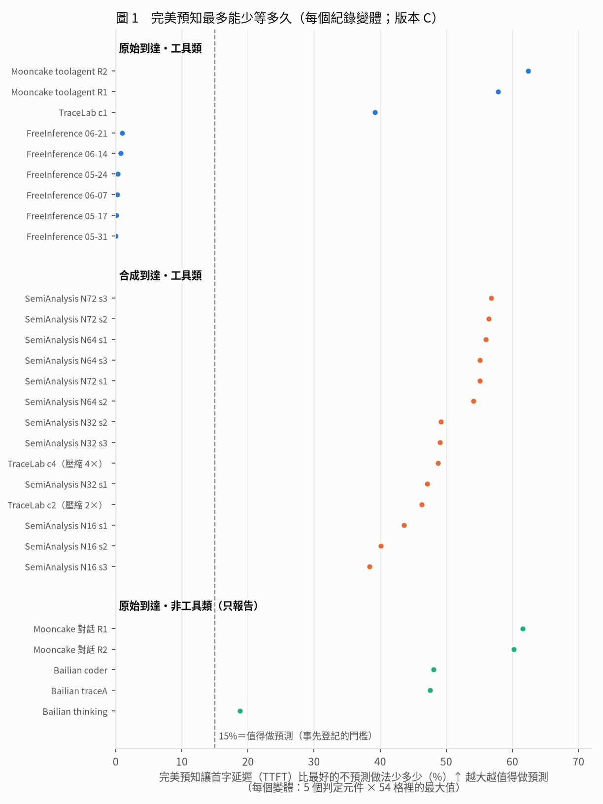
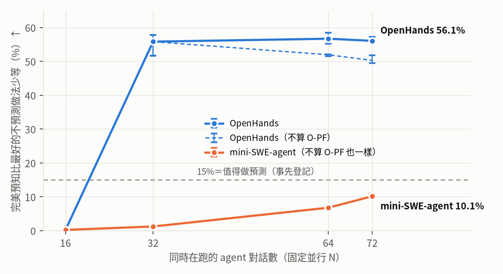

# 預測在工具類 agent 上仍有空間：擴大驗證的結果與論文寫法（給老師，2026-11-07）

> 數字**以版本 C 為準**（正式主表：對手加了 vLLM 式的 block 粒度前綴快取 APC，完美預知的 GPU 層加了 block 粒度 Belady；PREREG 偏離 10），**論文版不含 CacheWise**（沒有授權；偏離 15）。標記：〔模擬〕紀錄驅動模擬；〔實測〕H200 上量的（引自論文稿 `PAPER.md` v4.2）；〔判讀〕作者的解讀；〔建議〕還沒寫進論文稿。每個數字的出處在第 8 節。

## 1 修改後的結論

原本的結論是「再加預測，多半不划算」。擴大驗證之後要改成：**預測值不值得做，要看工作負載**。在真實的 agent 服務紀錄（FreeInference）上，就算預測百分之百準，首字延遲也只能少不到 1%；但在會呼叫工具的 agent 紀錄（Mooncake toolagent、TraceLab）上，即使對手已經是我們能做到最強的不預測做法（GPU 層加 TTL 與前綴快取、十幾種固定規則逐格挑最快），完美預知仍能讓首字延遲少 39–62%：原始到達的 9 個工具類變體裡有 3 個、合成並行的 14 個全部，超過事先登記的 15% 門檻。省下來的時間主要來自決定「**誰留在 GPU 和 CPU 裡**」，不是預取；而「這一輪有沒有呼叫工具」這種免費線索一點都拿不到（TraceLab 的原始與合成到達都一樣），所以事先寫好的推翻條件成立。公開的 SWE-bench agent 軌跡也一樣分兩邊：OpenHands 同時跑 32 個以上時最多少 58%，mini-SWE-agent 同時跑 72 個也不到 11%（第 3.6 節）。預測不準時：回來時間差 ±30%，這段空間幾乎不變；把一部分預測換成亂猜時，目前的模擬掉很多，但其中一部分是模擬器的規則造成的，規則補上後會重跑（第 6 節）。

**直覺**〔判讀〕：把 GPU 想成書桌、CPU 想成書架。一般的 agent 服務上，照常規整理（固定規則）就幾乎都找得到書，知道誰先回來也沒得省；寫程式、呼叫工具的 agent 同時有很多個在跑，每個都佔一大疊書，書桌和書架放不下時，「先收誰」選錯就要重搬一次，這時知道誰先回來才有價值。

**這個結論有多穩**：換成更強的對手（版本 B → C）、完美預知不用 block 粒度 Belady、判定時不算 O-PF，判定字都一樣（第 3.5 節）。

## 2 為什麼結論會變

- 舊模擬器**沒有 GPU 層**：回合一結束整段 KV 就移出 GPU。真實系統（vLLM、Continuum）會先留在 GPU，對手的主要收益就在「GPU 裡留誰」。新模擬器加了 GPU 層（1,777 塊＝111 GiB）、Continuum 式的 TTL 對手，以及 vLLM 式的前綴快取（APC）。
- 舊稿只看了**兩份紀錄**（FreeInference、Mooncake）。現在論文用 6 份紀錄、28 個變體，多的正是相關研究用的 coding／工具 agent 這一類。
- 舊稿的 Mooncake 數字在新模擬器上要更新：預取上限 50.5% → 37.8%；192 格裡 ≥15% 的 36 格 → 38 格（方向不變；版本 B 的重算）。

## 3 擴大驗證做了什麼

### 3.1 用了哪些資料集

| 資料集 | 是什麼 | 時間 | 工具類 | 論文的變體 |
|:--|:--|:--|:--|--:|
| FreeInference | 免費推論服務上真實的 agent 請求（每個請求標明是使用者還是工具結果觸發）；取 6 週 | 真實 | 是 | 6 |
| Mooncake toolagent | Kimi 線上服務的工具／agent 請求（FAST 2025 公開），1 小時；R1、R2＝兩種把請求串成對話的規則（寬、嚴） | 真實 | 是 | 2 |
| TraceLab | 真實開發者用 coding agent 的紀錄（UW），有工具開始／結束時間；c1 原始時間，c2、c4 把各對話開始時間擠 2×、4×（對話內間隔不動） | 真實／壓縮 | 是 | 3 |
| SemiAnalysis cc-traces | Claude Code 經代理匿名化的紀錄，長 session；沒有絕對時間，所以固定同時 16／32／64／72 個對話、順序用 3 個 seed 打亂 | 合成並行 | 是 | 12 |
| Mooncake conversation | 同 Mooncake，聊天請求 | 真實 | 否（只報告） | 2 |
| Bailian | 阿里雲百煉（Qwen）的匿名使用紀錄：coder、thinking、traceA；聊天／API 服務，每份約 2 小時 | 真實 | 否（只報告） | 3 |
| CacheWise CATraces | CacheWise 論文公開的 94 個真實 Claude Code 對話 | 合成並行 | 是 | 0（內部 12） |
| mini-SWE-agent | 第三方公開的 mini-SWE-agent 跑 SWE-bench Verified 的 499 條軌跡（Qwen3-30B，MIT）；單獨一節 | 合成並行 | 是 | 另計 12 |
| OpenHands | OpenHands 官方評測輸出：CodeActAgent 跑 SWE-bench Lite 的 299 條軌跡（Claude 3.5 Sonnet，最多 100 步，MIT）；單獨一節 | 合成並行 | 是 | 另計 12 |

- **CacheWise 不放進論文**：沒有宣告授權（偏離 15）。內部已跑完，拿掉前後的判定字相同：合成工具類從 26 個裡 21 個過門檻變成 14 個全部過；拿掉的 12 個裡有 5 個沒過，所以拿掉後看起來更一致，論文要附這一句。
- 授權：其他都是 CC BY 4.0 或 Apache-2.0。
- 「合成並行」的到達時間是人為的，論文要和真實到達分開報（照登記）。
- **單獨成一節、不和這 28 個合併計數的**：mini-SWE-agent、OpenHands 的公開軌跡（補 SWE-bench 這一類；偏離 17；軌跡內用真實時間，對話開始時間用固定並行 16／32／64／72 × 3 個 seed）——**已完成，見第 3.6 節**；ShareGPT、WildChat、LMSYS、UltraChat 四份常用的聊天資料集（偏離 13）——都跑完，等偏離 14 修正版重跑後再算。

### 3.2 怎麼量（四個層級）

- **①** 最簡單的 LRU。**②** 最好的不預測做法：每一格、每個動作，在 10 個 CPU 規則 × 16 個 GPU 規則（GPU LRU、TTL 0.3–300 秒、前綴快取 APC）裡事後挑最快；還原用 Cake、慢層存 INT4。**④** 完美預知，拆成 5 個動作分別量（GPU 層的完美淘汰含 block 粒度 Belady）。**③** 不用預測的免費線索。
- **少等多少**＝④ 比 ② 首字延遲少多少（%）。≥15% 才算值得做，這個門檻和推翻條件都在看任何結果之前就登記了。
- 每個變體 54 格＝CPU 9 種大小 × 慢層 3 種速度 × GPU 閒／忙。

### 3.3 主結果表〔模擬；版本 C、論文版〕

格內＝「最多少等 %」（括號＝少等 ≥15% 的格數／總格數）。↑ 越大越值得做預測。O-PF（預取）一欄待偏離 14 修正版取代。

| 類別 | 紀錄 | 變體 | GPU 裡留誰 ↑ | CPU 先淘汰誰 ↑ | 預取（待修正）↑ | 丟不丟 ↑ | 回合結束就丟 ↑ |
|:--|:--|--:|--:|--:|--:|--:|--:|
| 原始・工具 | Mooncake toolagent R2 | 1 | 37.4%（48/54） | 62.4%（35/54） | 53.3%（45/54） | 51.6%（36/54） | 7.5%（0/54） |
|  | Mooncake toolagent R1 | 1 | 40.9%（49/54） | 57.8%（32/54） | 47.3%（45/54） | 47.4%（41/54） | 6.4%（0/54） |
|  | TraceLab c1 | 1 | 39.2%（16/54） | 21.9%（4/54） | 13.8%（0/54） | 2.4%（0/54） | 0.1%（0/54） |
|  | FreeInference（6 週） | 6 | 1.0%（0/324） | 0.7%（0/324） | 0.8%（0/324） | 0.6%（0/324） | 0.0%（0/324） |
| 合成・工具 | SemiAnalysis 並行 72（3 個 seed） | 3 | 56.8%（109/162） | 45.3%（74/162） | 16.4%（3/162） | 6.5%（0/162） | 1.6%（0/162） |
|  | SemiAnalysis 並行 64（3 個 seed） | 3 | 56.0%（107/162） | 43.9%（63/162） | 18.5%（6/162） | 5.9%（0/162） | 1.3%（0/162） |
|  | SemiAnalysis 並行 32（3 個 seed） | 3 | 49.2%（77/162） | 30.4%（22/162） | 15.1%（1/162） | 3.2%（0/162） | 0.7%（0/162） |
|  | TraceLab c4（壓縮 4×） | 1 | 48.8%（36/54） | 35.0%（18/54） | 22.1%（5/54） | 3.5%（0/54） | 0.2%（0/54） |
|  | TraceLab c2（壓縮 2×） | 1 | 46.3%（24/54） | 27.2%（8/54） | 21.9%（3/54） | 2.5%（0/54） | 0.1%（0/54） |
|  | SemiAnalysis 並行 16（3 個 seed） | 3 | 43.6%（28/162） | 18.2%（2/162） | 4.5%（0/162） | 2.6%（0/162） | 0.3%（0/162） |
| 原始・非工具（只報告） | Mooncake 對話 R1 | 1 | 39.7%（50/54） | 61.6%（39/54） | 57.7%（48/54） | 55.7%（45/54） | 8.9%（0/54） |
|  | Mooncake 對話 R2 | 1 | 35.8%（46/54） | 60.2%（37/54） | 54.2%（45/54） | 49.8%（35/54） | 8.1%（0/54） |
|  | Bailian coder | 1 | 35.1%（27/54） | 32.0%（14/54） | 48.1%（23/54） | 24.8%（14/54） | 2.8%（0/54） |
|  | Bailian traceA | 1 | 41.8%（37/54） | 29.5%（12/54） | 47.5%（17/54） | 34.3%（22/54） | 2.9%（0/54） |
|  | Bailian thinking | 1 | 18.3%（3/54） | 7.8%（0/54） | 17.1%（2/54） | 18.8%（4/54） | 1.1%（0/54） |

- 讀法：原始工具類只有 Mooncake toolagent 和 TraceLab c1 過門檻；FreeInference 6 週全部 <1%。合成並行的 SemiAnalysis、TraceLab c2／c4 全部過門檻。「回合結束就丟」在任何紀錄都沒有一格 ≥15%。

### 3.4 圖

**圖 1　每個紀錄變體「完美預知最多能少等多久」**。怎麼看：每個點是一個變體，越往右越值得做預測；虛線是 15% 門檻。看到什麼：原始工具類兩極化，FreeInference 貼在 0，Mooncake toolagent、TraceLab c1 遠超過門檻；合成並行的 14 個全部過門檻。

**圖 2　能少等 ≥15% 的地方，靠的是預測哪個動作**。怎麼看：柱子越高，這個動作越值得預測。看到什麼：工具類主要在「GPU 裡留誰」與「CPU 先淘汰誰」（合成 97%、原始 52%）；預取主要在 Mooncake 上大（原始工具類的 90 格全是 Mooncake toolagent）。

**圖 3　CPU 記憶體多大時最值得預測：中間最大**。怎麼看：x 軸是 CPU 記憶體大小，111 GiB＝和 GPU 的 KV 預算一樣大。看到什麼：太小時誰都放不下，沒得挑；太大時什麼都放得下，不用挑；中間最值得預測（原始工具類 8 GiB 11.5% → 128 GiB 18.5% → 1,024 GiB 5.6%；合成工具類 64 GiB 最高 27.1%，1,024 GiB 是 0）。所以登記的「隨容量下降」只在 CPU 大於 GPU 預算之後成立。

**圖 4　預測不準時，還剩多少值得做**。怎麼看：100%＝沒有雜訊時能少等 ≥15% 的格子都還在。P4 以版本 B 選格（偏離 8），論文版拿掉 CacheWise。看到什麼：回來時間差 ±30%（綠線）幾乎沒影響：原始工具類剩 95%、合成 94%；不算 O-PF 時是 99.6%、97.5%。**待修正**：實線、虛線（模型 P，把 λ 比例的預測換成亂猜）的下降有一部分來自模擬器規則（猜錯的預取副本不丟、過期的預測一直當成「馬上回來」），修正版會取代這兩條線（第 6 節）。

**圖 5　免費線索拿得走嗎：TraceLab c1 的 20 格，線索做法都比最好的固定規則慢**。怎麼看：1＝最好的固定規則；藍點（完美預知）在左邊＝更快，橘點（工具呼叫線索）在右邊＝更慢。看到什麼：完美預知快 15–39%，線索做法慢 2.3–6.4 倍，因為 86% 的回合都有工具呼叫，分不出誰先回來。照登記，「拿走完美預知收益的一半以上」才算線索有用；20 格全部沒有。合成到達的 TraceLab c2、c4 也一樣（35 格、59 格全部沒有）。

### 3.5 可信度怎麼確認

- **對手換強（版本 B → C）判定字不變**：原始工具類 3/9、合成工具類 14/14；最大值 62.4%、56.8%。
- **不靠 block 粒度 Belady**：完美預知不用它時，判定字一樣；TraceLab c1 的「GPU 裡留誰」從 39.2% 降到 17.0%，但仍過門檻，「CPU 先淘汰誰」21.9% 不受影響，推翻條件也還成立。
- **不靠 O-PF**：判定時不算 O-PF（待修正），判定字一樣。
- **兩支程式互相核對**：版本 C 用 icpe-rux 的分析程式；拿掉 Belady 的列後用原本的分析程式重算，其他元件選到的組合和時間逐位元相同。每台機器的模擬程式先對拍到逐位元相同才用；版本 C 的每個變體都先逐值重現版本 B。
- W3 的規則在跑之前登記（PREREG 偏離 9），用版本 C 重算 f 後判定不變。

### 3.6 SWE-bench agent 軌跡（單獨一節；合成並行・工具類）〔模擬；版本 C〕

格內＝3 個 seed 各自的「最多少等 %」取中位數（最小–最大）；每個 seed 當一個變體各自判（使用者 11/7 在看數字之前決定）。

| 軌跡 | 並行 16 | 並行 32 | 並行 64 | 並行 72 | ≥15% 的變體 |
|:--|--:|--:|--:|--:|:--|
| OpenHands | 0.2%（0.2–0.5） | 55.8%（51.7–57.7） | 56.7%（55.2–58.5） | 56.1%（55.4–57.2） | 9／12（並行 32、64、72 的 9 個） |
| 　不算 O-PF | 0.2% | 55.8% | 51.9% | 50.3% | 9／12 |
| mini-SWE-agent | 0.2%（0.2–0.2） | 1.2%（1.2–1.2） | 6.8%（6.7–7.1） | 10.1%（9.8–10.9） | 0／12 |

**圖 6　SWE-bench agent：同時跑的對話一多，OpenHands 就值得預測，mini-SWE-agent 到 72 個也不值得**。怎麼看：x 軸是同時在跑的對話數，點是 3 個 seed 的中位數，誤差棒是最小–最大；虛線是判定不算 O-PF（待修正）。看到什麼：OpenHands 從 16 個的 0.2% 跳到 32 個的 56%，之後持平；mini-SWE-agent 慢慢升到 10%，始終在 15% 以下。

- 判定：24 個變體裡 9 個 ≥15%，全是 OpenHands。不算 O-PF（最大 57.7%）、不算 O-PF 也不用 block 粒度 Belady（56.8%）、換版本 B（58.5%），都還是 9 個。
- OpenHands ≥15% 的地方，最多的是「GPU 裡留誰」，「CPU 先淘汰誰」、預取、「丟不丟」也有；寫入頻寬飽和 0 格。
- 〔判讀〕和主結果一樣，值不值得看的是記憶體壓力：並行 16 時兩份都放得下。兩份差這麼多的原因（例如每個對話的上下文長度）還沒量，NOT_MEASURED。
- **限制**（照實寫進論文）：到達是合成的（固定並行）；OpenHands 的輸入用 Llama tokenizer 重算時，比 Claude 回報的少（增量比中位數 0.795，沒過登記的 0.8；第一次呼叫約少 1,900 個 Claude token），影響方向沒量；mini-SWE-agent 有 20.2% 的呼叫是格式錯誤、沒有回覆，不模擬；agent 沒跑 W3，所以這一節的推翻條件只能寫「未定」。

## 4 圖表怎麼呈現：同類論文的做法與我們的修改

我們讀了 8 篇同類論文的評估章節（PBKV、SAGA、CacheScout、CacheWise、Continuum、KVFlow、Ask the Tool、Cake）；圖片本身讀不到，下面只寫圖說與正文寫明的部分。

| 論文 | 主結果怎麼呈現 | 軸、單位怎麼寫 | 上限（oracle）怎麼呈現 |
|:--|:--|:--|:--|
| PBKV | 表：列＝工作負載 × 策略，欄＝模型 × 指標 | 欄名帶單位與方向：「Lat. (s)↓」「PA. TTFT (s)↓」「Hit Rate (%)↑」；附錄 mean ± std | 附錄掃雜訊 λ（命中率 vs λ；只讀到摘要） |
| SAGA | 表：列＝系統，欄＝兩個基準 × 「TCT (s)」「Mem%」；mean ± std over 10 trials、顯著性星號；下方列對每個對手的加速倍數 | 單位寫在欄名 | 對 Bélády 的競爭比表：「Lower is better (1.0 = optimal)」 |
| CacheScout | 圖：命中率、平均 TTFT 按工作負載分組；每個工作負載一張 TTFT 的 CDF | 圖說第一句就是結論；TTFT 用 ms | 沒有；掃到達率、GPU 快取大小 |
| CacheWise | 圖：session 完成時間 (s) vs 並行數 N；P50／P90／P99 | 圖說寫「Lower values are better」 | CacheWise\*：給真值工具時間的版本並列 |
| Continuum | 圖：按模型 × 硬體分組，上下兩列＝兩個資料集；圖例「Ours, vLLM, Autellix」 | — | 沒有；掃 batch、輪數、SSD 大小 |
| KVFlow | 圖：「Speedup over SGLang (GPU-only cache)」 | x 軸直接寫設定「Fixed / Dynamic / Output token」 | 沒有 |
| Ask the Tool | 圖：「post-tool TTFT reduction against LRU (%)」vs 工具呼叫長度 | 縮減寫成「對誰、少多少 %」 | oracle 畫在同一張圖；用「拿回 oracle 收益的 63%」描述 |
| Cake | 表：對兩個對手的加速倍數，列＝硬體 × GPU 使用率，欄＝頻寬 | 倍數「×」 | 沒有 |

**我們採用的規則**〔建議〕
1. **y 軸寫讀者在乎的量、對誰、哪個方向好**：照 Ask the Tool 的「TTFT reduction against LRU (%)」，我們寫「完美預知讓首字延遲比最好的不預測做法少多少（%）↑」，不用內部詞「上限／headroom」。英文版建議：*TTFT reduction over the best non-predictive policy (%)*。
2. **主結果用表**（PBKV、SAGA）：列＝紀錄，欄＝動作，格＝最大值和過門檻的格數；欄名帶單位和 ↑↓。
3. **門檻畫成參考線並寫字**：「15%＝值得做預測（事先登記）」。
4. **oracle、對手、線索畫在同一軸**（Ask the Tool），以對手＝1；並用「拿走完美預知收益的多少」說明線索（Ask the Tool 的「% of the oracle's prize」）。
5. **掃描圖的 x 軸寫出物理意義**：CPU 記憶體標出「111＝GPU 的 KV 預算」；雜訊寫「λ 比例的預測換成亂猜」（PBKV 的 λ、CacheScout 的 GPU cache budget）。
6. **圖說第一句就是結論**（CacheScout、Continuum），第二句說怎麼看。
7. **多個 seed 報中位數與範圍**（PBKV、SAGA 報 mean ± std over 10 trials）：P4 的逐格檔已有最小–最大與平均 ± 標準差。

**這份文件已照做的**：圖 1–5 的軸名、門檻字、圖例、圖說都改成上面的寫法；第 3.3 節的表照 PBKV／SAGA 的排法。

## 5 摘要怎麼寫：同類論文的寫法與我們的版本

| 論文 | 字數 | 句子順序 | 數字怎麼寫 | 點名對手 |
|:--|--:|:--|:--|:--|
| PBKV | 約 191 | 情境 → 既有做法的缺口 → 觀察（工作流是動態的）→ 系統 → 機制 → 對預測錯誤的設計 → 結果 | 「up to 1.85× speedup over LRU」「up to 1.26× over … KVFlow」 | 有 |
| SAGA | 約 223 | 問題（量化 3–8×）→ 主張 → 三個機制（含「within 1.31× of Bélády」）→ 結果 → **代價**（約 30% 較低峰值吞吐）→ 結論 | 「1.64× (geometric mean, p < 0.001) over vLLM v0.15.1 with prefix caching」 | 有 |
| CacheScout | 約 207 | 情境 → 機會 → 既有系統缺口 → 系統 → 洞見 → 做法 → 實作 → 結果 | 範圍：「reduces mean TTFT by 18–45%」 | 沒有 |
| CacheWise | 約 131 | 情境 → 「unlike chat workloads … not studied」→ 收集真實紀錄 → 分析發現 → 系統 → 結果 | 「up to 2–2.6×」「up to 3.5×」 | 沒有 |
| Continuum | 約 247 | 情境 → 現行做法 → 缺口 → 洞見 → 兩個挑戰 → 系統 → 機制 → 結果 | 「by over 8x」 | 沒有 |
| KVFlow | 約 223 | 情境 → 既有做法 → LRU 的缺口 → 後果 → 系統 → 兩個機制 → 結果 | 「up to 1.83× … over SGLang with hierarchical radix cache」 | 有 |
| Ask the Tool | 約 258 | 情境 → 現況（都在猜）→ 「We show that …」→ 洞見 → 提案 → 普查 → 準確度 → 結果 → **一句話結論** | 「cuts the p90 TTFT … by 20.7% … against LRU, close to an oracle」 | 有（LRU、oracle） |
| Cake | 約 190 | 情境 → 問題 → 既有做法 → 缺口 → 系統 → 兩個機制 → 結果 → 結論 | 「on average 2.6× reduction in TTFT compared to compute-only and I/O-only」 | 有 |

**共同點**〔判讀〕
1. 130–260 字。1–2 句情境 → 1 句缺口 → 1 句洞見 → 2–3 句做了什麼 → 1 句帶數字的結果；SAGA 多一句代價，Ask the Tool 收在一句結論。
2. 數字幾乎都寫「對誰」：over LRU、over SGLang with HiCache、vs vLLM with prefix caching；用「up to」最大值、範圍或平均。
3. 它們都報「比 LRU／前綴快取快多少」。**我們的差別是對手最強**，這一點要放在摘要前半，讀者才知道我們的數字為什麼比較小、也比較可信。
4. 我們是量測研究，不是新系統；寫法最接近 CacheWise（「既有研究沒看 X，我們收集真實紀錄來看」）和 Ask the Tool（「We show that …」＋一句話結論）。

**摘要（照上面的結構改寫；版本 C、論文版；英文約 250 字）**〔建議〕

> LLM agents and multi-turn chat leave gaps between requests, during which serving systems move a session's KV cache out of GPU memory; when the user or a tool result returns, the cache must be restored before the first token. Recent agent-serving systems predict who returns and when, and report large gains over LRU or prefix caching. We ask how much prediction can still save over the strongest non-predictive policy. On an NVIDIA H200 we measure how to restore parked KV (load, recompute, Cake, INT4); in trace-driven simulation over 28 variants of six traces, we compare a perfect oracle against the per-cell best of non-predictive rules (10 CPU-tier rules; LRU, Continuum-style TTLs and block-level prefix caching at the GPU tier), with thresholds preregistered before any result. Restoration needs no prediction: a fixed table suffices, with INT4 plus Cake fastest on slow tiers (11.0–40.7% over the runner-up). Prediction pays only on some workloads: on a production agent-serving trace the oracle cuts time to first token (TTFT) by under 1%, but on tool-calling traces by up to 62%, exceeding 15% in 3 of 9 real-arrival and all 14 synthetic-concurrency variants, mostly by choosing what stays in GPU and CPU memory rather than by prefetching. Public SWE-bench agent trajectories show the same split: up to 58% for OpenHands, under 11% for mini-SWE-agent. A free tool-call cue captures none of this gap, and the gap survives ±30% error in predicted return times. Measure the oracle against a strong baseline before building a predictor.

**中文對照**

> LLM agent 與多輪對話的請求之間常有空檔，服務系統會把對話的 KV cache 移出 GPU；使用者或工具結果回來時，要先把它搬回，才出得了第一個字。近來的 agent 服務系統會預測誰、何時回來，並報告比 LRU 或前綴快取大幅的提升。我們問：對最強的不預測做法，預測還能多省多少？我們在 NVIDIA H200 上實測停放的 KV 怎麼還原（載入、重算、Cake、INT4），並在 6 份紀錄、28 個變體上做紀錄驅動模擬，拿完美預知和「每格在不預測的規則裡挑最快」比（10 個 CPU 規則；GPU 層有 LRU、Continuum 式 TTL 和 block 粒度前綴快取），門檻在看任何結果之前登記。還原不需要預測：照一張固定的表選就夠，慢層上 INT4 加 Cake 最快（比次佳快 11.0–40.7%）。預測只在部分工作負載上值得：真實 agent 服務紀錄上，完美預知只讓首字延遲（TTFT）少不到 1%；工具呼叫的紀錄上最多少 62%，原始到達的 9 個變體裡 3 個、合成並行的 14 個全部超過 15%，主要靠決定誰留在 GPU 與 CPU 記憶體，而不是預取。公開的 SWE-bench agent 軌跡也一樣分兩邊：OpenHands 最多少 58%，mini-SWE-agent 不到 11%。免費的工具呼叫線索一點都拿不到；預測的回來時間差 ±30%，這段空間幾乎不變。蓋預測器之前，先拿完美預知和強對手比一次。

- 摘要刻意不寫還在變的結果：10% 亂猜（P4 模型 P，待偏離 14 修正）、四份聊天資料集、GPU 實機重播。
- SWE-bench 那一句（11/7 加）：58% 含 O-PF（待修正），不算 O-PF 是 57.7%，四捨五入一樣；OpenHands 只在並行 ≥32 時過門檻，論文正文要寫明並行數和輸入可能少算（第 3.6 節）。
- 摘要登記：**11/10（一）19:59（台灣）**；全文 11/17。這些結果出來後，全文前可以補一句；HotCRP 通常允許全文截止前修改摘要，但以 ICPE 的規定為準。
- 標題建議維持「組合地圖」主軸再加預測：*When the Session Returns: Restoring Parked KV Cache on H200, and Where Prediction Still Pays*。投稿版的每個數字要用 `paper-claim-audit` 逐句核對。

## 6 還沒做完的

| 項目 | 狀態 | 會影響什麼 |
|:--|:--|:--|
| 版本 C（對手加 APC；GPU 層的完美淘汰加 block 粒度 Belady） | **已完成**（論文版 28 個變體）；判定字和版本 B 相同 | 不含 Belady 時也成立（第 3.5 節）；CacheWise 不跑（偏離 15） |
| W3 線索：TraceLab c1、c2、c4、FreeInference | **已完成**；用版本 C 重算後，原始、合成到達的推翻條件都成立 | — |
| P4 雜訊：模型 P 的斷崖 | 查明是模擬器兩條沒登記的規則；登記偏離 14、改好程式。驗證時另外找到一個舊問題（只影響「預取進 GPU」的 O-ALL，只報告的列），使用者選加旗標修；重新驗證中，之後才出重跑清單，修正版取代正式結果 | 圖 4 的模型 P 兩條線；O-PF 一欄也可能變（判定不靠它）；11/10 摘要前來不及 |
| 版本 C ≥15% 的格補跑 P4（偏離 10 第 5 點） | 還沒排 | 圖 4 改成以版本 C 選格 |
| 四份聊天資料集（ShareGPT、WildChat、LMSYS、UltraChat） | 四份的版本 B、C 都跑完；等偏離 14 的 O-PF 重跑後再算（使用者決定） | 單獨一節，回答「為什麼沒跑 ShareGPT」 |
| mini-SWE-agent、OpenHands 公開軌跡 | **已完成**（第 3.6 節）；O-PF 一欄待偏離 14 重跑 | 單獨一節，補 SWE-bench 這一類 |
| GPU 實機重播（W6，H200） | W6c（重算校準到 128K）跑完、還沒分析；W6a（打字線索）和別人的 job 重疊，停掉等對方跑完再送；接著是 **TraceLab c1 的 GPU 層重播**（使用者 11/7 決定：NFS、CPU 8 GiB、GPU 閒；GPU 規則 LRU、TTLB:30、BEL；從紀錄時間的中位數起連續 5,000 個請求，跨 25 小時；2 次），再來 W6b（Mooncake 對話的淘汰順序） | 目前預測的結果**全部是模擬**；重播只有整份紀錄約 0.75% 的請求，只能說「這一段在 GPU 上和模擬一致」 |
| 打字線索（Mooncake 對話）用新模擬器重測 | 未做 | 舊稿「打字線索拿走八成」能不能留 |
| W5（CPU 層存 INT4）、排隊模型 | **已完成**（icpe-rux，只報告）：W5 沒有任何格因此升過 15%；排隊在中負載（等 2–20 秒）讓上限變大，主結果不含排隊、是保守的一邊。二階（事件驅動）排隊：使用者決定在 RUX3DPRO 做，先登記 | 不改主判定 |
| 論文改稿、摘要登記（11/10 19:59）、引用與數字核對 | 未開始 | — |

**風險**〔判讀〕：原始工具類過門檻的只有兩份紀錄（Mooncake toolagent 只有一小時；TraceLab c1），而且 W3 只有 TraceLab 有線索欄位；有真實多使用者到達時間的公開工具類紀錄很少，短期補不到，論文要寫成限制（SWE-bench 軌跡只補了合成到達這一邊）。預測的結果全部是模擬。

## 7 一句話給老師

在最強的不預測對手之上（含前綴快取與 TTL），預測的價值集中在「工具類 agent 的記憶體淘汰」：值得做、免費線索拿不到，對回來時間的誤差不敏感；一般 agent 服務不值得做；公開的 SWE-bench agent 也一樣看負載（OpenHands 最多 58%，mini-SWE-agent 不到 11%）。這個結論換更強的對手、拿掉 block 粒度 Belady 都不變；缺的是 GPU 實機驗證與更多真實到達的工具類紀錄。

## 8 數字出處

- 版本 C（論文版）：run `20261107-122216-icpe-main-verC`，`results/icpe_next/main/verC/`（`verC_verdict.csv`、`verC_by_trace.csv`、`verC_noBELP_*`、`verC_noOPF_*`、`verB_paper_*`、`w3_C_*`）；輸入是 `results/icpe_next/apc/<變體>/`（icpe-rux、icpe-trx 跑的）。
- SWE-bench agent 軌跡（第 3.6 節）：run `20261107-140839-icpe-main-agent`，`results/icpe_next/main/agent/`（`agent_verC_verdict.csv`、`agent_verC_noOPF_*`、`agent_verC_noBELP_*`、`agent_verB_*`、`agent_seed_*`）；輸入 `results/icpe_next/apc/{miniswe,openhands}_*`、`results/icpe_next/b/agent_*`（icpe-data）。圖 6：run `20261107-151225-icpe-main-agent-fig`（`code/icpe/main_agent_fig.py`，點在 `figs/fig6_data.csv`）。
- W5、排隊：icpe-rux 的 STATUS_RUX 14:30（`origin/icpe-next-rux` f63f4879），本文件只轉述、沒重算。W6 與 TraceLab 重播的設計：STATUS_A 13:06（`origin/icpe-next-a` 343ae74f）。
- 版本 B：run `20261106-110854-icpe-main-verB-p1`，`results/icpe_next/main/verB/`。P2／P3：`results/icpe_next/main/p23/`。
- P4：runs `20261107-082202-icpe-main-p4-noise`、`20261107-094535-icpe-main-p4-summary`，`results/icpe_next/main/p4/noise/`（以版本 B 選格；圖 4 加總時拿掉 CacheWise）。
- W3：TRX40 runs `20261107-084104-icpe-trx-rux-tl_c1-w3`、`20261107-092256-icpe-trx-rux-tl_c2-w3`、`20261107-095115-icpe-trx-rux-tl_c4-w3`；版本 C 重算見上；PREREG 偏離 9。
- 圖與第 3.3 節的表：run `20261107-124716-icpe-main-advisor-figs-verC`（`code/icpe/main_report_figs.py`；每個點在 `figs/fig_data.csv`，表在 `figs/table_main_verC.csv`）。
- 同類論文：arXiv 2605.06472（PBKV）、2605.00528（SAGA）、2608.14624（CacheScout）、2606.16824（CacheWise）、2511.02230（Continuum）、2507.07400（KVFlow）、2609.18849（Ask the Tool）、2410.03065（Cake）；2026-11-07 讀 arXiv 的摘要頁與 HTML 全文，圖片內的軸名讀不到。字數是人工概數。
- 實測數字（11.0–40.7%）與資料集說明：`docs/icpe_paper_20261030/PAPER.md` v4.2、`docs/icpe_brief_20261030/NEXT_PLAN_20261104.md` §5.5，本文件沒有重新核對實測值。
