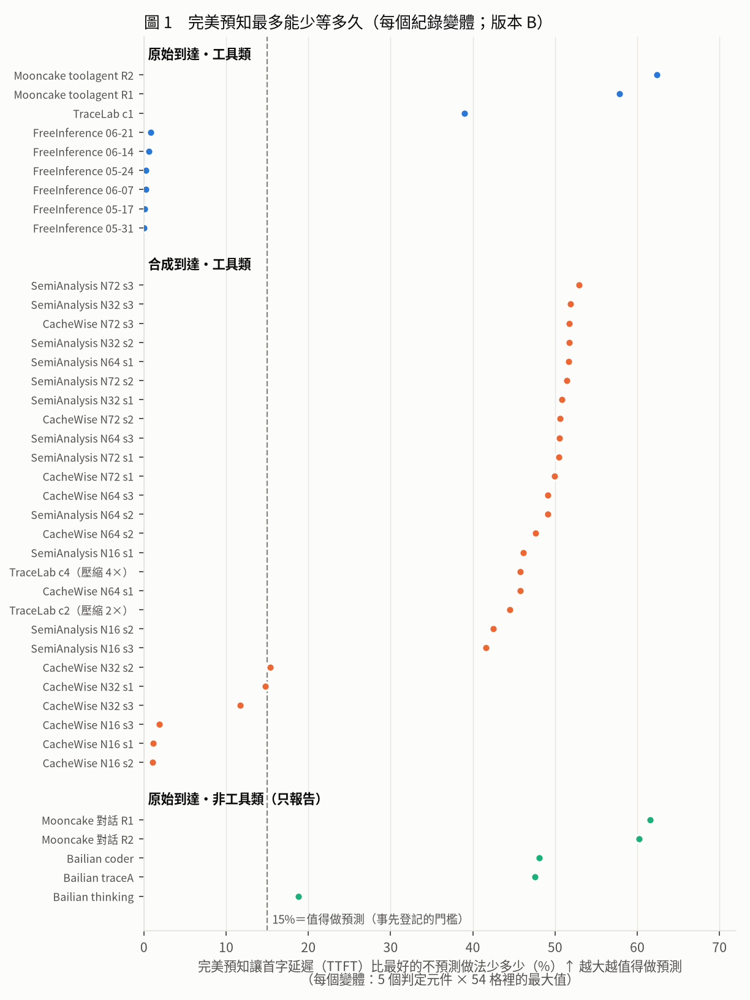
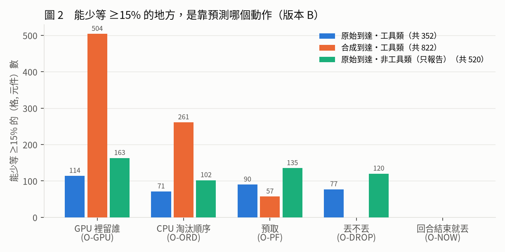
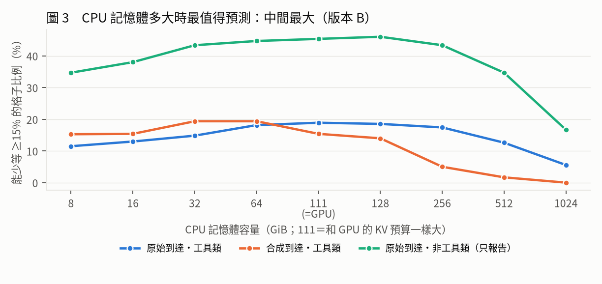
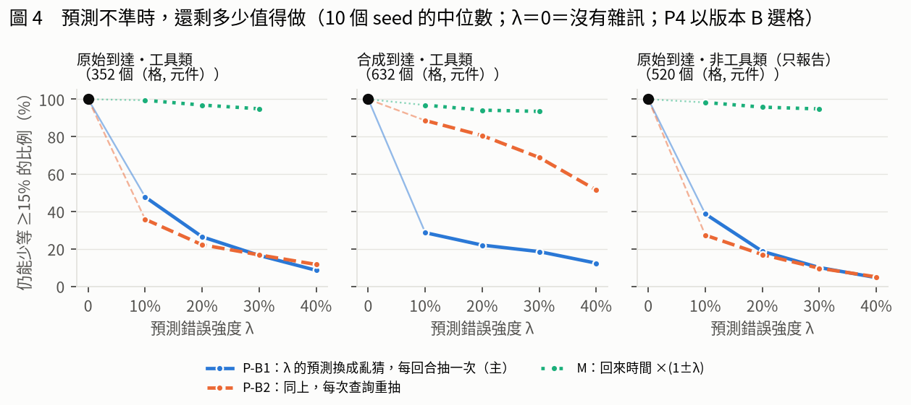
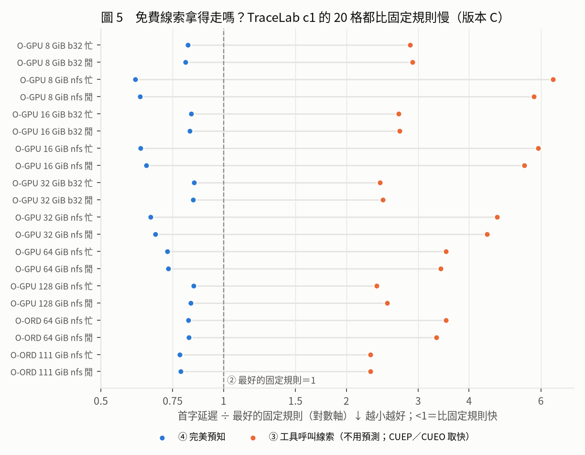

# 預測在工具類 agent 上仍有空間：擴大驗證的結果與論文寫法（給老師，2026-11-07）

> 數字**以版本 B 為準**（對手還沒加 vLLM 式前綴快取 APC；加了之後的「版本 C」正在算，見第 6 節）。標記：〔模擬〕紀錄驅動模擬；〔實測〕H200 上量的（引自論文稿 `PAPER.md` v4.2）；〔判讀〕作者的解讀；〔建議〕還沒寫進論文稿。每個數字的出處在第 8 節。

## 1 修改後的結論

原本的結論是「再加預測，多半不划算」。擴大驗證之後要改成：**預測值不值得做，要看工作負載**。在真實的 agent 服務紀錄（FreeInference）上，就算預測百分之百準，首字延遲也只能少不到 1%；但在會呼叫工具的 agent 紀錄（Mooncake toolagent、TraceLab）上，即使對手已經是我們能做到最強的不預測做法（GPU 層加 TTL、十幾種固定規則逐格挑最快），完美預知仍能讓首字延遲少 39–62%：原始到達的 9 個工具類變體裡有 3 個、合成並行的 26 個裡有 21 個，超過事先登記的 15% 門檻。省下來的時間主要來自決定「**誰留在 GPU 和 CPU 裡**」，不是預取；而「這一輪有沒有呼叫工具」這種免費線索一點都拿不到（TraceLab 的原始與合成到達都一樣），所以事先寫好的推翻條件成立。但這段空間要預測得準才拿得到：只要 10% 的預測是亂猜，超過 15% 的格子就剩不到一半。

**直覺**〔判讀〕：把 GPU 想成書桌、CPU 想成書架。一般的 agent 服務上，照常規整理（固定規則）就幾乎都找得到書，知道誰先回來也沒得省；寫程式、呼叫工具的 agent 同時有很多個在跑，每個都佔一大疊書，書桌和書架放不下時，「先收誰」選錯就要重搬一次，這時知道誰先回來才有價值。

## 2 為什麼結論會變

- 舊模擬器**沒有 GPU 層**：回合一結束整段 KV 就移出 GPU。真實系統（vLLM、Continuum）會先留在 GPU，對手的主要收益就在「GPU 裡留誰」。新模擬器加了 GPU 層（1,777 塊＝111 GiB）和 Continuum 式的 TTL 對手。
- 舊稿只看了**兩份紀錄**（FreeInference、Mooncake）。現在是 7 份紀錄、40 個變體，多的正是相關研究用的 coding／工具 agent 這一類。
- 舊稿的 Mooncake 數字在新模擬器上要更新：預取上限 50.5% → 37.8%；192 格裡 ≥15% 的 36 格 → 38 格（方向不變）。

## 3 擴大驗證做了什麼

### 3.1 用了哪些資料集

| 資料集 | 是什麼 | 時間 | 工具類 | 變體 |
|:--|:--|:--|:--|--:|
| FreeInference | 免費推論服務上真實的 agent 請求（每個請求標明是使用者還是工具結果觸發）；取 6 週 | 真實 | 是 | 6 |
| Mooncake toolagent | Kimi 線上服務的工具／agent 請求（FAST 2025 公開），1 小時；R1、R2＝兩種把請求串成對話的規則（寬、嚴） | 真實 | 是 | 2 |
| TraceLab | 真實開發者用 coding agent 的紀錄（UW），有工具開始／結束時間；c1 原始時間，c2、c4 把各對話開始時間擠 2×、4×（對話內間隔不動） | 真實／壓縮 | 是 | 3 |
| SemiAnalysis cc-traces | Claude Code 經代理匿名化的紀錄，長 session；沒有絕對時間，所以固定同時 16／32／64／72 個對話、順序用 3 個 seed 打亂 | 合成並行 | 是 | 12 |
| CacheWise CATraces | CacheWise 論文公開的 94 個真實 Claude Code 對話；每個複製 5 份後固定並行 16／32／64／72 × 3 seed | 合成並行 | 是 | 12 |
| Mooncake conversation | 同 Mooncake，聊天請求 | 真實 | 否（只報告） | 2 |
| Bailian | 阿里雲百煉（Qwen）的匿名使用紀錄：coder、thinking、traceA；聊天／API 服務，每份約 2 小時 | 真實 | 否（只報告） | 3 |

- 授權：CacheWise 沒有宣告授權，原始資料只留在實驗室主機，論文只放彙總數字；其他是 CC BY 4.0 或 Apache-2.0。
- 「合成並行」的到達時間是人為的，論文要和真實到達分開報（照登記）。

### 3.2 怎麼量（四個層級）

- **①** 最簡單的 LRU。**②** 最好的不預測做法：每一格、每個動作，在 10 個 CPU 規則 × 15 個 GPU 規則（GPU LRU、TTL 0.3–300 秒）裡事後挑最快；還原用 Cake、慢層存 INT4。**④** 完美預知，拆成 5 個動作分別量。**③** 不用預測的免費線索。
- **少等多少**＝④ 比 ② 首字延遲少多少（%）。≥15% 才算值得做，這個門檻和推翻條件都在看任何結果之前就登記了。
- 每個變體 54 格＝CPU 9 種大小 × 慢層 3 種速度 × GPU 閒／忙。

### 3.3 主結果表〔模擬〕

格內＝「最多少等 %」（括號＝少等 ≥15% 的格數／總格數）。↑ 越大越值得做預測。

| 類別 | 紀錄 | 變體 | GPU 裡留誰 ↑ | CPU 先淘汰誰 ↑ | 預取 ↑ | 丟不丟 ↑ | 回合結束就丟 ↑ |
|:--|:--|--:|--:|--:|--:|--:|--:|
| 原始・工具 | Mooncake toolagent R2 | 1 | 36.7%（47/54） | 62.4%（35/54） | 53.3%（45/54） | 51.6%（36/54） | 7.5%（0/54） |
|  | Mooncake toolagent R1 | 1 | 40.4%（49/54） | 57.8%（32/54） | 47.3%（45/54） | 47.4%（41/54） | 6.4%（0/54） |
|  | TraceLab c1 | 1 | 38.9%（18/54） | 23.3%（4/54） | 7.2%（0/54） | 2.1%（0/54） | 0.1%（0/54） |
|  | FreeInference（6 週） | 6 | 0.8%（0/324） | 0.7%（0/324） | 0.9%（0/324） | 0.7%（0/324） | 0.0%（0/324） |
| 合成・工具 | SemiAnalysis 並行 72（3 個 seed） | 3 | 52.9%（110/162） | 45.3%（83/162） | 18.5%（7/162） | 6.5%（0/162） | 1.6%（0/162） |
|  | SemiAnalysis 並行 32（3 個 seed） | 3 | 51.9%（80/162） | 30.4%（24/162） | 22.9%（4/162） | 3.2%（0/162） | 0.7%（0/162） |
|  | CacheWise 並行 72（3 個 seed） | 3 | 51.8%（59/162） | 30.1%（26/162） | 23.3%（21/162） | 4.4%（0/162） | 0.3%（0/162） |
|  | SemiAnalysis 並行 64（3 個 seed） | 3 | 51.7%（109/162） | 43.9%（72/162） | 19.6%（8/162） | 5.9%（0/162） | 1.3%（0/162） |
|  | CacheWise 並行 64（3 個 seed） | 3 | 49.1%（50/162） | 25.6%（22/162） | 20.3%（10/162） | 5.1%（0/162） | 0.4%（0/162） |
|  | SemiAnalysis 並行 16（3 個 seed） | 3 | 46.2%（34/162） | 18.4%（4/162） | 5.4%（0/162） | 2.6%（0/162） | 0.3%（0/162） |
|  | TraceLab c4（壓縮 4×） | 1 | 45.8%（36/54） | 35.7%（20/54） | 20.9%（5/54） | 4.1%（0/54） | 0.2%（0/54） |
|  | TraceLab c2（壓縮 2×） | 1 | 44.5%（24/54） | 29.3%（10/54） | 19.4%（2/54） | 2.5%（0/54） | 0.1%（0/54） |
|  | CacheWise 並行 32（3 個 seed） | 3 | 15.4%（2/162） | 5.8%（0/162） | 10.3%（0/162） | 2.8%（0/162） | 0.1%（0/162） |
|  | CacheWise 並行 16（3 個 seed） | 3 | 1.9%（0/162） | 0.9%（0/162） | 1.1%（0/162） | 1.6%（0/162） | 0.0%（0/162） |
| 原始・非工具（只報告） | Mooncake 對話 R1 | 1 | 39.6%（50/54） | 61.6%（39/54） | 57.7%（48/54） | 55.7%（45/54） | 8.9%（0/54） |
|  | Mooncake 對話 R2 | 1 | 35.8%（46/54） | 60.2%（37/54） | 54.2%（45/54） | 49.8%（35/54） | 8.1%（0/54） |
|  | Bailian coder | 1 | 34.3%（27/54） | 32.0%（14/54） | 48.1%（23/54） | 24.8%（14/54） | 2.8%（0/54） |
|  | Bailian traceA | 1 | 41.7%（37/54） | 29.5%（12/54） | 47.5%（17/54） | 34.3%（22/54） | 2.9%（0/54） |
|  | Bailian thinking | 1 | 18.3%（3/54） | 7.8%（0/54） | 17.1%（2/54） | 18.8%（4/54） | 1.1%（0/54） |

- 讀法：原始工具類只有 Mooncake toolagent 和 TraceLab c1 過門檻；FreeInference 6 週全部 <1%。合成並行裡，CacheWise 並行 16、32 幾乎沒有，並行 64 以上和 SemiAnalysis 全部都有。「回合結束就丟」在任何紀錄都沒有一格 ≥15%。

### 3.4 圖

**圖 1　每個紀錄變體「完美預知最多能少等多久」**。怎麼看：每個點是一個變體，越往右越值得做預測；虛線是 15% 門檻。看到什麼：原始工具類兩極化，FreeInference 貼在 0，Mooncake toolagent、TraceLab c1 遠超過門檻；合成並行裡，SemiAnalysis 從同時 16 個對話起就都過門檻；CacheWise 要同時 64 個以上才過。

**圖 2　能少等 ≥15% 的地方，靠的是預測哪個動作**。怎麼看：柱子越高，這個動作越值得預測。看到什麼：工具類主要在「GPU 裡留誰」與「CPU 先淘汰誰」（合成 93%、原始 53%）；預取主要在 Mooncake 上大（原始工具類的 90 格全是 Mooncake toolagent）。

**圖 3　CPU 記憶體多大時最值得預測：中間最大**。怎麼看：x 軸是 CPU 記憶體大小，111 GiB＝和 GPU 的 KV 預算一樣大。看到什麼：太小時誰都放不下，沒得挑；太大時什麼都放得下，不用挑；中間最值得預測。所以登記的「隨容量下降」只在 CPU 大於 GPU 預算之後成立。

**圖 4　預測不準時，還剩多少值得做**。怎麼看：100%＝沒有雜訊時能少等 ≥15% 的格子都還在。實線（主）照 PBKV 的做法，把 λ 比例的預測換成亂猜。看到什麼：回來時間差 ±30% 幾乎沒影響；但只要 10% 亂猜，原始工具類剩 48%、合成剩 22%。

**圖 5　免費線索拿得走嗎：TraceLab c1 的 22 格，線索做法都比最好的固定規則慢**。怎麼看：1＝最好的固定規則；藍點（完美預知）在左邊＝更快，橘點（工具呼叫線索）在右邊＝更慢。看到什麼：線索做法慢 1.6–3.9 倍，因為 86% 的回合都有工具呼叫，分不出誰先回來。照登記，「拿走完美預知收益的一半以上」才算線索有用；22 格全部沒有。合成到達的 TraceLab c2、c4 也一樣：36 格、61 格全部沒有，線索做法慢 1.37–2.97 倍。

### 3.5 可信度怎麼確認

- 主要的核對：P4 的無雜訊部分和版本 B 逐格相同（12／12）；雜訊強度 0 時和無雜訊完全相同（24／24）；TRX40 重算 TraceLab c1 的 324 個（格, 元件）0 差；各機器的模擬程式先對拍到逐位元相同才用。
- W3 的規則在跑之前登記（PREREG 偏離 9），跑完的判定不受彙總方式影響（22 格全部沒過一半）。

## 4 圖表怎麼呈現：同類論文的做法與我們的修改

我們讀了 8 篇同類論文的評估章節（PBKV、SAGA、CacheScout、CacheWise、Continuum、KVFlow、Ask the Tool、Cake）；圖片本身讀不到，下面只寫圖說與正文寫明的部分。

| 論文 | 主結果怎麼呈現 | 軸、單位怎麼寫 | 上限（oracle）怎麼呈現 |
|:--|:--|:--|:--|
| PBKV | 表：列＝工作負載 × 策略，欄＝模型 × 指標 | 欄名帶單位與方向：「Lat. (s)↓」「PA. TTFT (s)↓」「Hit Rate (%)↑」；附錄 mean ± std | 附錄掃雜訊 λ（命中率 vs λ；只讀到摘要） |
| SAGA | 表：列＝系統，欄＝兩個基準 × 「TCT (s)」「Mem%」；mean ± std over 10 trials、顯著性星號；下方列對每個對手的加速倍數 | 單位寫在欄名 | 對 Bélády 的競爭比表：「Lower is better (1.0 = optimal)」 |
| CacheScout | 圖：命中率、平均 TTFT 按工作負載分組；每個工作負載一張 TTFT 的 CDF | 圖說第一句就是結論；TTFT 用 ms | 沒有；掃到達率、GPU 快取大小 |
| CacheWise | 圖：session 完成時間 (s) vs 並行數 N；P50／P90／P99 | 圖說寫「Lower values are better」 | CacheWise\*：給真值工具時間的版本並列 |
| Continuum | 圖：按模型 × 硬體分組，上下兩列＝兩個資料集；圖例「Ours, vLLM, Autellix」 | — | 沒有；掃 batch、輪數、SSD 大小 |
| KVFlow | 圖：「Speedup over SGLang (GPU-only cache)」 | x 軸直接寫設定「Fixed / Dynamic / Output token」 | 沒有 |
| Ask the Tool | 圖：「post-tool TTFT reduction against LRU (%)」vs 工具呼叫長度 | 縮減寫成「對誰、少多少 %」 | oracle 畫在同一張圖；用「拿回 oracle 收益的 63%」描述 |
| Cake | 表：對兩個對手的加速倍數，列＝硬體 × GPU 使用率，欄＝頻寬 | 倍數「×」 | 沒有 |

**我們採用的規則**〔建議〕
1. **y 軸寫讀者在乎的量、對誰、哪個方向好**：照 Ask the Tool 的「TTFT reduction against LRU (%)」，我們寫「完美預知讓首字延遲比最好的不預測做法少多少（%）↑」，不用內部詞「上限／headroom」。英文版建議：*TTFT reduction over the best non-predictive policy (%)*。
2. **主結果用表**（PBKV、SAGA）：列＝紀錄，欄＝動作，格＝最大值和過門檻的格數；欄名帶單位和 ↑↓。
3. **門檻畫成參考線並寫字**：「15%＝值得做預測（事先登記）」。
4. **oracle、對手、線索畫在同一軸**（Ask the Tool），以對手＝1；並用「拿走完美預知收益的多少」說明線索（Ask the Tool 的「% of the oracle's prize」）。
5. **掃描圖的 x 軸寫出物理意義**：CPU 記憶體標出「111＝GPU 的 KV 預算」；雜訊寫「λ 比例的預測換成亂猜」（PBKV 的 λ、CacheScout 的 GPU cache budget）。
6. **圖說第一句就是結論**（CacheScout、Continuum），第二句說怎麼看。
7. **多個 seed 報中位數與範圍**（PBKV、SAGA 報 mean ± std over 10 trials）：P4 的逐格檔已有最小–最大與平均 ± 標準差。

**這份文件已照做的**：圖 1–5 的軸名、門檻字、圖例、圖說都改成上面的寫法；第 3.3 節的表照 PBKV／SAGA 的排法。

## 5 摘要怎麼寫：同類論文的寫法與我們的版本

| 論文 | 字數 | 句子順序 | 數字怎麼寫 | 點名對手 |
|:--|--:|:--|:--|:--|
| PBKV | 約 191 | 情境 → 既有做法的缺口 → 觀察（工作流是動態的）→ 系統 → 機制 → 對預測錯誤的設計 → 結果 | 「up to 1.85× speedup over LRU」「up to 1.26× over … KVFlow」 | 有 |
| SAGA | 約 223 | 問題（量化 3–8×）→ 主張 → 三個機制（含「within 1.31× of Bélády」）→ 結果 → **代價**（約 30% 較低峰值吞吐）→ 結論 | 「1.64× (geometric mean, p < 0.001) over vLLM v0.15.1 with prefix caching」 | 有 |
| CacheScout | 約 207 | 情境 → 機會 → 既有系統缺口 → 系統 → 洞見 → 做法 → 實作 → 結果 | 範圍：「reduces mean TTFT by 18–45%」 | 沒有 |
| CacheWise | 約 131 | 情境 → 「unlike chat workloads … not studied」→ 收集真實紀錄 → 分析發現 → 系統 → 結果 | 「up to 2–2.6×」「up to 3.5×」 | 沒有 |
| Continuum | 約 247 | 情境 → 現行做法 → 缺口 → 洞見 → 兩個挑戰 → 系統 → 機制 → 結果 | 「by over 8x」 | 沒有 |
| KVFlow | 約 223 | 情境 → 既有做法 → LRU 的缺口 → 後果 → 系統 → 兩個機制 → 結果 | 「up to 1.83× … over SGLang with hierarchical radix cache」 | 有 |
| Ask the Tool | 約 258 | 情境 → 現況（都在猜）→ 「We show that …」→ 洞見 → 提案 → 普查 → 準確度 → 結果 → **一句話結論** | 「cuts the p90 TTFT … by 20.7% … against LRU, close to an oracle」 | 有（LRU、oracle） |
| Cake | 約 190 | 情境 → 問題 → 既有做法 → 缺口 → 系統 → 兩個機制 → 結果 → 結論 | 「on average 2.6× reduction in TTFT compared to compute-only and I/O-only」 | 有 |

**共同點**〔判讀〕
1. 130–260 字。1–2 句情境 → 1 句缺口 → 1 句洞見 → 2–3 句做了什麼 → 1 句帶數字的結果；SAGA 多一句代價，Ask the Tool 收在一句結論。
2. 數字幾乎都寫「對誰」：over LRU、over SGLang with HiCache、vs vLLM with prefix caching；用「up to」最大值、範圍或平均。
3. 它們都報「比 LRU／前綴快取快多少」。**我們的差別是對手最強**，這一點要放在摘要前半，讀者才知道我們的數字為什麼比較小、也比較可信。
4. 我們是量測研究，不是新系統；寫法最接近 CacheWise（「既有研究沒看 X，我們收集真實紀錄來看」）和 Ask the Tool（「We show that …」＋一句話結論）。

**摘要（照上面的結構改寫，英文約 230 字**）〔建議；版本 C 出來後換數字〕

> LLM agents and multi-turn chat leave gaps between requests, during which serving systems move a session's KV cache out of GPU memory; when the user or a tool result returns, the cache must be restored before the first token. Recent agent-serving systems predict who returns and when, and report large gains over LRU or prefix caching. We ask a narrower question: how much can prediction still save over the strongest non-predictive policy? On an NVIDIA H200 we measure how to restore parked KV (load, recompute, Cake, INT4), and in trace-driven simulation over 40 variants of seven traces we compare a perfect oracle against the per-cell best of 10 CPU-tier and 15 GPU-tier non-predictive rules, including Continuum-style TTLs, with thresholds preregistered before any result. Restoration needs no prediction: a fixed table suffices, with INT4 plus Cake fastest on slow tiers (11.0–40.7% over the runner-up). Prediction pays only on some workloads: on a production agent-serving trace the oracle cuts time to first token (TTFT) by under 1%, but on tool-calling traces by up to 62%, exceeding 15% in 3 of 9 real-arrival and 21 of 26 synthetic-concurrency variants, mostly by choosing what stays in GPU and CPU memory rather than by prefetching. A free tool-call cue captures none of this gap, yet the gap requires accurate prediction: with 10% of predictions randomized, fewer than half of these cells stay above 15%. Measure the oracle against a strong baseline before building a predictor.

**中文對照**

> LLM agent 與多輪對話的請求之間常有空檔，服務系統會把對話的 KV cache 移出 GPU；使用者或工具結果回來時，要先把它搬回，才出得了第一個字。近來的 agent 服務系統會預測誰、何時回來，並報告比 LRU 或前綴快取大幅的提升。我們問一個更窄的問題：對最強的不預測做法，預測還能多省多少？我們在 NVIDIA H200 上實測停放的 KV 怎麼還原（載入、重算、Cake、INT4），並在 7 份紀錄、40 個變體上做紀錄驅動模擬，拿完美預知和「每格在 10 個 CPU 規則與 15 個 GPU 規則（含 Continuum 式 TTL）裡挑最快」的做法比，門檻在看任何結果之前登記。還原不需要預測：照一張固定的表選就夠，慢層上 INT4 加 Cake 最快（比次佳快 11.0–40.7%）。預測只在部分工作負載上值得：真實 agent 服務紀錄上，完美預知只讓首字延遲（TTFT）少不到 1%；工具呼叫的紀錄上最多少 62%，原始到達的 9 個變體裡 3 個、合成並行的 26 個裡 21 個超過 15%，主要靠決定誰留在 GPU 與 CPU 記憶體，而不是預取。免費的工具呼叫線索一點都拿不到，但這段空間要預測得準：10% 的預測換成亂猜，超過 15% 的格子剩不到一半。蓋預測器之前，先拿完美預知和強對手比一次。

- 和舊稿摘要相比：第三個結論翻過來；加了「對手最強」與「事先登記」兩句；收尾改成一句給設計者的話（Ask the Tool 的寫法）。
- 標題建議維持「組合地圖」主軸再加預測：*When the Session Returns: Restoring Parked KV Cache on H200, and Where Prediction Still Pays*。投稿版的每個數字要用 `paper-claim-audit` 逐句核對。

## 6 還沒做完的

| 項目 | 狀態 | 會影響什麼 |
|:--|:--|:--|
| 版本 C：對手加 vLLM 的前綴快取（APC），④ 的 GPU 層加 block 粒度 Belady（BELP） | 進行中；SemiAnalysis 並行 16、32 共 6 個已完成，其餘在兩台機器上跑；CacheWise 等之後 | ② 變強、數字會降；**TraceLab c1 能不能過 15% 取決於 BELP**（加 BELP 是看過探索才決定的，所以會並列「不含 BELP」） |
| W3 線索：TraceLab c2、c4（合成到達）、FreeInference | **已完成**（11/7 10:50）：c2 36 格、c4 61 格全部沒拿走一半；FreeInference 6 週沒有 ≥15% 的格 | 合成到達的推翻條件也成立（以版本 B 為準） |
| P4 雜訊：O-PF 的異常（λ 10% 就幾乎不預取） | icpe-sim 檢查中 | 若是程式錯誤，圖 4 的部分數字要重算 |
| P4 改用版本 C 的選格與對手 | 未決定 | 圖 4 |
| GPU 實機重播（W6，H200） | 等 GPU | 目前預測的結果**全部是模擬** |
| 打字線索（Mooncake 對話）用新模擬器重測 | 未做 | 舊稿「打字線索拿走八成」能不能留 |
| W5（CPU 層存 INT4）、排隊模型 | 已登記，排在版本 C 之後；只是敏感度 | 不改主判定 |
| 慢層容量上限 | Rust 版已和 Python 逐位元相同；正式格子未跑 | 第二批結果 |
| 論文改稿、摘要登記（11/10 19:59）、引用與數字核對 | 未開始 | — |
| W7 合成參數地圖 | 暫停（給 CCGrid） | 不進 ICPE |

**風險**〔判讀〕：原始工具類過門檻的只有兩份紀錄（Mooncake toolagent 只有一小時；TraceLab c1），而且 W3 只有 TraceLab 有線索欄位。版本 C 若讓 TraceLab c1 掉到 15% 以下（不含 BELP 時），原始工具類的推翻條件就只剩無法判 W3 的 Mooncake toolagent。

## 7 一句話給老師

在最強的不預測對手之上，預測的價值集中在「工具類 agent 的記憶體淘汰」：值得做、免費線索拿不到、但要預測得準；一般 agent 服務不值得做。正在等版本 C 確認這個結論在更強的對手（APC）下還成立。

## 8 數字出處

- 版本 B：run `20261106-110854-icpe-main-verB-p1`，`results/icpe_next/main/verB/`。P2／P3：`results/icpe_next/main/p23/`。
- P4：runs `20261107-082202-icpe-main-p4-noise`、`20261107-094535-icpe-main-p4-summary`，`results/icpe_next/main/p4/noise/`。
- W3：TRX40 runs `20261107-084104-icpe-trx-rux-tl_c1-w3`、`20261107-092256-icpe-trx-rux-tl_c2-w3`、`20261107-095115-icpe-trx-rux-tl_c4-w3`（`origin/icpe-next-trx` ab78226）；`origin/icpe-next-trx` 的 `results/icpe_next/v8_explore/w3/tracelab_c1/`；PREREG 偏離 9。
- 圖與第 3.3 節的表：run `20261107-104634-icpe-main-advisor-figs`（`code/icpe/main_report_figs.py`；每個點在 `figs/fig_data.csv`，表在 `figs/table_main.csv`）。
- 同類論文：arXiv 2605.06472（PBKV）、2605.00528（SAGA）、2608.14624（CacheScout）、2606.16824（CacheWise）、2511.02230（Continuum）、2507.07400（KVFlow）、2609.18849（Ask the Tool）、2410.03065（Cake）；2026-11-07 讀 arXiv 的摘要頁與 HTML 全文，圖片內的軸名讀不到。字數是人工概數。
- 實測數字（11.0–40.7%）與資料集說明：`docs/icpe_paper_20261030/PAPER.md` v4.2、`docs/icpe_brief_20261030/NEXT_PLAN_20261104.md` §5.5，本文件沒有重新核對實測值。
