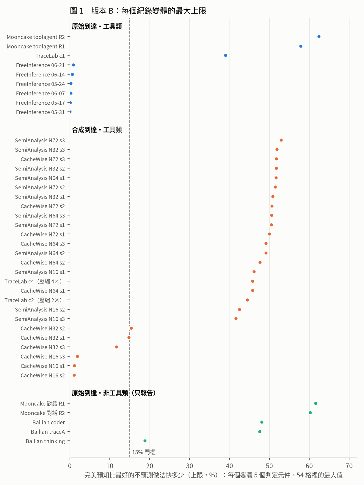
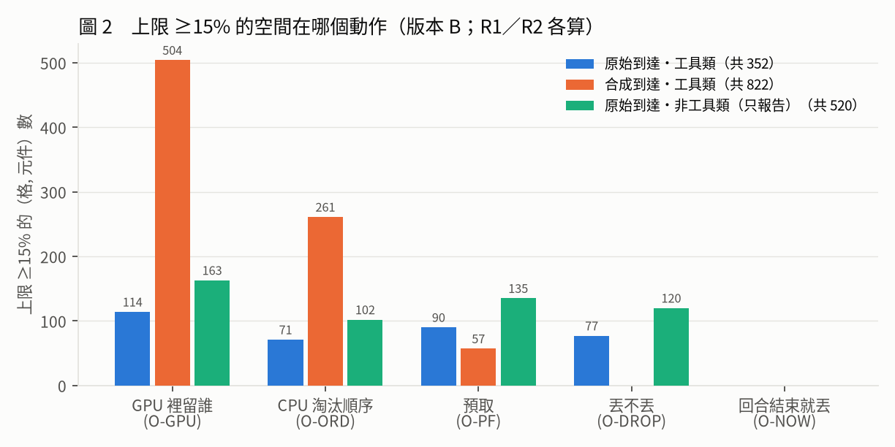
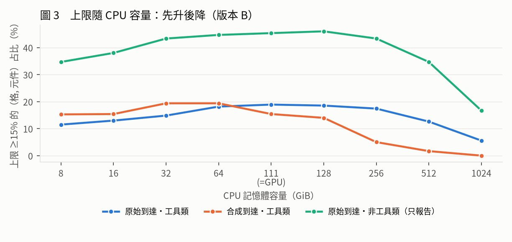
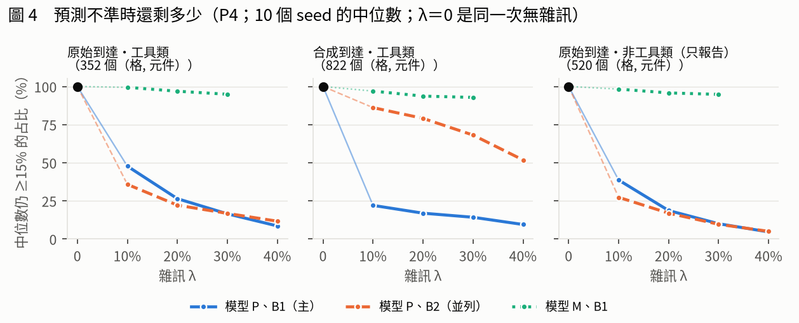
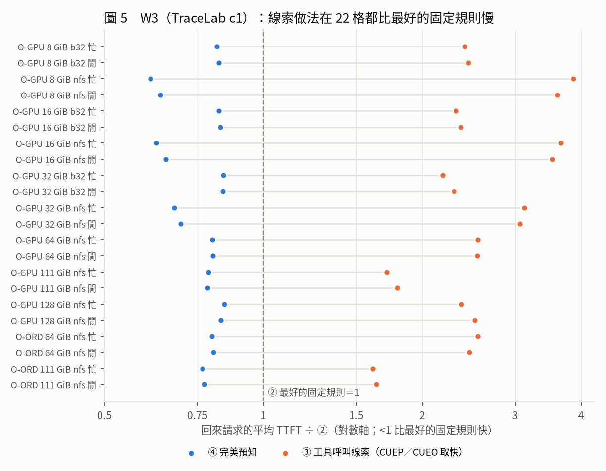

# ICPE 主結果報告：預測在工具類工作負載上還有空間

> icpe-main，2026-11-07。**以版本 B 為準**（② 不含 block 粒度 APC）；偏離 10 的版本 C 算完後，主表與推翻條件要換數字（第 9 節）。
> 標記：〔模擬〕＝紀錄驅動的模擬；〔實測〕＝H200 上量的（引自 `PAPER.md` v4.2，本報告沒有重新核對）；〔判讀〕＝作者的解讀；〔建議〕＝給論文的建議，**沒有改 `main.tex` 或 `PAPER.md`**。
> 每個數字的出處在第 11 節（run_id、檔名、commit）。

## 1 一頁看懂

- **要回答的問題**：使用者或工具隔一陣子才回來時，先預測「誰、什麼時候回來」再決定 KV 放哪裡，比最強的不預測做法還能快多少？用「完美預知」（④）對「固定規則裡每格挑最快」（②）的差距當上限；**上限 ≥15% 才算值得做**，門檻在看任何結果之前就登記了（PREREG §1）。
- **答案要看工作負載**〔模擬〕：
  - 真實的 agent 服務紀錄 FreeInference（6 週）：最大 0.85%，不值得。
  - 工具類紀錄：Mooncake toolagent 最大 62.4%（R2）／57.8%（R1），TraceLab c1 38.9%。原始到達的 9 個工具類變體裡有 3 個 ≥15%；合成並行的 26 個變體裡有 21 個 ≥15%。
- **空間在「誰留在 GPU／CPU」，不太在預取**：≥15% 的（格, 元件）裡，原始工具類 53%、合成工具類 93% 是 GPU 層淘汰（O-GPU）或 CPU 淘汰順序（O-ORD）。
- **事先登記的推翻條件成立**（原始工具類）：TraceLab c1 上，「工具一呼叫就處理這段 KV」的免費線索，在 22 個 ≥15% 的格全部比最好的固定規則還慢（1.6–3.9 倍），拿不到這段空間。照 PREREG，結論改成「**在這類工作負載上預測仍有空間**」。
- **但要預測得準**：照 PBKV 的混合雜訊，只要 10% 的預測換成亂猜，原始工具類 ≥15% 的格剩 48%（168／352），合成剩 22%；時間乘上 ±30% 的誤差則幾乎不影響（剩 95%／93%）。
- **還會變的**：版本 C（② 加 APC）要取代版本 B；TraceLab c1 的前半撐不撐得住，取決於 ④ 加不加 BELP（第 9 節）。

## 2 要證明什麼

- 事先登記的三個假設（PREREG §1）：
  - **H1**：有簡單線索的地方，簡單線索拿走完美預取改善量的大部分。
  - **H2**：對最強的不預測做法，剩下的空間集中在淘汰順序，不在預取。
  - **H3**：上限隨 CPU 容量變大而下降。
- **推翻條件**：只要有一份真實的工具類紀錄，上限 ≥15%，又沒有簡單線索能拿走大部分，結論改成「在這類工作負載上預測仍有空間」。
- **對手（②）**：每格、每個動作，在 10 個不預測的 CPU 規則（LRU、LRU2、ARC、S3-FIFO、GDSF、Pensieve 式、LRU+RPF 等）× 15 個 GPU 規則（GPU LRU、Continuum 式 TTL 0.3–300 秒 × 2 種）裡事後挑最快；還原用 Cake、慢層存 INT4。**這比相關研究常用的 LRU 對手強很多**。
- **完美預知（④）**：分成 5 個判定元件——預取（O-PF）、CPU 淘汰順序（O-ORD）、丟不丟（O-DROP）、回合結束就丟（O-NOW）、GPU 層淘汰（O-GPU）。
- **範圍**：40 個紀錄變體 × 54 格（CPU 9 個容量 × 慢層 3 種 × GPU 閒／忙）。主指標：回來請求的平均首字延遲（TTFT）。

## 3 主結果（版本 B）〔模擬〕

**圖 1　每個紀錄變體的最大上限。**原始到達的工具類裡，FreeInference 6 週都 <1%；Mooncake toolagent、TraceLab c1 遠超過 15%。合成並行的紀錄只有 CacheWise 並行 16、32 的幾個不到 15%。

| 類別 | 變體數 | ≥15% 的變體 | 最大 | 判定 |
|:--|--:|--:|--:|:--|
| 原始到達・工具類 | 9 | 3（toolagent R1、R2；TraceLab c1） | 62.4% | ≥15% 成立 |
| 合成到達・工具類 | 26 | 21 | 52.9% | ≥15% 成立 |
| 原始到達・非工具類（只報告） | 5 | 5 | 61.6% | 只報告 |

- 判定照偏離 7：原始、合成各自判；Mooncake R1、R2 各自判；寫入頻寬飽和的格照算、另標（≥15% 的 1,694 個（格, 元件）裡 144 個飽和，全在 Mooncake）。

## 4 空間在哪裡（H2、H3）〔模擬〕

**圖 2　上限 ≥15% 的（格, 元件）落在哪個動作。**合成工具類幾乎全在 GPU 層淘汰與 CPU 淘汰順序（765／822）；原始工具類有一半在這兩項（185／352），預取（90）與丟不丟（77）也不少。回合結束就丟（O-NOW）在所有紀錄都沒有一格 ≥15%。

- **H2**〔判讀〕：合成工具類支持（93% 在淘汰）；原始工具類部分支持（53%），因為 Mooncake toolagent 的預取上限也高（最大 53.3%）。

**圖 3　上限 ≥15% 的格占比隨 CPU 容量：先升後降。**原始工具類從 8 GiB 的 11.5% 升到 111 GiB 的 18.9%，再降到 1,024 GiB 的 5.6%；合成工具類在 32–64 GiB 最高（19.4%），1,024 GiB 是 0。

- **H3**〔判讀〕：只在 CPU 大於 GPU 預算（111 GiB）之後成立；CPU 很小時上限反而較低，所以不能寫成「隨容量單調下降」。

## 5 換設定還成立嗎（P2／P3 敏感度，只報告）〔模擬〕

以版本 A（3 個 TTL）為基礎，每次只換一個設定。判定字（≥15% 的變體數／全部）：

| 類別 | 版本 A | nvme807 | 只載入 | GPU 寫穿（wt） | 預取進 GPU |
|:--|:--|:--|:--|:--|:--|
| 原始・工具類 | 3/9 | 2/9 | 3/9 | 3/9 | 3/9 |
| 合成・工具類 | 21/26 | 16/26 | 23/26 | 22/26 | 22/26 |
| 原始・非工具類 | 5/5 | 4/5 | 5/5 | 5/5 | 5/5 |

- 工具類的判定字在每個敏感度都成立。nvme807 只有一種慢層（18 格），要和同格的 ssd 比：原始工具類 2/9 對 2/9。
- 只載入時有 84 個（格, 元件）上限 >90%，是慢層讀取把對手拖到數百秒的極端格，不是典型值。

## 6 預測不準時（P4，W4 雜訊）〔模擬〕

**圖 4　10 個 seed 的中位數仍 ≥15% 的（格, 元件）占比。**範圍＝版本 B 上限 ≥15% 的 2,582 個（格, 元件）。模型 P（照 PBKV：以機率 λ 把「下次回來時間」換成從同一份紀錄亂抽的值）是主模型；B1＝每個回合結束抽一次，B2＝每次問都重抽；模型 M＝時間乘上 (1＋ε)，ε～U[−λ, λ]。

| 模型 P、B1（主） | 格數 | λ 10% | 20% | 30% | 40% |
|:--|--:|--:|--:|--:|--:|
| 原始・工具類 | 352 | 168 | 93 | 58 | 30 |
| 合成・工具類 | 822 | 181 | 139 | 117 | 78 |
| 原始・非工具類（只報告） | 520 | 201 | 97 | 52 | 24 |

- 原始工具類 3 個變體到 λ＝40% 都還各有格 ≥15%：toolagent R1 60／23／12／2、R2 100／64／42／27、TraceLab c1 8／6／4／1。
- B2 並列：原始工具類 126／78／59／41；合成工具類 708／650／560／426。
- 模型 M（λ 10／20／30%）：原始工具類 350／341／334；合成工具類 797／770／763。
- 3 個佇列 seed 合起來（只算三個 seed 都有選到的格，P、B1）：CacheWise 53 組全部 <15%；SemiAnalysis 160 組剩 51／44／36／25。
- 〔判讀，沒另外驗證〕合成到達上 B1 比 B2 傷得重很多；O-PF 在合成到達上只要 λ>0 就變負、而且和 λ 幾乎無關（例：TraceLab c2 一格 λ 10–40% 都是 −23.9%）。可能是「挑最快回來的那個」被亂抽的極端值主導，或模擬器處理「預測時間已過」的方式；要不要請 icpe-sim 查，待決定。

## 7 推翻條件：簡單線索拿得走嗎（W3）〔模擬〕

**圖 5　TraceLab c1 的 22 個 ≥15% 的（格, 元件）：④ 比最好的固定規則快 16–39%，線索做法（③）反而慢 1.6–3.9 倍。**線索＝這一輪輸出有工具呼叫（回合結束就看得到）；③＝CUEP（釘在 GPU 到下次請求）或 CUEO（立刻移到 CPU），配 10 個 CPU 規則，事後挑最快。

- 照偏離 9：拿走比例 f＝(T② − T③) ÷ (T② − T④)；f > 0.5 才算「拿走大部分」。22 格全部 f ≤ 0.5（中位數 −7.41），寫入飽和 0 → 後半成立；前半 38.9% 成立 → **原始工具類的推翻條件成立**。
- 先決條件：TRX40 重算版本 B 的 c1 全部 324 個（格, 元件），7 欄 0 差。W3 在偏離 9 登記（08:37:10）之後才跑。
- 穩健性〔判讀〕：判定的 270 列裡，線索做法沒有一格贏過最好的固定規則；所以就算把 ③ 改成「線索或固定規則取快」，f＝0 仍 ≤ 0.5；也和「任一格」或「全部格」的彙總方式無關。
- 為什麼線索沒用〔判讀〕：TraceLab 86% 的回合都有工具呼叫，線索幾乎一直亮著、分不出誰會先回來。
- **H1**：TraceLab 的工具呼叫線索不支持 H1；Mooncake 對話的打字線索（舊稿：拿到預取約八成）是舊模擬器＋GPU 重播，新模擬器沒有重測。
- 還沒判：合成到達（TraceLab c2、c4）、FreeInference 在 TRX40 跑；Mooncake toolagent、SemiAnalysis 沒有線索欄位 → 未定。

## 8 論文的兩個 Mooncake 舊測試：新舊模擬器並列〔模擬〕

| 測試 | 舊稿（old V0） | 新模擬器、版本 B |
|:--|--:|--:|
| T1：對話紀錄 O-PF、SSD 級、CPU 128 GiB | 50.5% | 37.8% |
| T2：192 格 ≥15%（不截尾） | 95 | 111 |
| T2：截尾一小時、排除寫入飽和 | 36 | 38 |

- 舊稿的 50.5% 要改；「192 格裡 36 格」在新模擬器是 38 格，結論方向不變。

## 9 故事該怎麼改〔建議〕

**一句話**：舊稿的第三個結論「再加預測，多半不划算」要改成「**預測值不值得看工作負載：真實的 agent 服務紀錄不值得；工具類工作負載上，即使對手已有 GPU 層的 TTL 與各種固定規則，完美預知仍能快 ≥15%，空間主要在 GPU／CPU 裡留誰，免費的工具呼叫線索拿不到；但預測要準**」。

| 項目 | 舊稿（PAPER v4.2，10/30） | 新結果（版本 B，11/7） |
|:--|:--|:--|
| 對手 | 沒有 GPU 層，回合結束整段 KV 移出 GPU | GPU 層 1,777 塊；GPU LRU＋7 個 TTL × 2 種，每格挑最快 |
| 紀錄 | FreeInference、Mooncake 兩份 | 加 TraceLab、CacheWise、SemiAnalysis、Bailian，共 40 個變體 |
| 預測的結論 | 多半不划算 | 看工作負載；工具類 ≥15%，推翻條件成立 |
| 空間在哪 | 以預取為主（打字線索拿走八成） | 以淘汰為主（GPU 層、CPU 順序） |
| 和 CPU 容量 | 隨容量下降 | 先升後降，CPU 大於 GPU 預算後才下降 |
| Mooncake 數字 | 50.5%；36／192 | 37.8%；38／192 |
| 預測準不準 | 沒做 | 混合雜訊 10% 剩一半以下；乘法誤差幾乎不影響 |

**章節怎麼調**〔建議〕
1. 第 1–4 章（場景、寫入時預知不用做、對手決定答案、INT4＋Cake 的表與 MPS）**不動**：都是 H200 實測，不受新模擬器影響。
2. 第 3 章「對手」補上 GPU 層與 TTL：這是我們和 PBKV、CacheScout、Continuum 對手設定最大的差別，也是新結果成立的前提。
3. 第 7 章（預測）重寫：圖 1 換成本報告的圖 1；加「空間在哪」（圖 2）、「容量」（圖 3）、「W3 線索拿不到」（圖 5）、「預測要準」（圖 4）。
4. 摘要、引言、結論的第三點跟著改；限制加：全部是模擬（W6 的 GPU 重播還沒做）、原始工具類只有兩份紀錄（Mooncake toolagent 只有一小時）、合成並行是人為到達、版本 C 待算。
5. 打字線索那一段降級成「舊模擬器的結果」，或在新模擬器補跑後再用。

**風險：哪些會讓新故事站不住**〔判讀〕
- **版本 C（APC）**：探索裡 SemiAnalysis N16 s1 的 O-GPU 中位數從 8.5% 降到 4.6%；TraceLab c1 的 O-GPU 若 ④ 不加 BELP 會從 39% 掉到 5%。加 BELP 是看過探索才選的，所以版本 C 會並列「④ 不含 BELP」（只報告）。
- **原始工具類的證據很窄**：≥15% 的只有 Mooncake toolagent（一份紀錄、兩個規則）和 TraceLab c1；W3 只有 TraceLab 有線索欄位。
- **引擎審查**：W3 與版本 C 用的 v8 引擎沒有 Python 參考版，也沒經過 icpe-sim 審查（使用者決定不用）。

## 10 ICPE 標題與摘要〔建議〕

摘要登記：**11/10（一）19:59（台灣）**；全文 11/17（NEXT_PLAN）。下面的數字都是版本 B，版本 C 出來後要換；括號裡的英文數字要和最終表逐一核對。

**標題選項**
1. *When the Session Returns: Restoring Parked KV Cache on H200, and Where Prediction Still Pays*（保留「組合地圖」主軸，加上預測的新結論；**建議**：投 EERCS 時實測的地圖仍是主貢獻，預測是模擬）。
2. *Strong Baselines First: How Much Can Perfect Prediction Still Save for KV Cache in LLM Agent Workloads?*（以預測為主軸；新結論最醒目，但主結果全是模擬）。
3. *Is Predicting Returns Worth It? A Preregistered Upper-Bound Study of KV Cache Placement for LLM Agents*（強調事先登記與上限方法）。

**摘要草稿（英文，約 230 字）**

> Multi-turn chat and LLM agents leave gaps between requests, during which serving systems move a session's KV cache out of the GPU; when the user or a tool result returns, the cache must be restored before the first token. Recent agent-serving systems predict who returns and when, and report large gains over LRU-style baselines. We ask how much prediction can still add over the strongest non-predictive policies. On an NVIDIA H200 we measure restoration options (load, recompute, Cake, INT4) and GPU sharing; in trace-driven simulation over 40 trace variants we bound prediction with a perfect oracle against the per-cell best of 10 CPU-tier rules and 15 GPU-tier rules (LRU and Continuum-style TTLs), with thresholds preregistered before any result. First, a fixed lookup table suffices for restoration: INT4 with Cake is fastest on slow tiers (11.0–40.7% over the runner-up). Second, the value of prediction depends on the workload: on a production agent-serving trace the oracle gains under 1%, but on tool-calling traces it gains up to 62%, reaching 15% in 3 of 9 real-arrival and 21 of 26 synthetic-concurrency variants, mostly by deciding what stays in GPU and CPU memory rather than by prefetching. A free tool-call cue captures none of this gap, so our preregistered falsification condition is met. Third, the gap requires accurate prediction: replacing 10% of predictions with random draws leaves under half of these cells above 15%, while ±30% timing error barely matters.

**中文對照**

> 多輪對話與 AI agent 的請求之間常有空檔，系統會把對話的 KV cache 移出 GPU，使用者或工具結果回來時要先搬回，才出得了第一個字。近來的 agent 服務系統先預測「誰、何時回來」，並報告比 LRU 類對手大幅的提升。我們問：對最強的不預測做法，預測還能多給多少？我們在 NVIDIA H200 上實測還原方式（載入、重算、Cake、INT4）與 GPU 共用；並在 40 個紀錄變體上做紀錄驅動模擬，用完美預知對「10 個 CPU 規則 × 15 個 GPU 規則（LRU 與 Continuum 式 TTL）逐格取最快」量上限，門檻在看任何結果前登記。第一，還原照一張固定的表選就夠：慢層上 INT4＋Cake 最快（比次佳快 11.0–40.7%）。第二，預測值不值得看工作負載：真實 agent 服務紀錄上完美預知快不到 1%；工具呼叫的紀錄上最多快 62%，原始到達的 9 個變體裡 3 個、合成並行的 26 個裡 21 個達到 15%，空間主要在決定誰留在 GPU 與 CPU，而不是預取。免費的工具呼叫線索一點都拿不到，事先登記的推翻條件成立。第三，這段空間要預測得準：10% 的預測換成亂猜，達到 15% 的格剩不到一半；時間誤差 ±30% 則幾乎不影響。

- 摘要沒放 MPS（篇幅），要放的話照 `PAPER.md` 的 31–63%。
- 「production agent-serving trace」指 FreeInference；「tool-calling traces」指 Mooncake toolagent、TraceLab，合成並行另含 SemiAnalysis、CacheWise。投稿前用 `paper-claim-audit` 逐句核對。

## 11 數字出處與還沒做完的

**出處**（都在 `icpe-next-main`，已 push 到 6dd2849 之後的分支頭；圖的每個點在 `figs/fig_data.csv`）
- 版本 B：run `20261106-110854-icpe-main-verB-p1`；`results/icpe_next/main/verB/verB_verdict.csv`、`verB_by_trace.csv`、`verB_by_cpu.csv`、`oldtests_verB_*`。
- P2／P3：run `20261106-141610-icpe-main-p23-sens`；`results/icpe_next/main/p23/`。
- P4：runs `20261107-082202-icpe-main-p4-noise`（next_sim_analyze，核對 12／12、λ＝0 自檢 24／24）、`20261107-094535-icpe-main-p4-summary`；`results/icpe_next/main/p4/noise/`。
- W3：TRX40 run `20261107-084104-icpe-trx-rux-tl_c1-w3`、重現 runs `20261107-083210-…-tl_c1-apc`、`20261107-084950-…-tl_c1-reproB`；`origin/icpe-next-trx` 9e1064f／4ca0d65 的 `results/icpe_next/v8_explore/w3/tracelab_c1/`；PREREG 偏離 9（`origin/icpe-next-rux` 8f04a91、e7e0c77、aec99d1）。
- 圖：run `20261107-102042-icpe-main-report-figs`（`code/icpe/main_report_figs.py`）。
- 實測數字（11.0–40.7% 等）：`docs/icpe_paper_20261030/PAPER.md` v4.2 與其 `EVIDENCE.md`，本報告沒有重新核對。

**還沒做完的**
1. 版本 C（偏離 10）：RUX3DPRO 算 SemiAnalysis（已完成 N16、N32 共 6 個）、Mooncake、Bailian；TRX40 算 TraceLab、FreeInference；CacheWise 等使用者恢復。之後我出版本 C 的表、判定，並列「④ 不含 BELP」。
2. W3 的合成到達（TraceLab c2、c4）與 FreeInference。
3. P4 要不要改用版本 C（要補跑雜訊）；O-PF 異常要不要請 icpe-sim 查。
4. W5、排隊（偏離 11，只是敏感度）；慢層容量上限（PREREG 第 5 項）；W6 的 GPU 重播（等 H200）。W7 已暫停（只給 CCGrid）。
