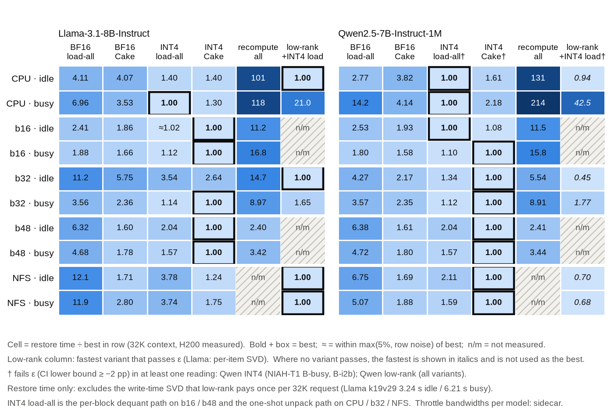
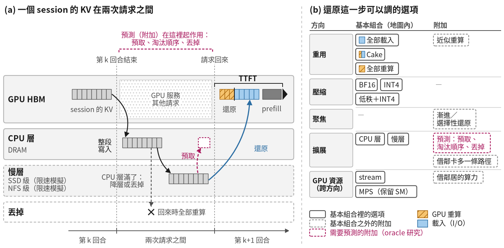
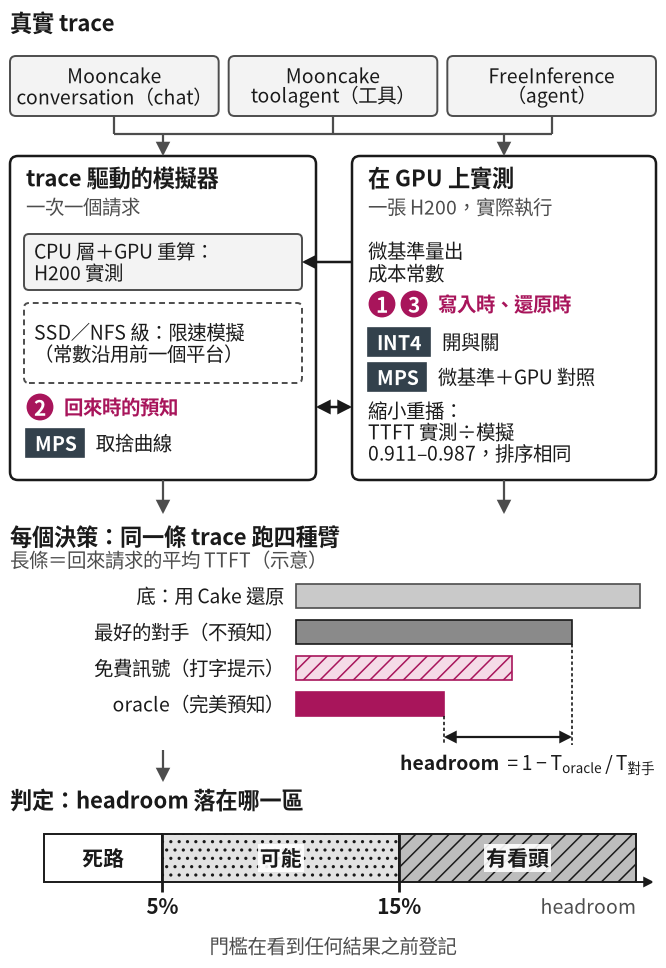
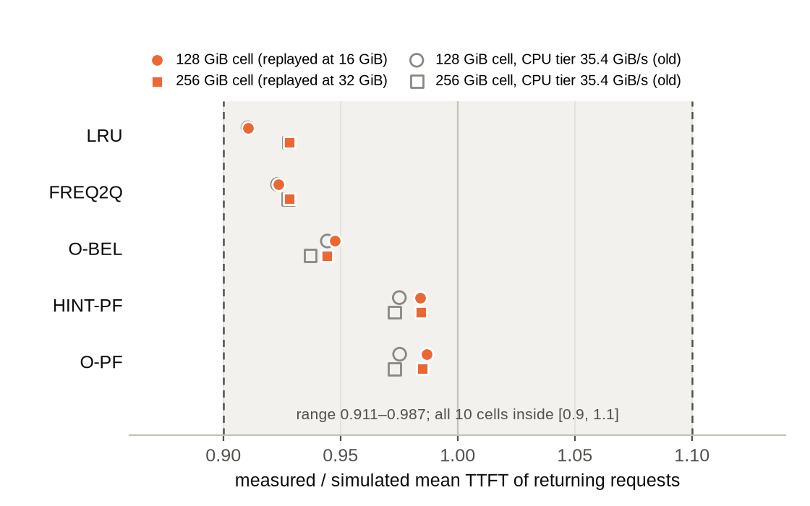
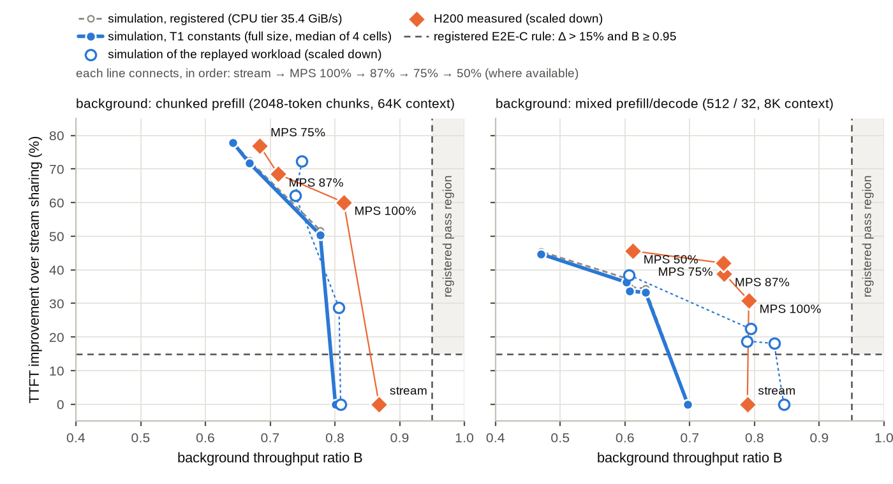
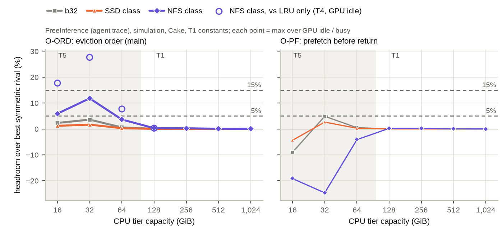
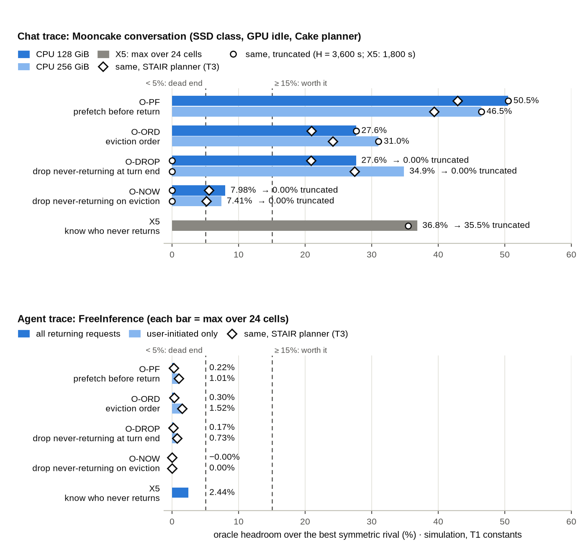
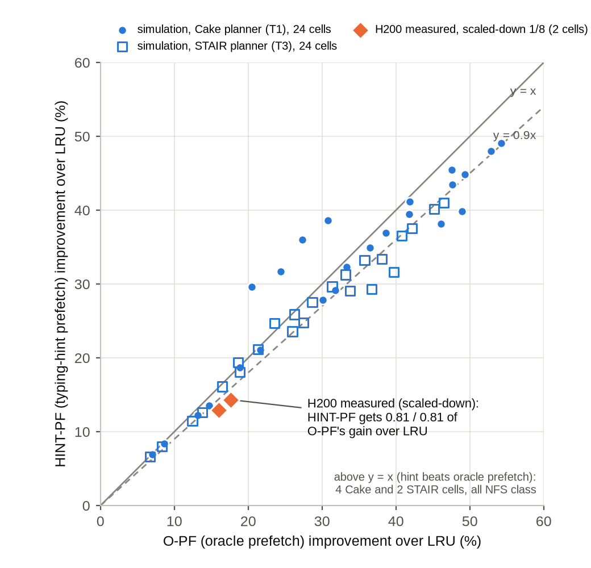
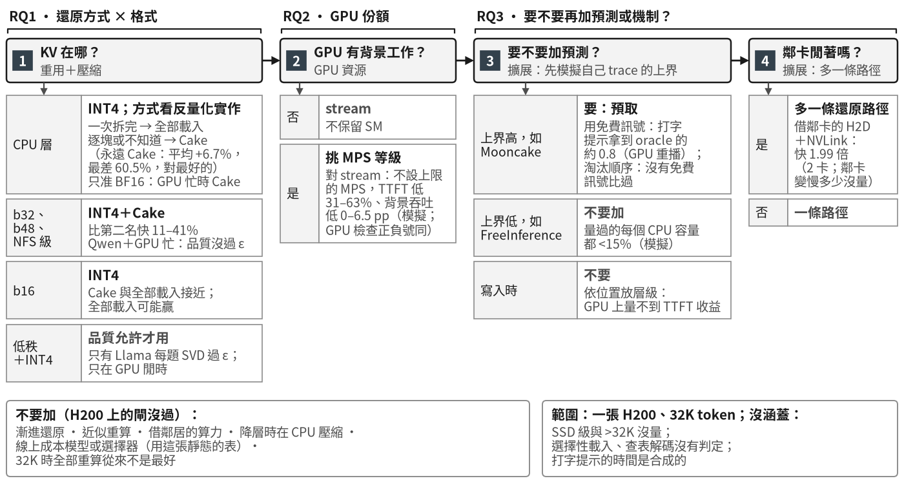

# 使用者回來時，停放的 KV 該怎麼送回 GPU？H200 上事先登記的組合地圖

*When the Session Returns: A Preregistered Decision Map for Restoring Parked KV Cache on H200*（英文暫定題）

> v4.1（2026-10-30）。標記：〔實測〕＝在 H200 上量的；〔模擬〕＝trace 模擬；〔判讀〕＝作者的解讀。方括號是 [`EVIDENCE.md`](EVIDENCE.md) 的列號。〔待決〕＝寫法等「待你決定」。

> **待你決定**（內部用；數字都已核對，內文照「建議」寫，受影響的句子標〔待決〕）
> 1. **投稿類型**：建議 EERCS（Empirical）：貢獻是量測地圖與負面結果，不是新系統；Regular 也可。
> 2. **AI 揭露**（§3.6）：「作者人工檢查了 oracle、模擬器、量化與計時程式」這句，要你確認真的做過才留。
> 3. **頁數**：本稿 9 張圖。英文版超過 10 頁時，建議依序把圖 4（模擬驗證）縮成表 1 的一列、圖 6（FreeInference 容量）移到 artifact、圖 3（方法流程）併進圖 2。
> 4. **「最好」的品質規則**（§4）：本稿用「主測驗（32K、192 題）過 ε 才算」，對 INT4 與低秩一視同仁；Qwen 的 INT4 在多鍵 NIAH 的 Cake＋GPU 忙讀法沒過，用 † 標出。另一個選法是「每種讀法都要過」，那樣 Qwen 慢層忙格的最好會改成 INT4 全部載入。
> 5. **FreeInference 那句的範圍**（§7.2）：建議「前 6 週、四種回來時上界、測過的 CPU 16–1,024 GiB 都 <15%；知道誰不回來只在另一週、128–1,024 GiB 量過」。
> 6. **打字提示的數字**（§7.4）：建議主引 GPU 縮小重播的 0.81／0.79，全尺寸模擬的中位數當輔助，並限定「只對預取」。
> 7. **知道誰不回來的條件**（§7.3）：建議「11 格裡 10 格在 CPU ≤256 GiB、全部在 b32／b48」。
> 8. **MPS 圖**（§6）：圖 5 同時畫 H200 常數版（藍實線）與登記版（灰虛線）；建議只留 H200 常數版。

## 一頁看懂

1. **場景**：使用者和聊天機器人或 agent 對話，兩則訊息之間常隔幾秒到幾分鐘。這段時間，服務端把這段對話的 KV cache 移出 GPU，放到 CPU 記憶體或更慢的儲存；使用者再發問時，KV 要先回到 GPU，畫面才會出現第一個字。一段 32K token 的 Llama 對話，KV 有 4.0 GiB [M1]。
2. **三個問題，一個接一個**：RQ1 不加預測時，送回方式 × 格式怎麼選、會不會翻轉？RQ2 GPU 要和背景工作共用時，分多少給還原？RQ3 一張固定的表已經夠用時，再加預測或更聰明的機制還值多少？
3. **方法**：一張 H200、兩個 7–8B 模型、三條真實 trace，判準在看到數字前登記。RQ1 在 GPU 上直接量 32K 的單次還原；RQ2 的端到端與 RQ3 的預測用 trace 模擬，並用 1/8 的 GPU 縮小重播檢查（TTFT 不含排隊時，實測÷模擬＝0.911–0.987）[B6]。
4. **RQ1 地圖**：在比 CPU 慢的限速層（b32、b48、NFS 級），INT4 加 Cake 最快，比次好的做法快 11.0–40.7% [M1]。在 CPU 記憶體上，INT4 怎麼解壓比用哪種送回方式更重要：一次拆完時整段載入最快，逐塊解壓時 Cake 較快 [M1、E3]。全部重算在 32K 從來不是最好 [M1]。
5. **RQ1 穩定**：在測過的層上，重算變快或換成像真實服務的背景時，最快的做法都不變；所以一張固定的表就夠 [A5、M3]。
6. **RQ2**：從 stream 共享換成不設上限的 MPS，回來的請求快 30.7–62.9%，背景吞吐最多少 6.5 pp；把背景再限緊才是明顯的取捨〔模擬〕[S2、M4]。
7. **RQ3 加預測**〔模擬〕：FreeInference 前 6 週上，在測過的 CPU 容量連完美預知都快不到 15%；Mooncake 上，截尾並排除寫入飽和後，192 格裡仍有 36 格 ≥15% [B3-T5、B9]。預取可用打字提示拿到大部分（GPU 縮小重播 0.81／0.79）[C2-GPU]〔待決〕。
8. **RQ3 其他機制**：漸進還原、近似重算、借鄰居的算力都沒過登記的門檻；借閒置鄰卡多一條還原路徑過了，但只量了 2 張卡 [G-A0、G-M12、G-M08、G-M06]。

**圖 1　RQ1 的地圖：每列的最快組合隨層、GPU 忙閒、模型與 INT4 的解壓實作變。** 〔實測〕32K 單次還原的時間 ÷ 該列最快，粗框是最快。格式要在主測驗過 ε 才算最快；低秩不含寫入時的 SVD 成本；† 是有一種讀法沒過 ε；b16、b48 兩列用逐塊解壓，其他列用一次拆完；SSD 級沒有量 [M1、M2]。

## 摘要

多輪對話與 agent 讓同一段對話隔一段時間又送來新訊息。這時系統可能已經把這段對話的 KV cache 移到 CPU 記憶體或更慢的儲存，必須先送回 GPU，使用者才看得到回答的第一個字。送回有許多組合：怎麼送、存成什麼格式、GPU 分多少給還原，還能再加預測或更聰明的機制。我們在一張 H200 上，用事先登記的門檻依序回答三個問題。第一，在 32K 的單次還原裡，比 CPU 慢的限速層上 INT4 加 Cake（GPU 重算前段、同時載入後段）最快，比次好的做法快 11.0–40.7%；在 CPU 記憶體上，INT4 的解壓實作決定該整段載入還是用 Cake；這些答案在測過的條件下不翻轉，所以查一張固定的表就夠。第二，GPU 要和背景工作共用時，從共用 stream 換成 MPS 能讓回來的請求快 30.7–62.9%、背景吞吐最多少 6.5 pp，限得更緊才是取捨；登記的背景門檻在多數組合裡連 stream 共享都過不了。第三，在固定的、不預測的底上再加東西：trace 模擬裡（TTFT 不含排隊，經 1/8 的 GPU 重播檢查），預測在 FreeInference 前 6 週連完美預知都快不到 15%，在 Mooncake 上仍有空間，其中預取用打字提示就能拿到大部分；其他機制裡只有借閒置鄰卡多一條還原路徑過了門檻。

## 名詞表

| 名詞 | 意思 |
|:--|:--|
| 停放的 KV、回來請求 | 對話在兩次請求之間移出 GPU 的 KV cache；同一段對話的下一則訊息叫回來請求，它要先把停放的 KV 送回 GPU |
| TTFT | 從送出下一則訊息，到看到回答第一個字的時間 |
| CPU 層、慢層 | 停放 KV 的地方。CPU 層是主機記憶體；慢層是限速模擬的層，不是真的裝置 |
| SSD 級、NFS 級 | 用頻寬上限模仿 SSD 與網路儲存的慢層 |
| b16／b32／b48 | 把頻寬限到剛好讓 Cake 在第 16／32／48 塊會合（32K 共 64 塊）的慢層，所以頻寬依模型不同 |
| 全部載入、全部重算、Cake | 三種送回的方式：把存的 KV 整段搬回；在 GPU 上從頭重算；GPU 從第一塊往後重算、同時從最後一塊往前載入，在中間會合 |
| BF16、INT4、低秩＋INT4 | 三種 KV 格式：原精度；每個數 4 位元，位元組小 3.2 倍；先做低秩分解再量化，位元組小約 8–17 倍 |
| 一次拆完、逐塊解壓 | INT4 送回 GPU 後轉回可用格式的兩種實作：整段讀完一次轉；每讀一塊就轉一次 |
| GPU 閒、GPU 忙 | 還原時 GPU 上有沒有其他工作；地圖的「忙」是合成的固定背景負載 |
| stream 共享、MPS | 兩種讓還原與背景工作同時用一張 GPU 的方式：各用一條 CUDA stream、不保留 SM；或用 NVIDIA 的 MPS 限制背景能用的 SM 比例 |
| 領先、翻轉 | 領先＝1 − 最好的時間 ÷ 第二好的時間；翻轉＝條件改變後，某格的最快做法換成另一個 |
| oracle、上界 | oracle 和對手做同樣的事，只多知道未來的一件事；它比最好的不預知對手少花的 TTFT 比例叫上界 |
| 四種回來時上界 | 預取、淘汰順序、回合結束就丟、輪到淘汰時才丟；「知道誰不回來」另外列 |
| 打字提示預取 | 從使用者開始打字起就預取；不需要預測模型，但要客戶端送出打字事件；提前量用打字速度模型算 |
| 四個方向 | 圖 2(b) 的整理軸：重用（怎麼送回、近似重算）、壓縮（格式）、聚焦（只讀重要的部分）、擴展（多一層、多一條路、預測）；GPU 資源跨各方向 |

## 1 引言：先畫地圖，再問固定的表之上還缺什麼

**停放的 KV 該怎麼送回，可以寫成一張以層、GPU 忙閒、模型與解壓實作為鍵的表（RQ1）；GPU 要共用時，MPS 給的是一條延遲換背景吞吐的曲線（RQ2）；在接近這張表、不預測的底上，預測只在部分 trace 上值得加（RQ3）[M1、M3、M4、B3-T5、B9]。**

聊天與 agent 讓同一段對話在幾秒到幾分鐘後又回來。GPU 記憶體要留給正在生成的請求，所以服務系統把等待中的對話的 KV 移到 CPU 記憶體或更慢的儲存（§11）。使用者回來時，系統要先把 KV 送回 GPU，才能開始算新訊息；這段等待使用者看得到，就在 TTFT 裡。

業界從幾個方向縮短這段等待：改送回的方式、把 KV 壓小、只讀重要的部分、多一條路或提前開始，還能調整 GPU 分給還原的比例（§11）。每個方向都有系統報告收益，但比較的底各不相同，而且大多一次只看一個方向。設計者要的是另一件事：手上的條件該選哪個組合，再加什麼才值得。

我們把這件事拆成三個依序的問題（表 0）。RQ1 畫出不加預測的地圖，並檢查它穩不穩；地圖穩，就表示查一張固定的表就夠。RQ2 在這張表上加 GPU 資源這個條件。RQ3 接著問：既然固定的表已經夠用，再加預測或其他機制還值多少。

**表 0　三個問題**

| RQ | 白話 | 想知道 | 和前一題的關係 |
|:--|:--|:--|:--|
| RQ1 不加預測時，誰最好？ | 使用者回來時，還原方式（載入／重算／Cake）× 格式（BF16／INT4／低秩）怎麼選 | 什麼情況用哪個組合、好多少？會不會隨情況翻轉？ | 起點：畫出地圖；地圖穩，就查一張固定的表，不必每次現場挑 |
| RQ2 GPU 要共用時怎麼分？ | 用 MPS 保留一部分 SM 給還原 | 保留多少，前景快多少、背景掉多少？ | 用 RQ1 的 INT4；模擬的底另含打字提示預取（§6） |
| RQ3 在固定的表之上，再加東西還值多少？ | 加預測（寫入時、回來時），或更聰明的機制（漸進、近似重算、借算力、多一條路徑） | 哪些值得、在哪些 trace 上？能不能用免費訊號代替預測？ | 量的是「固定、不預測的底」上的增量；預測的底在慢層接近 RQ1，CPU 層用 BF16＋Cake、沒有 MPS（§3.3） |

**貢獻**：
1. **RQ1 的地圖與穩定性**：兩個模型、六種層、GPU 閒與忙下的最快組合與領先幅度，全部在 GPU 上量；CPU 層的答案取決於 INT4 的解壓實作；最快的做法在測過的條件下不翻轉（§4、§5）。
2. **RQ2 的取捨曲線**：從 stream 共享換成 MPS 的收益，與再限緊背景的代價，以及登記判定（§6）。
3. **RQ3 的增量**：在三條真實 trace 上用 oracle 量預測的上界，經 GPU 縮小重播檢查；其他機制各自對照事先登記的門檻（§7、§8）。
4. **決策流程**：把三題的答案依序整理成設計者可以照做的流程（§9）。

## 2 背景：KV 從哪裡回來、要等多久

**本節說明 RQ1–RQ3 要選的東西：KV 有多大、停在哪、回來時有哪些送法（圖 2）。**

**KV cache 是什麼**。模型讀過的每個 token 都會留下一組中間結果，叫 KV；下一則訊息要接著這些結果算，才不用重讀整段對話。KV 隨對話變長：32K token 時，Llama-3.1-8B 的 KV 有 4.0 GiB，Qwen2.5-7B 有 1.75 GiB（BF16）[M1]。

**它為什麼離開 GPU**。使用者在打字或在看回答時，這段 KV 只是佔著 GPU 記憶體。主流的服務引擎都會把它移到 CPU 記憶體；CPU 記憶體滿了，再移到 SSD 或遠端儲存，或直接丟掉（§11）。本文的 SSD 級與 NFS 級是限速模擬；這兩組頻寬常數沿用先前在另一個平台（MI300X）上量到的值，H200 上沒有重量 [§0]。

**使用者回來時**。系統有三種送回方式。全部載入：把存的 KV 整段搬回。全部重算：在 GPU 上把整段對話重讀一次。Cake：GPU 從第一塊往後重算，同時從儲存層從最後一塊往前載入，兩邊相遇就完成（圖 2(a) 右上）。儲存層越慢，會合點越靠後，GPU 算的部分越多。

**TTFT**。從使用者送出下一則訊息，到看到回答第一個字的時間。它包含送回 KV 的時間，加上算新訊息的時間（prefill）；在忙的服務裡還有排隊。RQ1 的地圖只量送回這一段。

**還不知道的事**。送回方式、格式、GPU 分配、預測與其他機制可以疊在一起（圖 2(b)），但哪個組合在哪種條件下最好、再加東西值不值得，沒有一張共同的表（§11）。

**圖 2　KV 在兩次請求之間停在不同的層，回來時再送回 GPU；送回的時間算在使用者等的 TTFT 裡。** (a) 一個 session 的 KV 在兩次請求之間的去向；(b) 還原這一步可以調的選項：實線框是 RQ1／RQ2 的基本組合，虛線框是 RQ3 量的附加，紅色虛線框是需要預測的附加。

**本節的結論**：要選的是送回方式、格式與 GPU 分配；下一節說明我們怎麼量、怎麼判斷值不值得。

## 3 方法：怎麼判斷「值得」

**三個 RQ 共用一套事先登記的門檻；RQ1 在 GPU 上直接量，RQ2 的端到端與 RQ3 的預測用 trace 模擬並經 GPU 檢查。**

### 3.1 兩種量法

- **GPU 微基準**〔實測〕：一次送回一段 32K 的 KV，量送回時間（不含新訊息的 prefill 與排隊）。每種做法重複 10 次（CPU、b32、NFS 級）或 30 次（b16、b48），取中位數 [M1]。RQ1、RQ2 的微基準與 RQ3 的機制用這種量法。
- **trace 模擬**〔模擬〕：照真實 trace 的時間一次送一個請求，算回來請求的平均 TTFT；成本常數來自 GPU 微基準 [§0]。模擬是確定性的，每格跑一次。RQ2 的端到端與 RQ3 的預測用這種量法。

我們用自己的 harness（量載入、重算與 Cake 的程式），而不是 vLLM、LMCache 或 SGLang，因為要能分開控制載入、重算與會合點。harness 的重算比 vLLM 慢（sdpa 1.75／1.76 倍，fa3 1.30／1.32 倍）；模擬裡把重算加速到 vLLM 級，RQ3 的判定不變 [E1、E2、B7]。

**表 1　設定（只用 H200）**

| 項目 | 值 | 證據 |
|:--|:--|:--|
| 平台 | 一張 NVIDIA H200（143,771 MiB，PCIe Gen5 x16），不做 TP；vLLM 0.28.0、torch 2.13.0+cu130 | §0 |
| 模型 | Llama-3.1-8B-Instruct、Qwen2.5-7B-Instruct-1M | §0 |
| 格式 | BF16；INT4（KIVI 式）；低秩＋INT4（xKV，只有全部載入的路徑） | M1、M2 |
| GPU 忙 | 地圖：合成的背景負載（duty 1.0），不是 MPS；RQ2：像真實服務的背景（chunked prefill、prefill 與 decode 混合） | M1、M4 |
| CPU 層 | 地圖：真實的 pinned H2D；模擬：讀 43.5888、寫 41.1687 GiB/s | M1、§0 |
| 限速慢層 | b16／b32／b48：Llama 8.83／2.49／0.722 GiB/s，Qwen 4.33／1.23／0.358 GiB/s；NFS 級 0.331 GiB/s；SSD 級 6.981 GiB/s 只用在模擬 | §0、M1 |
| trace | Mooncake conversation 12,031 請求、toolagent 23,608 請求（各從一小時的線上請求抽樣）；FreeInference 前 6 週 129,717 請求（2026-05-17～06-27）；另一週 2026-07-26～08-01 只用於「知道誰不回來」 | §0、B3-X5 |
| 品質 | 主測驗：32K、4 種任務共 192 題、seed 67000；多鍵 NIAH 與 LongBench 另報 | D2-Q、M2 |

Mooncake 的 trace 引用 FAST'25；FreeInference 以 CC-BY-4.0 釋出，照資料卡引用 Nixon et al.（*From Requests to Sessions*，2026）。FreeInference 的 block 是 16 token：我們把連續 32 塊併成一塊 512 token，並用 token 數驗算 block 數。

### 3.2 門檻

每個判準在看到數字之前寫進登記檔並 commit；5% 與 15% 沿用研究計畫一開始就定好的停損規則 [§0]。預測的判定流程見圖 3。

- **時間**：一個做法要比對照快超過 $\delta^*$ 才算有改進；$\delta^*$ 取 5% 與該實驗量到的雜訊中較大的那個 [§0]。RQ1 的地圖另用 A5 登記的規則：領先 <5% 算平手。INT4 速度實驗與機制實驗（雜訊定為 2 倍標準差）另要求配對差的 bootstrap 95% CI 不含 0；寫入時的實驗只看中位數 [§0]。
- **品質**：$\varepsilon$＝格式對 BF16 的答對率差，95% CI 下界 ≥ −2 個百分點；地圖上一個格式要在主測驗過 $\varepsilon$ 才算最快 [§0、M2]。
- **RQ3 的預測**：上界 ≥15%、而且同一組設定有 ≥2 種 CPU 容量做到，算**值得做**；所有格 <5% 算**死路**；其他算**可能** [§0]。

**圖 3　RQ3 預測的判定是機械的：oracle 比最好對手少花的比例，對照事先登記的門檻。** 長條是示意；圖中的「有看頭」就是本文的「值得做」。

### 3.3 RQ3 的預測：底、oracle 與公式

**底**：預測模擬是一個固定、不預測的底，接近 RQ1 的表但不相同 [§0]。回合結束時 KV 以 BF16 進 CPU 層，降到慢層時存成 INT4，回來時對整個存起來的前綴用 Cake。和 RQ1 的差別有五個：CPU 層用 BF16＋Cake，不是 RQ1 的 INT4 全部載入；INT4 用逐塊解壓；沒有 MPS；Mooncake 的主結果多在 SSD 級，而 SSD 級不在 RQ1 的地圖裡；RQ2 的底另含打字提示預取。寫入時的預知另在 GPU 上量，底是「延後到 CPU 層滿了才決定」[A1'']。所以 RQ3 量的是「固定的表之上還缺什麼」，不是在 RQ1 的表上逐格量的增量。

**上界的意思**：oracle 是同一個策略，只多了某一個未來量的完美資訊，所以它界住的是「把這個量的預測器放進同一個策略」最多能省多少，不是所有策略的極限。它也不是嚴格的上界：NFS 級有 4 格打字提示預取比 oracle 預取還快 [C2]。

一塊的載入時間：位元組 $b$ 除以那一層的頻寬 $B$，INT4 再加解壓時間 $d$；那一層正在寫入時，讀取再乘量到的 $k_{\text{read}}$ [§0]。

$$\ell_{\text{BF16}}=\frac{b_{\text{BF16}}}{B_{\text{CPU}}},\qquad \ell_{\text{INT4}}=\frac{b_{\text{INT4}}}{B_{\text{層}}}+d \tag{1}$$

Cake：有存的前綴是第 0 到第 $L-1$ 塊；每一步讓落後的一邊前進一塊，兩邊在第 $m$ 塊相遇，送回時間取兩邊較晚的那一個。$f(i)$ 是在 GPU 上重算第 $i$ 塊的時間；H200 上量到第 79 塊（約 40K token），之後線性外插 [§0]。

$$T_{\text{restore}}=\max\Big(\sum_{i=0}^{m-1} f(i),\ \sum_{i=m}^{L-1}\ell(i)\Big) \tag{2}$$

模擬的 TTFT 是送回時間，加上重算沒存的塊與新訊息；策略 $\pi$ 的成績是所有回來請求 $\mathcal{R}$ 的平均。

$$\text{TTFT}_r=T_{\text{restore}}+\sum_{i=L}^{n_r-1} f(i),\qquad T(\pi)=\frac{1}{|\mathcal{R}|}\sum_{r\in\mathcal{R}}\text{TTFT}_r(\pi) \tag{3}$$

四種回來時的 oracle 從 trace 讀「下一個讀到這個 session 的請求」，每個只改一個決定，其他照 LRU [§0]：

- **預取**：慢層讀取線空著時，先把最早回來的 session 的後段以 INT4 搬進 CPU 層。
- **淘汰順序**：CPU 層滿時，先降級最晚回來的 session（Belady；或把距離乘上能空出的位元組），每格取較快的一個。
- **回合結束就丟、輪到淘汰時才丟**：不再回來的 session 在這兩個時間點直接丟掉。截尾 $H$ 時，離 trace 結尾不到 $H$ 秒的決定一律當「會回來」。
- **知道誰不回來**（另列）：替每個 session 選去處（CPU BF16、CPU INT4、慢層或丟掉）；對手是最好的固定規則，任一主格 ≥15% 就算值得做。

上界是 oracle 比最好的同動作對手 $\mathcal{S}_c$ 少花的比例；Mooncake 沒有 session 欄位，我們用兩種規則重建，每格取較小的上界 [§0]。

$$h_c=\frac{T_{\text{rival}}-T_{\text{oracle}}}{T_{\text{rival}}},\qquad T_{\text{rival}}=\min_{\pi\in\mathcal{S}_c}T(\pi) \tag{4}$$

打字提示的提前量：這一輪新輸入的 token 數 $\Delta_r$ 扣掉 10 個模板 token，換成字元數（每 token $c_{\text{tok}}$ 個字元），除以桌機打字速度 51.56 WPM（Dhakal et al.），再以兩請求之間的空檔為上限（TPOT 取 50 ms）[§0]。

$$L_r=\min\Big(\frac{\max(\Delta_r-10,\,0)\cdot c_{\text{tok}}}{51.56\times 5/60},\ \text{think}_r\Big) \tag{5}$$

慢層的寫入負載 $\rho_w$＝寫入的忙碌時間 ÷ trace 長度；$\rho_w\ge 1$ 的格叫「寫入飽和」：模擬器讓還沒寫完的資料就能讀，所以這些格偏樂觀 [§0]。

### 3.4 模擬的排序與正負號在 GPU 上站得住

我們把 Mooncake conversation 依 session 抽 1/8，在 H200 上用真的搬運與重算重播 12 個乾淨的 run（SSD 級、Llama、CPU 16／32 GiB）（圖 4）[B6]：

- 實測÷模擬＝0.911–0.987，10 格全在 ±10% 內 [B6]。
- 模擬差 ≥5% 的 15 對策略，排序全同；8 個上界的正負號全同 [B6]。
- 重播一次只送一個請求，TTFT 不含排隊；含排隊時上界變小（§10）。

**圖 4　模擬比實測略慢，但都在 ±10% 內，排序與正負號一致。** 〔實測〕÷〔模擬〕，TTFT 不含排隊；灰色空心是舊 CPU 常數的重播 [B6]。

### 3.5 偏離與量測防護

和登記不同的做法寫成「偏離」；會碰到報告數字的列在下表，完整清單在匿名 artifact（審查期間不附連結）。沒過門檻的檢驗也照列（§5、§7、§8）。這是共用叢集：每個量時間的 run 都有 GPU 監看，同一張卡出現外來 process 就作廢重量 [R-T1G、E4]。

| 偏離 | 影響 | 出處 |
|:--|:--|:--|
| FreeInference 在預測實驗登記之後、看結果之前才加入；原登記要求總結以只用 Mooncake 的版本為準 | FreeInference 的結論屬於偏離；H200 上的重跑另有登記 | X1 登記 §2.9、T5 |
| 截尾 $H$ 是登記之後加的穩健性檢查；登記規定以較保守的版本為準，截尾版較保守，所以當 Mooncake 的主結果 | 比原登記保守 | X1 登記 §4.7、B9 |
| 換成 H200 的 CPU 層常數後，排隊模擬的一項自我驗證不適用，不再當停止條件 | 排隊的數字照登記算 | T1 偏離 1 |
| MPS 的 GPU 檢查因時限拆成兩個 job；15 個 run 都在同一張卡 | 無 | E2E GPU 偏離 1 |
| 同節點別人 job 的開始與結束：照登記用全部量測單位，另報拿掉後的結果 | 判定不變 | T1G 附加 1 |

### 3.6 AI 使用揭露

harness、模擬器、在叢集上執行實驗與分析腳本，由 AI coding agent（Claude Code，模型 Claude Opus 5.5）撰寫並執行。研究問題、事先登記的門檻、每個 go／no-go 決定與解讀由作者負責。每個數字都對應一條指令與一個輸出檔；判準先登記；模擬經 GPU 重播檢查（§3.4）。〔待決：作者人工檢查核心程式那一句〕

**本節的結論**：判準與量法都先定好；下一節用 GPU 微基準回答 RQ1 的前半：哪個組合最好。

## 4 RQ1（上）：慢層用 INT4＋Cake；CPU 層看解壓實作〔實測〕

**RQ1 先問不加預測時誰最好：最快的組合隨層、GPU 忙閒、模型與 INT4 的解壓實作變；在 b32、b48、NFS 級每一格都是 INT4＋Cake [M1]（表 2、圖 1）。**

**表 2　32K 單次還原的最快組合（格式要在主測驗過 ε；領先＝比第二好的做法快多少）**

| 層（INT4 的解壓） | GPU 閒 | GPU 忙 | 證據 |
|:--|:--|:--|:--|
| CPU 層（一次拆完） | Llama：低秩＋INT4\*\*；不算低秩時 INT4 全部載入與 Cake 平手。Qwen：INT4 全部載入，領先 37.9% | INT4 全部載入；Llama 領先 23.1%（這格雜訊 28.4%，只算弱勝），Qwen 54.2% | M1 |
| b16（逐塊解壓） | Llama 平手；Qwen INT4 全部載入，領先 7.1% | INT4＋Cake，領先 9.4–10.4% | M1 |
| b32（一次拆完） | INT4＋Cake，領先 25.4–25.6%；Llama 的低秩\*\*更快 | INT4＋Cake，領先 11.0–12.0% | M1 |
| b48（逐塊解壓） | INT4＋Cake，領先 37.4–37.9% | INT4＋Cake，領先 36.2–36.3% | M1 |
| NFS 級（一次拆完） | INT4＋Cake，領先 27.2–40.7%；Llama 的低秩\*\*更快 | INT4＋Cake，領先 37.0–37.4%；Llama 的低秩\*\*更快 | M1 |
| SSD 級 | 沒量 | 沒量 | M1 |

\*\* 只有 Llama 的每題 SVD 配置在主測驗過 ε；寫入時每個 32K 請求要多花 3.24–5.31 s 做 SVD，不算在還原時間裡 [M1、M2]。領先只在 BF16／INT4 的做法之間算。Qwen 的 INT4 在多鍵 NIAH 的 Cake＋GPU 忙讀法沒過 ε（−0.8 pp，CI 下界 −2.2），圖 1 用 † 標出 [M2]〔待決〕。

- **CPU 層：解壓實作比送回方式更重要**。一次拆完時，GPU 忙的 INT4 全部載入比 Cake 快 23.1%（Llama）與 54.2%（Qwen）[M1]。換成逐塊解壓（線上選擇器實驗的實作），全部載入反而比 Cake 慢 1.52–3.52 倍 [E3、註 14]。所以 CPU 層的鍵要包含實作。
- **保守的預設**：不確定實作時，一律用 Cake。在成本模型的 24 個測試格裡，一律 Cake 平均只比最好的多 6.7%、最差 60.5% [M3-f]；但在一次拆完的實作下，CPU 層 GPU 忙時 Cake 是最快做法的 1.30 倍（Llama）與 2.18 倍（Qwen）（圖 1）。
- **全部重算**在 32K 的每一格都不是最好：GPU 閒時要 1.85–2.11 s，忙時 3.56–4.05 s [M1]。
- **只准 BF16 時**，CPU 層 GPU 忙要改用 Cake（Llama 0.121 vs 0.238 s）；所有慢層也都用 Cake [M1]。
- **低秩＋INT4 的代價**：GPU 忙時在 CPU 層與 b32 有約 0.71–0.77 s 的底，比 INT4 慢；Qwen 沒有在主測驗過 ε 的配置 [M1、M2]。

**RQ1（上）的答案**：送回方式與格式可以用「層 × GPU 忙閒 × 模型 × 解壓實作」查出來；慢層用 INT4＋Cake，CPU 層照實作選整段載入或 Cake，b16 上兩者差 ≤10.4% [M1]。下一節檢查這張表會不會翻轉。

## 5 RQ1（下）：在測過的條件下不翻轉，查固定的表就夠〔實測〕

**RQ1 的後半問表 2 會不會隨情況翻轉：在測過的層上，重算變快或背景換成像真實服務的負載時，最快的做法都不變 [A5、M3]（表 3）。**

**表 3　表 2 的穩定性**

| 檢驗 | 涵蓋 | 結果 | 證據 |
|:--|:--|:--|:--|
| 重算換成更快的 fa3 | CPU 層、b32、NFS 級（24 格＝2 模型 × 3 層 × 閒忙 × 2 格式） | 0 格翻轉，1 格從平手變成全部載入；地圖對應的 12 格最快做法都不變；b16、b48 沒測 | A5、M1、M3 |
| 合成的忙換成像真實服務的背景 | CPU 層與 b32 的端到端動作 | 可判定的組合 0 個翻轉；2 個因雜訊太大沒判；報告標為暫定 | M3 |
| 線上選擇器（CPU 層、GPU 忙；逐塊解壓） | 12 格 × 2 個 seed | 30–100% 的次數選了全部載入，在這個實作下比 Cake 慢 1.52–3.52 倍；換 seed 部分重現 | M3、E3 |
| 用微基準常數的成本模型（逐塊解壓） | 24 個測試格 | 平均多花 33.4%，最差 256% | M3 |

後兩列的錯，有一部分來自實作：它們的「全部載入」是逐塊解壓；換成表 2 的一次拆完，CPU 層最快的反而是全部載入 [M1、註 14]。

**RQ1 的答案**〔判讀〕：在測過的條件下，表 2 不隨重算速度或背景負載改變，所以系統只要查一張以實作為鍵的固定表；線上量測或成本模型沒有帶來好處 [A5、M3]。下一節在這張表上加 GPU 資源這個條件（RQ2）。

## 6 RQ2：GPU 要共用時，MPS 是一條取捨曲線〔模擬＋GPU 檢查〕

**RQ2 在 RQ1 的表上加「GPU 分多少給還原」：從 stream 共享換成不設上限的 MPS，回來的請求快 30.7–62.9%，背景吞吐最多少 6.5 pp；再把背景限緊才是明顯的取捨 [S2、M4]（表 4、圖 5）。**

這裡是模擬的設定：慢層用 RQ1 的 INT4，還原與背景先用 stream 共享，底另含打字提示預取（§7.4）[M4]。B 是背景吞吐 ÷ 背景單獨跑的吞吐；連 stream 共享時 B 就只有 0.697–0.957，6 組裡只有 1 組達到登記的 B ≥0.95 [M4、S2]。

**表 4　MPS 的取捨（gain＝回來請求 TTFT 對 stream 共享的改善；背景 87%＝背景只能用 87% 的 SM）〔模擬〕**

| 模型, 背景, trace | stream：B | MPS 不設上限：gain／B | 背景 87% | 背景 75% | 背景 50% |
|:--|--:|:--|:--|:--|:--|
| Llama, chunked prefill, conversation | 0.801 | 50.4%／0.777 | 71.7%／0.668 | 77.8%／0.643 | 沒量 |
| Llama, chunked prefill, FreeInference | 0.937 | 62.9%／0.937 | 76.0%／0.772 | 79.5%／0.752 | 沒量 |
| Llama, mixed, conversation | 0.697 | 33.2%／0.632 | 33.7%／0.607 | 36.3%／0.602 | 44.7%／0.470 |
| Llama, mixed, FreeInference | 0.929 | 39.8%／0.889 | 39.9%／0.829 | 42.0%／0.811 | 46.8%／0.622 |
| Qwen, mixed, conversation | 0.701 | 30.7%／0.648 | 32.2%／0.624 | 33.3%／0.607 | 42.4%／0.487 |
| Qwen, mixed, FreeInference | 0.957 | 31.5%／0.915 | 32.2%／0.866 | 33.4%／0.803 | 41.0%／0.630 |

Qwen 加 chunked prefill 背景沒有量 [M4]。

- **登記的端到端判定**（改善 >15% 且 B ≥0.95）：可判的 24 格 0 格過，判定不成立 [S2]。
- **最好的等級固定嗎**：登記判定「不成立」，只因為 VQ 解碼的動作不固定；其他 20/22 個（模型, 動作）在微基準裡最快的等級固定 [M3-c]。
- **微基準**〔實測〕：有 18 格還原比 stream 快 ≥30%，背景吞吐保有 ≥0.91 [S1]。
- **GPU 檢查**：登記判定不成立（MPS-GPU-INVALID）。可比的 7 格正負號全同，但 GPU 的收益比模擬大 4.6–31.3 pp；曲線的形狀可信，絕對值要在自己的 GPU 上量 [S3]。

**圖 5　MPS 沿一條曲線拿背景吞吐換回來請求的 TTFT，沒有一點進入登記的通過區。** 〔模擬〕＋〔實測〕左：Llama、chunked prefill、conversation；右：Llama、mixed、conversation。藍實線＝H200 常數的模擬，灰虛線＝登記版常數，空心圈＝縮小工作的模擬，◆＝H200 實測 [S2、S3、M4]〔待決〕。

**RQ2 的答案**〔判讀〕：先決定背景能讓出多少吞吐，再在自己的 GPU 上量兩三個 MPS 等級；從 stream 換成不設上限的 MPS 在模擬裡幾乎不傷背景，再限緊就是用背景吞吐換延遲 [S2、S3、M4]。下一節問：在固定的表之上，再加預測還值多少（RQ3）。

## 7 RQ3（上）：在固定的表之上加預測，要看 trace〔模擬；寫入時是實測〕

**RQ1 說明固定的表就夠；RQ3 接著問預測能不能再加：寫入時就決定放哪層，在 GPU 上量不到收益；回來時的預測在 FreeInference 前 6 週上連完美預知都快不到 15%，在 Mooncake 上預取與淘汰順序仍有空間 [A2、B3-T5、B9]。** 預測模擬的底見 §3.3。

### 7.1 寫入時的預知：量不到收益〔實測〕

**依塊在對話裡的位置，在寫入時決定放哪層，對 TTFT 沒有可量到的收益；依位置決定精度，也沒有穩定的品質差距 [A1''、A2、A4]（表 5）。**

**表 5　寫入時預知的 GPU 實測（對照＝延後到 CPU 層滿了才決定）**

| 檢驗 | 結果 | 判定 | 證據 |
|:--|:--|:--|:--|
| 依位置決定放哪層，重算用 fa3／sdpa | TTFT 差 −0.37～+0.01%／−0.02～+1.16%，門檻 5%，每點 6 次重複 | 量不到 | A1''、A1' |
| 寫入時決定，同時贏兩個對手各 ≥5% | 16 個 GPU 列 0 列過；模擬裡存活的設定上 GPU 確認 0/2 | 量不到 | A2、A3 |
| 依位置降精度（品質檢定） | 前、中、後段的品質差方向不一，沒有穩定的差距 | 量不到 | A4、A4' |

〔判讀〕Cake 從前段重算，還原時大多不讀前段，所以前段放哪層、存什麼精度影響不大 [A4]。寫入准入對 SSD 寫入量與壽命的好處不在本文的量測範圍。

### 7.2 FreeInference：命中率已經很高，回來時的上界就低

**前 6 週、CPU ≥128 GiB 時，四種回來時上界都 ≤0.30%；在測過的 16–64 GiB 也沒有一格 ≥15% [B3-X1、B3-T5]（表 6、圖 6）。**〔待決〕

**表 6　FreeInference 的上界（前 6 週，最後一列除外；每格取慢層 × GPU 閒／忙的最大值）**

| 上界 | CPU 16–64 GiB | CPU 128–1,024 GiB | 證據 |
|:--|:--|:--|:--|
| 預取 | ≤4.89% | 0.22% | B3-T5；圖 7 sidecar |
| 淘汰順序 | ≤11.81%（≥5% 只在 NFS 級、16–32 GiB） | 0.30% | B3-T5、B3-X1 |
| 丟棄（兩種） | ≤0.65% | 0.17% | B3-T5；圖 7 sidecar |
| 判定（四種上界） | 可能（4 格 ≥5%、0 格 ≥15%） | 死路 | B3-T5、B3-X1 |
| 知道誰不回來（另一週 2026-07-26～08-01） | 沒量 | 2.44%（死路） | B3-X5 |

- **為什麼低**：不是因為 CPU 對工作集比較寬裕：CPU 128 GiB 只放得下 FreeInference 工作集的 0.78–8.06%，Mooncake 則是 1.20–1.28% [§0]。差別在命中率：FreeInference 的回來請求在 128 GiB 時有 99.29% 命中 CPU 層，沒有差距可補 [B3-T4]〔判讀〕。
- **小 CPU 時**：那 4 格全是淘汰順序＋NFS 級，最好的對手是 S3-FIFO；對手換成 LRU，同樣的格看起來有 17.7–29.2%，多出來的來自 LRU 太弱 [B3-T5、B3-T4]。預取的 oracle 在小 CPU 時比對手慢（最低 −29.5%），所以這裡的上界可以是負的：它只預知回來時間，騰空間時照 LRU [B3-T5]〔判讀〕。
- **和 Liu 等人對照**（他們在同一條 trace 上比較淘汰策略，§11）：命中率差距與「沒命中就重算」的 TTFT 差距各自在小容量出現過，但沒有一個容量兩者同時越過登記的門檻 [B3-T4]。這不是他們的重現：block 粒度、併發與 oracle 都不同。

**圖 6　FreeInference 前 6 週，淘汰順序與預取的上界在測過的 CPU 16–1,024 GiB 每一點都低於 15%。** 〔模擬〕實線對最好的對手；空心圈對 LRU，只在 16–64 GiB 高於實線；圖內 T5／T1 標示兩批模擬的容量範圍 [B3-T5、B3-T4]。

### 7.3 Mooncake：截尾後仍有 36 格 ≥15%

**Mooncake 的兩條 trace 上，截尾並排除寫入飽和後，192 格裡仍有 36 格 ≥15%，CPU 到 512 GiB 都有 [B9]（表 7、圖 7）。**

**表 7　Mooncake 的上界 ≥15% 的格數（每個容量 48 格＝2 條 trace × 4 種上界 × 3 種慢層 × GPU 閒／忙）**

| | CPU 128 | 256 | 512 | 1,024 GiB | 合計 |
|:--|--:|--:|--:|--:|--:|
| 截尾 $H$＝3,600 s，並排除寫入飽和（主結果） | 16 | 12 | 8 | 0 | 36/192 |
| 不截尾（含丟棄格與寫入飽和格，只報告） | 28 | 31 | 24 | 12 | 95/192 |

- **為什麼用截尾版**：trace 只有一小時，快到結尾的 session 看起來都不會再回來，「回合結束就丟」因此顯得很有用；不截尾的 95 格裡有 28 格是它，截尾後都是 0.0% [B2、B9]。
- **conversation**：代表格（SSD 級、GPU 閒）的預取上界 50.5%、淘汰順序 27.6／31.0% [B1]。預取的登記對手只有 LRU 與 LRU+RPF（預取最近用過的 session）；換成較快的 LRU2 是 45.3% [B1-R]。
- **toolagent**：96 格裡 40 格 ≥15%，截尾並排除寫入飽和後仍 12 格 [B8]。
- **GPU 上仍在，但較小**：縮小重播上，預取對 LRU 是 17.9%，模擬是 24.2%；含排隊時只剩 8.1／4.7% [B6]。toolagent 沒有 GPU 重播。
- **知道誰不回來**：48 格裡 11 格 ≥15%，10 格在 CPU ≤256 GiB、全部在 b32／b48 [B5]〔待決〕。

**圖 7　同樣的 oracle，在 Mooncake conversation 的代表格上越過 15%，在 FreeInference（前 6 週、CPU 128–1,024 GiB）上全部低於 5%。** 〔模擬〕丟棄的上界大半來自 trace 太短，截尾後是 0.0% [B2]；X5 那根（2.44%）用的是另一週。圖內代號：O-PF＝預取、O-ORD＝淘汰順序、O-DROP／O-NOW＝回合結束就丟／輪到淘汰時才丟、X5＝知道誰不回來、◇＝更強的還原規劃器 [B1、B3-X1、B3-X5]。

### 7.4 免費訊號：打字提示拿到預取的大部分

**打字提示拿到預取上界的大部分；淘汰順序還沒有測過任何免費訊號 [C2-GPU、B1-ORD]（表 8、圖 8）。**

提前量是合成的：Mooncake 沒有按鍵時間，我們用公式 (5) 算；這個提前量在 conversation、NFS 級上能藏住 62.2–72.0% 的慢層還原時間 [C1]。

**表 8　打字提示預取拿到 oracle 預取改善的比例（Mooncake conversation）**〔待決〕

| 設定 | 比例 | 證據 |
|:--|--:|:--|
| GPU 縮小重播，CPU 16／32 GiB〔實測〕 | 0.81／0.79 | C2-GPU |
| 全尺寸模擬，SSD 級／b32／NFS 級的中位〔模擬〕 | 0.933／0.941／1.118 | C2 |
| 全尺寸模擬，24 格的最小〔模擬〕 | 0.814 | C2 |

- GPU 上，oracle 預取只比打字提示快 4.0／3.8%，不到 5% [C2-GPU]。比例 >1 的 4 格全在 NFS 級，多數寫入飽和，是較弱的證據 [C2、R-T3]。
- **淘汰順序沒有免費訊號**：打字提示只和預取比過；淘汰順序的上界沒有任何免費訊號比過 [B1-ORD]。

**圖 8　打字提示拿到 oracle 預取改善的大部分：模擬點貼著 y＝x，GPU 實測是 0.81／0.79。** 〔模擬〕＋〔實測〕；y＝x 以上的格全在 NFS 級；圖內 HINT-PF＝打字提示預取、O-PF＝oracle 預取 [C2、C2-GPU]。

**RQ3（上）的答案**〔判讀〕：寫入時的預知不必做；回來時的預測要先在自己的 trace 上量上界，FreeInference 這類 trace 上不值得，Mooncake 這類 trace 上預取先用打字提示，淘汰順序還沒有免費訊號 [A2、B3-T5、B9、C2-GPU、B1-ORD]。下一節看預測以外的機制。

## 8 RQ3（下）：不靠預知的其他機制，只有多一條路徑過門檻〔實測〕

**RQ3 的後半問預測以外的機制：在 GPU 上和各自登記的對照比，只有借閒置鄰卡多一條還原路徑過了門檻（表 9）。** INT4、低秩、MPS 與預測已在 §4、§6、§7 回答 [M5]。

**表 9　其他機制的判定**

| 方向 | 機制（做什麼） | 判定 | 關鍵結果 | 證據 |
|:--|:--|:--|:--|:--|
| 聚焦 | 漸進還原（先讀粗版、只精修重要的塊） | 停止 | 比差不多位元組的均勻壓縮：Qwen 只好 1.28 pp（要 ≥2）、Llama 好 2.32 pp；兩者都比 BF16 差（−2.58／−1.86 pp） | G-A0、M5-聚焦-a |
| 重用 | 近似（稀疏）重算 | 停止 | 品質掉 8.64–14.56 pp（要 ≥ −2） | G-M12 |
| 壓縮 | 降級時才在 CPU 上壓縮 | 不成立 | CPU 壓縮速度跟不上 KV 產生的速度，要在 GPU 上壓 | M5-壓縮-d |
| 擴展 | 借閒置鄰卡多一條還原路徑 | 過 | 16 GiB 還原快 1.986 倍；只有 2 卡、鄰卡閒，鄰卡受的影響沒量 | G-M06 |
| GPU 資源（第五類） | 借鄰居的算力（用 decode 用不完的算力做還原） | 停止 | 45 個候選 0 個過；背景吞吐比 0.35–0.74 | G-M08 |

另有三個登記了但沒有完成判定：查表式 VQ 解碼、打字時挑塊、依注意力頭還原 [M5]。

**RQ3 的答案**〔判讀〕：在固定的表之上，H200 單卡沒有其他不靠條件的收益；需要額外硬體的「多一條路徑」值得在多卡上再量 [M5、G-M06]。下一節把三題的答案依序整理成流程。

## 9 給設計者的決策流程

**三題的答案依序串成一個流程：先用 RQ1 的表選送回方式與格式，再用 RQ2 的曲線分 GPU，最後才照 RQ3 決定要不要加東西（圖 9）。**〔判讀〕

**圖 9　送回停放 KV 的決策流程：RQ1 查表 → RQ2 分 GPU → RQ3 才考慮預測與多一條路徑。**

1. **RQ1｜KV 停在 CPU 記憶體**：先看 INT4 的解壓實作。一次拆完 → INT4 全部載入；逐塊解壓 → Cake；不確定 → 一律 Cake（成本模型的測試格平均多 6.7%，但一次拆完時最多慢到 2.18 倍）[M1、M3-f]。
2. **RQ1｜KV 停在 b32、b48 或 NFS 級**：INT4＋Cake [M1]。b16 上 Cake 與全部載入差 ≤10.4%，選哪個都行；SSD 級沒量，照慢層用 Cake 是外推 [M1]。
3. **RQ1｜寫入時能付 SVD 的成本、模型是 Llama**：低秩＋INT4 在 GPU 閒時更快；Qwen 不要用 [M1、M2]。
4. **RQ2｜GPU 要和背景工作分享**：先決定背景能讓出多少吞吐，再在自己的 GPU 上量兩三個 MPS 等級；模擬的絕對值不可信 [S3、M4]。
5. **RQ3｜想加預測**：先在自己的 trace 上量 oracle 上界。低於 5% 就不蓋；5–15% 先試打字提示這類免費訊號，不蓋預測器；≥15% 時預取先用打字提示，淘汰順序目前沒有免費訊號 [B3-T5、B9、C2-GPU、B1-ORD]。
6. **RQ3｜有閒置的鄰卡**：多一條還原路徑值得試（只量 2 卡、鄰卡受的影響沒量）；漸進還原、近似重算、借鄰居的算力在我們的門檻下不值得 [G-M06、G-A0、G-M12、G-M08]。

## 10 限制

**結論只在這個範圍內成立：一張 H200、兩個 7–8B 模型、32K 的地圖、限速模擬的慢層，以及經縮小 GPU 重播檢查、但不含排隊的預測模擬。** 每條限制後面寫它讓結論往哪邊偏。

| 限制 | 對結論的偏向 | 證據 |
|:--|:--|:--|
| 單卡 H200、7–8B，不做 TP；多一條路徑只量 2 張卡 | 方向不明；大模型的 KV 更大，送回更貴 | §0、G-M06 |
| 地圖只到 32K；SSD 級沒有還原格子 | SSD 級與更長 context 的最快做法沒有根據 | M1 |
| SSD 級與 NFS 級是限速模擬，常數來自 MI300X | 真實裝置的干擾與延遲沒算，可能讓慢層看起來較穩 | §0 |
| 地圖的「忙」是合成的固定負載；背景翻轉只測 CPU 與 b32 | b16、b48 的穩定性沒有根據 | M1、M3 |
| b16、b48 用逐塊解壓 | 這兩層的 INT4 時間偏慢，b16 的平手可能改變 | M1 |
| Qwen 的 INT4 在 Cake＋GPU 忙讀法沒過 ε；低秩只有 Llama 每題 SVD 過 | Qwen 慢層忙格的建議有品質風險 | M2 |
| RQ3 的底在 CPU 層是 BF16＋Cake，不是 RQ1 的表 | 方向沒有量過 | §0 |
| 預測的 TTFT 不含排隊；含排隊時預取的上界從 17.9／16.2% 降到 8.1／4.7% | 上界偏高 | B6 |
| 寫入飽和的格讓還沒寫完的資料就能讀 | 這些格偏樂觀；主結果已排除 | §0、B9 |
| 單一決策 oracle；聯合 oracle 沒量 | 可能低估同時預知多件事的上界 | §0 |
| 打字提示的提前量是合成的 | 方向不明；真實按鍵時間沒量 | §0 |
| FreeInference 只用前 6 週，「知道誰不回來」另用一週；Mooncake 兩條 trace 各一小時，而且有大量相同的請求；FreeInference 的 512 token 換算是近似 | trace 的代表性有限；兩條 Mooncake 不算兩份獨立證據 | B3-X5、§0 |
| $f(i)$ 只量到約 40K token；FreeInference 前 6 週超過 128K 的比例沒算 | 長請求的重算成本靠外插 | §0 |
| 同節點別人的 job 照登記保留；同 NUMA 平行量時間沒驗證 | 拿掉後判定不變 | R-T1G、E4 |
| 預測型系統只讀了摘要 | 文獻的對照組要做 citation audit | 無 |

## 11 相關研究

**前作各自改進一個方向，比較的底也各不相同；本文把這些選擇放在同一張 H200 上、同一套事先登記的門檻下，依 RQ1 → RQ2 → RQ3 比較。**

**分層 KV 系統**。vLLM 的 offloading 與 tiering、LMCache、Mooncake 與 CachedAttention 都把 KV 移到 CPU 或儲存層，回來時再送回〔文件、ATC'24〕。它們提供機制與預設值，沒有回答哪個組合在哪種條件下最好。本文的 RQ1 量的就是這些機制上方的選擇。

**算與載的還原**。Cake 讓 GPU 從前段重算、同時從後段載入〔內文〕；HCache 依離線 profile 決定每層用 hidden state 投影、傳 KV 或重算〔部分〕；CacheFlow 用 DP 規劃多個 session 的還原〔摘要；先前讀過內文〕；Cascade 用延遲預算決定搬多少、其餘重算〔內文〕；py-kvcache 與 *When the KV Cache Is Slower Than the GPU* 用離線量到的成本決定載或算〔內文〕。它們假設成本可以離線量好，或算與載互不干擾。本文把 Cake 放進格式、解壓實作與 GPU 分配的組合裡比較，並量到在測過的條件下表不翻轉。

**壓縮**。TensorRT-LLM 只在 host 或磁碟上把 KV 存成 NVFP4〔文件〕；KVServe 依頻寬與 SLO 挑壓縮組合〔內文〕；CacheGen 壓縮 KV 再串流〔內文〕；ShadowKV 與 xKV 用低秩分解〔部分〕。它們多半只看位元組或頻寬。本文把格式和送回方式一起比，量到 INT4 在慢層要配 Cake、在 CPU 層要看解壓實作，以及低秩的寫入成本。

**選擇性讀取（聚焦）**。ReadKV 與 Fathom 讓 decode 時的 query 決定每塊讀多細〔內文〕；Janus 用原生稀疏模型的索引預測要從 SSD 讀哪些塊〔內文〕；IMPRESS 依新請求挑塊〔部分〕。它們多在 decode，query 是精確的。本文量的是回來那一刻、用新問題決定先讀粗版再精修的漸進還原，結果沒過門檻。

**部分重算的重用**。CacheBlend 等工作重用已存的 KV、只補算一部分〔未讀內文〕。本文的近似（稀疏）重算屬於這一類，在 32K 回來請求上品質掉太多。

**預測型管理**。PBKV、SAGA、CacheScout、CacheWise、Continuum、KVFlow 預測下一步呼叫、回來時間或存活時間，報告大的收益〔摘要〕；*Ask the Tool* 用工具回報的進度當免費訊號〔摘要〕；SARIA 與 Gandalf 在寫入時決定准不准進 SSD，目標是寫入量與壽命〔摘要〕。從摘要看，它們的對照組不是分層儲存＋Cake。本文在固定、不預測的底上量預測的 oracle 上界，發現它依 trace 而定。

**工作負載特性與極限研究**。Liu 等人在 FreeInference 上比較 14 種淘汰策略，發現花俏的策略贏不了 LRU、但離 Belady 遠，miss 的成本只算重算〔內文〕；*Where Should the KV Cache Live?* 用合成 workload 說預取 oracle 也贏不了不預取〔內文〕；*KVCache Cache in the Wild* 描述 trace 的重用特性〔摘要〕。本文的 miss 是從慢層用 Cake 送回、指標是 TTFT，並經 GPU 縮小重播檢查。

**GPU 分享與 SM 分割**。Tutti 把 SSD I/O kernel 放進獨立的 green context〔部分〕；Bidaw 把 KV 轉換放到低優先權 stream〔內文〕；vLLM 用固定 12 個 SM 的 kernel 搬小塊 KV〔PR〕；NanoFlow、Bullet 等在同一張 GPU 上分 SM 給 prefill 與 decode〔部分〕。查過的 12 個 GPU 共用系統都沒有把 KV 還原放進 SM 分配。本文的 RQ2 量到 MPS 對還原是一條延遲換背景吞吐的曲線。

## 12 結論

使用者回來時，停放的 KV 該怎麼送回 GPU，在我們量的 H200 範圍內可以依三步決定。RQ1：慢層（b32、b48、NFS 級）用 INT4＋Cake；CPU 記憶體上先看 INT4 的解壓實作，一次拆完就整段載入，否則用 Cake；全部重算從來不是最好，而且這張表在測過的條件下不翻轉，所以查表就夠 [M1、M3]。RQ2：GPU 要和背景工作分享時，從 stream 換成 MPS 在模擬裡幾乎不傷背景，再限緊就是用背景吞吐換延遲，絕對值要在自己的 GPU 上量 [S2、S3、M4]。RQ3：在固定的表之上，寫入時的預知不必做；回來時的預測在 FreeInference 前 6 週、測過的 CPU 容量上連完美預知都快不到 15%，在 Mooncake 上預取可用打字提示、淘汰順序還沒有免費訊號；其他機制裡只有借閒置鄰卡多一條還原路徑過了門檻 [A2、B3-T5、B9、C2-GPU、G-M06]。〔判讀〕有效的做法都在減少要搬的位元組，或讓搬與算重疊（INT4、Cake、多一條路徑）；靠預知或近似的機制多數沒過門檻，預取是例外，而且打字提示就拿到大部分。

**未來工作**（每項對應 §10 的一條限制，都還沒有結果）
- **真實的慢層與 SSD 級的地圖**：在真的 NVMe SSD 與網路儲存上量送回時間，補上 SSD 級。
- **更長的 context 與實作**：把地圖延伸到 64K 與 128K；b16、b48 改用一次拆完的實作重量。
- **真實的負載與品質**：用像真實服務的背景重量 b16、b48 的穩定性；為 Qwen 的 INT4＋Cake 找過 ε 的設定。
- **端到端服務**：在有 batching 與排隊的服務系統裡量回來請求的 TTFT，檢查查表與 MPS 曲線的效果。
- **預測**：用有真實按鍵時間的 trace 驗證打字提示；在 RQ1 的表上逐格重量預測的增量；量聯合 oracle；為淘汰順序找一個免費訊號。
- **更大的模型與多卡**：在多卡上量多一條還原路徑的收益與對鄰卡的影響。

---

## 對照表（內部用，投稿版刪除）

| 本文的名稱 | 內部代號 | EVIDENCE 列 |
|:--|:--|:--|
| RQ1 地圖；穩定性；RQ2 曲線；四個方向 | M1；M3；M4；M5 | M1–M5 |
| 一次拆完；逐塊解壓 | A5 的 S4；D2 的 K0（G5b、C0 用 S0） | M1 注意、註 14 |
| 每層最佳還原規則；線上選擇器；成本模型 | P0-1；G5b；C0 | A5、M3-a；E3、M3-e；M3-f |
| 最好的 MPS 等級固定；背景下不翻轉；SM 份額 | GB0-STATIC；GB0-FLIP；GB0-SHARE | M3-c、M3-b、M3-d、S1 |
| MPS 端到端；GPU 檢查 | E2E-C（K2＝stream＋INT4＋打字提示）；MPS-GPU | S2；S3、M4 |
| 四種回來時上界 | X1：O-PF、O-ORD（O-BEL、O-BELS）、O-DROP、O-NOW | B1、B1-ORD、B2、B3-X1、B3-T5、B8、B9 |
| 知道誰不回來 | X5 | B3-X5、B5 |
| 打字提示預取；提前量 | HINT-PF；X3 | C1、C2、C2-GPU |
| GPU 縮小重播 | P02（T1G 重量） | B6 |
| 命中率差距對 TTFT 差距；FreeInference 小 CPU | T4；T5 | B3-T4；B3-T5 |
| 更強的還原規劃器 | STAIR（T3） | R-T3 |
| 寫入時放置；延後決定 | S5；S4+ | A1''、A1'、A2、A3、A4、A4' |
| 漸進還原；打字時挑塊；依注意力頭還原 | A0／A0-C；G-M04；M05 | G-A0、M5-聚焦 |
| 近似重算；借鄰居的算力；多一條路徑 | G-M12；G-M08；G-M06 | G-M12、G-M08、G-M06 |
| CPU 上壓縮；VQ 解碼 | W0；G-M11 | M5-壓縮-d、M5-壓縮-c |
| CPU 層用 H200 常數；截尾 | T1；H3600 | §0、R-T1；B2、B9 |
| 判定字：值得做／可能／死路 | 有看頭／可能／死路 | §0 門檻 |

## 數字出處（內部用）

- 內文與表格的數字都來自 [`EVIDENCE.md`](EVIDENCE.md)；證據欄或方括號是它的列號，[§0] 是設定表，[註 14] 是它文末的註。版本照它的規則：模擬用 H200 的 CPU 層常數（T1），GPU 實測用 T1G，更強規劃器（T3）只當敏感度，只用 H200。
- 只出自圖 sidecar 的數字：表 6 的 0.22% 與 0.17%（`figs/fig3_scorecard.sources.json`）；§4 與 §9 的 1.30 倍與 2.18 倍（`figs/fig10_map.sources.json` 的 ratio）。「6 組裡只有 1 組 B ≥0.95」是從 [M4] 的 stream 欄數的。
- §3.3 說預測模擬用逐塊解壓，出自 `code/p3x/x1_sim.py` `constants()` 的反量化常數（AUDIT_v4 #1 核對）；§5 說背景翻轉只測 CPU 與 b32，出自 AUDIT_v4 #5 讀的 B0 原始資料。兩者都沒有數字。
- 本稿沒有跑新實驗；查核是 self-review，不是 cross-model review。
