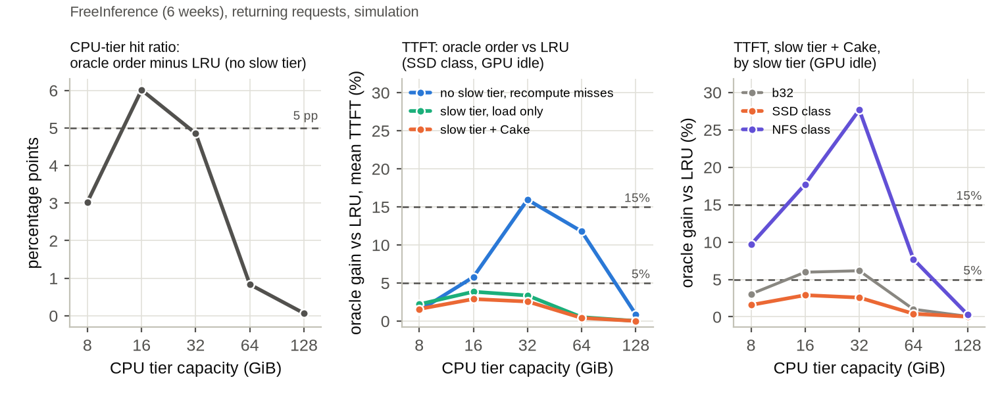
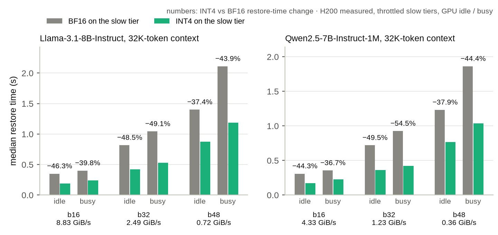

# 預知值多少，要看 trace：在 Cake 之上量分層 KV 還原的預知上界（H200 上的極限研究）

*Foresight Depends on the Trace: Oracle Bounds for Tiered KV-Cache Restore on Top of Cake, Measured on H200*（英文暫定題）

> v3（2026-10-30）。標記：〔實測〕＝在 H200 上量的；〔模擬〕＝trace 模擬；〔判讀〕＝作者的解讀。方括號裡的代號是 [`EVIDENCE.md`](EVIDENCE.md) 的列號。〔待決〕＝這句的寫法等「待你決定」的選擇。

## 一頁看懂

1. **問題**：多輪對話與 agent 讓同一個 session 隔一段時間又回來。兩次請求之間，它的 KV cache 停在 CPU 記憶體或更慢的層；請求回來時，KV 要先還原到 GPU，還原時間算進 TTFT。一段 32K 的 context 有 64 塊 KV [§0]。
2. **提問**：近期系統假設「預測誰回來、何時回來」能縮短還原。但 Cake 不用預測就能還原（GPU 重算前段，同時載入後段）：在 32K 單次還原的微基準裡，限速慢層上的 INT4 KV 用 Cake 比全部載入快 11.0–67.2% [A5]。在 Cake 之上，完美的預知還值多少？
3. **方法**：在一張 H200 上做極限研究，用三條真實 trace（Mooncake 的聊天與工具 trace、FreeInference 的 agent 服務 trace）。oracle 完美預知一件事，和做同樣動作、但不預知的最好對手比 TTFT；上界 ≥15% 才算值得做，門檻事先登記。回來時的結果是 trace 模擬，用 1/8 的 GPU 縮小重播檢查：TTFT 不含排隊時，實測÷模擬＝0.911–0.987 [B6]。
4. **寫入時的預知：不值得**。寫入時就決定 KV 放哪一層，16 個 GPU 量測列沒有一列過門檻 [A2]。
5. **回來時的預知：看 trace**〔模擬〕。FreeInference 前 6 週上，四種回來時 oracle 在測過的每個 CPU 容量都快不到 15%；知道誰不回來的上界用的是另一週 2026-07-26～08-01、CPU 128–1,024 GiB，≤2.44%。Mooncake 上，扣掉 trace 太短造成的收益、並排除寫入跟不上的組合後，48 個設定 × 4 種預知的 192 個組合裡仍有 36 個 ≥15% [B3-T5、B9]〔待決〕。
6. **還原時的預知：不需要**。每一層一條固定的還原規則就夠；重算變快後，24 個設定裡沒有一個翻轉 [A5]。
7. **不用預知、而且有效的**：把位元組變小。INT4 讓限速模擬的慢層還原快 36.7–54.5% [D2]；MPS 的 SM 預留只是拿背景吞吐換前景延遲 [S2]。
8. **預知何時值得**：在 Mooncake 這類 trace 上做預取與淘汰順序。預取有免費的打字提示可用（使用者開始打字就預取）：在 1/8 的 GPU 縮小重播（SSD 級）上拿到 oracle 預取改善的 0.81／0.79，提前量是用打字速度模型合成的 [C2-GPU]〔待決〕；淘汰順序還沒有測過的免費訊號 [B1-ORD]。

**圖 1　同樣的 oracle，在 Mooncake conversation 的代表格上越過 15%，在 FreeInference（CPU 128–1,024 GiB）上全部低於 5%。** 〔模擬〕上圖：SSD 級、GPU 閒；灰色長條是「知道誰不回來」在 conversation 24 格裡的最大值（b48、GPU 閒、CPU 128 GiB）。下圖的四種上界用 FreeInference 前 6 週；X5 那根（2.44%）用的是另一週 2026-07-26～08-01，不是同一份資料。圖內代號：O-PF＝預取、O-ORD＝淘汰順序、O-DROP／O-NOW＝回合結束就丟／輪到淘汰時丟、X5＝知道誰不回來、◇ STAIR（T3）＝更強的還原規劃器（§6）、「T1 constants」＝CPU 層與 GPU 重算在 H200 上量，SSD／NFS 級是限速模擬、常數沿用先前在 MI300X 上的量測 [§0]。

> **待你決定**（數字都已核對；內文照「建議」寫，受影響的句子標〔待決〕）
> 1. **故事框架**：建議 (A)「預知值多少要看 trace」，內文照此寫；(B) 收窄到 FreeInference＋聊天的預取，Mooncake 的淘汰順序列為未解的例外。注意：X1／X5 的原登記規定總結以只用 Mooncake 的版本為準，(A) 以 FreeInference 為故事的一半，已列在偏離表（§3.4）。
> 2. **FreeInference 那句的範圍**（§5.1）：建議「前 6 週上，回來時的四種上界在 CPU 16–1,024 GiB 都 <15%；知道誰不回來只在另一週 2026-07-26～08-01 量過 128–1,024 GiB」，不寫「agent trace」泛稱。
> 3. **打字提示的數字**（§5.3）：建議主引 GPU 縮小重播的 0.81／0.79，全尺寸模擬的中位數當輔助，並限定「只對預取」。
> 4. **提前量的 trace**（§5.3）：建議只引 Mooncake conversation 的 62.2–72.0%，不引論文以外的 trace。
> 5. **知道誰不回來的條件**（§7）：建議「11 格裡 10 格在 CPU ≤256 GiB、全部在 b32／b48，兩條 Mooncake trace 都有」。
> 6. **更強規劃器的例外**（§6）：建議「SSD 級 ≥99.4% 的回來請求不比 Cake 慢」，不寫「處處不慢」。
> 7. **MPS 與 INT4 的措辭**（§8）：MPS 曲線標〔模擬〕並附 GPU 反例，圖 9 改用 H200 常數的版本；INT4 品質主引 32K 192 題，Qwen 忙時沒過的讀法寫進限制。
> 8. **其他四個還原機制**（§8.3）：建議只留一句（3 個沒過、1 個過），細節留給下一篇。
> 9. **AI 揭露**（§3.5）：「作者人工檢查了 oracle、模擬器、量化與計時程式」這句，要你確認真的做過才留。
> 10. **投稿類型**：建議投 EERCS（Empirical）：本文的貢獻是量測地圖與負面結果，不是新系統；Regular 也可，但較看重新設計。
> 11. **頁數**：英文版 10 頁放不下 9 張圖時，建議依序：圖 6（命中率橋接）移到 artifact；圖 4（模擬驗證）縮成表 2 的一列；圖 3（方法流程）併進圖 2。

## 摘要

多輪對話與 agent 讓 KV cache 在兩次請求之間停在 CPU 記憶體或更慢的儲存層；請求回來時，還原 KV 的時間算進 TTFT。近期的 KV 管理系統假設預測能縮短這段時間：知道誰會回來、何時回來，就能先預取、先淘汰、先丟掉。但 Cake 不用預測就能還原：GPU 重算前段，同時從儲存層載入後段。本文量的是：在 Cake 之上，完美的預知還值多少。我們在一張 H200 上做極限研究：在三條真實 trace 上，讓完美預知的 oracle 和做同樣動作的最好不預知策略比 TTFT，門檻事先登記；回來時的結果是 trace 模擬，經 1/8 的 GPU 重播檢查，TTFT 不含排隊。第一，寫入時就決定 KV 放哪一層，16 個 GPU 量測列沒有一列過門檻。第二，回來時的預知要看 trace：FreeInference 前 6 週上，四種回來時 oracle 在測過的設定裡都快不到 15%；Mooncake 上扣掉 trace 太短造成的收益、並排除寫入跟不上的組合後，48 個設定 × 4 種預知的 192 個組合裡仍有 36 個快 15% 以上。第三，還原時每層一條固定規則就夠，重算變快後 24 個設定沒有一個翻轉。不用預知就有效的是把位元組變小：INT4 讓限速慢層的還原快 36.7–54.5%。所以設計者該先在自己的 trace 上量 oracle 上界，再決定要不要蓋回來時的預測器；寫入端與還原端維持簡單即可。

## 名詞表

| 名詞 | 意思 |
|:--|:--|
| 回來請求 | 同一個 session 的下一個請求；它要先把之前的 KV 還原到 GPU，才能算新的 token |
| Cake | 不用預測的還原方式：GPU 從第一塊往後重算，同時從儲存層從最後一塊往前載入，兩邊相遇就完成 |
| CPU 層、慢層 | KV 停放的地方。CPU 層是主機記憶體；慢層有 SSD 級、NFS 級與 b16／b32／b48，都是限速模擬，不是真的裝置 |
| 格 | 一組模擬設定：trace、慢層、GPU 閒或忙、CPU 容量、上界的種類 |
| oracle | 和對手做同樣的事，只多知道未來的某一件事；它的成績是「預測這件事」的上界 |
| 最好的對手 | 能做和 oracle 一樣的動作、但不看未來的策略裡，最快的一個（例如 LRU、S3-FIFO） |
| 上界 | oracle 比最好的對手少花的 TTFT 比例（公式見 §3.3）；≥15% 算值得做，<5% 算死路 |
| 預取的上界 | oracle 知道 session 何時回來，回來前先把它的 KV 從慢層搬進 CPU 層 |
| 淘汰順序的上界 | CPU 層滿時，oracle 先把最晚回來的 session 降到慢層（Belady 式） |
| 丟棄的上界 | oracle 知道哪個 session 不再回來，在回合結束時或輪到淘汰它時直接丟掉 |
| 知道誰不回來的上界 | oracle 知道每個 session 何時（會不會）回來，替它選去處：CPU BF16、CPU INT4、慢層或丟掉；對手是最好的固定規則 |
| 打字提示預取 | 從使用者開始打字起就預取；不用預測，但提前量是用打字速度模型算出來的 |

| 符號（§3.3） | 意思 |
|:--|:--|
| $f(i)$ | 在 GPU 上重算第 $i$ 塊的時間；位置越後越貴，GPU 忙時乘上量到的倍數 |
| $\ell(i)$、$d$ | 載入第 $i$ 塊的時間；$d$ 是一塊 INT4 的反量化時間 |
| $L$、$m$、$n_r$ | 有存的前綴塊數；Cake 的會合點；請求 $r$ 的總塊數 |
| $T(\pi)$ | 策略 $\pi$ 下，回來請求的平均 TTFT |
| $\text{next}(s)$ | 目前之後，第一個讀到 session $s$ 的請求；不再有人讀時為 $\infty$ |
| $h_c$ | 元件 $c$ 的上界 |
| $\delta^*$、$\varepsilon$ | GPU 量時間的門檻；品質的門檻 |
| $\rho_w$ | 慢層的寫入負載；$\ge 1$ 叫「寫入飽和」 |
| $L_r$ | 打字提示的提前量 |

## 1 引言：在 Cake 之上，預知值多少要看 trace

**在 Cake 之上，回來時的完美預知在 FreeInference 上（CPU ≥128 GiB 時）幾乎沒有空間，在 Mooncake 上仍有一部分設定 ≥15%；寫入時與還原時的預知則都不需要。**〔待決〕

多輪對話與 agent 讓同一個 session 隔一段時間又回來。GPU 放不下所有 session 的 KV，服務端把它們停在 CPU 記憶體或更慢的儲存層。請求回來時，KV 要先回到 GPU，新的 token 才能開始算，所以還原時間直接算進 TTFT。

近期系統把預測加進 KV 管理並報告大的收益：PBKV、SAGA、CacheScout、CacheWise、Continuum、KVFlow 預測下一步呼叫、回來時間或存活時間〔依摘要〕。Liu 等人在真實的 FreeInference trace 上發現，淘汰策略的命中率離 Belady 還遠。這些工作背後的假設是：知道得越多，TTFT 越短；而它們比較的底多半是「沒命中就重算」（§10）。

miss 的代價已經變了。Cake 不用預測就能還原：GPU 從前段重算，同時從儲存層載入後段，兩邊相遇就結束。miss 變便宜，預知的價值也可能跟著變小。所以我們問三個問題：

- **RQ1**：在 Cake 之上，寫入時、回來時、還原時的預知，上界各是多少？
- **RQ2**：上界高的地方，免費的訊號拿得到多少？
- **RQ3**：不用預知的話，什麼值得做？

我們做的是極限研究（limit study）：讓 oracle 完美預知一件事，看它最多能比不預知的最好對手省多少 TTFT。上界低的地方，預測同一件事的預測器就不必蓋。

**貢獻**：
1. **極限研究**：在 Cake 之上，用三條真實 trace、同動作的最好對手與事先登記的門檻，量三種預知的上界；模擬經縮小的 GPU 重播檢查（§3）。
2. **回來時預知的地圖**：FreeInference 上低、Mooncake 上有一部分高；預取有免費訊號可用，淘汰順序沒有（§5、§7）。
3. **兩個負面結果**：寫入時依位置放置，在 GPU 上量不到收益；還原方式用每層固定規則就夠（§4、§6）。
4. **不用預知的收益**：INT4 與 MPS 在 H200 上值多少（§8）。

## 2 背景與系統模型：還原時間就在 TTFT 裡

**請求回來時，KV 從 CPU 層或慢層還原到 GPU；預知只能在三個時刻改變這段時間（圖 2、表 1）。**

- **KV 停在哪**：每個回合結束，session 的 KV 以 BF16 寫進 CPU 層。CPU 層滿了，就挑一個 session 以 INT4 降到慢層，或直接丟掉，回來時再重算。KV 以 512 token 為一塊 [§0]。
- **怎麼還原**：全部載入、全部重算，或 Cake 兩邊同時做、在中間會合。慢層越慢，會合點越靠後；b16／b32／b48 就是讓會合點落在第 16／32／48 塊的頻寬 [§0]。
- **三條 trace**：Mooncake conversation（聊天）、Mooncake toolagent（工具與 agent）、FreeInference 前 6 週（真實的 agent 服務；知道誰不回來的上界另用 2026-07-26～08-01 一週）。規模見表 2。

**表 1　三種預知**

| 預知 | 決定的時刻 | oracle 事先知道 | 不預知的對照 | 節 |
|:--|:--|:--|:--|:--|
| 寫入時 | 回合結束、寫出 KV 時 | 之後有沒有請求讀每一塊 | 延後到 CPU 層滿了才決定 | §4 |
| 回來時 | 兩次請求之間 | 誰回來、何時回來 | 同動作的最好對手；打字提示 | §5 |
| 還原時 | 請求到達 | 每種還原方式的實際成本 | 每層一條固定規則 | §6 |

**圖 2　還原時間在 TTFT 裡，三種預知各自只能縮短其中一段。** 長條長度是示意。(b) 的底是 GPU 上量到的每層最佳規則：CPU 層的 INT4 全部載入、BF16 在 GPU 忙時用 Cake；慢層用 Cake [A5]。模擬器則把 Cake 用在整個存起來的前綴（§9）。MPS 的端到端結果是模擬，只有微基準在 GPU 上量。

## 3 方法：用 oracle 量上界

**我們量「完美預測器最多能省多少」：門檻在看數字前登記，模擬用縮小的 GPU 重播檢查。**

### 3.1 比什麼

每個問題都在同一條 trace 上比四種做法：底（Cake）、最好的對手、免費訊號、oracle。對手只在同動作的策略裡挑：淘汰順序的對手有 LRU、LRU2、ARC、S3-FIFO、GDSF、PENS；預取的對手只有 LRU 與 LRU+RPF（預取最近用過的 session）[§0]。判定字只有三個：值得做、可能、死路（定義見 §3.3）。

我們用自己的 harness（量載入、重算與 Cake 的程式），而不是 vLLM、LMCache 或 SGLang，因為要能分開控制載入、重算與 Cake 的會合點。harness 的重算比 vLLM 慢（主結果用的 sdpa 1.75／1.76 倍，fa3 1.30／1.32 倍）；把模擬裡的重算加速到 vLLM 級，判定字不變 [E2、B7]。

**表 2　設定（只用 H200）**

| 項目 | 值 | 證據 |
|:--|:--|:--|
| 平台 | 一張 NVIDIA H200（143,771 MiB，PCIe Gen5 x16），不做 TP；vLLM 0.28.0、torch 2.13.0+cu130 | §0 |
| 模型 | Llama-3.1-8B-Instruct、Qwen2.5-7B-Instruct-1M | §0 |
| 重算 | harness 的 attention 用 PyTorch sdpa 量 $f(i)$（主結果）；FlashAttention-3（fa3）與 vLLM 級當敏感度 | B7、E1、E2 |
| 精度 | BF16；慢層存 INT4（KIVI 式，每塊 20,971,520 B） | D1 |
| 共用前綴 | 同一塊只存一份（refcount），和 vLLM、SGLang 的前綴快取一樣 | 模擬器登記 |
| 批次 | 模擬與重播一次處理一個請求，不做 batching | B6 |
| CPU 層〔H200 實測〕 | 讀 43.5888、寫 41.1687 GiB/s（量到最慢一次 ×0.9） | §0 |
| SSD 級／NFS 級〔限速模擬〕 | 讀 6.981／0.331、寫 1.911／0.601 GiB/s；常數沿用先前在 MI300X 上的量測 | §0 |
| b16／b32／b48〔限速模擬〕 | Llama 8.83／2.49／0.722 GiB/s | §0 |
| Mooncake conversation | 12,031 請求，回來的 3,511／2,357（兩種 session 規則） | §0 |
| Mooncake toolagent | 23,608 請求，回來的 7,132／2,378 | §0 |
| FreeInference 前 6 週 | 129,717 請求，回來的 128,072；2026-05-17～06-27 | §0 |
| FreeInference 另一週（只用於知道誰不回來） | 84,524 請求，回來的 83,326；2026-07-26～08-01 | B3-X5 |
| 門檻 | 上界 ≥15%（≥2 種 CPU 容量）值得做、全部 <5% 死路；GPU 時間 $\delta^*$；品質 $\varepsilon$ | §0 |

Mooncake 的兩條 trace 引用 FAST'25；FreeInference 以 CC-BY-4.0 釋出，照資料卡引用 Nixon et al.（*From Requests to Sessions*，2026）。FreeInference 的 block 是 16 token：我們把連續 32 塊併成一塊 512 token，以最後一塊的 id 當鍵，並用 token 數驗算 block 數；Mooncake 只存完整的 block。兩個 tokenizer 的 512 token 直接當成一樣長，這是近似（§9）。

**圖 3　判定是機械的：oracle 對最好對手的上界，對照事先登記的門檻。** 長條是示意；判定是分組的（同一組 ≥2 種 CPU 容量 ≥15% 才算值得做，§3.3），圖中的「有看頭」就是值得做。GPU 框裡的 MPS 只有微基準是實測，端到端是模擬；重播檢查只涵蓋 conversation、SSD 級、Llama，TTFT 不含排隊。

### 3.2 模擬的排序與正負號在 GPU 上站得住

我們把 Mooncake conversation 依 session 抽 1/8，在 H200 上用真的搬運與重算重播 12 個乾淨的 run（SSD 級、Llama、CPU 16／32 GiB）[B6]：

- 實測÷模擬＝0.911–0.987，10 格全在 ±10% 內。
- 模擬差 ≥5% 的 15 對策略，排序全同；8 個上界的正負號全同。
- 重播一次只送一個請求，TTFT 不含排隊；含排隊時上界變小（§9）。

**圖 4　模擬比實測略慢，但都在 ±10% 內，排序與正負號一致；判定需要的就是這兩樣。** 〔實測〕÷〔模擬〕，TTFT 不含排隊；灰色空心是舊 CPU 常數的重播。

### 3.3 定義與公式

**上界的意思**：oracle 是同一個策略，只多了「某一個未來量」的完美資訊。所以它界住的是「把這個量的預測器放進同一個策略」最多能省多少，不是所有可能策略的極限。它也不是嚴格的上界：NFS 級有 4 格打字提示預取比 oracle 預取還快 [C2]；FreeInference 小 CPU 時，有 53 列 oracle 比某個對手慢 [B3-T5]。

一塊的載入時間（$b$＝一塊的位元組，$B$＝那一層的讀取頻寬；讀 INT4 時加上反量化 $d$；那一層正在寫入時，讀取再乘量到的 $k_{\text{read}}$）：

$$\ell_{\text{BF16}}=\frac{b_{\text{BF16}}}{B_{\text{CPU}}},\qquad \ell_{\text{INT4}}=\frac{b_{\text{INT4}}}{B_{\text{層}}}+d \tag{1}$$

Cake：前綴 $[0,L)$ 有存。GPU 從第 0 塊往後重算，I/O 從第 $L-1$ 塊往前載入；每一步讓落後的一邊前進一塊，兩邊在第 $m$ 塊相遇（載入那一邊含 I/O 線上的排隊；預取中的塊要等預取讀完）：

$$T_{\text{restore}}=\max\Big(\sum_{i=0}^{m-1} f(i),\ \sum_{i=m}^{L-1}\ell(i)\Big) \tag{2}$$

TTFT 是還原，加上重算沒存的塊與這一輪的新 token；指標是回來請求 $\mathcal{R}$ 的平均：

$$\text{TTFT}_r=T_{\text{restore}}+\sum_{i=L}^{n_r-1} f(i),\qquad T(\pi)=\frac{1}{|\mathcal{R}|}\sum_{r\in\mathcal{R}}\text{TTFT}_r(\pi) \tag{3}$$

回來時 oracle 從 trace 讀 $\text{next}(s)$：淘汰順序與丟棄看 session 獨有的第一塊，預取看最後一塊；每個 oracle 只改一個決定，其他照基本機制（LRU 順序、CPU 層滿了就降級）：

- **淘汰順序**：CPU 層滿時降級 $\arg\max_s \text{next}(s)$（Belady），或 $\arg\max_s (\text{next}(s)-r_{\text{now}})\cdot\text{bytes}(s)$（Belady-Size；$r_{\text{now}}$＝目前的請求，$\text{bytes}(s)$＝降級 $s$ 能空出的位元組），每格取較快的一個。
- **丟棄**：回合結束時 $\text{next}(s)=\infty$ 就丟；或輪到淘汰它時，$\text{next}(s)=\infty$ 就丟、否則降級。截尾 $H$ 時，離 trace 結尾不到 $H$ 秒的決定一律當「會回來」。
- **預取**：降級時記下下一個讀它的請求（看最後一塊）；慢層讀取線空著時，先預取最早有人讀的 session，只搬 Cake 會用載入的後段，以 INT4 放進 CPU 層；騰空間時只准降級 $\text{next}$ 更晚的 session。

上界與判定（$\mathcal{S}_c$＝元件 $c$ 的同動作對手集合，$\mathcal{O}_c$＝它的 oracle 族；Mooncake 每格取兩種 session 重建規則的較小值）：

$$h_c=\frac{T_{\text{rival}}-T_{\text{oracle}}}{T_{\text{rival}}},\qquad T_{\text{rival}}=\min_{\pi\in\mathcal{S}_c}T(\pi),\qquad T_{\text{oracle}}=\min_{\pi\in\mathcal{O}_c}T(\pi) \tag{4}$$

- **值得做**：某個元件 $c$，在同一組（trace、慢層、GPU 狀態）、Cake 下，有 ≥2 種 CPU 容量 $h_c\ge 15\%$。**死路**：所有格（含全部載入）$h_c<5\%$。其他是**可能**。
- 知道誰不回來的上界另有登記：對手是最好的固定去處規則，任一主格 ≥15% 就算值得做。

打字提示的提前量（$\Delta_r$＝這一輪新輸入的 token 數，$c_{\text{tok}}$＝每 token 字元數；分母是桌機打字的每秒字元數；$\text{think}_r$＝兩請求的間隔扣掉上一輪估計的生成時間，TPOT 取 50 ms）：

$$L_r=\min\Big(\frac{\max(\Delta_r-10,\,0)\cdot c_{\text{tok}}}{51.56\times 5/60},\ \text{think}_r\Big) \tag{5}$$

GPU 時間與品質的門檻（雜訊的量法依實驗登記；MPS 與 §8.3 的機制實驗用 2σ）：

$$\delta^*=\max(5\%,\ \text{雜訊}),\qquad \varepsilon:\ \text{品質差的 95\% CI 下界}\ge -2\ \text{pp},\qquad \rho_w=\frac{\text{慢層寫入的忙碌時間}}{\text{trace 長度}} \tag{6}$$

判「有改進」的條件依實驗登記：寫入時的 GPU 實驗只看中位數差 $>\delta^*$；INT4 速度與用 2σ 的實驗另要求配對差的 bootstrap 95% CI 不含 0。FreeInference 的 $\rho_w$ 取各週的最大值。$\rho_w\ge 1$ 的格標「寫入飽和」：模擬器讓還沒寫完的資料就能讀，所以這些格偏樂觀。

### 3.4 事先登記與量測防護

每個判準在看到數字之前寫進登記檔並 commit；5% 與 15% 沿用研究計畫一開始就定好的停損規則。沒過門檻的檢驗也照列（§4、§6、§8）。模擬是確定性的，每格跑一次；FreeInference 每週各自重播，平均 TTFT 是各週的總和相加後再除以總個數。這是共用叢集：每個量時間的 run 都有 GPU 監看，同一張卡出現外來 process 就作廢重量 [R-T1G、E4]。

**與登記的偏離**（會碰到報告數字的；完整清單在匿名 artifact，審查期間不附連結）：

| 偏離 | 影響 | 出處 |
|:--|:--|:--|
| FreeInference 是 X1／X5 登記之後、看結果之前才加的；原登記規定判定列兩版，總結以只用 Mooncake 的版本為準。本文把它當故事的一半；H200 上的重跑與小 CPU 擴充另有事先登記 | Mooncake 版的判定不變；FreeInference 的結論屬於偏離 | X1 登記 §2.9、P1-2、T5 |
| 截尾 $H$ 是登記之後才加的穩健性檢查，不改原判定；本文改用截尾並排除飽和的計數當 Mooncake 的頭條 | 頭條比原登記保守 | X1 登記 §4.7、B2、B9 |
| 換成 H200 的 CPU 層常數後，排隊模擬的一項自我驗證不適用（參考值是舊常數算的），不再當停止條件 | 排隊的數字照登記算 | T1 偏離 1 |
| 更強規劃器的只報告比值，第一次算錯了子集（含全部還原），改成只算回來請求後重跑；改正前沒看過任何判定 | 判準不變 | T3 偏離 1 |
| 命中率橋接的自我測試第一次因欄位撞名當掉，還沒算出任何數字；修正後照登記跑 | 無 | T4 結果 |
| MPS 的 GPU 檢查因時限拆成兩個 job；15 個 run 都在同一張卡 | 無 | E2E GPU 偏離 1 |
| 同節點別人 job 的開始與結束：照登記用全部單位判定，另報拿掉後的結果 | 判定字不變 | T1G 附加 1 |
| Llama INT4 的寫入時精度檢定走對照路徑，不是 H200 的登記路徑 | 只當補充 | A4' |

### 3.5 AI 使用揭露

harness、模擬器、在叢集上執行實驗與分析腳本，由 AI coding agent（Claude Code，模型 Claude Opus 5.5）撰寫並執行。研究問題、事先登記的門檻、每個 go／no-go 決定與解讀由作者負責。每個數字都對應一條指令與一個輸出檔；判準先登記；模擬經 GPU 重播檢查（§3.2）。〔待決：作者人工檢查核心程式那一句〕

## 4 寫入時的預知：GPU 上量不到收益〔實測〕

**寫入時就依位置決定 KV 放哪層，對 TTFT 沒有可量到的收益；依位置決定精度，在同樣位元組下也沒有穩定的品質收益（表 3）。**

**表 3　寫入時預知的 GPU 實測**

| 檢驗 | 結果 | 判定 | 證據 |
|:--|:--|:--|:--|
| 依位置放層級，對延後決定（重算用 fa3） | TTFT 差 −0.37～+0.01%，門檻 5%，每點 6 次重複 | 量不到 | A1'' |
| 同上（重算用 sdpa） | −0.02～+1.16% | 量不到 | A1' |
| 寫入時決定，同時贏兩個對手各 ≥5% | 16 個 GPU 列 0 列過 | 量不到 | A2 |
| 模擬裡存活的設定，上 GPU 確認 | 0/2 存活 | 量不到 | A3 |
| 依位置降精度（Qwen FP8，品質檢定） | 前段品質好 17.3 pp，但慢 8.0%；中、後段品質較差 | 沒有穩定差距 | A4 |
| 同上（Llama INT4） | −0.47～+0.08 pp，6 個 CI 都含 0 | 沒有穩定差距 | A4' |

〔判讀〕Cake 從前段重算，還原時大多不讀前段，所以前段放哪層、存什麼精度影響不大。前段降精度的品質反而好，也是因為還原時沒讀那一段 [A4]。寫入准入對 SSD 寫入量與壽命的好處（SARIA、Gandalf）不在本文的量測範圍。

**含意**：寫入端可以保持簡單：回合結束就寫進 CPU 層，滿了再決定。

## 5 回來時的預知：上界要看 trace〔模擬〕

**FreeInference 前 6 週上，四種回來時 oracle 在測過的每個 CPU 容量都快不到 15%；Mooncake 上，截尾並排除寫入飽和後，192 格裡仍有 36 格 ≥15%。**

### 5.1 FreeInference：容量夠，上界就低

**前 6 週、CPU ≥128 GiB 時，四種上界都 ≤0.30%；CPU 縮到 16–64 GiB，也沒有一格 ≥15%（表 4、圖 5）。知道誰不回來的上界用的是另一週 2026-07-26～08-01，CPU 128–1,024 GiB 時 ≤2.44%。**〔待決〕

**表 4　FreeInference 的上界（前 6 週，最後一列除外；Cake；每格取慢層 × GPU 閒／忙的最大值）**

| 上界 | CPU 16–64 GiB | CPU 128–1,024 GiB | 證據 |
|:--|:--|:--|:--|
| 預取 | ≤4.89% | 0.22% | B3-T5；圖 1 sidecar |
| 淘汰順序 | ≤11.81%（≥5% 只在 NFS 級、16–32 GiB） | 0.30% | B3-T5、B3-X1 |
| 丟棄（兩種） | ≤0.65% | 0.17% | B3-T5；圖 1 sidecar |
| 判定（四種上界） | 可能（4 格 ≥5%、0 格 ≥15%） | 死路 | B3-T5、B3-X1 |
| 知道誰不回來（另一週 2026-07-26～08-01，不同資料） | 沒量 | 2.44%（死路） | B3-X5 |

只算使用者發起的回來請求，四種回來時上界仍都 <5%（最大 3.92%）[B3-T5]。

**為什麼低**：CPU 128 GiB 時，CPU 層的命中率已經是 99.29% [B3-T4]。容量夠，本來就沒有差距可以補。

**小 CPU 時**：那 4 格 5–12% 全是淘汰順序＋NFS 級，最好的對手是 S3-FIFO [B3-T5]。對手換成 LRU，同樣的格看起來有 17.7–29.2% [B3-T4]；多出來的部分來自 LRU 太弱。預取的 oracle 在 16 GiB 甚至比對手慢〔判讀：它只預知回來時間，騰空間時照 LRU〕。

**圖 5　FreeInference 上，淘汰順序與預取的上界在 CPU 16–1,024 GiB 每一點都低於 15%。** 〔模擬〕實線對最好的對手；空心圈對 LRU，只在 16–64 GiB 高於實線。圖內「T1 constants」的意思同圖 1。

**和 Liu 等人對照**：同一段 FreeInference 上，命中率差距與「沒命中就重算」的 TTFT 差距，各自在小容量出現過，但沒有一個容量兩者同時越過登記的門檻（5 pp 與 15%）[B3-T4]。這不是 Liu 等人的重現：block 粒度、併發與 oracle 都不同。

**圖 6　命中率差距（左）與重算時的 TTFT 差距（中）沒有在同一個容量同時越線。** 〔模擬〕右圖是有慢層＋Cake 時 oracle 對 LRU 的值；NFS 級的高點換成最好的對手後只剩 5.6–11.8%（圖 5）。

### 5.2 Mooncake：截尾後仍有 36 格 ≥15%

**Mooncake 的兩條 trace 上，截尾並排除寫入飽和後，192 格裡仍有 36 格 ≥15%，CPU 到 512 GiB 都有（表 5）。**

**表 5　Mooncake 的上界 ≥15% 的格數（Cake；每個容量 48 格）〔模擬〕**

| | CPU 128 | 256 | 512 | 1,024 GiB | 合計 |
|:--|--:|--:|--:|--:|--:|
| 截尾 $H$＝3,600 s，並排除寫入飽和（主結果） | 16 | 12 | 8 | 0 | 36/192 |
| 不截尾（含丟棄格與寫入飽和格，只報告） | 28 | 31 | 24 | 12 | 95/192 |

48 格＝2 條 trace × 4 種上界 × 3 種慢層 × GPU 閒／忙 [B9]。照 X1 登記，總結以較保守的截尾版為準；不截尾的計數裡有 28 格是回合結束就丟，本文把它歸因於 trace 太短 [B2]；寫入飽和的格偏樂觀（§3.3）。

- **conversation**：圖 1 上半的代表格裡，預取、淘汰順序、回合結束就丟都 ≥15%，預取最高 50.5% [B1]。預取的登記對手只有 LRU 與 LRU+RPF；換成集合外較快的 LRU2，是 45.3% [B1-R]。
- **toolagent**：96 格裡 40 格 ≥15%；截尾並排除寫入飽和後仍 12 格 [B8]。
- **丟棄的上界大半來自 trace 太短**：回合結束就丟的上界最大 47.4%（Cake），截尾 $H$＝3,600 s 後是 0.0% [B2]。預取與淘汰順序的上界不受截尾影響。
- **GPU 上仍在，但比較小**：縮小重播上，預取對 LRU 是 17.9%，同設定的模擬是 24.2% [B6]。toolagent 與知道誰不回來沒有 GPU 重播。

### 5.3 打字提示：拿到預取的大部分

**免費的打字提示拿到預取上界的大部分；淘汰順序還沒有測過任何免費訊號（表 6、圖 7）。**

提前量是合成的：Mooncake 沒有按鍵時間，我們用公式 (5) 和桌機打字速度 51.56 WPM（Dhakal et al.）算 [§0]。這個提前量在 conversation、NFS 級上能藏住 62.2–72.0% 的慢層還原時間 [C1]〔待決〕。

**表 6　打字提示預取拿到 oracle 預取改善的比例（Mooncake conversation；提前量是合成的）**〔待決〕

| 設定 | 比例 | 標記 | 證據 |
|:--|--:|:--|:--|
| 全尺寸模擬，SSD 級（中位） | 0.933 | 〔模擬〕 | C2 |
| 全尺寸模擬，b32（中位） | 0.941 | 〔模擬〕 | C2 |
| 全尺寸模擬，NFS 級（中位） | 1.118 | 〔模擬〕 | C2 |
| 全尺寸模擬，24 格的最小 | 0.814 | 〔模擬〕 | C2 |
| GPU 縮小重播，CPU 16／32 GiB | 0.81／0.79 | 〔實測〕 | C2-GPU |

- GPU 上，oracle 預取只比打字提示快 4.0／3.8%，不到 5%，不判 [C2-GPU]。
- 比例 >1 的 4 格全在 NFS 級：oracle 預取騰空間時照 LRU，所以不是嚴格上界；NFS 級多數格也寫入飽和，這 4 格是較弱的證據 [C2、R-T3]。
- **淘汰順序沒有免費訊號**：打字提示只和預取比過。淘汰順序在 conversation 代表格的上界是 27.6／31.0%，沒有任何免費訊號和它比過 [B1-ORD]。

**圖 7　打字提示拿到 oracle 預取改善的大部分：模擬點貼著 y＝x，GPU 實測是 0.81／0.79。** 〔模擬〕＋〔實測〕；y＝x 以上的格全在 NFS 級。

**含意**：FreeInference 這類 trace 上，不必蓋回來時的預測器。Mooncake 這類 trace 上，預取的上界在 GPU 重播上仍然存在，而打字提示已拿走大部分；淘汰順序的上界還沒有免費訊號可用。

## 6 還原時的預知：每層一條固定規則就夠〔實測〕

**每一層的最佳還原方式是固定的；依當下狀況線上挑選沒有空間，反而常選錯（表 7）。**

**表 7　還原時的預知**

| 檢驗 | 結果 | 證據 |
|:--|:--|:--|
| 重算換成更快的 fa3，最佳方式會不會變 | 24 格 0 翻轉（1 格從平手變成全部載入） | A5 |
| 慢層（b32、NFS 級）：Cake 對全部載入，32K 單次還原的微基準，不是 TTFT | 16 格全是 Cake 勝；INT4 格快 11.0–67.2%（sdpa），fa3 時 16.5–71.9% | A5 |
| 加上像真實服務的背景負載 | 最快的還原計畫和閒時相同（雜訊大的格不判） | S1 |
| 線上選擇器（CPU 層、GPU 忙） | 12 格裡 10 格比最好的慢 1.31–3.51 倍；換 seed 部分重現 | E3 |
| 更強的還原規劃器（照 CacheFlow 想法的簡化版）〔模擬〕 | 11 個判定 0 個改變；聊天的上界少 2.3–7.6 pp | R-T3 |

固定規則是：慢層一律用 Cake；CPU 層的 INT4 用全部載入，BF16 在 GPU 忙時用 Cake [A5]。更強的還原規劃器不是 CacheFlow 本身；它在 SSD 級 ≥99.4% 的回來請求不比 Cake 慢 [R-T3]〔待決〕。

**含意**：還原端用固定規則即可；線上選擇器只多了選錯的風險。

## 7 預知何時值得：一張地圖〔模擬〕

**預知值不值得，先看 trace，再看是哪一種決定（表 8）。**

**表 8　回來時預知的地圖（Cake）**

| 預知什麼 | FreeInference | Mooncake | 免費訊號 | GPU 重播 | 證據 |
|:--|:--|:--|:--|:--|:--|
| 預取 | ≤4.89% | 值得做（代表格 50.5%） | 打字提示拿到大部分 | conversation | B3-T5、B1、C2 |
| 淘汰順序 | 可能（≤11.81%） | 值得做（代表格 27.6／31.0%） | 沒測過 | conversation | B3-T5、B1-ORD |
| 丟棄不回來的 | ≤0.65% | 回合結束就丟：截尾後 0.0% | 無 | 無 | B3-T5、B2 |
| 知道誰不回來 | ≤2.44%（另一週 2026-07-26～08-01，只量 128–1,024 GiB） | 值得做（48 格裡 11 格 ≥15%；這一種的登記是任一主格 ≥15%） | 沒測過 | 無 | B3-X5、B5 |

寫入時與還原時的預知直接在 GPU 上量，不靠 trace 模擬；兩者都不值得（§4、§6）。

**不是 CPU 相對工作集的大小把兩者分開**：CPU 128 GiB 只占工作集的一小部分，FreeInference 有 2 週比 Mooncake 還吃緊 [§0]。差別出現在命中率：FreeInference 在 128 GiB 時 CPU 命中 99.29% [B3-T4]〔判讀〕；根因還沒查證。

**知道誰不回來的 11 格**：10 格在 CPU ≤256 GiB，全部在 b32／b48 慢層，conversation 與 toolagent 都有 [B5]〔待決〕。這組條件只描述這一種上界：其他上界在 SSD 級與 CPU 512／1,024 GiB 也有 ≥15% 的格 [B9]。

換更快的重算（fa3 或 vLLM 級）或更強的還原規劃器，Mooncake 的判定字都不變 [B7、R-T3]。

## 8 不用預知的做法：把位元組變小〔實測；MPS 端到端是模擬〕

**不用預知、而且有效的是 INT4：它讓限速慢層的還原快 36.7–54.5%；MPS 的 SM 預留則是延遲與背景吞吐的取捨。**

### 8.1 INT4：位元組小 3.2 倍

- INT4 讓每塊 KV 的位元組小 3.2 倍 [D1]。
- 限速慢層（b16／b32／b48 × GPU 閒／忙）12 格全部 INT4 勝：Llama 快 37.4–49.1%，Qwen 快 36.7–54.5% [D2]。
- CPU 層不會變快：Qwen 在 GPU 忙時反而慢 80.0% [D2]〔判讀：CPU 層夠快，反量化的成本蓋過省下的傳輸〕。
- 品質：32K context、4 種任務共 192 題、seed 67000，INT4 對 BF16 兩個模型都在 $\varepsilon$ 內（Qwen +0.4 pp、Llama +1.0 pp）[D2-Q]〔待決〕。
- 再壓更小不划算：低秩＋INT4 多數配置品質沒過 $\varepsilon$，在慢層也只有 6/8 格比 INT4 快 [D3、D4]。
- 不能和 §5 相加：模擬的底已經把降到慢層的 KV 存成 INT4。

**圖 8　INT4 讓每一個限速慢層的還原都變快。** 〔實測〕32K，每格 30 對的中位數；CPU 層沒有畫，因為那裡 INT4 不快。

### 8.2 MPS：延遲換背景吞吐

MPS（NVIDIA Multi-Process Service）能給還原固定的 SM 份額；我們試了 100%、87%、75%、50% 四個等級。

- **微基準**〔實測〕：有 18 格還原比 stream 共享快 ≥30%，背景吞吐保有 ≥0.91 [S1]。
- **端到端**〔模擬〕：32 格裡 24 格可判，0 格過登記門檻；不設上限時 TTFT 快 30.7–62.9%，背景吞吐最多少 6.5 pp [S2]。
- **GPU 檢查**：方向一致、大小不一致。可比的 7 格正負號全同，但 GPU 的收益比模擬大 4.6–31.3 pp [S3]〔待決〕。

**圖 9　MPS 沿一條曲線拿背景吞吐換前景 TTFT，沒有一點進入登記的通過區。** 〔模擬〕＋〔實測〕實線是登記版常數，只畫 Llama、conversation；◆＝H200 實測。

### 8.3 其他不靠預知的還原機制

我們另外檢驗了四個還原機制：漸進還原、借鄰居的算力、近似重算都沒過門檻；借鄰卡多一條還原路徑過了，但只用 2 張卡、鄰卡閒置 [G-A0、G-M08、G-M12、G-M06]〔待決〕。

## 9 限制

**本文的結論只在這個範圍內成立：一張 H200、兩個 7–8B 模型、限速模擬的慢層，以及經縮小 GPU 重播檢查、但不含排隊的模擬 TTFT。**

- **平台**：單卡 H200，不做 TP；其他 GPU、更大的模型、多卡都沒有量。
- **慢層是模擬的**：SSD 級與 NFS 級是限速層，不是真的裝置；頻寬常數沿用先前在 MI300X 上的量測。CPU 層與 GPU 重算的常數在 H200 上量 [§0]。
- **回來時的結果是模擬**：GPU 重播只驗了 conversation、SSD 級、Llama；toolagent、NFS 級與知道誰不回來沒有 GPU 驗證 [B6]。
- **TTFT 不含排隊，只報平均**：含排隊時，GPU 上預取的上界從 17.9／16.2% 降到 8.1／4.7% [B6]；不預取時，併發模擬裡 p99 TTFT 的排隊占比中位 0.983 [B4]。
- **模擬的底**：模擬器把 Cake 用在整個前綴，沒有實作 §6 的每層固定規則；影響沒有查證 [§0]。
- **單一決策 oracle**：同時預知多件事的聯合 oracle 沒有量；單一 oracle 不是嚴格上界（§3.3）。
- **打字提示是合成的**：真實按鍵時間沒有量；手機打字速度的結果沒有報 [§0]。
- **寫入飽和與截尾**：NFS 級的 Cake 格有 36/64 寫入飽和 [R-T3]；表 5 另報截尾並排除飽和後的格數。
- **trace**：FreeInference 只用前 6 週，知道誰不回來的上界另用 2026-07-26～08-01 一週，兩者不是同一份資料 [B3-X5]；Mooncake 的兩條 trace 是從一小時的線上請求抽樣的（資料 README），而且兩條有大量相同的請求，不算兩份獨立的證據。兩者為什麼不同，根因沒有查證。FreeInference 的 tokenizer 和 Llama 不同，512 token 的換算是近似。
- **重算的量測範圍**：$f(i)$ 在 H200 上只量到前 80 塊（約 40K token），之後是線性外插 [§0]。FreeInference 前 6 週有多少回來請求超過 Llama-3.1-8B 的 128K 上限，沒有算過（NOT_VERIFIED）；超過 40K 的部分，重算成本都靠外插。
- **重算速度**：harness 的重算比 vLLM 慢（sdpa 1.75 倍、fa3 1.30 倍）；vLLM 級是模擬裡的縮放，不是實測 [E1、E2、B7]。
- **INT4 品質**：Qwen 在多鍵 NIAH 上，GPU 忙的兩種讀法 −0.8 pp 沒過 $\varepsilon$ [D2-Q]。
- **量測污染**：同節點別人 job 開始或結束時的量測單位照登記保留，拿掉後判定不變 [R-T1G]；同一個 NUMA 節點上平行量時間沒有驗證 [E4]。
- **文獻**：預測系統（PBKV 等）只讀了摘要。

## 10 相關研究

**前作在「沒命中就重算」的底上報告預測的收益；本文把底換成 Cake，量預知還剩多少（表 9）。**

**表 9　定位**

| 工作 | miss 時的底 | 預知什麼 | oracle 上界 | workload | 讀到哪 |
|:--|:--|:--|:--|:--|:--|
| Liu 等人，*When Fancy Eviction Fails* | 重算 | 淘汰順序 | 有（Belady 類） | 真實，含 FreeInference | 內文 |
| *Where Should the KV Cache Live?* | 重算 | 預取 | 有 | 合成 | 內文 |
| *Ask the Tool, Don't Guess* | – | 工具回報的進度（免費訊號） | 作者稱接近 oracle | agent | 摘要 |
| PBKV、CacheScout、CacheWise、Continuum、KVFlow | 待讀內文 | 下一步呼叫、轉移、TTL | – | agent | 摘要 |
| SARIA、Gandalf | – | 寫入准入 | – | – | 摘要 |
| CachedAttention | – | 排程佇列預取（免費訊號） | 無 | 多輪對話 | 書目 |
| Cake、CacheFlow | 重算＋載入 | 不預知 | – | – | Cake 內文；CacheFlow 摘要 |
| **本文** | **Cake** | 寫入時、回來時、還原時 | 每種一個 | 真實，三條 trace | – |

- **預測型 KV 管理**：從摘要看，PBKV 等沒有一篇的對照組是分層儲存＋Cake。本文量的是換成 Cake 之後，預知還剩多少（§7）。
- **極限研究**：Liu 等人說花俏的淘汰策略贏不了 LRU，但離 Belady 遠。圖 6 和他們不衝突：沒有一個容量同時有命中率差距與 TTFT 差距。FreeInference 小容量的 NFS 格裡，S3-FIFO 的 TTFT 比 LRU 好〔判讀：指標與容量區間都不同〕。*Where Should the KV Cache Live?* 說預取 oracle 也沒用，和我們在 conversation 上的結果相反〔判讀：可能因為合成 workload 與「沒命中就重算」〕。
- **還原機制**：Cake 與 CacheFlow 回答「怎麼還原更快」；我們量的是「線上挑還原方式」值多少（§6）。
- **寫入准入**：SARIA、Gandalf 改善 SSD 寫入量與壽命；ICPE'25 *Better Memory Tiering* 主張第一次就放對（只核對書目）。我們的反向結論只限 TTFT（§4）。
- **免費訊號**：打字提示是 *Ask the Tool*（agent 端）與 CachedAttention（排程佇列）在使用者端的對應，只涵蓋預取。

## 11 結論

多輪 KV 的還原時間直接算進 TTFT，而 Cake 不用預測就能還原。我們量了在 Cake 之上，完美的預知還值多少；答案依決定的時刻與 trace 而定。寫入時與還原時的預知，在 GPU 上量不到收益：寫入端延後決定、還原端每層一條固定規則就夠。回來時的預知要看 trace：FreeInference 前 6 週上，四種回來時上界在測過的 CPU 容量都低於 15%（知道誰不回來的上界在另一週量，也低於 15%）；Mooncake 上截尾並排除寫入飽和後，192 格裡仍有 36 格達到 15%；其中預取已有免費的打字提示可用，淘汰順序還沒有。

**對設計者的建議**
- **先量上界，再蓋預測器**：在自己的 trace 上跑同樣的 oracle 對最好的對手；上界低於 5% 就不必蓋回來時的預測器，5–15% 要再量〔判讀〕。
- **寫入端與還原端保持簡單**：回合結束就寫進 CPU 層，滿了再決定；還原用每層固定規則，慢層一律 Cake。
- **先把位元組變小**：慢層的 KV 存 INT4，不需要預知；MPS 只當延遲與背景吞吐之間的旋鈕。
- **預取先用免費訊號**：打字提示已拿到預取上界的大部分；只有在淘汰順序的上界高、又沒有免費訊號時，才值得考慮專門的預測器。

**未來工作**（每項對應 §9 的一條限制，都還沒有結果）
- **真實的慢層**：在真的 NVMe SSD 與網路儲存上重量 SSD 級與 NFS 級的常數，取代限速模擬與沿用的 MI300X 常數。
- **更多 trace**：用更多真實的 agent 與聊天 trace，找出把 FreeInference 與 Mooncake 分開的 trace 特徵。
- **聯合 oracle**：同時預知預取、淘汰順序與丟棄，量單一決策 oracle 漏掉的上界。
- **淘汰順序的免費訊號**：在聊天型 trace 上找一個不需要學習的訊號，和淘汰順序的上界比。
- **端到端服務**：在有 batching 與排隊的服務系統裡量回來請求的 TTFT，並把 GPU 重播擴到 toolagent、NFS 級與知道誰不回來。
- **更大的模型與多卡**：更大的模型 KV 更大，還原在 TTFT 裡的比重可能不同；在多卡與其他 GPU 上重做。

---

## 對照表（內部用，投稿版刪除）

| 本文的名稱 | 內部代號 | EVIDENCE 列 |
|:--|:--|:--|
| 回來時的四種上界（合稱） | X1 | B1、B2、B3-X1、B3-T5、B8、B9 |
| 預取的上界 | O-PF | B1、B1-R、C2 |
| 淘汰順序的上界 | O-ORD（oracle 族：O-BEL、O-BELS） | B1-ORD、B3-T5 |
| 丟棄的上界（回合結束時／輪到淘汰時） | O-DROP／O-NOW | B2 |
| 知道誰不回來的上界 | X5（oracle 族 OA–OD，對手 R1–R6） | B3-X5、B5 |
| 打字提示預取；提前量 | HINT-PF；X3 | C1、C2、C2-GPU |
| GPU 縮小重播 | P02（T1G 重量） | B6、C2-GPU |
| 更強的還原規劃器 | STAIR（T3） | R-T3 |
| 依位置放層級；延後決定 | S5；S4+ | A1''、A1'、A2、A3 |
| 依位置降精度 | F25／M25／B25 對 R25 | A4、A4' |
| 每層固定還原規則；線上選擇器 | P0-1；G5b | A5；E3 |
| 命中率差距對 TTFT 差距 | T4（BRIDGE-NO-GAP） | B3-T4 |
| FreeInference 縮小 CPU | T5 | B3-T5 |
| 截尾 | H1800／H3600 | B2、B8、B9 |
| 兩種 session 重建規則（取小） | R1／R2（rule＝min） | §0 |
| CPU 層用 H200 常數 | T1（舊版 35.4 GiB/s 只當敏感度） | §0、R-T1 |
| 重算速度 sdpa／fa3／vLLM 級 | V0／V1／V2 | B7、E1、E2 |
| 併發與排隊 | X4 | B4 |
| INT4 對 BF16；低秩＋INT4 | E1 對 E0；`:cal`、每題 SVD | D1、D2、D2-Q；D3、D4 |
| MPS 微基準／端到端／GPU 檢查 | GB0-SHARE／E2E-C／MPS-GPU | S1、S2、S3 |
| 第三階段還原閘 | A0、M08、M12、M06 | G-A0、G-M08、G-M12、G-M06 |
| 判定字：值得做／可能／死路 | 有看頭／可能／死路 | §0 門檻 |

## 數字出處（內部用）

- 內文與表格的數字都來自 [`EVIDENCE.md`](EVIDENCE.md)；證據欄或段尾方括號是它的列號，[§0] 是設定表。版本照它的規則：模擬用 H200 的 CPU 層常數（T1），GPU 實測用 T1G／T1G-2，更強規劃器（T3）只當敏感度，只用 H200。
- 只出自圖 sidecar 的數字：表 4 的 0.22% 與 0.17%、圖 1 的 b48 那根長條（`figs/fig3_scorecard.sources.json`）；圖 8 的「每格 30 對」（`figs/fig5_int4.sources.json`）；§8.2 的 MPS 等級（`figs/fig6_mps.sources.json`）。
- §3.3 的公式照 artifact 的模擬器（`x1_sim.py` 的 `View.restore`、`Engine.select`、`dead`、預取）、打字提示（`x1_gpu.py` 的 `leads`）與登記檔寫，常數（10、51.56、5、60、50 ms）見 [§0]。FreeInference 的換算（16 token、32 塊）照 `x1_fi.py`；偏離表照各登記檔的「偏離」一節；Mooncake「一小時抽樣」與 Nixon et al. 的引用照 PREFLIGHT.md 的 [U10]、[U11]。
- 一頁看懂與表 7 的 11.0–67.2%（sdpa、INT4）與 16.5–71.9%（fa3、INT4）見 [A5]；§9 的「前 80 塊」見 [§0]「重算時間 f(i) 的量測範圍」；知道誰不回來在 FreeInference 用的週次見 [B3-X5]（差異 17）。§9 的「超過 128K」寫 NOT_VERIFIED（[§0]）；「兩條 Mooncake trace 有大量相同請求」只寫定性，出自 X5 文件 §4.1。
- 本稿沒有跑新實驗；查核是 self-review，不是 cross-model review。
