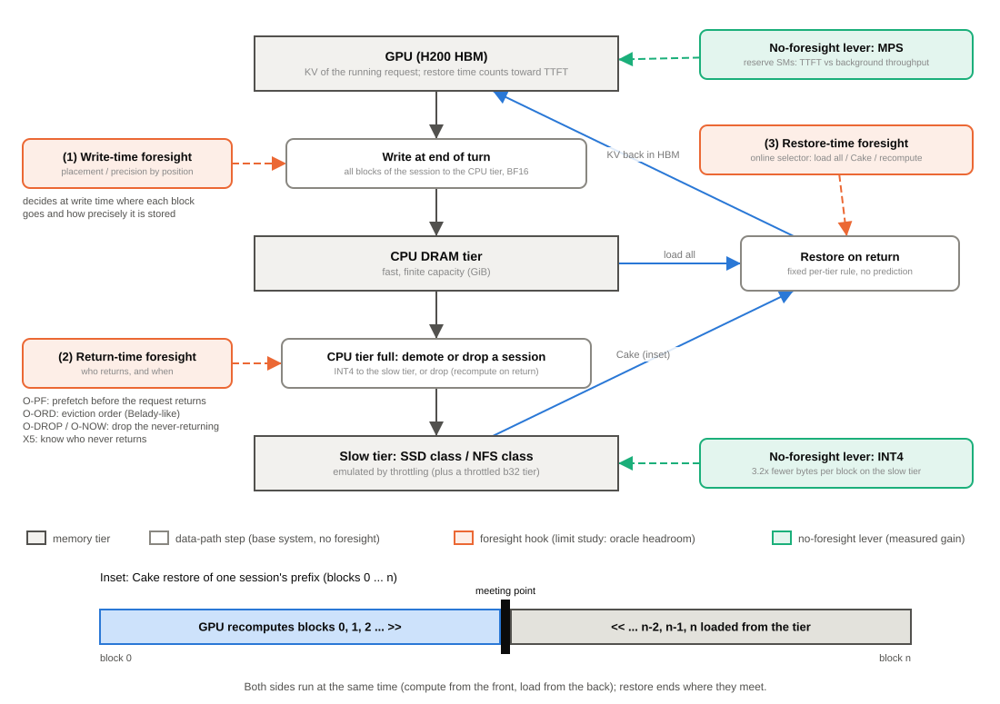
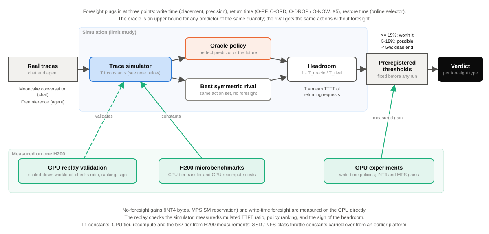

# 要不要預測？在 Cake 之上，預知對分層 KV 還原值多少——H200 上的極限研究

*To Predict or Not to Predict? Oracle Bounds for Foresight in Tiered KV-Cache Restore on H200*（英文暫定題）

> **閱讀指引**
> 1. 標記：〔實測〕＝在 H200 上量的；〔模擬〕＝trace 模擬（常數是 H200 量的）；〔算術〕＝由量測值算出；〔判讀〕＝作者的解讀，沒有直接證據。
> 2. 方括號裡的代號（如 [B1]）是 [`EVIDENCE.md`](EVIDENCE.md) 的列號，[§0] 是它的設定表；本文每個數字都從那裡抄，圖說另可引該圖的 `figs/*.sources.json`。
> 3. 版本：模擬用 T1（CPU 層＝H200 量的常數）；GPU 實測用 T1G／T1G-2；STAIR 規劃器（T3）只當敏感度。只用 H200 的數字。
> 4. ⏳待決＝數字已核對、論文措辭要使用者決定，括號裡附建議寫法；全部列在文末「待決事項」。T4、T5 都已完成並填入。
> 5. SSD 級、NFS 級是**限速模擬層**，不是真實裝置；它們的頻寬常數沿用 MI300X 量的值（使用者的選擇）。

---

## 摘要

多輪對話與 agent 讓 KV cache 在請求之間停在 CPU DRAM 或更慢的儲存層；請求回來時，還原時間直接算進 TTFT。近期系統在 KV 管理上加入預測（PBKV、CacheScout、Continuum、KVFlow 等）並報告大的收益；Liu 等人也在真實的 FreeInference trace 上發現淘汰策略的命中率離 Belady 很遠。這些結果都是在「沒命中就重算」的設定下量的（預測系統的部分依摘要判斷）。另一方面，Cake 不需要任何預測就能還原：前段在 GPU 重算、後段從儲存層載入、在中間會合。**在 Cake 加上固定的分層規則之後，預知還值多少？** 我們在一張 H200 上做 limit study：把預知分成寫入時、回來時、還原時三種，各用 oracle（完美預測器）量它對最好的不預知對手的 TTFT 上界；門檻事先登記；用兩條真實 trace（Mooncake conversation、FreeInference）；模擬器的常數在 H200 上量，並以 GPU 重播驗證（TTFT 不含排隊時實測÷模擬 0.911–0.987，排序與正負號全同）。結果：寫入時的預知在 GPU 上量不到收益（0/16 個設定過門檻）；agent trace 上，CPU 16–1,024 GiB 都沒有任何回來時的 oracle 元件達到 15%：CPU ≥128 GiB 時 ≤2.44%，因為容量夠（CPU 命中 99.29%），不是差距被吸收；CPU 更小時，好的不預知策略已經拿走大部分；chat trace 上界高（oracle 預取 50.5%），但免費的打字提示在 GPU 上拿到 oracle 改善的 0.81／0.79；還原方式用固定規則就夠，換更強的規劃器判定字也不變。不用預知的已知做法裡，INT4 讓限速慢層的還原快 36.7–54.5%（CPU 層不會），MPS 的 SM 預留則是拿背景吞吐換前景延遲的取捨。預知值 ≥15% 的區域很窄：只在 Mooncake 的兩條 trace 上、慢層慢且 CPU 容量吃緊時（⏳待決：B3 與判準的措辭）。這些上界告訴設計者哪裡不必蓋預測器。

---

## 1 引言

**傳統看法**：預測能讓分層 KV 更快。知道誰會回來就先預取，知道誰不回來就先丟，知道哪些 KV 重要就放在快的層。近期系統把這些預測做進 KV 管理（PBKV、SAGA、CacheScout、CacheWise、Continuum、KVFlow），都報告了大的收益。Liu 等人（*When Fancy Eviction Fails*）在 FreeInference 上發現，花俏的淘汰策略贏不了 LRU，但離 Belady 的命中率還很遠，好像留了空間給好的預測器。

**什麼變了**：這些收益的對照組是「沒命中就重算」（Liu 等人讀了內文；預測系統只讀了摘要，待核對）。實際的服務會把 KV 停在 CPU DRAM 或更慢的層；而 Cake 不需要任何預測就能從那裡還原。miss 的代價變了，預知的價值也可能跟著變。

**問題**：
- **RQ1**：在 Cake＋固定分層規則之上，寫入時、回來時、還原時三種預知的 oracle 上界各是多少？
- **RQ2**：上界高的地方，免費訊號拿得到多少？
- **RQ3**：預知什麼時候值得做？不用預知的話，什麼值得加？

**答案**（完整計分見 §9 表 6）：
- 寫入時：GPU 上量不到收益（§4）。
- 回來時：agent trace 在 CPU 16–1,024 GiB 都 <15%，≥128 GiB 時 <5%；chat 上界高，但打字提示拿走大部分（§5）。
- 還原時：固定規則就夠，線上選擇器常選錯（§6）。
- 值得預知的區域：慢層慢、CPU 吃緊，只在 Mooncake 兩條 trace 上觀察到（§7）。不用預知的：INT4 在限速慢層有效；MPS 是取捨（§8）。

**貢獻**：
1. 一個在 Cake 之上量預知上界的 limit study：oracle 階梯、兩條真實 trace、事先登記的門檻；模擬經 GPU 驗證，實測÷模擬 0.911–0.987（TTFT 不含排隊；含排隊時收益變小）[B6]（§3）。
2. 三種預知的上界：寫入時 GPU 0/16 [A2]；agent trace 在 CPU 16–1,024 GiB 都 <15%、≥128 GiB 時 ≤2.44% [B3-X1、B3-X5、B3-T5]；chat 的 oracle 預取 50.5% [B1]，但打字提示在 GPU 上拿到它的 0.81／0.79 [C2-GPU]（§4–§6）。
3. 一座通往 Liu 等人的橋：同一段 FreeInference 上，命中率差距與「沒命中就重算」的 TTFT 差距沒有在同一個容量同時出現（BRIDGE-NO-GAP）[B3-T4]（§5.1）。
4. 一條可證偽的條件：預知 ≥15% 的 11 格全在慢層 ≤2.49 GiB/s，其中 10 格在 CPU ≤256 GiB [B5]（§7）。
5. 兩個已知做法在 H200 上的量測：INT4 讓限速慢層還原快 36.7–54.5% [D2]；MPS 端到端 0/32 格過登記門檻 [S2]（§8）。

---

## 2 背景與系統模型

- **KV 停在哪**：每個回合結束時，整個 session 的 KV 以 BF16 寫進 CPU 層；CPU 層滿了，就挑一個 session 以 INT4 降到慢層，或丟掉（回來時重算）。block＝512 token，32K context＝64 塊；BF16 每塊 Llama 67,108,864 B、Qwen 29,360,128 B [§0]。
- **還原算進 TTFT**：請求回來時，前綴的 KV 要先回到 HBM，新的 token 才能開始 prefill。
- **三種還原方式**：全部載入、全部重算、Cake（ICML'25；GPU 從第 0 塊往後重算，I/O 從最後一塊往前載入，兩邊相遇就結束）。會合點由慢層頻寬決定；b16／b32／b48 三個限速層就是「會合點在第 16／32／48 塊」的頻寬 [§0]。
- **固定的分層規則**（本文的底）：慢層一律用 Cake；CPU 層依格式，INT4 全部載入，BF16 在 GPU 忙時用 Cake [A5]。這條規則不用任何預測。
- **三個插入點**：① 寫入時（放哪層、存什麼精度）；② 回來時（預取、淘汰順序、丟棄）；③ 還原時（挑還原方式）。§4–§6 依這個順序排。

**圖 1　還原時間在 TTFT 裡，三種預知各自只能改變其中一段。** KV 在回合結束時進 CPU 層，滿了以 INT4 降到慢層或丟掉；還原用不需預測的固定分層規則（插圖：Cake 前段重算、後段載入，在會合點相遇）。

---

## 3 方法：limit study

**oracle 階梯**。每個問題都在同一條 trace 上跑四種臂：底（Cake＋固定規則）→ 最好的對稱對手（同樣的動作、不預知）→ 免費訊號（打字提示）→ oracle（完美預知一件事，其他照對手）。oracle 是同類預測器的上界，所以：

> headroom＝1 − T_oracle ÷ T_對手；T＝回來請求的平均 TTFT；每格取兩種 session 重建規則（R1、R2）中較小的值。

**表 1　三種預知與本文的 oracle**

| 預知 | 決定的時刻 | oracle 事先知道什麼 | 不預知的對照 | 具名前作 | 節 |
|:--|:--|:--|:--|:--|:--|
| 寫入時 | 回合結束、降層那一刻 | 每塊之後會不會被讀 → 依位置定層級與精度 | 延後決定（S4+）；最好的不看位置策略 | SARIA、Gandalf〔摘要〕；ICPE'25 *Better Memory Tiering*〔只核對書目〕 | §4 |
| 回來時 | 兩次請求之間 | 誰回來、何時回來 → 預取（O-PF）、淘汰順序（O-ORD）、丟掉不回來的（O-DROP、O-NOW）、知道誰不回來（X5） | LRU 等對稱策略；打字提示預取（HINT-PF） | PBKV、CacheScout、Continuum、KVFlow〔摘要〕；CachedAttention | §5、§7 |
| 還原時 | 請求到達 | 各還原方式的實際成本 → 挑最快的 | 固定的分層規則 | CacheFlow〔摘要〕；我們自己的線上選擇器 G5b | §6 |

**判定規則（事先登記）**。δ\*＝max(5%, 雜訊)。某元件在同一（trace, 慢層, GPU）、Cake、≥2 種 CPU 容量下 ≥15% →「有看頭」；所有格 <5% →「死路」；其他 →「可能」。品質的 ε＝95% CI 下界 ≥ −2 個百分點 [§0]。登記檔在看到數字之前 commit；和登記不同的做法寫成「偏離」。

**表 2　設定（只用 H200）**

| 項目 | 值 | 證據 |
|:--|:--|:--|
| GPU | NVIDIA H200，143,771 MiB，PCIe Gen5 x16；單卡，不做 TP | §0 |
| 軟體 | vLLM 0.28.0；torch 2.13.0+cu130 | §0 |
| 模型 | Llama-3.1-8B-Instruct；Qwen2.5-7B-Instruct-1M（vLLM 端用 noDCA） | §0 |
| CPU 層〔實測〕 | 讀 43.5888、寫 41.1687 GiB/s | §0（T1） |
| SSD 級〔限速模擬〕 | 讀 6.981、寫 1.911 GiB/s（常數抄自 MI300X） | §0 |
| NFS 級〔限速模擬〕 | 讀 0.331、寫 0.601 GiB/s（常數抄自 MI300X） | §0 |
| b16／b32／b48〔限速〕 | Llama 8.83／2.49／0.722 GiB/s；Qwen 4.33／1.23／0.358 GiB/s | §0 |
| trace：Mooncake conversation（chat） | 12,031 請求；回來的 3,511（R1）／2,357（R2） | §0 |
| trace：Mooncake toolagent（X1、X5 網格裡也有） | 23,608 請求；回來的 7,132（R1）／2,378（R2） | §0 |
| trace：FreeInference 前 6 週（agent，2026-05-17～06-27） | 129,717 請求；回來的 128,072；使用者發起的回來 5,242 | §0 |
| 門檻 | δ\*＝max(5%, 雜訊)；≥15% 有看頭；<5% 死路；ε：95% CI 下界 ≥ −2 pp | §0 |

**模擬器**。一次處理一個請求、不排隊、session 粒度；成本常數來自 H200 的微基準（表 2）。載入 trace 時用另一個欄位驗算 block 的單位。

**圖 2　判定是機械的：oracle 對最好的對稱對手的 headroom，對照事先登記的門檻。** 模擬的常數來自 H200 微基準；寫入時的預知與不用預知的收益直接在 GPU 上量；模擬另以 GPU 縮小重播檢查。

**GPU 驗證**。把 Mooncake conversation 依 session 抽 1/8（1,535 個請求、467 個回來），CPU 16／32 GiB（＝128／256 ÷ 8）、SSD 級、Llama、Cake；5 個策略 × 2 容量＋LRU 重複，共 12 個乾淨的 run [B6]：
- 實測÷模擬 0.911–0.987，10 格全在 [0.9, 1.1]。
- 模擬差 ≥5% 的 15 對，排序全同；8 個 headroom 的正負號全同 → 模擬可以拿來排序與判定。
- GPU 上的 headroom 比模擬小：O-PF 對 LRU 17.9／16.2%（模擬 24.2／21.1%）。
- **TTFT 不含排隊**：回來請求平均排隊 1.19–1.26 s；含排隊時 O-PF 對 LRU 只剩 8.1／4.7%（只報告；重播不做 batching）。

**圖 3　模擬的 TTFT 比實測略長，但都在 ±10% 內，排序也一致；判定需要的正是這兩樣。** 〔實測〕÷〔模擬〕，TTFT 不含排隊。實心＝T1G 重量（主結果，0.911–0.987）；灰色空心＝CPU 層 35.4 GiB/s 的舊重播 [B6]。

**污染防護**。這是共用叢集：每個量時間的 run 都由 GPU 監看包住，出現外來 process 就作廢重量。兩個量時間的 job 放在不同 NUMA 節點的卡上不互相污染：8 個指標變慢 −2.19～+0.94%，95% CI 上界最大 +4.02%（δ\* 5%）[E4]。

**AI 使用揭露**。harness、模擬器、實驗執行與分析腳本由 Claude Code 撰寫並執行；研究問題、事先登記的門檻、每個 go／no-go 決定與解讀由作者負責；每個數字對應一條指令與一個輸出檔。⏳待決：「作者人工檢查了 oracle、模擬器、量化與計時程式」這一句，要使用者確認核心程式確實人工檢查過，才能留下。

---

## 4 寫入時的預知：GPU 上量不到收益〔實測〕

**主張：寫入時就依位置決定層級或精度，對 TTFT 沒有可量到的收益。**

**表 3　寫入時預知的 GPU 實測**

| 問題 | 結果 | 門檻 | 判定 | 證據 |
|:--|:--|:--|:--|:--|
| 依位置決定層級（S5）對延後決定（S4+），重算用 fa3 | 回來請求 TTFT 中位數差 −0.37／−0.37／+0.01%（CPU 份額 0.25／0.5／1.0；6 次重複；正＝S5 快） | δ\* 5%（雜訊 0.03%） | 量不到 | A1'' |
| 同上，重算用 sdpa | +1.16／+0.09／−0.02% | δ\* 5%（雜訊 1.76%） | 量不到 | A1' |
| 寫入時決定，同時贏兩個對手各 ≥5% | GPU 0/16；同 run 的模擬 0/16 | 5% | 量不到 | A2 |
| 第 1 輪模擬存活的 2 個設定 | GPU 上各 2/5 seed 過（要 ≥3/5）→ 存活 0/2 | 3/5 seed | 量不到 | A3 |
| 依位置降精度（Qwen FP8；前／中／後 25% 的塊對隨機 25%） | 前段 +17.3／+18.8 pp（閒／忙），但慢 8.0／9.9%；中段 −4.9／−4.4、後段 −3.4／−1.9 pp | δ\* 5%；ε | 量不到（K2） | A4 |
| 同上，Llama INT4（對照路徑，不是 H200 的登記路徑） | −0.47～+0.08 pp，6 個 CI 都含 0 | ε | 量不到（K2） | A4' |

- **為什麼**〔判讀〕：Cake 從前段重算，前段存成什麼精度、放在哪層，大多不會被讀到。前段降精度的品質「好」，是因為那段沒被讀到，不是放對了位置 [A4]。
- **範圍**：這是對 TTFT 的結論。寫入准入對 SSD 寫入量與壽命的好處（SARIA、Gandalf）不在本文的量測範圍。

**發現與含意**：「第一次就放對」對 TTFT 不成立；寫入端保持簡單，不必在寫入時就依位置做決定。

---

## 5 回來時的預知：agent 上界低；chat 上界高，但免費訊號拿走大部分〔模擬〕

**主張：在 Cake 之上，回來時 oracle 的上界在 agent trace 上處處 <15%（CPU ≥128 GiB 時 <5%）；在 chat trace 上 ≥15%，但免費的打字提示拿到 oracle 預取改善的大部分。**

**圖 4　agent trace 上每一種回來時 oracle 都在 5% 線左邊；chat trace 上預取（O-PF）、淘汰順序（O-ORD）、回合結束就丟（O-DROP）都越過 15%。** 〔模擬〕，T1 常數；◇＝STAIR 規劃器（T3，只當敏感度）。agent 的長條是 24 格（CPU 128–1,024 GiB）的最大；chat 的 X5 長條（36.8%）只取 conversation 24 格，[B5] 的 37.4% 在 toolagent。

### 5.1 agent trace（FreeInference 前 6 週）

- X1 的四個 oracle 元件（O-PF、O-ORD、O-DROP、O-NOW），CPU 128–1,024 GiB × 3 種慢層 × GPU 閒／忙：最大 0.30%（O-ORD）；只算使用者發起的回來 1.52% → **死路** [B3-X1]。STAIR 下一樣：0.30／1.52%。
- 知道誰不回來（X5，只掃 CPU 128–1,024 GiB）：24 個主格最大 2.44%，0 格 ≥5%；截尾 H＝1,800／3,600 s 後 2.44／2.45% → **死路** [B3-X5]。

**為什麼低：容量夠，不是差距被吸收。** 為了和 Liu 等人對話，我們在同一段 FreeInference 上把 CPU 層縮到 8–128 GiB，比較命中率的差距與 TTFT 的差距（表 4、圖 5）[B3-T4]：

**表 4　命中率差距 vs TTFT 差距（oracle 順序對 LRU；SSD 級、GPU 閒、回來的請求）〔模擬〕**

| CPU 容量 | LRU 命中率（無慢層） | G_hit（pp） | G_rec（無慢層，沒命中就重算） | G_cake（有慢層＋Cake） | 判定 |
|--:|--:|--:|--:|--:|:--|
| 8 GiB | 13.2% | 3.03 | 1.4% | 1.6% | NO-GAP |
| 16 GiB | 46.6% | 6.01 | 5.8% | 2.9% | NO-GAP |
| 32 GiB | 82.0% | 4.85 | 15.9% | 2.6% | NO-GAP |
| 64 GiB | 97.6% | 0.83 | 11.8% | 0.4% | NO-GAP |
| 128 GiB | 99.29% | 0.07 | 0.9% | 0.02% | NO-GAP |

（LRU 命中率欄出自 `figs/fig8_bridge.sources.json`，其餘出自 [B3-T4]。）

- 事先登記：G_hit ≥5 pp **且** G_rec ≥15% 才算「有 Liu 等人那種差距」。沒有一個容量同時達到 → **BRIDGE-NO-GAP**；12 種（慢層 × GPU × 子集）也全是 NO-GAP。
- 有慢層時，「CPU＋慢層」的命中率每個容量都是 99.42%：幾乎沒有東西被丟，miss 變成「從慢層用 Cake 載回」。
- 所以 CPU ≥128 GiB 的低上界要讀成：**在這個模型裡容量夠（CPU 命中 99.29%），本來就沒有差距**；不能讀成「差距被分層＋Cake 吸收了」。這也不是 Liu 等人的重現（block 粒度、併發、oracle 都不同），只比方向。
- T4 只報告的一列：NFS 級慢層、CPU 16／32 GiB 時，oracle 順序對 **LRU** 的 G_cake＝17.7／27.7%（GPU 閒）、19.1／29.2%（忙）；64 GiB 7.7%、128 GiB 0.3%。對手是 LRU，不是最好的對稱對手；下一段改用最好的對手。

**圖 5　命中率差距（左）與「沒命中就重算」的 TTFT 差距（中，藍）沒有在同一個容量同時越線：BRIDGE-NO-GAP。** 有慢層＋Cake 時，SSD 級的差距 ≤2.9%；NFS 級、CPU 16–32 GiB 時 oracle 順序對 LRU 值 17.7–27.7%（右，GPU 閒，只報告；對手是 LRU）。〔模擬〕

**CPU 縮小時：對最好的對稱對手仍沒有一格 ≥15%。** 用 X1 原本的方法與判定規則，把 FreeInference 的 CPU 層擴到 16／32／64 GiB（圖 6）[B3-T5]：

- Cake 96 格（4 元件 × CPU 16／32／64／128 GiB × 3 種慢層 × 閒／忙）裡 4 格 ≥5%、0 格 ≥15%，熱組 0。判定：全部回來的請求 **「可能」**，只算使用者發起 **「死路」**。
- 那 4 格全是 O-ORD＋NFS 級：CPU 16 GiB 5.59／5.92%、32 GiB 11.62／11.81%（閒／忙）；最好的對手都是 S3-FIFO，沒有寫入飽和。T4 對 LRU 的 17.7–29.2%，換成最好的對稱對手只剩 5.6–11.8%：大部分是 LRU 太弱，不是預知的空間。
- 其他最大值：O-PF 4.89%（32 GiB、b32、閒）、O-DROP ≤0.65%、O-NOW ≤0.06%；O-ORD 在 64 GiB 3.64%、在 SSD 級 ≤1.66%。只算使用者發起：O-ORD ≤3.92%、O-PF ≤1.44%。
- 只報告：O-PF 在 16 GiB 每一格都是負的（最大 −4.38%），全網格最差 −29.5%（32 GiB、NFS 級、忙）；oracle 比某個對手慢的列共 53。〔判讀〕O-PF 只預知一件事、騰空間時照 LRU（同 §5.3），CPU 小時騰空間的代價蓋過預取的好處，所以它在這裡不是上界。
- 自檢：CPU 128 GiB 的 828 列和 T1 逐值相同。STAIR、其他 trace 沒跑。

**圖 6　FreeInference 上，CPU 16–1,024 GiB 每一格的 oracle 對最好的對稱對手都 <15%；只有淘汰順序＋NFS 級、CPU 16–32 GiB 落在 5–15%。** 實線＝對最好的對稱對手（16–64 GiB 來自 T5、128–1,024 GiB 來自 T1；每點取 GPU 閒／忙的較大值）；空心圈＝T4 對 LRU 的值（NFS 級、GPU 閒），明顯高於實線。右圖：預取 oracle 在小容量是負的。〔模擬〕

⏳待決：B3 的論文措辭（建議寫法：「agent trace 上，我們掃的 CPU 16–1,024 GiB 都沒有任何預知元件達到 15%；CPU ≥128 GiB 時 ≤0.30%；5–12% 只出現在淘汰順序＋NFS 級、CPU 16–32 GiB」）。注意 X5 只掃了 128–1,024 GiB；不寫「差距被吸收」，也不把 T4 對 LRU 的 17.7–29.2% 寫成上界。

### 5.2 chat trace（Mooncake conversation）

- 代表設定（SSD 級、GPU 閒、Cake），CPU 128／256 GiB：O-PF 50.5／46.5%、O-ORD 27.6／31.0%、O-DROP 27.6／34.9%、O-NOW 8.0／7.4% → **有看頭**（R1、R2、取小都是）；這幾格沒有寫入飽和 [B1]。STAIR 下 O-PF 42.9／39.4%，判定不變。
- **「不回來就丟」大半是 trace 太短**（X1 網格 384 格，含兩條 Mooncake trace）：不截尾時 O-DROP 最大 47.7%（58 格 ≥15%）；截尾 H＝3,600 s 後 O-DROP 0.0%（0 格、0 熱組）。O-PF、O-ORD 的最大值不受截尾影響，判定仍是「有看頭」（O-ORD 9、O-PF 11 個熱組）[B2]。截尾 H＝1,800 s 還不夠：O-DROP 最大 24.1%，剩 1 個熱組。
- GPU 上也在，但比較小：O-PF 對 LRU 17.9／16.2%（模擬 24.2／21.1%）；含排隊時只剩 8.1／4.7% [B6]。
- 併發時尾端是排隊，不是預測：不預取時，p99 TTFT 裡排隊占的比例中位 0.983（最小 0.837；264 格）；平均 headroom ≥5% 的 65 格裡，44 格的收益主要來自還原變快 [B4]。

### 5.3 免費訊號：打字提示

- **提前量夠**：在 Mooncake conversation、NFS 級上，打字提示的提前量藏住 62.2–72.0% 的慢層還原（時間加權；2 模型 × BF16／INT4 × 閒／忙）[C1]。
- **全尺寸模擬**（conversation、R1、SSD／b32／NFS × 閒／忙 × 128–1,024 GiB，24 格）：HINT-PF 對 LRU 6.9–49.1%，O-PF 對 LRU 7.0–54.2%；HINT-PF 拿到 O-PF 改善的比例中位 SSD 0.933、b32 0.941、NFS 1.118；逐格最小 0.814 [C2]。
- **GPU 縮小重播**〔實測〕：回來請求平均 TTFT LRU 0.278／0.272 s、HINT-PF 0.237／0.237 s、O-PF 0.228／0.228 s（CPU 16／32 GiB）→ HINT-PF 拿到 O-PF 改善的 **0.81／0.79**〔算術〕（同設定模擬 0.86／0.85）。O-PF 只比 HINT-PF 快 4.0／3.8%，<5%，不判 [C2-GPU]。
- **比例 >1 的 4 格**（全在 NFS 級、128／256 GiB）：O-PF 只預知一件事，騰空間時照 LRU，所以不是嚴格上界；NFS 級多數 Cake 格寫入飽和（T1 36/64），這些格是較弱的證據 [C2、R-T3]。
- ⏳待決：C2 的措辭（建議寫法：「HINT-PF 拿到 O-PF 改善的 ≥0.92（全尺寸模擬中位；SSD／b32 兩種規劃器都是 0.92–0.94；NFS 級 Cake 1.118、STAIR 0.932）；逐格最小 0.814（Cake）／0.796（STAIR）；GPU 縮小實測 0.81／0.79」）。

**圖 7　免費的打字提示拿到 oracle 預取改善的大部分：模擬點貼著 y＝x，逐格比例最小 0.814（Cake）／0.796（STAIR）。** 〔模擬〕：實心＝Cake（T1）、空心＝STAIR（T3），各 24 格；y＝x 以上的格全在 NFS 級。橘色菱形是 GPU 縮小重播〔實測〕，T1G 主值 0.81／0.79；灰色空心菱形是 CPU 層 35.4 GiB/s 的舊重播 [C2-GPU]。

**發現與含意**：chat 的上界是真的（GPU 上也在），但留給預測器的只剩 oracle 與打字提示之間的那一段；GPU 上這一段 <5%。這是 *Ask the Tool* 在使用者端的對應。

---

## 6 還原時的預知：固定規則就夠〔實測〕

**主張：每一層的最佳還原方式是固定的；依當下狀況線上挑還原方式沒有空間，反而常選錯。**

- **固定規則不翻轉**：重算換成更快的 fa3（sdpa 的 0.75 倍）後，24 格 0 翻轉，1 格弱變化（Llama、CPU 層閒、BF16：平手 → 全部載入）。慢層 16 格全是 Cake，比全部載入快 16.5–87.5%；CPU 層 INT4 全部載入勝或平手，BF16 在 GPU 忙時 Cake 勝（Llama 0.152 vs 0.238 s、Qwen 0.068 vs 0.236 s）[A5]。微基準裡加上像真實服務的背景負載，最快的還原計畫也和閒時相同（0 翻轉）[S1]。
- **線上選擇器常選錯**：G5b 在 CPU 層、GPU 忙時，原本 12 格裡 10 格比最好的慢 1.31–3.51 倍。換 seed 310／311 重跑：4 格兩次都 >1.05 倍、5 格只有一次、1 格都沒有 → **部分穩定**。24 個（格 × seed）裡全部載入都比 Cake 慢 1.52–3.52 倍，G5b 卻有 30–100% 的次數選了全部載入 [E3]。
- **更強的規劃器也不改判定**：STAIR（照 CacheFlow 的想法寫的簡化規劃器，不是 CacheFlow 本身）下 11 個判定檔 0 個字改變；chat 的 oracle headroom 少 2.3–7.6 pp。回來請求的 STAIR÷Cake 中位 SSD 0.953／0.935、NFS 0.491／0.625 [R-T3]。
- ⏳待決：STAIR 例外句（建議寫法：「SSD 級回來請求 ≥99.4% STAIR ≤ Cake；其餘 20/3,511（CPU 128 GiB）、16/3,511（256 GiB）最多慢 2.05／2.28 倍；NFS 級 0 個」）。不寫「STAIR 處處 ≤ Cake」。

**發現與含意**：Cake＋固定分層規則已經是調好的底；線上選擇器多付了出錯的風險，換不到時間。

---

## 7 預知什麼時候值得做

**條件（〔模擬〕，本文的模型裡）**：回來時的預知對最好的對稱對手值 ≥15% 的格子，都同時滿足兩個條件：

1. **慢層慢**：「知道誰不回來」（X5）的 11 個 ≥15% 格，9 格在 b48（0.722 GiB/s）、2 格在 b32（2.49 GiB/s），b16（8.83 GiB/s）0 格 [B5]。
2. **CPU 容量相對工作集吃緊**：11 格裡 10 格在 CPU ≤256 GiB（128 GiB 6 格、256 GiB 4 格），512 GiB 只有 1 格（15.2%）[B5]。

這兩個條件**必要、但不充分**：FreeInference 在 NFS 級、CPU 16–32 GiB 時兩個都滿足，對最好的對稱對手仍只有 5.6–11.8%（圖 6）[B3-T5]。所以 ≥15% 只在 Mooncake 的兩條 trace 上觀察到；在 Mooncake 裡，trace 型態不是條件：conversation 6 格、toolagent 5 格，最大 37.4% 在 toolagent [B5]。GPU 閒 7 格、忙 4 格。

- **穩健性**：Llama 主格子 48 格裡 11 格 ≥15%（10 格的 CI 下界也 ≥15%）；嚴格規則 20 格、最大 48.6%；截尾 H＝1,800 s 仍 11 格、37.1%；只算 ≤32K 剩 9 格；Qwen（只報告）4/48、最大 27.6% [B5]。重算加速到 fa3／vLLM 級時 11／16／17 格，最大 37.4／40.6／41.5% [B7]。
- **和 §5.1 一致**：FreeInference 在 CPU ≥128 GiB 時命中 99.29%，條件 2 不成立，上界 ≤0.30% [B3-T4、B3-X1]；CPU 縮到 16–32 GiB、NFS 級時兩個條件都成立，但最好的對稱對手（S3-FIFO）已經離 oracle 不遠，只剩 5.6–11.8% [B3-T5]。T4 對 LRU 的 17.7–29.2% 不是預知的上界。為什麼 Mooncake 不是這樣，NOT_VERIFIED。
- **效度**：X5 的格子沒有直接的 GPU 重播；§3 的 GPU 驗證（B6）驗的是 X1 的 chat 設定。
- **機制**〔判讀〕：預知只在 miss 既常發生（容量吃緊）又貴（慢層慢）時省得到時間；少了任一個，底就已經接近 oracle。

⏳待決：判準的最終寫法（建議寫法：照 B5（H200 版）寫「CPU 吃緊＋慢層慢，Mooncake conversation 與 toolagent 都有：11 格裡 10 格在 CPU ≤256 GiB、全部在 b32／b48 慢層」，**不加** agent trace（FreeInference）的條件）。不寫「只有聊天型」。

---

## 8 不用預知的收益：已知做法在 H200 上值多少〔實測〕

這兩件都是已知做法（4-bit KV 卸載、固定 SM 預留）。我們只量它們在 H200 上值多少，以及它們不需要預知。

### 8.1 INT4：位元組小 3.2 倍，限速慢層的還原變快

- 每塊位元組：Llama 67,108,864 → 20,971,520 B；Qwen 29,360,128 → 9,175,040 B [D1]。
- 還原時間（32K；b16／b32／b48 × 閒／忙）：Llama 快 37.4–49.1%、Qwen 快 36.7–54.5%；12 格全部 INT4 勝，污染列 0 [D2]。
- **CPU 層不會變快**：Llama 忙 −39.4%、閒 +13.0%（沒過 δ\* 28.4%）；Qwen 閒 −21.9%、忙 −80.0% [D2]。〔判讀〕CPU 層夠快，反量化的成本蓋過省下的傳輸。
- 品質：32K、192 題，INT4 對 BF16 Qwen +0.4 [−1.1, +2.2]、Llama +1.0 [−0.4, +2.7] pp，兩個都過 ε [D2-Q(a)]。多鍵 NIAH＋LongBench-6（對照路徑）：Llama 四種讀法都過；Qwen 讀法 A 過，GPU 忙的兩種讀法 −0.8 [−2.2, +0.3] 沒過 ε [D2-Q(b)]。
- 再壓更小不划算：低秩＋INT4（8–17 倍）多數配置品質沒過 ε [D3]；在慢層比 INT4 快只有 6/8 格，b32、GPU 忙時反而慢（0.56–0.63 倍）[D4]。

**圖 8　INT4 讓每一個限速慢層的還原變快（Llama 37.4–49.1%、Qwen 36.7–54.5%），收益來自位元組變小。** 〔實測〕，32K token，每格 30 對的中位數。圖只畫限速慢層；CPU 層 INT4 沒有變快 [D2]。

### 8.2 MPS：延遲換背景吞吐的旋鈕

- **微基準**〔實測〕：18 格比 stream 共享快 ≥30%，背景吞吐比 ≥0.91；最強一格 4.28 倍（CI [4.26, 4.29]），背景比 0.980 [S1]。
- **端到端**〔模擬〕：**E2E-NOGO**，0/32 格過登記門檻（另 8 格 NOT_MEASURED）；四組（模型, 背景）都選不出固定的 MPS 等級（開發集背景吞吐最高 0.945 < 0.95）。只報告：不設上限的 MPS 讓 TTFT 比 stream 好 30.7–62.9%，背景吞吐少 −0.04～6.5 pp [S2]。
- **GPU 檢查**〔實測〕對〔模擬〕：**MPS-GPU-INVALID**。可比的 7 格正負號全同，但 GPU 的收益全部比模擬大 4.6–31.3 pp，其中 4 格差 >10 pp [S3]。方向可信，大小不可信。
- ⏳待決：MPS 的標記（建議寫法：曲線標〔模擬〕，旁邊寫 GPU 檢查是反例：「7 格正負號一致、GPU 的收益大 4.6–31.3 pp，MPS-GPU-INVALID」）。不寫「不用預測的端到端增益」。

**圖 9　MPS 沿著一條曲線拿背景吞吐換前景 TTFT，沒有一點進入登記的通過區（Δ>15% 且 B≥0.95）。** 實線＝全尺寸模擬，用登記版（CPU 層 35.4 GiB/s；T1 重跑的收益差 ≤1.3 pp）；空心＝縮小工作的模擬、◆＝H200 實測，正負號一致但 GPU 收益較大（MPS-GPU-INVALID）[S2、S3]。

### 8.3（可選）不靠預知、但更聰明的還原

⏳待決：第三階段的四個閘要不要放進 ICPE（建議：放這張小表當「沒過的列」，或整段留給下一篇）。

**表 5　第三階段的還原機制閘〔實測〕**

| 機制 | 判定 | 關鍵數字 | 證據 |
|:--|:--|:--|:--|
| 漸進還原 | STOP | 確認性實驗 Q128：P−E0 −2.58 [−3.87, −1.34] pp；P−U\* +1.28 [−0.27, +2.88]（要 ≥+2） | G-A0 |
| 借鄰居的算力 | STOP | 45 個候選 0 個過；背景吞吐比 0.35–0.74（要 ≥0.95） | G-M08 |
| 近似重算 | STOP | 品質 −14.56／−8.64 pp（要 ≥−2）；速度 0.47 倍（要 ≤0.3） | G-M12 |
| 借鄰卡多一條還原路徑 | PASS | 16 GiB 還原快 1.986 倍；只有 2 卡、鄰卡閒；對鄰卡的影響 NOT_MEASURED | G-M06 |

---

## 9 計分表與效度威脅

**表 6　計分表：加在 Cake＋固定規則上的東西**（判定字：「量不到」＝<δ\*；「死路」＝所有格 <5%；「有看頭」＝≥15% 且 ≥2 種容量；「值得」＝實測收益過門檻；「取捨」＝收益要拿別的東西換；「不成立」＝登記的主張沒過）

| # | 加在 Cake 上的東西 | 要預知？ | 上界或收益 | 標記 | 證據 | 判定 | 節 |
|--:|:--|:--|:--|:--|:--|:--|:--|
| 1 | 寫入時依位置決定層級 | 要 | −0.37～+0.01%（fa3）；−0.02～+1.16%（sdpa） | 〔實測〕 | A1''、A1' | 量不到 | §4 |
| 2 | 寫入時決定，同時贏兩個對手 | 要 | GPU 0/16；模擬存活的設定 GPU 0/2 | 〔實測〕 | A2、A3 | 量不到 | §4 |
| 3 | 寫入時依位置決定精度 | 要 | 前段品質好但慢 8.0／9.9%；Llama INT4 −0.47～+0.08 pp | 〔實測〕 | A4、A4' | 量不到 | §4 |
| 4 | 回來時 oracle，agent（FreeInference） | 要 | CPU 16–1,024 GiB 0 格 ≥15%；≥128 GiB 時 X1 ≤0.30%（使用者發起 1.52%）、X5 ≤2.44%；5.6–11.8% 只在 O-ORD＋NFS 級、16–32 GiB | 〔模擬〕 | B3-X1、B3-X5、B3-T5 | 128–1,024 GiB 死路；加入 16–64 GiB 後「可能」（使用者發起仍死路） | §5.1 |
| 5 | 回來時 oracle，chat（SSD 級、閒） | 要 | O-PF 50.5／46.5%、O-ORD 27.6／31.0%、O-DROP 27.6／34.9%；GPU 上 O-PF 17.9／16.2% | 〔模擬〕＋〔實測〕 | B1、B6 | 有看頭 → 看第 7 列 | §5.2 |
| 6 | 「不回來就丟」（截尾 H＝3,600 s） | 要 | O-DROP 47.7% → 0.0% | 〔模擬〕 | B2 | 大半是 trace 太短 | §5.2 |
| 7 | 打字提示預取（免費訊號） | 不用 | 拿到 O-PF 改善的中位 0.933–1.118（模擬）；0.81／0.79（GPU） | 〔模擬〕＋〔實測〕 | C2、C2-GPU | 拿走大部分（⏳待決措辭） | §5.3 |
| 8 | 知道誰不回來（X5，Mooncake 兩條） | 要 | 48 格裡 11 格 ≥15%，最大 37.4% | 〔模擬〕 | B5 | 有看頭：例外，條件見 §7 | §7 |
| 9 | 線上挑還原方式 | 要（預測成本） | 固定規則 24 格 0 翻轉；選擇器比最好的慢 1.31–3.51 倍（部分穩定） | 〔實測〕 | A5、E3 | 量不到 | §6 |
| 10 | 更強的規劃器（STAIR） | 不用 | 11 個判定檔 0 個字改變 | 〔模擬〕 | R-T3 | 判定不變 | §6 |
| 11 | INT4（限速慢層） | 不用 | 還原快 37.4–49.1%（Llama）、36.7–54.5%（Qwen）；CPU 層不快 | 〔實測〕 | D1、D2、D2-Q | 值得（限速慢層） | §8.1 |
| 12 | 低秩＋INT4 | 不用 | 慢層比 INT4 快 6/8 格；b32 忙 0.56–0.63 倍 | 〔實測〕 | D3、D4 | 不成立 | §8.1 |
| 13 | 固定 SM 預留（MPS） | 不用 | TTFT 好 30.7–62.9%，背景吞吐少 −0.04～6.5 pp；0/32 格過 | 〔模擬〕＋GPU 檢查 | S1、S2、S3 | 取捨（E2E-NOGO） | §8.2 |

**表 7　效度威脅**

| 威脅 | 類別 | 對上界的偏向 | 我們做了什麼 | 剩下的風險 |
|:--|:--|:--|:--|:--|
| 模擬器與 GPU 的差距 | 內部 | 模擬偏高（GPU 上 O-PF 對 LRU 17.9／16.2%，模擬 24.2／21.1%） | 縮小重播：0.911–0.987，排序與正負號全同 [B6] | 只驗證 conversation、SSD 級、Llama |
| TTFT 不含排隊 | 構念 | 不含排隊時收益偏高（含排隊 8.1／4.7%） | 併發模擬：p99 排隊占比中位 0.983 [B4、B6] | 重播不做 batching |
| CPU 層常數（原本是 MI300X 量的） | 內部 | 舊常數偏低：跨 5%／15% 門檻的 271 列全部往上 | 換成 H200 的重跑：0 個判定字改變 [R-T1]；GPU run 重量：字全同、數字變 ≤1.2 pp [R-T1G] | X5 沒重跑（它不讀 CPU 層常數） |
| 慢層不是真實裝置 | 外部 | 不定 | 限速模擬；b16／b32／b48 掃頻寬 [§0] | 常數沿用 MI300X；沒有真 SSD／NFS |
| harness 重算比 vLLM 慢（sdpa 1.75／1.76 倍；fa3 1.30／1.32 倍） | 內部 | 不定 | 模擬裡把重算加速到 fa3／vLLM 級：9 個判定字全是「有看頭」，≥15% 的格 190／192／189 [E1、E2、B7] | vLLM 級是縮放的模擬，不是實測 |
| 規劃器強度 | 構念 | Cake 當底時上界較寬（STAIR 下少 2.3–7.6 pp） | STAIR：判定字 0 改變 [R-T3] | STAIR 是簡化版；X3／X4／X5 沒用 STAIR 跑 |
| trace 截尾 | 內部 | 截尾高估 O-DROP | H＝1,800／3,600 s [B2] | H＝1,800 s 還剩 1 個熱組 |
| 單一決策 oracle | 構念 | 可能低估聯合上界 | NFS 級 4 格 HINT-PF > O-PF，照實報告 [C2] | 聯合 oracle NOT_MEASURED |
| 只有一條 agent trace | 外部 | 不定 | FreeInference 掃 CPU 16–1,024 GiB [B3-X1、B3-T5]；X5 另含 Mooncake toolagent [B5] | 只用前 6 週；小容量沒用 STAIR 跑；其他 agent trace NOT_MEASURED |
| NFS 級寫入飽和 | 內部 | NFS 的數字偏弱 | 註明：T1 的 Cake 格 36/64 飽和 [R-T3] | C2、T4 的 NFS 格有沒有飽和 NOT_VERIFIED |
| 共用叢集的污染 | 內部 | 不定 | GPU 監看＋作廢重量；不同 NUMA 平行 CAL-OK [E4]；T1G 全部「重疊：無」[R-T1G] | 同 NUMA 沒量 |
| 單平台、7–8B、單卡 | 外部 | 不定 | 題目與摘要寫明「on H200」 | 其他 GPU、更大模型 NOT_MEASURED |

---

## 10 相關研究

**表 8　定位**（「讀到哪」照查新報告：內文／摘要／書目）

| 工作 | miss 時的底 | 預知什麼 | oracle 上界 | workload | 指標 | GPU 驗證 | 讀到哪 |
|:--|:--|:--|:--|:--|:--|:--|:--|
| *When Fancy Eviction Fails*（Liu 等人） | 重算 | 淘汰順序 | ✓（Belady 類） | 真實（FreeInference 等） | 命中率、省下的計算 | – | 內文 |
| *Where Should the KV Cache Live?* | 重算 | 預取 | ✓（預取 oracle） | 合成 | – | ✗ | 內文 |
| *Ask the Tool, Don't Guess* | – | 工具回報的進度（免費訊號） | 作者稱接近 oracle | agent | p90 TTFT | – | 摘要 |
| PBKV／CacheScout／CacheWise／Continuum／KVFlow | 看起來是重算或只在 GPU（待讀內文） | 下一步呼叫、轉移、TTL | – | agent | – | – | 摘要 |
| SARIA／Gandalf | – | 寫入准入 | – | – | SSD 寫入量／壽命 | – | 摘要 |
| CachedAttention | – | 排程佇列預取（免費訊號） | ✗ | 多輪對話 | – | – | refs.bib |
| Cake／CacheFlow | 重算＋載入（還原機制） | 不預知 | – | – | 還原時間 | – | Cake 內文；CacheFlow 摘要 |
| **本文** | **Cake＋固定分層規則** | 寫入時、回來時、還原時 | ✓（每種一個） | 真實 chat＋agent | 回來請求的 TTFT | ✓（縮小重播） | – |

**預測型 KV 管理。** PBKV、CacheScout、CacheWise、Continuum、KVFlow 都報告預測帶來大的收益。從摘要看，沒有一篇的對照組是「分層儲存＋Cake 還原」；若讀內文確認，本文的立場就是：它們的收益是對「沒命中就重算」量的，換成分層＋Cake 後，agent trace 上預知剩下的空間在 CPU 16–1,024 GiB 都 <15%、≥128 GiB 時 <5%（§5.1），≥15% 只在 §7 的區域。

**limit study 與 oracle 上界。** Liu 等人在同一條 FreeInference 上說「花俏的策略贏不了 LRU、但離 Belady 遠」；「簡單策略就夠」不是本文的新發現。新的是：在 Cake 式分層還原之上、以 TTFT 計的 oracle 上界，以及它和命中率差距的關係（表 4：本來就沒差距，不是被吸收）。*Where Should the KV Cache Live?* 說預取 oracle 也沒用，和我們 chat trace 上預取上界高的結果相反；〔判讀〕可能的原因是合成 workload、沒命中就重算、PCIe 爭用。

**還原機制。** Cake 與 CacheFlow 回答「怎麼還原更快」；我們量的是「依狀況線上挑還原方式」值多少，結論是固定規則就夠（§6）。

**寫入准入與分層。** SARIA、Gandalf 的寫入時決定改善 SSD 寫入量與壽命；ICPE'25 *Better Memory Tiering* 主張分層記憶體要「第一次就放對」（只核對書目）。我們的反向結論只限於 TTFT（§4）。

**已知做法。** 4-bit KV 卸載與固定 SM 預留業界已在做；本文只貢獻它們在 H200 上的量測與「不需要預知」這一點（§8）。免費訊號方面，打字提示是 *Ask the Tool*（agent 端）與 CachedAttention（排程佇列）在使用者端的對應。

---

## 11 結論

多輪 KV 還原的時間直接算進 TTFT；在 Cake＋固定分層規則之上，預知的 oracle 上界在 agent trace 上處處 <15%（CPU ≥128 GiB 時 ≤2.44%），在 chat trace 上雖高，免費的打字提示在 GPU 上就拿到 0.81／0.79。預知值 ≥15% 的格子只出現在 Mooncake 的兩條 trace、慢層慢且 CPU 吃緊時。工程力氣該先放在位元組（INT4，限速慢層）與資源分配的取捨上；這些上界告訴設計者哪裡不必蓋預測器。

---

## 待決事項

1. C2 的措辭（§5.3；建議寫法已附）。
2. STAIR 例外句（§6；建議寫法已附）。
3. MPS 曲線標〔模擬〕＋GPU 檢查（MPS-GPU-INVALID）的寫法（§8.2）。
4. B3 的論文措辭（§5.1；T5＝「可能」，登記規定先回報；建議寫法已附）。
5. 「預知何時值得做」的判準（§7；建議照 B5 H200 版、不加 FreeInference 的條件，已附）。
6. 第三階段四個還原閘要不要放進 ICPE（§8.3 表 5）。
7. `docs/h200/ICPE_EVIDENCE.md` 還沒更新成 T1 的值；本稿照 `EVIDENCE.md` 用 T1／T1G。
8. INT4 品質主引 D2-Q(a)，(b) 寫明 Qwen GPU 忙的讀法沒過 ε（EVIDENCE 待決 6），待確認。
9. C1 只引 Mooncake conversation 的 62.2–72.0%（X3 最好的一格在 Bailian traceA，不在本文兩條 trace；EVIDENCE 待決 7）。
10. AI 揭露：使用者要確認核心程式確實人工檢查過，「作者人工檢查」那一句才能留下（§3）。

## 數字出處

- 所有數字來自 [`EVIDENCE.md`](EVIDENCE.md)：方括號是它的列號（[§0]＝設定表），每列有原始檔與 run_id。版本規則照它的「怎麼用」：模擬用 T1，GPU 用 T1G／T1G-2，T3 只當敏感度，只用 H200。
- 圖：每張圖旁的 `figs/*.sources.json` 列出輸入檔、sha256 與 run_id。只出自 sidecar 的數字：表 4 的 LRU 命中率欄、圖 4 的 conversation X5 36.8%、圖 8 的「每格 30 對」、圖 9 的「T1 重跑差 ≤1.3 pp」與通過區門檻。
- 本稿沒有跑新實驗；查核是 self-review，不是 cross-model review。
