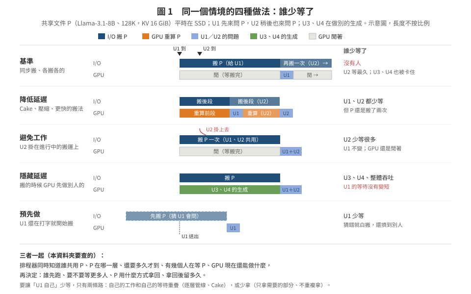

# 01　四個容易混在一起的概念，以及「誰」少等了

> 回到核心頁：[README.md](README.md)

這一頁先把字講清楚。原本貼進來的筆記把「隱藏延遲、降低延遲、避免工作、預先做」放在一起講，方向是對的，但如果不分開，後面的新意判斷就會亂：同一個機制換一種說法，看起來就像新東西。

---

## 1. 一個例子貫穿全文

一份很長的共享文件 P（例如公司手冊、一個 codebase、一份 128K token 的合約），很多使用者輪流來問。

- Llama-3.1-8B 時，P 的 KV 是 16 GiB〔算術，`docs/stage3_design_20261024/mechanisms/arith.md` §1〕；Qwen2.5-14B、256K 時是 48 GiB，一張 H200 只放得下 1 份〔同上〕。
- 所以 P 不可能永遠留在 HBM，平時在 CPU 記憶體或 SSD。
- 從 SSD 級的層拿回 16 GiB，Cake 要 1.46 s〔實測，GPU 閒，harness；`mechanisms/README.md` §3〕。

現在使用者 U1 在 t=0 來問 P，P 在 SSD。U2 在 t=0.3 s 也來問 P。GPU 上還有 U3、U4 正在生成（和 P 無關）。

**圖 1.** 同一個情境，四種做法各自讓誰少等。

---

## 2. 四個概念

| 概念 | 一句話 | 在例子裡長什麼樣 | 誰少等了 |
|:--|:--|:--|:--|
| **降低延遲**（latency reduction） | 讓那件事本身變快 | 壓縮 P 的 KV、走更快的搬法、Cake 前段重算後段載入 | U1、U2 都少等 |
| **避免工作**（work avoidance） | 不做那件事 | P 已在 HBM 時 U2 直接命中（prefix caching）；U2 掛在 U1 正在進行的取回上，不另外取一次（合併 in-flight） | U2 少等很多；U1 不變 |
| **隱藏延遲**（latency hiding） | 等的時候讓別的有用工作同時跑 | P 在搬時，GPU 先做 U3、U4 的生成 | **U3、U4 與整體吞吐**；U1、U2 的等待**沒有變短** |
| **預先做**（speculation／prefetch） | 在確定需要之前先做 | U1 還在打字時就開始搬 P | U1 少等；猜錯就浪費頻寬、擠掉別人 |

**最容易講錯的一點**：「搬 P 的時候讓 GPU 去做別人的工作」是隱藏延遲，但它隱藏的是**系統**的閒置，不是 U1 的等待。U1 自己的等待要變短，只有兩條路：
1. **自己的工作和自己的等待重疊**：逐層管線（算第 ℓ 層時搬第 ℓ+1 層）、Cake（GPU 重算前段時，I/O 搬後段）。
2. **減少要等的東西**：只搬需要的部分（第三階段的縮圖還原）、避免重複取回。

所以「隱藏延遲」這個詞在論文裡要說清楚是**誰**的延遲。

---

## 3. 三個交集各自是什麼

| 交集 | 意思 | 例子 |
|:--|:--|:--|
| 共享 × 排程 | 排程器知道誰和誰共用 KV | SGLang 的最長前綴優先、Preble 的路由、DLPM 的公平性（[02](02_prior_work_map.md)） |
| 隱藏 × 排程 | 排程器知道誰在等搬運，先跑別人 | vLLM 的非同步載入、Strata 把載入頻寬當資源（[02](02_prior_work_map.md)） |
| 共享 × 隱藏 | 共享的 KV 在搬的時候，其他人怎麼辦 | delayed hit：U2 要的東西正在為 U1 搬 |
| **三者一起** | 排程器同時知道：誰共用、共用的東西在哪一層、還要多久才到、等它的有幾個人、GPU 現在還能做什麼 | 這是本資料夾要查的 |

---

## 4. 筆記裡的事實宣稱，查證結果

查證細節在 [lit/L4](lit/L4_claims_multiagent_crossgpu.md) §1（文獻 agent 讀原文；self-review，不是 cross-model）。

| 筆記的宣稱 | 判定 | 要補正的地方 |
|:--|:--|:--|
| vLLM 已支援 Automatic Prefix Caching | 正確〔文件〕 | 只加速 prefill，不加速 decode |
| LMCache 支援跨請求、跨引擎共用 KV | 正確〔部分，arXiv 2510.09665 p.1、p.3、p.10〕 | 「跨引擎」是同一模型的多個實例、或 P/D 之間，不是跨模型 |
| SwiftCache（arXiv 2606.16135）讓不同模型共享閒置 HBM 與 NVLink | 正確〔全文 p.1、p.12〕 | 共享的是**記憶體空間**：KV 需求大的模型把自己的 KV 存到別的模型的空閒區塊。沒有兩個模型讀同一份 KV，也沒有「一次取回、多人用」 |
| ConServe（PMLR v306 qiao26i）利用線上推論的閒置 GPU 跑離線工作 | 正確〔全文〕 | PMLR v306 是 **ICML 2026**；arXiv 首版 2024-10 標題不同。筆記漏了它的**增量 KV checkpoint＋背景預取**：被搶占的離線請求，KV 在 GPU 有空時預取回來，和計算重疊 |
| 隱含：單純實作 KV 共用已不是新研究 | 成立 | 但筆記把 ConServe、SwiftCache 當最近前作**不對**。對這個三向交集，最近的是 **Strata**（OSDI'26）與 **KVFlow**（NeurIPS'25），見 [02](02_prior_work_map.md) |

---

## 5. GPU「在等」不代表 GPU 閒著

筆記這一點講得對，而且我們自己有數據：

- 還原的三種工作吃不同的資源：搬運吃 copy engine／PCIe，反量化吃 SM，重算吃 tensor core〔`stage3_design_20261024/README.md` §0〕。
- MI300X、GPU 閒時，重算、H2D、decode 同時跑彼此只拖慢 ≤6%〔實測，I1 interf，`docs/stage3_20261019/experiment_log.md`〕。
- H200、MPS 合成背景時，背景限在 87% SM，Cake 從 0.397 s 變成 0.127 s，背景吞吐 0.91〔實測，O9，`mechanisms/03_bandwidth_compute.md`〕。

所以「GPU 忙不忙」要看是**哪一種資源**忙，這在 [03](03_candidates.md) 的每個候選裡都要用到。
