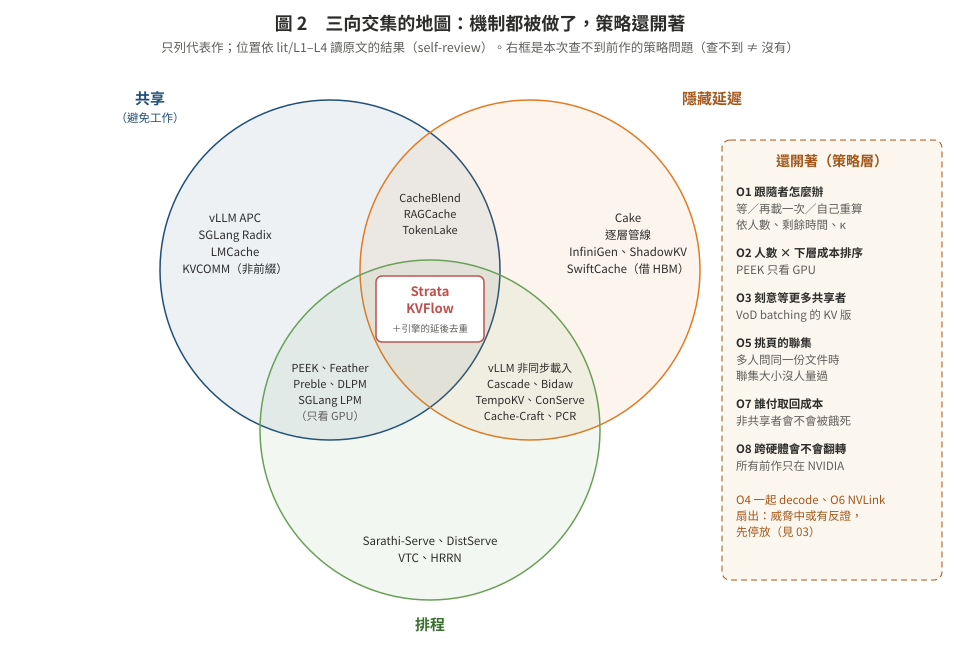

# 02　前人做到哪裡：三向交集的地圖

> 回到核心頁：[README.md](README.md)
> **一句話**：「共享 × 隱藏 × 排程」的**機制**已經被做完了（Strata、KVFlow、vLLM／SGLang 本身）；還開著的是**策略**：一段在下層的共享 KV 有 N 個人在等時，誰先、等不等、要不要乾脆重算、要不要等更多人、挑頁時怎麼取聯集。

本頁只整理結論；每一條的原文位置在 `lit/` 的四份調查檔。四份都是文獻 agent 讀原文、標頁碼，**self-review，不是 cross-model review**（CLAUDE.md §5）；獨立 verifier 的核對結果見 [lit/V_verifier.md](lit/V_verifier.md)。

| 檔 | 範圍 |
|:--|:--|
| [L1](lit/L1_strata_and_engines.md) | Strata 全文；vLLM、SGLang、LMCache、Dynamo、llm-d 的原始碼與 PR；PEEK、TempoKV |
| [L2](lit/L2_sharer_scheduling_fairness.md) | 依共享者排程、刻意等待、共享前綴 kernel、公平性、挑頁聯集（28 列對照表） |
| [L3](lit/L3_classic_analogs.md) | 古典對應：VoD batching／patching、DBMS cooperative scans、anticipatory scheduling、request coalescing、delayed hits、flow shop |
| [L4](lit/L4_claims_multiagent_crossgpu.md) | 筆記宣稱查證、多 agent／RAG 共享、跨 GPU 共享、GPU 閒置填補 |

**圖 2.** 三向交集的地圖。中間（三者都有）已經有 Strata 與 KVFlow；圈外右側是本次沒找到前作的策略問題。只列代表作。

---

## 1. 已經被做掉的部分

| 子問題 | 代表做法 | 證據 |
|:--|:--|:--|
| 共享本身（避免重算） | vLLM APC、SGLang RadixAttention、LMCache；非前綴的 CacheBlend、KVCOMM、Cache-Craft | L4 §1、§7.1 |
| 同一段 KV **本輪已有人要算或正在算**時，叫後到者等 | Strata delay hit（命中 transient node 超過 100 token 就延後一輪、排到佇列最前面）；SGLang in-batch 降級；PEEK pioneer 先跑 | L1 §1.4〔全文〕；L2 §2.2、§2.6 |
| 同一段 KV **正在從下層載入**時，只載一次 | vLLM `_chunks_being_loaded` 延後（#29087，2026-01 合併）；vLLM tiering 的 SSD→CPU promotion 只做一次；TempoKV 合併 SSD staging；KVFlow 的節點狀態 | L1 §2.4〔程式碼〕、§5.2〔全文〕；L4 §3.8 |
| 載入時讓別人先跑 | vLLM 非同步載入（`WAITING_FOR_REMOTE_KVS`，排程器跳過、排下一個）；Strata balanced batch（載入量÷計算量 >100 就降優先）與 bubble filling（載入時送 decode batch） | L1 §1.2–1.3〔全文〕、§2.3〔程式碼〕 |
| 排隊時就先預取 | Strata 的 SSD→CPU 預取與排隊時間重疊；Cache-Craft、PCR、Shared RAG-DCache | L1 §1.5；L4 §3.4、§3.6；L2 §2.10 |
| 依佇列中「幾個人共用」排序或分群 | PEEK（排序鍵的 score＝等待中共用者的深度加權需求，再以 cluster 大小 tie-break；group-major 讓同群連續送；**只有 GPU 快取**）、Feather（RL state 含等待共享者數）、SGLang DFS-weight、BatchLLM | L2 §2.6、§2.8、§2.2、§2.9 |
| 路由時算進下層命中 | llm-d（GPU 1.0／CPU 0.8）、Dynamo（host 0.75／disk 0.25），都是**靜態權重** | L2 §2.14〔程式碼／文件〕 |
| 依延遲預算決定還原多少、其餘重算（單請求） | Cascade（arXiv 2608.06557） | repo `stage3_design_20261024/lit/L8b`〔全文〕 |
| 共享前綴的 attention 攤提 | Hydragen、FlashInfer cascade、RelayAttention、ChunkAttention：**全部假設 KV 已在 HBM**；vLLM 在 2026-10-12 移除 cascade attention（PR #61126） | L2 §2.13 |
| 借別張卡的空閒 HBM | SwiftCache、Harvest、Aqua、Infinite-LLM、TokenLake | L4 §4 |
| GPU 閒置時把被搶占請求的 KV 預取回來 | ConServe（ICML 2026） | L4 §1.d〔全文〕 |

**對我們最重要的兩個前作：**

- **Strata**（OSDI'26）〔全文，L1 §1〕
  - 有：delay hit 延後、bundle hit（共用同一 context 的放同一批）、balanced batch、bubble filling、GPU-assisted I/O；GPU／CPU／SSD 三層。
  - 沒有：**以成本比較**的重算 vs 載入選擇（原文認為長 context 重算不吸引人，把「划算時改重算」歸給 Cake）；SSD 層預設 best-effort 預取，請求被排上就中止、只用已到的部分，其餘只能 prefill，算是隱含的退回〔推論，lit/V #5〕；依「等待人數」排序；刻意等更多共享者；公平性（原文自承）。
  - 原文自列的 future work：從更慢的 tier 預取時，只能靠排隊時間藏，**為它創造排程餘裕**是有前景的方向（**OSDI'26 版** §6，p.14；arXiv v1 沒有這段，lit/V #6）。這正是本資料夾的空位。
  - 原文自己的消融：同 context 的請求排在一起時，delay-hit 處理讓峰值吞吐 +42%；平均分散時完全沒效益（Fig. 11，p.12）。
- **KVFlow**（NeurIPS'25）〔部分，L4 §3.8〕：多 agent workflow；節點狀態防重複載入；載入藏在別的 agent 的計算後面；依 agent 步驟圖預取。原文假設 PCIe 搬運遠比重算便宜。

---

## 2. 工程社群正在碰、還沒解決的地方（vLLM）

〔PR〕，`gh` 唯讀查詢，2026-10-26；L1 §2.2、L4 §6。

| 編號 | 狀態 | 內容 |
|:--|:--|:--|
| #29087 | 2026-01-21 合併 | 同一批 CPU block 不重複載入；做法是把後到者延後 |
| #44294 | 2026-10-07 因過期自動關閉（**不是修好**） | 2×L40S、Qwen3-8B、50 併發共用 10K 前綴：凡是命中正在載入的 block 的請求全部被延後、排成一列；TTFT 11.46 s（不卸載 5.95 s） |
| #44295 | **仍開著**（stale、needs-rebase） | 修法：GPU 有壓力才延後，沒壓力就放棄命中、直接算。PR 內文的表：併發 20 時「一律延後」最好（−20.5% vs 一律放棄 −38.0%、本 PR −32.0%），併發 50 時「一律放棄命中」較好（−33.8% vs 延後 −40.7%、本 PR −32.4%）。表頭沒寫指標；依 issue #44294 在 2026-06-03 的留言，是相對不卸載的吞吐變化（lit/V #11）。PR 的 GPU 狀態寫「2×／5× 溢出」，issue 本文卻寫 GPU KV 沒有受限，兩者不一致 |
| #44882 | 開著 | 要求核心層的「一次載入、後到者掛上同一份」；列出三種現有做法都不好：重複載入、延後（排成一列）、回 miss（重算已知的命中） |
| #57418 | 開著，2026-10-25 仍有更新 | 真的「掛上同一份正在載入的 GPU block」；作者沒有效能主張 |

> **repo 更正**：`docs/stage3_20261019/lit/L3_reuse_serving_agentic.md` §F4 寫「修正 PR #44295 同樣關閉」，與 GitHub 現況不符（L1 §2.2）。

**我們自己的相關量測**（MI300X、vLLM 0.28，F2；`docs/stage3_20261019/results_analysis.md` §4.13）：#44294 的「開卸載慢一倍」在 MI300X 上**沒有重現**；真正的代價是開 CPU 卸載後 vLLM 在 ROCm 上強制改用較慢的 TRITON attention，高併發時慢約一倍〔實測〕。注意 F2 量的是一波請求的完成時間（vLLM 0.28），#44294 量的是 TTFT 與吞吐（0.19.1、L40S）；「沒重現」是在不同指標、不同版本下的結論（lit/V #35）。

〔判讀〕#44295 的表是目前唯一的直接證據：「等正在載入的那一次」和「自己重算」，**沒有一條固定規則在所有負載下都最好**。這是工程量測，不是論文；指標也沒寫清楚。

---

## 3. 還開著的策略問題（查不到 ≠ 沒有）

| # | 問題 | 最近的鄰居與差距 | 威脅 | 出處 |
|:--|:--|:--|:--|:--|
| O1 | **跟隨者怎麼辦**：一段共享 KV 正在從下層載入，後到的人該等、再載一次、還是自己重算（或 Cake 式部分重算）；依等待人數、剩餘載入時間、tier 頻寬、GPU 忙不忙、κ | vLLM #44295 用一個布林值；Strata 沒有以成本比較的重算選擇；Cache-Craft「沒到就從頭 prefill」；Cascade 有重算但沒有共享 | 中 | L1 §6.2 B3；L4 §7.2 G1 |
| O2 | **依「等待人數 × 下層取回成本」排序**，加公平 | PEEK、Feather 數人但只看 GPU；llm-d、Dynamo 只有靜態 tier 權重；SGLang PR #32911：開 HiCache 的生產流量下 LPM 的 p99 TTFT 比 FCFS 高 252.56% | 中 | L2 §3.2 第 1 點；L1 §6.2 B1 |
| O3 | **為了等未來的共享者刻意延後開始取回**（batching window） | 現有的「等」都是等**已經在飛**的那一次；Strata 的消融顯示共享者散開時 delay-hit 沒效益 | 低–中 | L2 §3.2 第 2 點；L1 §6.2 B2 |
| O4 | 還原一次後讓共享者用共享前綴 kernel 一起 decode | kernel 都假設在 HBM；vLLM 剛移除 cascade（反證：收益不夠抵複雜度） | 低–中 | L2 §3.2 第 3 點 |
| O5 | **依問題挑頁時，多個使用者挑到的頁取聯集、去重、依熱度排序取回** | 只有單一請求內的聯集（GQA head、speculative verify）；HiSparse 是每請求、每層一個 GPU cache；**聯集大小沒人量過** | 低 | L2 §2.16、§3.2 第 5 點 |
| O6 | 一張卡取回一次，經 NVLink 扇出給多張卡上的共享者 | SwiftCache 只有一個讀者；TokenLake 搬 query 不搬資料；Mooncake 多副本 | 中 | L4 §7.2 G2 |
| O7 | 下層取回的 I/O 成本由誰付、非共享者會不會被餓死 | DLPM 把跨 client 誰付列為未來工作（§9，p.12）；PrefixShield 只管 GPU | 中 | L2 §3.2 第 4 點 |
| O8 | 以上任何一項在 AMD 或跨硬體比較 | 所有論文都只在 NVIDIA；Strata 只宣稱 ROCm 相容 | 低–中 | L1 §6.2 B7 |

**主張的寫法**（L1 §6.3、L2 §3.3、L4 §7.3 的共同結論）：
- 不能主張「第一個處理 delayed hit」「第一個讓 in-flight 載入只做一次」「第一個在載入時讓別人先跑」（威脅**高**）。
- 站得住的是：給出**策略規則**，以及它**在什麼條件下翻轉**（例如何時重算勝過等待、CPU 層與 SSD 層、不同硬體），並證明只看 GPU 的 PEEK、只看預算的 Cascade、只看布林值的 #44295 會做錯。

---

## 4. 我們自己的數據已經殺掉的方向

**I1：多個 session 同時回來，一起決定誰重算、誰載入**〔模擬＋GPU 驗證，MI300X，`docs/stage3_20261019/experiment_log.md` I1〕

- 事先預測（模擬，互不干擾的模型，joint 只試「每個 session 全算或全載」）：N＝4、8 的 32 格裡，**沒有一格**「聯合決定」比「各請求各自最佳」好；8 格（同質、CPU 層）打平，其餘 24 格較差，平均 TTFT −12.6%～−59.9%、P95 −13.8%～−48.3%（`results/m16_stage3_mi300x/i1_concurrent_restore/prediction/prediction_llama.json`；lit/V #34）。能拿到的好處全部來自已知的單請求規則（G5b）與排隊順序（FCFS／SRPT 的教科書結果）。
- GPU 實測與模擬的平均 TTFT 比在 0.973–1.050，所以模擬可信、方向收掉。
- 計算、搬運、decode 同時跑，彼此只拖慢 ≤6%（GPU 閒）。

**這對本資料夾的意義**：I1 的 session 之間**沒有共享**。所以「共享」本身要帶來教科書以外的東西：
- 「依人數加權的最短工作優先」**本身就是教科書**（Smith's rule）。
- 新東西只能來自 LLM 特有的結構：可以重算（κ 依位置與硬體而變）、逐層的順序、每個問題只需要一部分頁。

這就是 [03](03_candidates.md) 選題的篩子。
