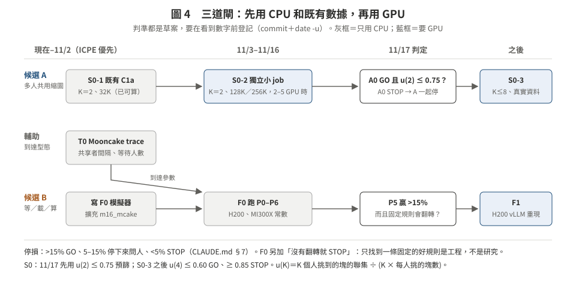

# 04　最小實驗與停損條件（草案，**尚未登記**）

> 回到核心頁：[README.md](README.md)
> **狀態**：這一頁是**草案**。照專案規矩，判準要在看到任何數字之前 commit＋`date -u` 登記；登記之後不改，改了寫成「偏離 N」。目前**沒有任何新量測**。
> 停損門檻沿用 CLAUDE.md §7：`>15%` GO、`5–15%` 停下來問人、`<5%` STOP。

三道閘對應 [03](03_candidates.md) 的兩個候選（A：多人共用的縮圖還原；B：跟隨者的等／載／算）和一個輔助量（T0：到達型態）。順序是**先用 CPU 和既有數據，再用 GPU**。

**圖 4.** 三道閘的順序與分岔。

---

## 0. 共用規則

- **平台**：只用 H200 與 MI300X 的常數。3090（平台 A）不做多租戶結論（CLAUDE.md §8）。
- **Mooncake trace**：`hash_ids` 是 **512-token** 的 block；載入函式要寫「用 A 欄位驗算 B 欄位」的斷言（CLAUDE.md §1 規則 6）。
- **時間的數字**要有 `GpuWatcher` 且不污染；品質的數字可以在污染時保留（CLAUDE.md §3）。
- **H200 排程**：ICPE 的 job 優先到 11/2；量時間的 job 不和 ICPE 量時間的 job 重疊（memory `stage3-design-20261024`）。
- **模擬器的可信度**：任何模擬結論，都要先有一次 GPU 對照（實測÷模擬 ≤1.10，同 I1 的做法），否則只能寫〔模擬〕。

---

## T0　到達型態：共享者多久來一個？（CPU，只報告）

**問題**：同一段共享前綴，下一個共享者多久會到？一段共享 KV 在還原的那幾秒內，平均有幾個人在等？

- **資料**：Mooncake conversation／toolagent trace（repo 已在 H200 與 MI300X 下載過，`kvcache-ai/Mooncake` `245e7106`，RUNLOG_H200 D4）。
- **量**：
  1. 共用 ≥S token 前綴（S＝2K、6K、16K；以 512-token block 計）的請求群，相鄰到達的間隔分布。
  2. 對每個平台、每一層（CPU、本地 SSD）的還原時間 W（用 repo 已量的常數算），一次還原進行中「到達的共享者人數」分布。
  3. 對照 Strata 的數字：toolagent 38% 的請求在 1 秒內和別人共用 ≥6K token，不計 system prompt（OSDI'26 版 §3.2）〔L1 §1.4；lit/V #8〕。我們要能重現這個量級，否則先查單位。
- **產出**：餵給 F0 的到達參數，不單獨判 GO／STOP。
- **成本**：CPU 幾分鐘；`code/m8_trace_oracle.py char` 已經有前綴共享分析可以擴充。

---

## S0　聯集有多大？（候選 A）

**問題**：K 個使用者問同一份文件的不同問題，每人挑前 m 塊，聯集 U(K) 佔 K·m 的比例 u(K) 是多少？

**S0-1（CPU，既有數據，已可算）**：C1a 的 K＝2、32K、合成題。
- 已有：兩輪問題的前 16 塊重疊率 Llama 0.864、Qwen 0.767（135 題，`results/m16_stage3_mi300x/c1a_predictive/tables_c1a.md`，「QRY1」列的重疊@16 + k/63）〔實測〕。
- 換算：u(2)＝(2−重疊)/2 → Llama 0.57、Qwen 0.62〔算術〕。
- **限制**：所有層平均的排名（不是逐層挑）；合成題；兩個問題問的是不同位置帶的 needle。

**S0-2（GPU，獨立的小品質 job）**：用 A0 的第 2 輪題（128K／256K；L128、Q128、Q256、Q14-256；每格 96 題），重用 A0 的打分程式，對同一份 context 的第 1 輪與第 2 輪問題各算一次挑法，記錄：
- 兩個問題前 m 塊（ρ＝1/16、1/8、1/4）的重疊，**全域**與**逐層**各一份；
- 重疊的塊裡，有多少是各自答案所在的塊。

- **為什麼不直接改 A0**：A0 已登記、正在跑；改它的程式要寫偏離，也有弄壞正在排隊的分片的風險。獨立 job 只讀 A0 的題目與打分函式，不碰 A0 的輸出與判定。
- **成本**：約 2–5 GPU 小時〔估計，用 A0 冒煙「Q256 每題 prefill 31 s」推〕。品質型，不量時間，照讓位規則排進品質 job 佇列；不和 ICPE 量時間的 job 重疊。

**S0-3（GPU，只在 A0 GO 之後）**：K 最多 8。
- 合成：m10_tasks 一份 context 放 K 根 needle、出 K 個問題。
- 真實：一份文件有很多問題的資料集，例如 NarrativeQA（Strata、TempoKV 都用過）、LooGLE、SCBench 的 multi-request 子集。下載前先確認授權與大小。

**判準草案**（ρ＝1/4，報中位數）：

11/17 只有 K＝2 的數字（S0-2），所以分兩段：

| 時間 | 結果 | 條件 | 下一步 |
|:--|:--|:--|:--|
| 11/17 預篩 | 繼續 | A0 GO，**而且**至少 2 個判定格 u(2) ≤ 0.75（兩個人挑的塊至少一半相同） | 做 S0-3 |
| 11/17 預篩 | STOP-S | A0 STOP；或所有判定格 u(2) > 0.75 | 兩個人都共用不到一半，人更多只會更差；A 只剩單請求的故事（＝路 2 本身） |
| S0-3 之後 | GO-S | 至少 2 個判定格 u(4) ≤ 0.60（每人分攤的搬運少 40% 以上） | 候選 A 進主實驗：和 HiSparse 式「每請求各挑各搬」比 |
| S0-3 之後 | STOP-S | 所有判定格 u(4) ≥ 0.85 | 同上 |
| S0-3 之後 | 問人 | 介於兩者 | 只報告 |

參考：C1a 在 32K 的 u(2) 是 0.57（Llama）、0.62（Qwen）〔算術，由實測重疊換算〕，在預篩門檻內；128K 與逐層挑時會不會變大，NOT_MEASURED。

**失敗條件要一起報**：重疊如果只來自「不分問題的頁」（開頭、最近、sink），答案頁仍各不相同 → 聯集小，但每個人仍要自己的答案頁；這不影響搬運的省，但要在論文裡說清楚。

---

## F0　跟隨者該等、該再載、還是該算？（候選 B，CPU 模擬）

**問題**：一段共享 KV 正在從下層載入，有 N 個人在等、GPU 上還有別的工作。固定規則（一律等、一律放棄命中、#44295 的布林值、Strata 式）和「依成本選」的規則差多少？最佳的固定規則會不會隨 tier（CPU vs SSD）或平台（H200 vs MI300X）翻轉？

**模擬器**：從 `code/m16_mcake.py`（多 session 的 Cake 排程；I1 在 MI300X 上實測÷模擬＝0.973–1.050）擴充：
1. 共享群：同一段前綴有多個請求，載入只做一次；
2. 跟隨者的動作：等、再載一次、放棄命中自己重算、在等的時候幫忙重算前段（Cake 式，讓這次還原提早結束）；
3. 其他工作：已在 HBM 的請求的 prefill／decode，會被還原的重算擠到（用 B0 量到的資源向量常數；只用 MPS 或同行程 stream 的數字）。

**比較的策略**：

| 代號 | 規則 | 來源 |
|:--|:--|:--|
| P0 | 不去重，各載各的 | vLLM 不開 prefix caching 時 |
| P1 | 一律等 in-flight 的那一次 | vLLM #29087 的延後 |
| P2 | 一律放棄命中、自己重算 | #44295 表中的「一律回 0」 |
| P3 | GPU 有壓力才等，否則重算 | #44295 |
| P4 | delay hit＋bundle＋bubble filling，沒有以成本比較的重算 | Strata |
| P5 | 依剩餘時間、等待人數 N、tier 頻寬、GPU 狀態、κ 選動作；還原的重算比例依 N 加權 | 本提案 |
| P6 | 事後知道一切的最佳 | 上界 |

**指標**：平均與 P95 TTFT、TTFT SLO 下的 goodput、被浪費的 GPU 時間（重算了但別人的載入先到）。

**判準草案**：

| 結果 | 條件 |
|:--|:--|
| GO-F | P5 在每個平台至少一格比 P1–P4 中最好的好 >15%（P95 TTFT），**而且**最好的固定規則在 CPU 層與 SSD 層、或 H200 與 MI300X 之間不同（＝會翻轉） |
| 問人 | 5–15% |
| STOP-F | 所有格 <5%；或沒有翻轉（那就只是「找一條好的固定規則」，是工程，不是研究） |

**為什麼要「翻轉」這一條**：I1 已經證明，沒有共享時「聯合決定」打不過「單請求規則＋排隊順序」（[02](02_prior_work_map.md) §4）。如果共享只帶來「依人數加權的排序」，那是 Smith's rule，教科書就有。研究價值只在：可以重算、κ 依位置與硬體而變，使得最佳規則會翻轉。

**F1（GPU，F0 GO 之後）**：在 H200 的 vLLM（CPU 卸載）重現 #44294／#44295 的形狀：共享前綴 10K–128K、併發 1–64；MI300X 已有 F2 可對照。先確認模擬器在這個形狀上可信（≤1.10），再談 P5。

---

## 時程（建議）

| 期間 | 做什麼 | 資源 |
|:--|:--|:--|
| 現在–11/2 | 登記 T0、S0、F0 的判準；寫 T0、F0 的程式與 S0-2 的小 job | 只有 CPU，不碰 H200 的 GPU |
| 11/3–11/16 | T0、F0 跑完（CPU）；S0-2 排進品質 job 佇列 | CPU＋約 2–5 GPU 小時 |
| 11/17 | 和 A0 一起報告：A0、S0、F0 各自 GO／STOP | — |
| 11/17 之後 | 只做通過的：S0-3 或 F1 | GPU |
