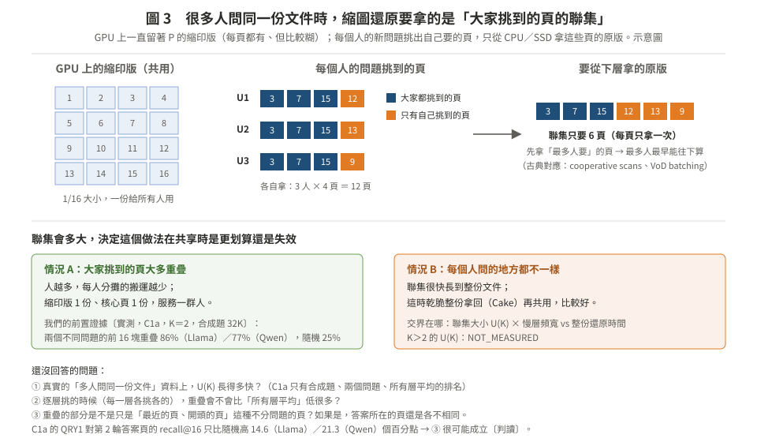

# KV 共享 × 隱藏延遲 × 排程（2026-10-26）

> **一句話**：這個交集的**機制**已經被 Strata（OSDI'26）、KVFlow（NeurIPS'25）和 vLLM／SGLang 本身做完了；還開著的是**策略**：一份共享的長文件 KV 在下層、有好幾個人在等時，該等、該再載、還是該重算（候選 B），以及依問題挑頁時大家的頁取聯集（候選 A）。兩者都接得上我們現有的線，第一步都只要 CPU，或一個 2–5 GPU 小時的小 job。
>
> **只要看這一頁。** 其他檔案是附錄。這是探索，**不改**目前的主線：路 1（ICPE，11/16）與第三階段的 A0（11/17 判定）照舊；第三階段的核心頁是 [`stage3_design_20261024/mechanisms/README.md`](../stage3_design_20261024/mechanisms/README.md)。
>
> 標記：〔實測〕附出處；〔算術〕是拿 repo 已量的常數代公式，不是結果；〔判讀〕是推論。文獻由 4 個文獻 agent 讀原文、標頁碼，再由 1 個零前文 verifier 核對 36 條關鍵說法（[lit/V](lit/V_verifier.md)）。全部是 **self-review，不是 cross-model review**（CLAUDE.md §5）。

---

## 1. 你問的交集是什麼（比喻）

全班共用一本很厚的參考書 P（一份 128K token 的文件；Llama-3.1-8B 的 KV 是 16 GiB），平時放在倉庫（CPU 記憶體或 SSD）。快遞（I/O）可以去拿；小明（GPU）也可以自己從頭抄一本（重算）。

- **共享**：甲已經叫快遞拿 P 了，乙也要 P，乙不必再叫一次。
- **隱藏延遲**：快遞在路上的時候，小明先幫別的同學做事。注意：這讓**別人**少等，甲自己的等待沒有變短（[01](01_concepts.md) §2）。
- **排程**：誰先、誰等、要不要等更多人一起。

三者一起問的是：**排程器同時知道誰共用 P、P 在哪一層、還要多久才到、有幾個人在等、GPU 還能做什麼，然後決定怎麼做。**

**圖 1.** 同一個情境的四種做法，以及各自讓誰少等。

---

## 2. 前人做到哪裡

**圖 2.** 中間（三者都有）已經有 Strata 與 KVFlow；右框是本次查不到前作的策略問題。細節在 [02](02_prior_work_map.md)。

### 2.1 Strata 和 KVFlow 在做什麼（白話）

用餐廳比喻：食材（KV）平時放在倉庫（CPU 記憶體或 SSD），要用時搬到灶台（GPU）。

**Strata**（OSDI'26；長文件被很多人反覆查詢的情境）做三件事〔L1 §1，讀全文〕：
1. **搬得快**：原本 KV 被切成很多小包，一包一包搬很慢。它改用 GPU 自己去搬一大批小包，搬的時候順便整理擺放方式。這是「降低延遲」。
2. **排菜單時知道「要等食材」**：一批菜裡，把「食材要搬很久」的菜和「食材已經在手邊、要煮很久」的菜搭在一起，搬的時間被煮的時間蓋住；真的蓋不住，就先做已經在出餐的菜（decode）填空檔。這是「隱藏延遲」。
3. **同一道菜不煮兩次**：第二桌點的菜和第一桌一樣、第一桌那鍋正要煮或正在煮，就讓第二桌晚一輪再來，直接分第一桌那鍋（delay hit）；同一份文件的請求盡量放進同一批（bundle hit）。這是「避免工作」。

它**沒有做**的：不比較「重煮一份」和「等倉庫送來」哪個快（它認為長文件重算太貴）；不數有幾桌在等同一道菜；不會為了湊更多桌而刻意晚點開火；SSD 那一層只能靠排隊時間蓋住（論文自己列為未來工作）；不管公平；只在 NVIDIA 上做。

**KVFlow**（NeurIPS'25；多個 agent 照固定流程輪流上場）〔L4 §3.8、repo L3 §H4〕：
1. 看流程圖就知道「哪個 agent 幾步後要上場」：快上場的不要趕出 GPU，還在 CPU 的先在背景搬回來，搬的時間藏在別的 agent 計算後面。
2. 每段 KV 記一個狀態（在 GPU、在 CPU、搬運中）：搬運中的不重複搬，那個 agent 先跳過、先跑已經準備好的。

它**沒有做**的：假設「搬」永遠比「重算」便宜；用的是合成的固定 prompt。

### 2.2 有人做了，為什麼還值得做

1. **學長說的「找一個 SOTA 改它」**：Strata 就是這個交集的 SOTA。我們不主張「第一個做共享＋隱藏＋排程」，而是主張「Strata＋改一處，在某些條件下更好」。
2. **它們的盲點剛好是我們手上有的**：重算 vs 搬（κ）、慢的層（SSD、NFS）、AMD 與跨硬體。這三樣我們都已經量過。
3. **它們自己寫的未來工作**：Strata 寫「為慢的層製造排程餘裕」和「公平性」（OSDI'26 版 §6）。

### 2.3 還開著的問題（白話版）

「查不到 ≠ 沒有」的意思是：我們讀了 lit/L1–L4 列出的論文、PR，以及 vLLM、SGLang 的程式碼，**沒看到**有人做；但不能保證全世界都沒有。

| # | 白話問題 | 具體例子 | 現在的系統怎麼做 |
|:--|:--|:--|:--|
| 1 | **後到的人該等、再搬一次，還是自己算？** | 50 個人同時問同一份 1 萬 token 的文件，第一個人的搬運已經在路上 | vLLM 一律叫大家等，結果 50 人排成一列，比完全不用快取還慢（11.46 s vs 5.95 s）。它的修正 PR 量到：20 人時「等」最好，50 人時「自己算」較好。**沒有人寫出「什麼時候該等、什麼時候該算」的規則** |
| 2 | **先處理哪一份文件？** | 文件甲有 20 人在等、但在 SSD（拿要 2 秒）；文件乙只有 1 人在等、在 CPU（0.3 秒） | 只看「GPU 上已經有多少」，不看「在哪一層、拿要多久、幾個人在等」 |
| 3 | **要不要等一下再搬？** | 搬一份文件要 2 秒；如果 1 秒後還會有 5 個人來問同一份，現在搬（第一個人快）還是等一下一起搬？ | 沒人做。但如果大家都是在搬運途中才到，問題 1 的「等那一趟」就夠了；所以要先看真實的到達間隔 |
| 4 | **每人只拿自己要的頁時，要拿多少？** | 3 個人各要 4 頁，大多重疊，其實只要拿 6 頁 | 每個請求各挑各搬；**聯集多大沒人量過** |
| 5 | **公平嗎？** | 共用多的請求一直被優先，獨自一人的請求一直被排後面 | SGLang 實測：開 HiCache 後，依共享排序的 P99 比先到先服務差 252.56% |
| 6 | **換硬體答案會不會變？** | 同一條規則在 H200 對、在 MI300X 錯 | 上面全部只在 NVIDIA 上做過 |

**工程社群正在碰問題 1**：vLLM 連開了 4 個 issue／PR（#44294、#44295、#44882、#57418），到 2026-10-26 都還沒解決（[02](02_prior_work_map.md) §2）。修正 PR 的表沒寫指標，依 issue 留言是「相對不卸載的吞吐變化」；它自己的折衷規則在 20 人時反而比不修還差〔lit/V #11〕。

**筆記裡的事實**：四條都對，但最近的前作不是筆記說的 ConServe、SwiftCache，而是 Strata、KVFlow（[01](01_concepts.md) §4）。

---

## 3. 篩子：我們自己的數據已經殺掉什麼

I1（MI300X，10/19–20）：多個 session 同時回來時「一起決定誰重算、誰載入」，**沒有一格比各自最佳好**：32 格裡 24 格較差（平均 TTFT −12.6%～−59.9%），8 格（同質、CPU 層）打平〔模擬，GPU 實測÷模擬＝0.973–1.050；lit/V #34〕。好處全部來自單請求規則與排隊順序（[02](02_prior_work_map.md) §4）。

所以「共享」如果只帶來「依人數加權排序」，那是教科書（Smith's rule）。新東西只能來自 LLM 特有的三件事：**可以重算**（κ 依位置與硬體而變）、**逐層的順序**、**每個問題只需要一部分頁**。

---

## 4. 兩個候選（都是「SOTA＋改一處」）

| | 候選 A：多人共用的縮圖還原 | 候選 B：跟隨者的等／載／算 |
|:--|:--|:--|
| SOTA | 我們的縮圖還原（路 2）；HiSparse（每請求一個 GPU cache） | vLLM 延後去重／#44295；Strata delay hit；Cake |
| 改一處 | 一份文件一份縮印版給所有人；每層挑到的頁取聯集、只取一次、最多人要的先送 | 每個跟隨者依剩餘時間、等待人數 N、tier、GPU 狀態、κ 選動作；多一個動作「幫忙」：從前段重算，讓整段還原變成 Cake 式雙向、所有人提早拿到 |
| 前置證據 | 同一 context 上兩個問題的前 16 塊重疊 86%（Llama）／77%（Qwen），隨機 25%〔實測，C1a，32K〕→ 兩人時每人分攤的搬運少 38–43%〔算術〕 | 10K 前綴從 SSD 級載 0.175 s vs 重算 0.26 s（κ≈1.5，會翻轉）；128K 從 NFS 級 48 s vs 重算 11 s（該算）〔算術，H200／MI300X 常數〕 |
| 新意威脅 | 低（沒找到跨請求的挑頁聯集） | 中（論文沒找到；vLLM 社群正在做機制） |
| 最大風險 | A0 沒過就一起停；128K、逐層挑時重疊變小 | 翻轉區太窄；好處又全部來自排隊順序（重演 I1） |
| 古典成分 | cooperative scans、PBM（依下一次使用時間保留） | delayed hits、anticipatory scheduling、flexible-operation flow shop、共享掃描排程 B²／(λ·t) |
| 第一步 | S0：一個 2–5 GPU 小時的小品質 job（重用 A0 的題目與打分） | T0＋F0：只用 CPU（trace＋擴充 `m16_mcake` 模擬器） |

**圖 3.** 候選 A：聯集多大，決定共享時是更划算還是失效。

「要不要等更多人、還原完留多久」（VoD batching、anticipatory 的 KV 版）沒有前作，但只在少數情況有用，所以併進候選 B 的模擬器當兩個參數。停放的方向與理由在 [03](03_candidates.md) 最後。

---

## 5. 下一步與時程

**圖 4.** 三道閘：先用 CPU 和既有數據，再用 GPU。判準都是**草案、尚未登記**（[04](04_gates.md)）。

### 5.1 能不能加進 H200 現在的實驗、一起大規模測？

**H200 現況**（`results/RUNLOG_H200_S3.md`，origin/main 2026-10-26）：
- 只有一台 hgx-cn01；lab 帳號的 CPU 上限等於 4 張卡（S3-SCHED-3）。
- 品質 job（A0、G-M12、D0）已經排滿；量時間的 job（B0、G-M08 的重量）一個接一個排；4 卡的 G-M06 在 hold。
- ICPE 量時間的 job 優先到 11/2；MI300X 的租約 10/22 已結束，所以 AMD 只有既有的常數，不能新量。

| 項目 | 需要什麼 | 現在能加嗎 | 規模 |
|:--|:--|:--|:--|
| T0 trace 統計 | CPU | **可以**，不佔 GPU | 三份 Mooncake trace 全部 |
| F0 模擬（候選 B） | CPU | **可以**，不佔 GPU。「大規模」最便宜的地方在這裡 | 長度 × tier × 併發 × 等待人數 × 策略 × 平台，可以掃上千格 |
| S0-2（候選 A，K＝2） | GPU，品質型（不量時間，照讓位規則和別人同時跑） | **可以**。建議做成獨立的小 job，重用 A0 的打分程式，**不改已登記的 A0** | 4 個判定格 × 96 題，約 2–5 GPU 小時〔估計，用 A0 冒煙「Q256 每題 prefill 31 s」推〕 |
| F1（候選 B 上真引擎） | GPU，量時間；要在 vLLM 的排程器裡實作 P1–P5 | **現在不建議**：量時間的佇列已排滿、ICPE 優先，而且要先過 F0 | 11/17 之後 |
| S0-3（候選 A，K≤8、真實資料） | GPU，品質型 | A0 GO 之後 | 4 個判定格 × 多份文件 |

**一句話**：候選 B 的「大規模」先在模擬器上做（便宜、可以掃很廣），GPU 只用來驗證模擬器準不準；候選 A 現在只加一個 2–5 GPU 小時的小 job，大規模等 A0 過了再說。

### 5.2 時程

- **現在–11/2**（ICPE 優先）：登記 T0、S0、F0 的判準；寫 T0、F0 的程式和 S0-2 的小 job。
- **11/3–11/16**：T0、F0 在 CPU 上跑；S0-2 排進品質 job 佇列。
- **11/17**：和 A0 一起報告 GO／STOP。
- **停損**：>15% GO、5–15% 問人、<5% STOP；F0 另加「最佳固定規則沒有翻轉就 STOP」。

**我的建議**〔判讀〕：
- 不要現在換題。
- 候選 A 幾乎不花成本，又補上路 2 審稿人一定會問的「多使用者時呢？」，先做。
- 候選 B 最貼近 Tiara「κ 跨硬體變 32 倍」的主張，而且有真實的工程問題當動機（vLLM #44294–#57418）；但要先用 CPU 模擬證明「會翻轉」，否則就是 I1 的重演。

---

## 6. 檔案

| 檔 | 內容 |
|:--|:--|
| [01_concepts.md](01_concepts.md) | 四個概念（降低、避免、隱藏、預先做）與「誰少等了」；筆記宣稱的查證結果 |
| [02_prior_work_map.md](02_prior_work_map.md) | 已被做掉的、vLLM 正在碰的、還開著的 O1–O8；我們自己殺掉的 I1 |
| [03_candidates.md](03_candidates.md) | 候選 A、B 的故事、演算法（文字版）、例子、對手；併入的 C；停放的方向 |
| [04_gates.md](04_gates.md) | T0、S0、F0 的最小實驗與判準草案 |
| [lit/L1](lit/L1_strata_and_engines.md) | Strata 全文；vLLM、SGLang、LMCache、Dynamo、llm-d 原始碼與 PR；PEEK、TempoKV |
| [lit/L2](lit/L2_sharer_scheduling_fairness.md) | 依共享者排程、刻意等待、共享前綴 kernel、公平性、挑頁聯集（28 列對照表） |
| [lit/L3](lit/L3_classic_analogs.md) | VoD batching／patching、cooperative scans、anticipatory、request coalescing、delayed hits、flow shop |
| [lit/L4](lit/L4_claims_multiagent_crossgpu.md) | 筆記宣稱查證、多 agent／RAG、跨 GPU 共享、GPU 閒置填補 |
| [lit/V_verifier.md](lit/V_verifier.md) | 零前文 verifier 對 36 條關鍵說法的原文核對 |
| `figures/` | 圖 1–4（SVG） |

**repo 更正（已在原檔加註）**：`docs/stage3_20261019/lit/L3_reuse_serving_agentic.md` §F4 寫 vLLM PR #44295「同樣關閉」；至 2026-10-26 它仍是 OPEN（L1 §2.2、lit/V #11）。
