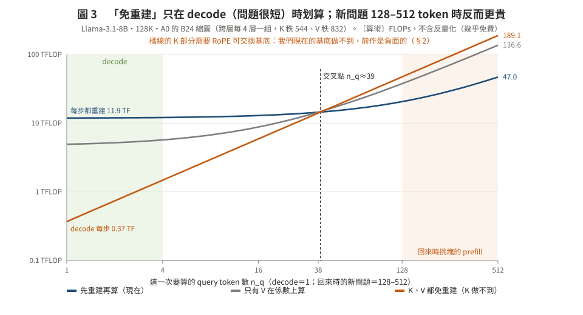
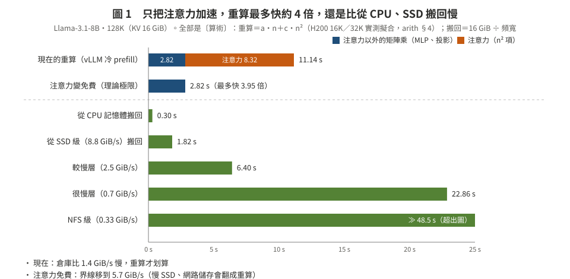
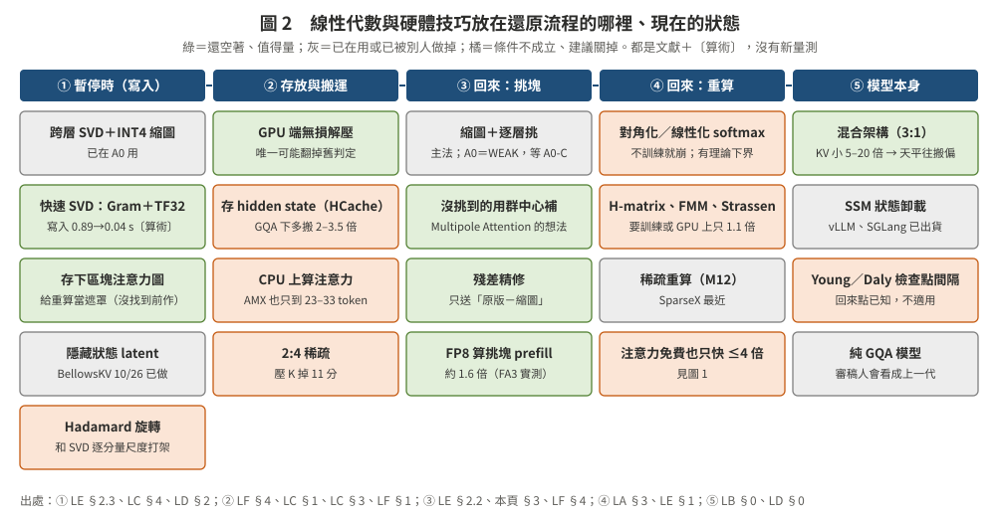

# 用線性代數加速「反量化／重建」——調查（2026-10-27）

> **只要看這一頁。** 細節在 `lit/`：LG（數學推導）、LH（GPU／CPU kernel 與硬體）是主體，LA–LF 是第一輪的背景，V 是複核紀錄。
> 標記：〔實測〕附出處；〔算術〕是用公式與專案已量常數推的，**不是結果**；〔判讀〕是推論。**這次沒有任何新量測**（規則：不在 Mac 上跑）。
> 關鍵事實經過零前文 agent 對原文複核（[lit/V_verify.md](lit/V_verify.md)）：
> - 第一輪（LA–LF）：58 條，53 OK、2 錯（已改）、3 部分。
> - 第二輪（LG、LH）：31 條，24 OK、4 錯（已改）、3 部分。
>
> 改正處都在原檔標〔複核〕。複核者和寫作者是同一個模型家族，所以這一頁仍算 self-review，不是 cross-model review。
> 入口：[CORE_QUESTION_20261008.md](../CORE_QUESTION_20261008.md)；第三階段主法：[stage3_design_20261024/mechanisms/README.md](../stage3_design_20261024/mechanisms/README.md)。

**使用者的原問題（10/27）**：「不可透過對角化等等技術優化加速嗎？透過線性代數優化，我看 Mamba 就一大堆？」→ 追加：看 SOTA；難的線性代數「達到啥條件就加速很多」；考慮 NVIDIA、AMD GPU、Intel AMX、AMD CPU 指令集 → **澄清：「我說的是用這些在反量化上，不是改 model」**。

---

## 一句話

**「反量化」其實有三筆不同的帳**，線性代數只對其中一筆有用：
- **單純的反量化**（INT4 → BF16）已經免費：約 0.03 ms／64 MiB 塊〔實測〕。
- **低秩重建**（係數 × 基底）是一次矩陣乘法，貴。但它在 GPU 忙時變慢，主因是 kernel 在排隊，不是算力不夠。
- **重建後放回 HBM**：佔用空間。

線性代數的「免重建」（把基底吸收進 query、直接在係數上算注意力）**只在 decode 時划算**；回來時要對新問題做的 prefill（128–512 token）反而更貴（圖 3）。
**最大的收穫是兩個對第三階段的更正**（§4）。

---

## 1. 三筆帳，用影印比喻

縮圖（A0 的 B24）＝把筆記「拆成少數幾張基本圖案（基底）＋每頁要用多少每種圖案（係數）」，係數再壓成 INT4。

| 帳 | 比喻 | 成本〔出處〕 | 線性代數能不能幫 |
|:--|:--|:--|:--|
| ① 單純反量化：INT4 係數 → 小數 | 把縮寫還原成全名 | 一個 64 MiB 塊：MI300X 0.03 ms（F3）；H200 融合 kernel 0.03–0.11 ms（int4_kivi 最慢）。已到 HBM 頻寬的 60–70%；只佔同一塊走 PCIe 時間（0.365 ms）的 8–20%，還能和搬運重疊〔實測，F3（MI300X）、LH §1（H200）〕 | **不需要**。論文裡的位元技巧（magic number、lop3、Marlin、QServe）只在 GEMM／注意力的內迴圈有用；我們這一步卡在記憶體頻寬 |
| ② 低秩重建：係數 × 基底 → K、V | 照配方把圖案疊回整頁 | Llama 128K 整份縮圖 11.8 TFLOP〔算術〕：GPU 閒約 15–30 ms，忙時 42–84 ms | **只有這一筆能幫**，見 §2 |
| ③ 重建後放回 HBM | 疊好的整頁要佔桌面 | 整份重建＝16 GiB，「一張卡放 97 個 session」的縮圖常駐就沒了 | 免重建能保住，但只有 decode 划算 |

---

## 2. 線性代數用在重建上：什麼條件划算（圖 3）

**核心技巧**：注意力的輸出 o＝P·V＝P·(C·B)＝(P·C)·B。先把注意力權重 P 乘上係數 C，最後才乘基底 B，就不用把整份 V 重建出來。K 那邊則是把基底吸收進 query。這和 Mamba-2、MLA 的「吸收」是同一招〔LG §2〕。

**代價**：P·C 的大小跟「秩」成正比。我們的縮圖是**跨層**基底，每 4 層共用一組，秩 544／832，比每個 head 的 128 維大得多。所以每個 query token 在係數空間算，反而比在原空間貴 4–6.5 倍。

**交叉條件**〔算術，LG §9，複核過〕：在係數上直接算比較便宜，當且僅當
　n_q · g · (r − d) < r · d，也就是 n_q < n_q\* ≈ d／g（r ≫ d 時）。

| 模型（B24） | V 的交叉點 | K 的交叉點 |
|:--|--:|--:|
| Llama-3.1-8B（g＝4） | 38 | 42 |
| Qwen2.5-7B（g＝7） | 26 | 35 |
| Qwen2.5-14B（g＝5） | 30 | 34 |

- **回來時對新問題做 prefill（128–512 token）**：免重建反而更貴。Llama 128K、n_q＝128：先重建再算 20.6 TFLOP、只有 V 免重建 37.7、全部免重建 47.3。
- **decode（每次 1 token）**：免重建每步 0.37 TFLOP；每步都重建要 11.9 TFLOP。差 32 倍，而且不必在 HBM 放 16 GiB 的重建結果。
  - **但這個 0.37 假設 K 也能免重建**，而 K 要免重建需要「RoPE 可交換」的基底（下面），前作是負面的。我們現在的基底跨頻率混合：每個 key 的 RoPE 旋轉都不一樣，基底沒辦法吸收進 query〔判讀〕。
  - **實際可行的是「只有 V 免重建」**：省掉 V 的重建（7.15 TFLOP）和 V 那半的 HBM（8 GiB）。K 要嘛重建一次、以 BF16 留在 HBM（8 GiB），要嘛 K 改存成 INT4（反量化免費，約 2.5 GiB）。
- **取捨**：跨層基底壓得比較小（專案量過比每層各自好），但擋住了免重建。如果改成每層每 head 各自一組（秩約 26），在係數上算永遠比較便宜，但壓縮效果差。

**K 的難題：RoPE**
- RoPE 讓 K 不能直接吸收。我想到的線性代數解法是：RoPE 在複數座標下是對角的，所以「每個頻率各自一組、跨 head／層共用」的基底能和 RoPE 交換〔LG 推導，複核過〕。
- **結果是負面的，而且已有前作**：
  - GitHub 的 PseudoHunt/rope-kv-compression（2026-09，未經同儕審查）在 Llama-2-7B 上試過。25% 的 key 預算下，能量只留 88.9%（RoPE 前 PCA 有 97.7%），輸出誤差是 2.69 倍。
  - 原因：K 的低秩主要來自「跨頻率」的冗餘，按頻率切開就丟掉了。專案自己的 K1（每個 head 36–40 維就有 95% 能量）也指向同一件事。
  - TransMLA 的 RoRoPE（要微調）、CommVQ（RoPE 可交換的碼本，代價約 (R＋1)／2＝6 倍注意力）是相鄰的前作。
  - 跨層版本沒找到前作，但從 K1b（相鄰層 cosine 約 0）看，大概救不回來〔判讀〕。

**其他技巧都碰不到重建那一步**〔LG §1〕：
- scale／zero 吸收進 query、softmax 平移不變（SageAttention 的 K 減平均）、Hadamard 免逆旋轉：都只處理 ① 那筆，本來就免費。
- 把重建融進注意力的 tile 裡（不寫回 HBM）：省約 8 ms 的 HBM 流量。但在 prefill 時，重建次數會變成 ⌈n_q·g／B_M⌉ 倍（Llama n_q＝128 時 4 倍）。
- 查表式（PQ／VQ）：只在 decode 划算，而且要換縮圖格式。

---

## 3. 硬體：NVIDIA、AMD、CPU（LH）

- **直接用低位元算 QKᵀ，不反量化**：
  - H200 可以用 FP8、INT8，比 FA2 快約 2.6 倍（H100 實測）。**Hopper 沒有 INT4 矩陣核心**（PTX 的 wgmma 沒有 s4），INT4 一定要先轉。
  - FP8 在 128K 有陷阱：vLLM 量到大海撈針從 91% 掉到 13%，改成兩層累加後回到 89%。
  - MI300X 有 FP8（FNUZ）、INT8，沒有 INT4；找不到注意力的實測數字。
- **重建是不是算力型**：每輸出一個位元組要 r 次運算。秩大於約 189（H200）或 247（MI300X）時是算力型，我們的 544–832 是；每個 head 秩 16–64 的是頻寬型。
- **忙時變慢的主因是排隊，不是算力**〔實測，專案既有資料〕：
  - 秩 16 的重建，算力只有 xKV 的 1/64，忙時卻慢 5.3 倍；xKV 慢 3.1 倍；一次性的 INT4 反量化只慢 1.44 倍。
  - xKV 拆成很多小份 copy 的搬運也慢 3.2 倍；INT4 疊成一大份只慢 1.09 倍。
  - 「最快格式翻轉」是這兩段變慢相加造成的（MI300X、duty 0.9、矩陣乘背景，`micro_llama.csv`／`micro_qwen.csv`，複核過）。
- **怎麼隔離**：
  - **合併成少數大 kernel**：最有效。MI300X 上忙時反量化從 9.7–23.4 ms 降到 1.4–4.3 ms〔實測〕。
  - **MPS 限制背景的 SM**：H200 上已量過有效（B0 mps87：INT4 載入快 4.28 倍，背景保有 0.98 的吞吐）。
  - Stream 優先權沒用；Green Contexts 沒量過；搬運引擎不能順便反量化。
- **CPU 先反量化再過 PCIe：一定輸**。PCIe 位元組變 3.2 倍；GPU 反量化要慢 9–29 倍才會反過來，目前量到最差只慢 1.4–3.8 倍〔算術〕。AMX、AVX-512 也救不了，瓶頸在 DRAM 和 PCIe，不在 SIMD 指令。

---

## 4. 對第三階段的兩個更正（比任何新技巧都重要）

1. **arith §9「縮圖還原快 6–10 倍」漏了重建成本。**
   - §9 的逐層流水 TTFT（Llama 128K 約 28 ms）沒有算「係數 × 基底」那 11.8 TFLOP〔LG §9；複核結果見 V_verify 第二輪〕。
   - 加回去：GPU 閒時多 15–30 ms，忙時多 42–84 ms，縮圖路徑的 TTFT 大約翻倍。
   - 複核確認（V_verify 第二輪）：`code/s3_mech_arith.py:222–245` 的 §9 只有問題的 prefill 與搬運，檔頭明寫「反量化不計」，沒有「係數 × 基底」那一項，也沒有重新套 RoPE。
   - **補法（10/27 只寫想法，code 還沒改）**：
     - 加一項「粗底重建」：FLOPs＝2·n·(rk＋rv)·W·H²·d·L（B24：rk 17、rv 26；W＝4），效率同 §6 的 50% 假設。
       - Llama 128K：11.8 TFLOP，閒 30 ms、忙 84 ms；
       - Qwen-7B 256K：5.2 TFLOP，閒 13 ms、忙 37 ms；
       - Qwen-14B 256K：35.5 TFLOP，閒 90 ms、忙 252 ms。
     - 重建和 prefill 都在 GPU 上、彼此串接，但可以和搬運重疊：逐層流水＝max(prefill＋重建, 精修傳輸)＋一層的傳輸；兩趟＝prefill＋重建＋傳輸＋prefill。
     - 「合用」欄：前段重算和後段粗底重建串接，再和後段精修傳輸取 max。
     - 表格保留舊值、旁邊加「含重建」欄；B16／B24／B32 都列（B32 重建少約 23%）。
   - **預期效果**（〔算術〕，Llama 128K，對 Cake 的倍數；重建閒 30 ms、忙 ×2.8）：

     | 層 | n_q＝128：舊 → 含重建（閒）→ 忙 | n_q＝512：舊 → 含重建（閒）→ 忙 |
     |:--|:--|:--|
     | CPU | 10.8 → 5.2 → 2.7 | 3.5 → 2.8 → 2.0 |
     | SSD 級（b16，8.8 GiB/s） | 9.6 → 9.6 → 9.6 | 10.2 → 10.2 → 7.5 |
     | b32／b48／NFS | 6.7／3.7／2.1，不變 | 6.9／3.7／2.2，不變 |

   - **讀法**：
     - 只有 **CPU 層**被高估約 2 倍（它的傳輸很短，被計算主導）。
     - SSD 級以下被傳輸主導，重建藏在傳輸後面，GPU 閒時完全不變。所以 mechanisms README 的「SSD 級約快 6–10 倍」仍然成立。
     - GPU 忙時，SSD 級、n_q＝512 會從 10.2 倍降到 7.5 倍。
2. **「只有搶算力的背景才會翻轉」要講得更謹慎。**
   - 「搶頻寬的背景不會翻轉」只在 MI300X、用 copy 迴圈當背景時量過。`results_analysis.md:282` 括號裡的「像小批次 decode 幾乎不影響」是外推。
   - H200 上用真實的長文 decode 當背景（B0），低秩重建的速度掉到 0.39–0.73 倍（慢 1.4–2.5 倍），背景 decode 的吞吐比是 0.41–0.74〔實測，`b0_report.json`；複核過〕。
   - 但這**不是**「H200 上會翻轉」的證據：INT4 路徑在 decode 背景下沒量（NOT_MEASURED），重建也不在 B0 的判定子集裡。
   - 要做：RUNLOG 補一條更正，把那句話限縮到原本的量測設定。
   - 複核還順手發現：`docs/stage3_design_20261024/runs/B0_interference.md:142` 寫的 G-M08 背景吞吐比 0.33–0.65，和 `b0_report.json`（比值 0.354–0.741）對不上。STOP 判定不受影響，但交給 H200 session 核對。

---

## 5. 建議：值得做的（都還沒登記成閘）

| # | 做什麼 | 改哪個 SOTA，改一處 | 為什麼 | 怎麼驗 |
|:--|:--|:--|:--|:--|
| 1 | **補 arith §9 的重建項**，重算倍數（補法已寫在 §4，code 未改） | — | CPU 層的倍數高估約 2 倍；SSD 級以下 GPU 閒時不變 | 只是算術；要不要改 code 由使用者決定 |
| 2 | **回來時的還原做成單一融合 kernel**（反量化＋重建＋寫入一次做完，搬運也疊成大份） | Cake／vLLM 的載入：很多小 kernel、很多小 copy → 一個大 kernel、一份大 copy | 忙時變慢的主因是排隊；MI300X 已看到 2–5 倍的差距 | H200 上同一個背景下，比「現在的 xKV 路徑」與「融合版」的還原時間 |
| 3 | **decode 時 V 在係數上算**（V 的基底吸收；K 存成 INT4 或重建一次留著） | 縮圖還原的 decode：沒挑到的塊整份重建成 BF16 → V 不重建、直接在係數上算 | 省掉 V 的重建與 V 那半的 HBM，讓縮圖大部分保持壓縮（M01 常駐的前提）。K 沒辦法免重建（§2） | 先量 TPOT 與 HBM 佔用；V 的部分數學上等價，只差捨入 |
| 4 | 挑塊的 prefill 用 FP8 算 | 挑塊 prefill：BF16 → FP8 | 約 1.6 倍；但要注意 128K 的累加精度陷阱 | 量挑塊的召回率有沒有變 |
| 5 | （低優先）每頻率共用基底 | — | 已有負面前作 | LG 的便宜檢查：既有 K dump 上「損失能量比」> 2.25 就停 |

**新演算法（10/27 補，已送到 kv-cliffs）**：完整故事和 6 個新演算法在 kv-cliffs 的 `docs/10_dequant_linalg_story.md` §7.5（commit 917c50e），候選編號 LA01–LA13。最推薦的是 **head 分塊的跨層基底**：
- 係數位元組完全相同，重建少 8 倍；
- 每個 head 的秩（K 68、V 104）比 128 小，所以 V 在任何問題長度都能免重建；
- Llama 128K、問題 128 token：20.6 → 8.6 TFLOP；decode：11.9 → 0.65 TFLOP〔算術〕；
- 代價是同位元組下誤差可能變大，但 K1b 量到 head 維度接近滿秩，損失可能很小〔判讀〕；
- 便宜驗法：既有 dump 上比重建誤差。

**不建議**：
- 在 prefill 用「免重建」：圖 3，貴 2.3 倍。
- 為了反量化另外加速，或在 CPU 先反量化：本來就免費／一定輸。
- 用 INT4 矩陣核心：H200、MI300X 都沒有。

---

## 6. 附錄：第一輪（誤解成「改模型」時查的）仍然有用的結論

- **Mamba 的對角化搬不到 softmax 模型**：結構是訓練出來的；有理論下界；不訓練硬換就崩（LA）。
- **就算注意力免費，128K 重算最多快約 4 倍**，仍比從 CPU、SSD 搬回慢（圖 1）。
- **SOTA 與撞題**（LD）：
  - 還原的 SOTA 仍是 Cake。
  - BellowsKV（2610.35023，10/26）重複了「跨層低秩＋INT4」的儲存格式發現（只在 GPU、只到 32K）。
  - 2026 旗艦都是混合或稀疏架構，**純 GQA 的 Llama-3.1／Qwen2.5 會被看成上一代** → 建議補一個混合模型（LB）。
- **硬體**（LF）：
  - R2「在 CPU 上算注意力」在所有平台都成立（EPYC 9554 16 核 3.17 TFLOPS；AMX 交叉點也只到 23–33 token）。
  - GPU 端無損解壓（nvCOMP）是唯一可能翻掉「無損壓縮讓 CPU 層變慢」舊判定的硬體事實。
- **條件 → 加速**（LE）：
  - 沒挑到的塊用群中心補（Multipole Attention）。
  - 寫入時的 SVD：`code/` 沒開 TF32，可以快很多，但只省寫入。

---

## 7. 檔案

| 檔 | 內容 |
|:--|:--|
| [lit/LG_dequant_free_math.md](lit/LG_dequant_free_math.md) | **主體**：免重建／免反量化的數學、交叉條件、RoPE 可交換基底、成本公式 |
| [lit/LH_dequant_kernels_hw.md](lit/LH_dequant_kernels_hw.md) | **主體**：H200／MI300X／CPU 的反量化 kernel、低位元矩陣核心、爭用與隔離 |
| [lit/LA_ssm_structure.md](lit/LA_ssm_structure.md) | Mamba／S4／SSD 為什麼快；softmax 能不能線性化 |
| [lit/LB_hybrid_state_cache.md](lit/LB_hybrid_state_cache.md) | 混合架構的 KV 與狀態；vLLM／SGLang 怎麼存狀態 |
| [lit/LC_attention_structure.md](lit/LC_attention_structure.md) | softmax 內部的結構：HCache、RoPE、(o, lse) 合併、稀疏 prefill、Hadamard |
| [lit/LD_sota_2026.md](lit/LD_sota_2026.md) | 2026 SOTA 與撞題風險 |
| [lit/LE_nla_conditions.md](lit/LE_nla_conditions.md) | 15 種進階數值線性代數的「條件 → 加速」表 |
| [lit/LF_hw_isa.md](lit/LF_hw_isa.md) | NVIDIA／AMD GPU、Intel AMX、AMD CPU 指令集；R2 重算 |
| [lit/V_verify.md](lit/V_verify.md) | 零前文複核紀錄（第一輪 LA–LF、第二輪 LG–LH） |
| [lit/RULES.md](lit/RULES.md) | 文獻 agent 的共用規則 |
| `figures/` | 圖 1–3（SVG） |
