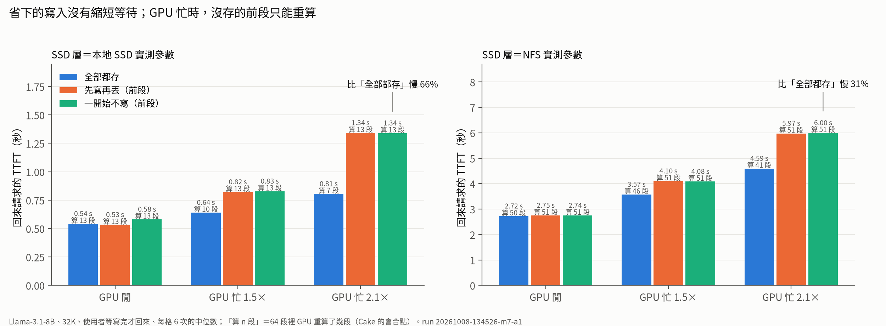
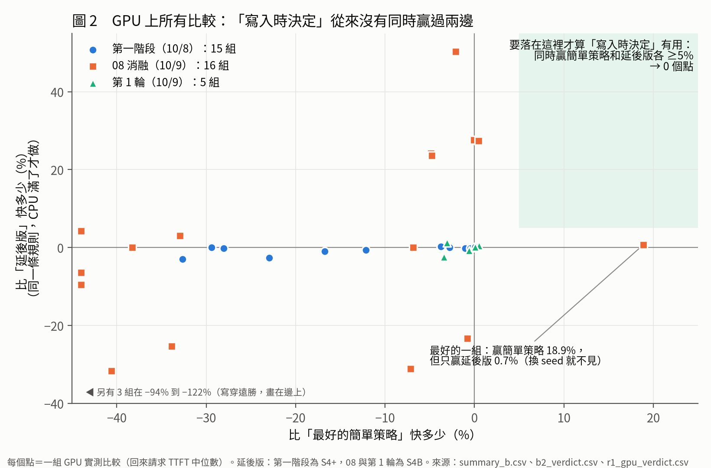
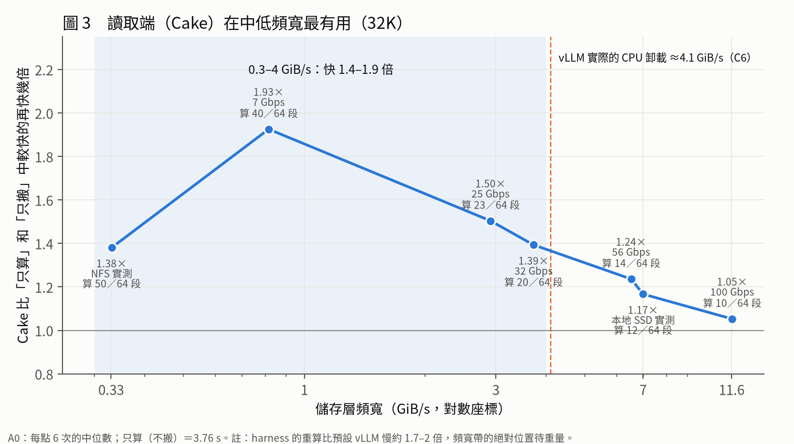

# 進度報告：寫入時依位置放 KV，有沒有用？（2026-10-12）

**給**：老師
**期間**：10/8–10/12
**平台**：AMD MI300X（單卡）；模型以 Llama-3.1-8B 為主
**詳細資料**：每個數字都能追到 `results/` 的 CSV 和 run_id；各報告的位置見文末。

---

## 0. 一頁摘要

- **老師的三個問題都有答案了**（§1）。
- **結論**：「寫入時依位置決定放哪一層」（S5），在所有測過的條件下，都被「滿了再搬」的延後做法追平。
  - 原因：寫入時用到的資訊（位置），等到要搬的時候一樣看得到。
- **真正有用的是讀取時的 Cake**：頻寬 0.3–4 GiB/s 時，比「只算」或「只搬」快 1.4–1.9 倍。
- **提案**：論文改成「**寫入簡單、讀取聰明**」，把第二階段（精度）放到讀取端，和 Cake 合併（§4）。
- **一個漏洞已用模擬補上**：我們實驗程式的重算比真實 vLLM 慢約 2 倍。把重算加快 2 倍重跑，結論不變（free 下 0 個存活，§3）。
- **需要老師決定 4 件事**（§6）。

---

## 1. 老師三個問題的答案

用老師的比喻：筆記 12 頁，回來時小明（GPU）從第 1 頁重抄，快遞（I/O）從倉庫把第 12 頁往前送，兩人在中間碰頭（這就是 Cake）。

| 老師的問題 | 答案 | 證據 |
|:--|:--|:--|
| Q1：少印前幾頁，回來時有比較快嗎？ | **沒有**。只有「寫入還沒寫完使用者就回來」時快 3.7–13%（24 格中 6 格，其中只有 3 格超過重跑雜訊 6.2%），寫完才回來時 24 格中 0 格 | 07 §5（A1、A2） |
| Q2：小明正在忙的時候呢？ | **代價明顯**。GPU 忙時，「一開始不存前段」要多等 13–66%（16K 以上），GPU 閒時沒差。所以改成「每段都存，只改放的地方」 | 07 §5（A1） |
| Q3：有沒有更簡單的方法？ | **有**。「先全部放 CPU，滿了再搬」的延後版，在所有條件下都追得上（§2） | 07、09、12、方向探索 |

---

## 2. 做了什麼、結果如何

| 日期 | 階段 | 做法 | 結果 |
|:--|:--|:--|:--|
| 10/8 | 第一階段 | 在 MI300X 上做實驗程式：真的 GPU 重算、真的 CPU 記憶體、限速模擬 SSD；還原後逐位元組驗證 | Cake 驗證有效。S5 和延後版只差 ≤3%。容量很緊時，LRU 反而比依位置淘汰快 12–33% |
| 10/9 | 08 消融 | 把對 S5 最有利的條件組合起來：CPU 慢、容量緊、搬移卡住請求、一次寫一大段文件 | GPU 上 16 組比較 **0 組通過**。最好的一組 S5 比簡單策略快 18.9%，但只比「同一條規則、滿了才套用」快 0.7%：贏的是規則，不是「寫入時」 |
| 10/9 | 破解第 1 輪 | 換模型（MHA、MoE）、看 SSD 寫入量、讀真實系統（vLLM、LMCache、SGLang、Dynamo）的原始碼；另請一個沒看過前文的 agent 做反方審查 | 模擬篩出 1 個可能贏的設定，**上 GPU 後 0／5 個 seed 通過** |
| 10/10 | 8 個方向同時探 | 多人同時用、真實 vLLM、硬體地圖、真實 trace、VLM 與新架構、精度、作業系統、其他新題目 | **全部被延後版追平**。延後版唯一會輸的「一直沒空搬」，在真實系統裡不會持續發生：vLLM 不會丟資料（133,504 個區塊 0 個被跳過），寫入也不會持續塞車 |
| 10/10 | 後續 F1–F6 | 用新 seed 重新確認、追 vLLM 的問題、量耗電、稽核舊論文、寫論文草稿 | 新 seed 下 **216 格 0 格通過**；另有兩個附帶發現（見下） |

### Cake 有用的範圍（32K）

| 頻寬 | Cake 比「只算」或「只搬」中較快的再快多少 |
|:--|:--|
| 0.3–4 GiB/s | **1.4–1.9 倍** |
| ≥7 GiB/s | <20% |
| ≥11.6 GiB/s | 約 5%，短 context 時甚至變慢 |

- context 越長越有效。
- 28 格中有 1 格例外：最短 context、最快頻寬（07 §4）。
- vLLM 實際從 CPU 搬的速度約 4.1 GiB/s，正好落在 Cake 最有效的範圍（07 §7）。

### 兩個附帶發現

1. **vLLM 在 AMD 上，開 CPU 卸載就變慢。**
   - 原因：vLLM 0.28 在 ROCm 上只要開任何 KV 卸載，就從快的 attention 實作換成慢的。33K prefill 的 attention 從 1.37 秒變 3.28 秒，3 個 seed 都重現。
   - 我們找到修法，可以消掉 45–74% 的變慢，資料不失真。
   - 上游還沒修（vLLM issue #60316）。
   - 另外，vLLM 只會「等著搬」：資料在 NFS 時，使用者最久等了 89 秒，重算其實只要 2–7 秒。
2. **用耗電來算時，最佳選擇和用速度算時不同。**
   - GPU 重算時 726 W，等搬運時 169 W。
   - 資料在 CPU 或本地 SSD 時，最省電的是「只搬不算」（GPU 少用 62–70% 的電，但慢 4–43%）；最快的是 Cake。
   - 但換算成錢，GPU 租金要很低才划算，所以這條比較窄。

---

## 附圖（3 張）

**圖 1　省下的寫入沒有縮短等待；GPU 忙時，沒存的前段只能重算**（32K，使用者等寫完才回來）
- GPU 閒時，三種做法一樣快：本地 SSD 0.53–0.58 s、NFS 2.72–2.75 s。→ 回答 Q1。
- GPU 忙 2.1 倍時：「全部都存」可以把會合點往前移，少算幾段（本地 SSD 從 13 段降到 7 段）。「一開始不寫」只能硬算 13 段，所以慢 66%（NFS 慢 31%）。→ 回答 Q2。

**圖 2　GPU 上所有比較：「寫入時決定」從來沒有同時贏過兩邊**
- 每個點是一組 GPU 實測比較，共 36 組：第一階段 15 組、08 消融 16 組、第 1 輪 5 組。
- 右上角（同時贏「最好的簡單策略」和「延後版」各 ≥5%）是空的。→ 回答 Q3。
- 最好的一組贏簡單策略 18.9%，但只贏延後版 0.7%，換一個 seed 就不見了。

**圖 3　讀取端（Cake）在中低頻寬最有用**（32K）
- 頻寬 0.3–4 GiB/s 時，比「只算」或「只搬」快 1.4–1.9 倍；11.6 GiB/s 時只快 5%。
- vLLM 實際的 CPU 卸載約 4.1 GiB/s，正好落在這個範圍。
- 註：harness 的重算比預設 vLLM 慢 1.7–2 倍，頻寬帶的絕對位置要重量。

畫圖程式：`code/m9_advisor_figs.py`（run `20261012-092620-advisor-figs`）；圖裡的每個數字在 `results/m9_followup/advisor_fig_data.csv`。

## 3. 發現的問題（照實報告）

1. **我們實驗程式的重算比真實 vLLM 慢約 1.7–2 倍。**
   - 第一階段拿來對照的 vLLM，剛好跑在上面說的慢路徑上，所以當時誤以為兩者相當。
   - 影響：Cake 有效頻寬的絕對數字要重量。
   - 更重要的是，真實速度正好落在 08 消融裡**唯一還沒排除的例外**：「重算比較便宜時」，模擬裡有少數設定 S5 會贏。
   - **10/12 已用模擬補上**（F7）：把重算加快到 2 倍和 1.7 倍，用完整的對手集合重跑。
     - 在 free（真實系統的預設）下 **0 個設定存活**，最大領先 4.9%。
     - hold 下有 1 個存活，但結果隨 seed 兩極：3 個 seed 贏 22–30%，2 個 seed 輸寫穿 20–27%。
   - 還沒有 GPU 確認：harness 的重算沒辦法直接變快。
2. **舊論文 `main.tex` 的數字稽核**：241 個數字裡 95 個一致、59 個不一致、17 個找不到來源、70 個來源有疑慮。主要問題：
   - κ 的主數字是在主機很忙時量的；
   - 部分數字是舊版 oracle 修正前的；
   - MI300X 的品質主張和實際跑的長度不符；
   - 部分原始 CSV 遺失。
   - 能重建的已重建。我**沒有改** `main.tex`，等老師決定怎麼處理。
3. **方法上的教訓**：
   - 模擬器整體準（多數誤差 <10%），但對「策略之間的差距」有約 5 個百分點的偏差。所以模擬只能挑候選，結論一定要上 GPU。
   - 反方審查指出，我曾在候選贏了之後才加對手，這是偏誤。之後都改成事先寫死判準，再用新 seed 確認。

---

## 4. 提案：寫入簡單、讀取聰明（把第二階段併進讀取端）

### 核心想法
- **寫入時能拿到的資訊**（位置、會不會被重用），晚點也拿得到。
- **讀取時才有的資訊**（GPU 現在忙不忙、頻寬多少、這次的品質要求），寫入時拿不到。
- 所以**決策應該放在讀取時**。寫入時越簡單越好：滿了再搬，搬到慢的層時才降精度。

### 第二階段（精度）怎麼合進來
- 原計劃（06 §6.1）是寫入時依位置挑哪些段降精度。但我們已經算出：**在 Cake 下，還原速度只看各精度各有幾段，和位置無關**。而且反量化很便宜（一段 0.031 ms），「搬到 SSD 時才降精度」的延後版也一樣好。
- 但**品質**和位置有關：Cake 還原時前段是重算的，重算出來是精確的 BF16，**不管當初存成什麼精度**。只有搬回來的後段的精度會影響品質。而前段（開頭的 token）正是品質最敏感的地方。
- **假設（待證）**：「低精度存＋Cake 還原」的品質接近全精度，速度接近全部搬低精度版。
- 讀取時再依 GPU 忙碌程度動態調整：GPU 忙時少重算、多搬，品質可能下降；規劃器要多重算一些來守住品質預算 ε。

### 可能的貢獻

| # | 貢獻 | 狀態 |
|:--|:--|:--|
| C1 | **量化分析**：讀取端會自己調整時，寫入時放哪一層幾乎不重要，延後就好 | 已有證據；要補 §3 第 1 點 |
| C2 | **洞見**：Cake 下品質只受搬回來的段影響，所以低精度存＋Cake ≈ 全精度品質 | 待證（需要有損實驗） |
| C3 | **設計**：讀取時規劃器，依 GPU 忙碌程度、頻寬、品質預算，決定重算多少、每段用什麼精度 | 待做 |
| C4 | **實作**：做在 vLLM（AMD）上，並修好上面的 attention 變慢問題 | 修法已驗證；規劃器待做 |
| C5 | **評估**：和 vLLM 預設、Cake（全精度）、統一量化、PatchKV 式做法比 | 待做 |

### 和前人的差別

| 前作 | 做了什麼 | 不同的地方 |
|:--|:--|:--|
| Cake | 讀取時兩頭同時還原；表 6 有接量化 | 假設全精度、只有一層；沒有品質預算，也沒討論「重算會恢復品質」 |
| PatchKV（2026-08，最接近） | 重算的段不存，載入的段逐 block 混精度 | 切點由「編輯位置」決定；精度在存的時候就凍結；沒有兩頭同時還原；沒和延後版比 |
| vLLM、LMCache、SGLang | 寫穿、滿了 LRU，讀取時只會搬 | 沒有讀取時的重算／搬運取捨 |

### 風險與退路
- **C2 不成立**（前段重算救不了品質）：還有「讀取時依 GPU 忙碌程度動態還原」＋C1＋C4，仍可寫成系統論文，但比較薄。
- **補漏洞後 S5 反而贏了**：變成正面結果：「重算便宜時，寫入時決定才有用」。
- **都不成立**：寫成負面結果的短論文。草稿已經有了（`docs/paper_negative_20261010/draft.md`）。

---

## 5. 下一步（老師同意的話）

| 步驟 | 內容 | 成本 | 有損？ |
|:--|:--|:--|:--|
| 0 | 補漏洞：模擬已補（F7）；若要 GPU 確認，要讓 harness 用快的 attention 重量重算速度 | 約 1–2 天 GPU | 無損 |
| 1 | 品質：用對精度敏感的模型（Qwen；Llama 在各種精度下撈針都全對，看不出差別），撈針放在不同深度，比「全精度＋Cake」「低精度全部搬」「低精度＋Cake」「PatchKV 式」 | 約 1 天寫程式＋2–3 小時 GPU | **有損** |
| 2 | 速度：同上幾組，在不同頻寬下量還原時間 | 約半天 GPU | 無損 |
| 3 | 動態：GPU 忙碌程度不同時，讓規劃器自己選重算多少來守住品質 | 約 1–2 天 | 有損 |

每一步的判準都會在開跑前寫死。

---

## 6. 需要老師決定

1. **方向**：同意改成「寫入簡單、讀取聰明」嗎？還是直接寫負面結果論文，或換題目？
2. **有損實驗**：§5 的步驟 1、3 會降精度、量品質，原本規劃要老師同意才做。可以做嗎？
3. **`main.tex`**：照稽核清單修，還是等新方向定了再整篇改寫？
4. **CVPR 2027**（06 §6：10/21 決定）：VLM 方向的探索結果偏弱。多存一份圖片編碼只是「寫穿」的變形，前人已做，目前沒找到強的視覺切入點。建議先不追，請老師決定。

---

## 附錄：文件地圖

| 內容 | 位置 |
|:--|:--|
| 總報告（第一階段＋消融＋第 1 輪） | `docs/phase1_20261008/FULL_REPORT.md` |
| 第一階段 | `docs/phase1_20261008/07_report.md` |
| 08 消融 | `docs/phase1_20261008/09_ablation_report.md` |
| 破解第 1 輪＋反方審查 | `docs/phase1_20261008/12_round1_report.md`、`docs/research_20261009_explore/REDTEAM_round1.md` |
| 8 個方向 | `docs/research_20261010_directions/SUMMARY.md` |
| 後續 F1–F6 | `docs/research_20261010_followup/SUMMARY.md` |
| `main.tex` 稽核 | `docs/audit_20261010/DATA_AUDIT.md` |
| 負面結果論文草稿 | `docs/paper_negative_20261010/draft.md` |
| 實驗流水帳（含所有失敗） | `results/RUNLOG_MI300X.md` |
