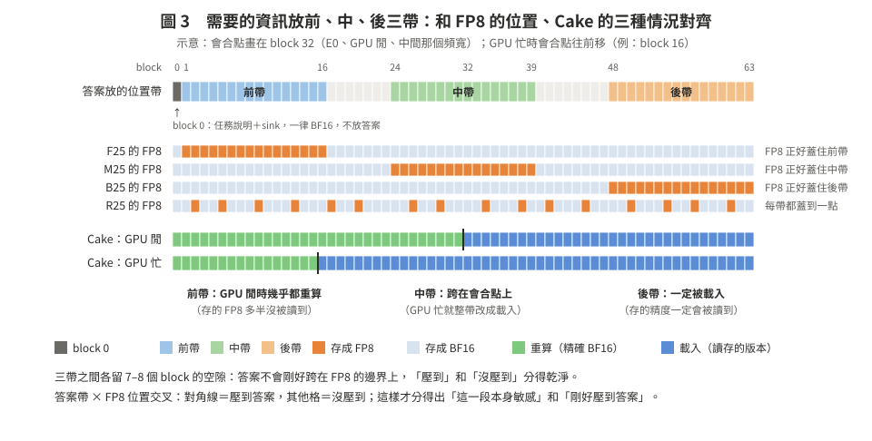

# 05　白話問答

> 回到 [README](README.md)。這一頁回答 10/13 討論時問到的問題；細節與出處在 [02](02_papers.md)、[03](03_plan_h200.md)、[cards/](cards/)。
> **比喻**（沿用）：KV cache＝模型讀文件時做的**筆記**，有筆記，下次再問就不用重讀。使用者回來時，**小明**（GPU）從第 1 頁往後重抄，**快遞**（I/O）從倉庫把最後一頁往前送，兩邊在中間碰頭（這就是 Cake）。

---

## 1. 為什麼用 FP8？只是舉例嗎？

- 老師的原話是「全 FP8 先當兩個端點，再挑一個比例，**例如** 25%」。「例如」講的是 25% 這個比例；FP8 是老師指定的格式。
- **為什麼是 FP8**：
  - vLLM 內建，H100、MI300 有硬體支援，是最常見的 KV 壓縮格式；Cake 原文接的也有 8-bit。
  - 它是最溫和的一步，大小剛好一半。
  - 這週只想動「位置」一個變數，所以**每一階裡格式固定**。
- **但格式會決定答案**：
  - 混精度只有在「最好的均勻低精度也不夠」時才有意義，也就是快掉下品質懸崖的地方。
  - 文獻裡的位置規則（保護開頭、保護最近的）都只在 2–4 bit 量到效果；到 4-bit 時效果已經很小（KVQuant 保護 sink 只差 0.02 PPL）。
  - FP8 很可能還沒到懸崖。在那裡「位置沒用」，只代表「FP8 這個工作點不需要位置策略」。
- **所以加了精度階梯**（[03 §2.5](03_plan_h200.md#25-精度階梯fp8-不需要就往下一階最多一階)）：FP8 這一階「均勻就夠」→ 往下一階 INT4 再看一次；INT4 也夠 → 整個停。只往下一階、事先寫死，避免「換個方式一直試到有結果」。2-bit 這週不做。

---

## 2. 要跟現有方法比嗎？什麼時候比？

**別人怎麼比（兩種習慣）**：

| 類型 | 代表 | 怎麼比 |
|:--|:--|:--|
| KV 量化論文 | KIVI、KVQuant、ZipCache | 同樣平均 bit 數 → 比品質（LongBench、RULER、撈針、GSM8K），2–4 個模型 |
| 還原系統論文 | Cake、CacheGen | 比等待時間：對「只重算」「只載入」，掃頻寬和 GPU 忙碌；有損的（CacheGen）才另外比品質 |

我們的「品質對延遲」圖把兩邊合起來（CacheGen 也這樣畫）。

**什麼時候比誰**：

| 階段 | 比誰 | 為什麼 |
|:--|:--|:--|
| **這週（Cake 核心）** | 均勻 FP8（E1，＝vLLM 的做法）、Cake＋均勻量化（E1 用讀法 B）、只保護 sink（E1s，＝StreamingLLM／KVQuant 的規則）、隨機混（R25） | 這些就是「別人的做法」在同一套還原器上的最簡版本，不用重做別人的系統 |
| 位置策略活下來之後 | 依 attention 風險選（PatchKV 式）、寫入時可算的內容指標（SemKV 式）、存兩份讀取時挑（CacheGen 式）、保護最近的（KIVI 式） | 這時才要證明「位置」比這些便宜或更好 |
| 寫論文時 | 真實系統：vLLM 預設（只載入）、LMCache、Cake；第二個長度 | 審稿人一定要 |
| 如果這週就停 | 只需要 vLLM 預設、Cake、均勻 FP8／INT8／INT4 | 論文變成量測型，不用打贏 KIVI |

所以：**這週先限縮在 Cake 核心**。先確認有沒有東西值得比，再花時間重做別人的方法。

---

## 3. Llama 全部 20/20，是不是實驗設計有問題？

**很可能是。** 之前說「Llama 每種精度都沒差、Qwen 是唯一會壞的」說得太滿。九月的品質實驗至少有四個問題：

| # | 問題 | 說明 |
|:--|:--|:--|
| 1 | 題目太簡單 | 單題撈針很容易滿分。20/20 是碰到天花板，不是「沒有損失」。同一批 Llama 的 GSM8K（120 題）：BF16 80.8、FP8 75.8，掉 5 分，但 120 題的雜訊也有好幾分，只能說「看不出來」〔實測 20260916-192213，D6 §4.5〕 |
| 2 | 題數太少 | 20 題，錯 1 題就是 5% |
| 3 | 情境不同 | 九月用 vLLM 原生 FP8：第一次讀文件時，每一層的 attention 就讀 FP8，誤差會往後面的層傳〔判讀〕。這週測的是「存起來的那份是低精度、還原時讀一次」，溫和很多 |
| 4 | 有混雜 | 3090 那次 Qwen 是 AWQ 量化權重、scale 1.0；MI300X 那次動態 FP8 換了 attention kernel |

**題目要多難？計劃裡有寫**（[03 §3.2](03_plan_h200.md#32-題數與難度)）：
- 每個模型、每個任務族、每個位置帶的 **BF16 正確率都要在 60–95%**。高於 95% 碰天花板，低於 60% 模型本身就不會。
- 難度只用 BF16 調（調干擾數、跳數、段落數），調好就凍結，再跑任何低精度。
- 任務不只撈針：多鍵撈針、一鍵多值、4 跳變數追蹤、兩跳 QA、全文詞頻聚合。
- 另外記兩個不會碰天花板的連續指標：標準答案的 log-prob、答案分布對 BF16 的 KL。
- 780 題，配對比較，CI 半寬約 1.6 個百分點〔算術〕。

**現在的模型怎麼選**（[03 §1.1](03_plan_h200.md#11-模型兩個模型都跑端點再照規則選主模型)）：
- 不用舊資料選。**Llama-3.1-8B 和 Qwen2.5-7B-1M 都跑端點**（多約半天 GPU）。
- Llama：Cake、KIVI、ZipCache、SemKV 都用，第一階段也是它，代表性最好。Qwen：已發表論文說它的 Key 怕量化，當壓力測試。
- 再照事先寫好的表選主模型：兩個都「均勻就夠」→ 往下一階；只有 Qwen 不夠 → 在 Qwen 上做；Llama 不夠 → 在 Llama 上做。主比較只用一個模型。

---

## 4.「Qwen 的 FP8 會壞」是誰說的？

依可信度：

| 層級 | 誰 | 說了什麼 | 限制 |
|:--|:--|:--|:--|
| 已發表論文 | KVTuner（ICML 2025） | Qwen2.5-7B 的 KV 都用 4-bit 時，GSM8K 從 0.77（8-bit）掉到 0.008 | **整數** 4-bit，不是 FP8 |
| | DiffKV（SOSP 2025） | Qwen2.5-7B 的 Key 用 4-bit 就幾乎全錯，所以對 Qwen 關掉低精度 | 同上 |
| 社群回報（沒有同儕審查） | TensorRT-LLM issue #4218 | Qwen2.5-Coder 開 FP8 權重＋FP8 KV，輸出亂碼 | 權重也是 FP8，混在一起 |
| | 第三方 fork（issue #28、PR #30） | Qwen2.5-7B 的 K 在少數 channel 有約 400 的固定偏移；先減掉偏移再量化，誤差大降 | GPTQ 權重；我們沒重現 |
| 我們自己 | 3090（8/31）、MI300X（9/16） | FP8 撈針 1/20、2/20；INT8 19/20、18/20 | 有 §3 的四個問題 |

**結論**：「Qwen2.5 的 Key 怕量化」有論文支持；「FP8 一定會壞」目前只是社群和我們的觀察，這週用新的情境重量。

**為什麼會壞（白話）**：
- FP8 像一把「**數字越大、刻度越寬**」的尺。數字小時刻度很細；數字在 400 附近時，相鄰兩格差 32。
- Qwen 的 K 有幾個 channel 一直待在 400 附近，真正有用的差異只有幾個單位，這把尺量不出來。
- INT8 是 256 格**等距**的尺，對「範圍窄」的資料反而比較準。所以同樣 8 bit，INT8 能過、FP8 不行。
- 這就是計劃裡 Step 2b 要試「K 先減掉偏移再存 FP8」和「INT8」的原因。

---

## 5. 三篇論文在做什麼（白話）

### CacheGen（SIGCOMM 2024）：像 YouTube 自動調畫質

- **問題**：筆記放在別台機器上，要透過很慢的網路送過來。
- **做法**：
  - 事先把每一段筆記壓成高、中、低幾種「畫質」（利用相鄰 token 的值很像，只存差值，再壓縮）。
  - 送的時候一段一段看網速挑畫質。
  - 網速太差的那段，乾脆只送原文，讓 GPU 自己重抄。
- **和我們的關係**：它是「**讀取時才決定精度**」的代表，代價是每段要多存幾份。我們這週是「只存一份」，所以不比；位置策略活下來，就一定要面對它。

### StreamingLLM（ICLR 2024）：垃圾桶在第一頁

- **問題**：對話很長，記憶體只放得下最近的筆記。
- **發現**：
  - 只留最近的筆記，模型會完全壞掉。
  - 只要多留**最開頭 4 個 token**，就恢復正常。
  - 原因：模型習慣把「不知道該看哪裡」的注意力倒在開頭那幾個 token 上，叫 **attention sink**。和那幾個字的內容無關，換成換行符號也一樣。
- **重點**：是開頭「幾個 token」，不是前半段；而且它做的是「丟掉」，不是「降精度」。
- **和我們的關係**：所以混合配置都把 block 0（含那幾個 token）留 BF16；但不能說「前 25% 比較重要」。這正是老師的提醒。

### MuKV（CVPR 2026）：影片筆記，存之前先刪掉不重要的格子

- **問題**：長影片問答，影片產生的 KV 太多。
- **做法**：
  - 存之前就把不重要的影像 token **刪掉**（不是降精度）。
  - 判斷重要性用兩個訊號：attention 分數，加上影像內容的變化量（它叫「頻率」）。
- **觀察**：只看 attention 的話，越早的 token 分數越高。我們的判讀是，這有一部分是計算方式造成的假象（越早的 token 被越多後面的 token 看到，分數自然累積得多）；加上內容訊號可以修正。
- **和我們的關係**：「attention 說前面比較重要」不能直接相信。另外，它說的「前面」是一小段影片內部的順序，不是長文章的前後。

---

## 6. GQA 的 KV 比較小，要不要改測 MHA？

- **差在哪**：GQA 是好幾個 query head 共用一組 K、V，所以 KV 比較小。每 token：Llama-3.1-8B 128 KiB、Qwen2.5-7B 56 KiB；MHA 的 LongAlpaca-7B（Cake 主表用的）是 512 KiB，是 Llama 的 4 倍〔算術，Cake Table 1〕。
- **KV 小的後果**：搬運便宜，會合點偏前，FP8 省下的**絕對時間**比較少。
- **這週不改**，理由：
  1. 頻寬是用「讓 E0 的會合點落在 block 16、32、48」來選的（[03 §4.1](03_plan_h200.md#41-怎麼選頻寬)），不是用裝置名稱。三種會合情況在 GQA 上一樣量得到，**相對比較不受 KV 大小影響**。MHA 只會讓 Cake 有用的頻寬帶整體往高頻寬移。
  2. 現在的主流模型都是 GQA；MHA 多半是舊模型。
  3. LongAlpaca-7B 長文能力弱，題目很難調到 60–95%〔推論〕（3090 上它最多 16K；換到 H200 沒有這個限制，但長文能力的問題還在）。
- **但要誠實報告**：GQA 模型在真實的 CPU 層上，FP8 能省的還原時間可能只有幾十到幾百毫秒（時間＝位元組 ÷ 頻寬；32K 的 BF16 KV：Qwen 1.75 GiB、Llama 4 GiB；H200 的 CPU→GPU 頻寬 NOT_MEASURED，03 §R0 量）。那時 FP8 的價值主要是**省空間**（同樣的 CPU／SSD 放 2 倍的對話），不是省時間。報告要分開寫。
- MHA 留到之後當穩健性檢查。

---

## 7. 顯卡要多大？24 GB 夠嗎？要不要 48 GB？

**這週的計劃（≤32K、Llama-3.1-8B 與 Qwen2.5-7B-1M）：24 GB 夠。**

| 項目 | Llama-3.1-8B | Qwen2.5-7B-1M | 依據 |
|:--|:--|:--|:--|
| vLLM 在這台 3090 上能放的 KV（BF16 權重） | **41,648 token** | **106,512 token** | 〔實測，M1，2026-08-30，`git show 52803bc^:results/RUNLOG.md`〕 |
| 權重（BF16） | 約 15 GiB | 約 14.2 GiB | 〔算術，參數量 × 2 B〕 |
| 32K＋問答的 KV 緩衝（約 34K token） | 約 4.2 GiB（128 KiB／token） | 約 1.8 GiB（56 KiB／token） | 〔算術〕 |
| CUDA context、allocator、單一 512-token chunk 的暫存 | 約 1–2 GiB | 約 1–2 GiB | 〔推論，沒量過〕 |
| 「GPU 忙」的背景程式（另一個 process） | 約 1 GiB | 約 1 GiB | 〔推論：3 個 8192×8192 BF16 矩陣 384 MiB＋context〕 |
| **harness 合計** | **約 21–23 GiB：緊** | **約 18–19 GiB：寬鬆** | 〔推論〕；3090 是 24 GiB |

- Llama 會緊，主要看 attention 有沒有走 flash kernel：退回 math kernel 時，每層會多出約 1–2 GiB 的暫存〔推論〕。所以 D0 要量峰值記憶體，同時確認 SDPA 用了哪個 kernel（03 §5.2）。
- 放不下時，照 03 §1.1：兩個模型一起降到 Llama 放得下的最大長度（≥16K）。

**限速模擬要不要考慮記憶體？**
- 「SSD／NFS」是 pinned CPU 記憶體加計時器，**不吃 GPU 記憶體**，吃的是主機記憶體。
- 一題要存：Llama 約 4 GiB（BF16）＋2 GiB（FP8）＋1 GiB（INT4）≈ 7 GiB；Qwen 約 3 GiB〔算術〕。這台的 `/dev/shm` 就有 221G（CLAUDE.md §3），不是瓶頸。

**什麼時候才需要 48 GB**〔算術／推論〕：

| 情況 | 為什麼 24 GB 不夠 |
|:--|:--|
| Llama 超過約 40K | vLLM 實測上限就是 41,648 token；64K 的 KV 要 8 GiB，加權重超過 24 GiB |
| MHA 模型（LongAlpaca-7B）跑 32K | KV 512 KiB／token × 32K＝16 GiB，加權重約 12.6 GiB，約 29 GiB |
| 13–14B 以上的模型（例如 Qwen2.5-14B-1M） | 權重就要約 27.5 GiB |
| 多個 session 同時留在 GPU（容量、併發實驗） | 每個 session 都要自己的 KV |

**換卡的代價**：
- 不同的 GPU，所有時間數字（f(i)、會合點、頻寬帶）都要重量，也違反這週「同一台機器」。
- 之後如果申請 48 GB，要注意架構：
  - **RTX A6000 48 GB**：和 3090 同樣是 Ampere（sm_86），程式、FP8 的路徑完全一樣，最好接。
  - **L40S、RTX 6000 Ada**：sm_89，有原生 FP8，vLLM 會走不同的 kernel，FP8 的結果不能直接和 3090 比。
- 建議：**這週用 3090**。等位置策略有結果、要往更長的 context、MHA 或更大的模型擴展時，再申請 48 GB。

---

## 8. 為什麼這樣設計？每個選擇的理由與參考

### 8.1 為什麼把需要的資訊放在前、中、後三帶

**原理（白話）**：用「影印的課本考試」來比。

- 課本 64 頁，其中 16 頁印得比較模糊（＝存成 FP8）。考試題目只問某一頁的內容（＝需要的資訊在哪）。
- **一次只改一件事，才知道結果是誰造成的（控制變因）**：別人的論文想知道「資訊放在哪會不會影響答對」，所以只改「答案在第幾頁」，其他都不變。這就是前面那些先例在做的事。
- **我們的問題多了一件事**：我們要知道「模糊的頁放在哪會不會影響答對」。但如果只改模糊頁的位置、題目的位置是亂的，會分不出兩種原因：
  - (a) **那幾頁本身就重要**（例如目錄、說明頁，不管問哪一頁，它模糊都會害你答錯）；
  - (b) **只是剛好模糊到你要找的那一頁**。
- **所以兩件事都要改，排成一張表（交叉設計）**：

  | 題目問的頁 ↓ ／ 模糊的頁 → | 前面模糊 | 中間模糊 | 後面模糊 |
  |:--|:--|:--|:--|
  | 問前面 | ？ | ？ | ？ |
  | 問中間 | ？ | ？ | ？ |
  | 問後面 | ？ | ？ | ？ |

  - 如果只有「模糊到題目那頁」的格子（對角線）答錯變多 → 是 (b)，位置本身不重要。
  - 如果「前面模糊」那一整欄都變差，連問後面的題目也錯 → 是 (a)，前段本身重要。
  - 如果都沒變 → 模糊沒影響，全部印模糊也可以。
- 只改其中一件事，(a) 和 (b) 看起來會一樣；兩件事交叉著改，才分得開。

**圖 3**　三個答案帶刻意和 FP8 的位置、Cake 的三種情況對齊。

1. **有先例：量「位置效應」的標準做法，就是把需要的資訊放在不同深度。**
   - Lost in the Middle（TACL 2024）：把有答案的那份文件放在 10／20／30 份文件中的不同位置，量到 U 形，放中間最差〔原文 §2.3 / p.5 / Fig. 5；[cards/P03](cards/P03_position_sensitivity_literature.md)〕。
   - Needle-in-a-Haystack（Kamradt 2023）：長度 × 深度的網格，例如 GPT-4-128K 用 15 個長度 × 15 個深度〔文件；E09 卡〕。
   - Yuan et al.（Findings of EMNLP 2024，專門評 KV 壓縮）：撈針 10 個長度 × 10 個深度，每格 3 次〔原文 App. B.2；[cards/P05](cards/P05_closest_work_mixed_precision.md)〕。
   - HELMET 的 RAG 任務把答案文件放在 6 個位置〔原文 p.4；E09 卡〕；RULER 的 needle 在句子位置上隨機抽〔程式碼 `niah.py`；E09 卡〕。
   - **我們多做的一步**：別人只動「資訊在哪」，我們同時動「低精度放在哪」。
2. **為什麼至少三帶，不是兩帶**：兩個點只看得出「前比後好或壞」這種直線關係。Lost in the Middle 量到的是 U 形（兩端好、中間差），至少要三個點才看得到這種非單調的形狀〔判讀〕。
3. **為什麼不是 10 個深度**：題數固定時，帶越多，每格題數越少。780 題分成 4 個任務 × 3 帶，每格 60 題；改成 10 個深度，每格只剩 18 題〔算術〕。九月就吃過這個虧：5 個深度 × 4 題，每格只有 4 題，不能當訊號〔D6 §4.5〕。
4. **三帶和 FP8 的位置對齊，形成交叉設計**：F25 的 FP8 正好蓋住前帶，B25 正好蓋住後帶。3 個答案帶 × 3 種 FP8 位置是一個 3×3 的表（[03 §3.1](03_plan_h200.md#31-任務不要只用容易滿分的單題撈針)），對角線是「壓到答案」，其他格是「沒壓到」。這樣才分得開兩種解釋：
   - (a) **前段本身比較敏感**：不管答案在哪，壓前段都比較傷；
   - (b) **只是剛好壓到答案**：只有對角線那幾格會傷。
   兩個因子交叉，才能把「主效應」和「交互作用」分開，這是實驗設計的基本做法〔判讀〕。如果答案位置隨機、只換 FP8 的位置，(a) 和 (b) 會混在一起。
5. **三帶剛好對到 Cake 的三種情況**（圖 3 下半）：
   - 前帶：GPU 閒時幾乎都被重算，存的 FP8 多半沒被讀到；
   - 中帶：跨在會合點上，GPU 忙時整帶都改成載入；
   - 後帶：一定被載入，存的精度一定會被讀到。
   所以三帶也代表「存的精度被讀到的機會」由低到高。這就是老師問的「是不敏感，還是沒被讀到」的直接檢驗。
   - **用筆記比喻**（64 頁筆記；示意：小明閒時兩人在第 32 頁碰頭，小明忙時在第 16 頁碰頭）：

     | 答案在第幾頁 | 小明閒（碰頭在 32） | 小明忙（碰頭在 16） | 存的縮印版（FP8） |
     |:--|:--|:--|:--|
     | 第 10 頁（前帶） | 小明重抄 → 精確 | 小明重抄 → 精確 | **永遠沒人看** |
     | 第 30 頁（中帶） | 小明重抄 → 精確 | 快遞送來 → 看到縮印版 | **看小明忙不忙** |
     | 第 55 頁（後帶） | 快遞送來 → 縮印版 | 快遞送來 → 縮印版 | **一定被看到** |

   - 一頁筆記在還原時只有這三種命運，所以分三帶。少了中帶，就量不到老師問的「GPU 忙起來改成多載入，品質還守得住嗎」。
6. **為什麼帶之間留空隙、block 0 不放答案**：
   - 帶之間各留 7–8 個 block，答案不會剛好跨在 FP8 的邊界上，「壓到」和「沒壓到」分得乾淨。
   - block 0 有 sink 和任務說明，所有混合配置都保留 BF16，所以不放答案。
   - Needle-in-a-Haystack 會把 needle 對齊到句點，實際位置會偏離設定（v2 另外存實際深度）〔程式碼；E09 卡〕。所以我們的產生器要用 tokenizer 驗算答案真的落在指定的 block 範圍（[03 §6](03_plan_h200.md#6-要改的程式)）。

### 8.2 其他設計選擇的理由

| 設計 | 為什麼 | 參考 |
|:--|:--|:--|
| 先量兩個端點（全 BF16、全 FP8） | 混精度要有意義，前提是均勻的低精度不夠 | 老師 10/13；全精度當品質上限是量化論文的慣例〔判讀〕 |
| E1s（只有 block 0 保留 BF16） | sink 只在最前面幾個 token；先量「最簡單的位置規則」，位置策略要先贏它 | StreamingLLM、KVQuant（[02 §3](02_papers.md#3-位置敏感度文獻真正支持什麼)） |
| E1sr（block 0 和最後一個 block 保留 BF16） | 已發表的「保護開頭＋保護最近」規則；位置策略也要贏它 | KIVI、SKVQ、QEvict、PM-KVQ（[02 §3.2](02_papers.md#32-其他有位置規則的-kv-量化)）；[cards/P06](cards/P06_sys_precision_eval_practice.md) 缺口 1 |
| 速度加「只重算」「只載入」參考線、加 8K／16K | 系統論文的慣例；Cake 的表就是報這兩個比值 | Cake Table 3、7（[cards/P01](cards/P01_Cake_quant_mechanism.md)）；[cards/P06](cards/P06_sys_precision_eval_practice.md) |
| 端點加 LongBench 子集（不進判準） | 系統論文多用真實資料集的標準指標，合成任務只證明機制 | CacheGen、QServe（[cards/P06](cards/P06_sys_precision_eval_practice.md)） |
| R25（隨機） | 「不用任何資訊」的基準，位置策略至少要贏它 | SemKV 用隨機當對照，而且在 Mistral 上隨機明顯比較差（[02 §3.2](02_papers.md#32-其他有位置規則的-kv-量化)） |
| 同位元組、同 codec、同 attention | 只讓「位置」一個變數不同 | 老師 10/13；評測陷阱 7、8：所有方法走同一條 pipeline、報實測位元組（[EVAL_FOUNDATIONS §8](../EVAL_FOUNDATIONS_20261007.md)） |
| 讀法 A（強制全載入）＋讀法 B（Cake 實際還原） | 分開「不敏感」和「沒被讀到」 | 老師 10/13；Cake 的量化實驗沒報品質（[cards/P01](cards/P01_Cake_quant_mechanism.md)） |
| 還原之後才問問題、看第 2 輪 | 很多量化論文在 prefill 時用精確 KV，量化只影響 decode，會低估損失；多輪要固定歷史，才不會被上一輪答錯帶偏 | 評測陷阱 2（KIVI、KVQuant）；SCBench 的多輪用標準答案接後續輪（E09 卡） |
| 題目不只撈針，BF16 正確率 60–95% | 撈針會飽和；難的檢索才看得出差別：SCBench 在 Llama-3.1-8B 多輪下，KIVI 2-bit 讓字串檢索從 57.1 掉到 12.0，全域類只從 35.1 到 31.0 | 評測陷阱 3；SCBench Table 4 p.9（E09 卡） |
| 兩個模型先篩 | 九月的舊資料有四個問題；Llama 代表性好，Qwen 當壓力測試 | 本頁 §3、§4 |
| 精度階梯 FP8 → INT4 | 位置效應只有接近品質懸崖時才可能出現；位元越高，位置規則的效果越小 | KVQuant：4-bit 時保護 sink 只差 0.02 PPL（[cards/P03](cards/P03_position_sensitivity_literature.md)） |
| 頻寬用「會合點落在哪」來選 | 結論不綁在某個裝置上，換機器也成立 | Cake 也是延遲注入，再把頻寬點對到規格（[cards/P01](cards/P01_Cake_quant_mechanism.md)） |
| 判勝門檻 δ*＝max(5%, 實測雜訊) | 舊的 5% 比量到的雜訊 6.2% 還小 | [phase1 07 §3.4](../phase1_20261008/07_report.md) |
| 配對比較、CI、每點至少 6 次 | 小差距沒有誤差棒就不算；中位數的 95% CI 至少要 6 次 | 評測陷阱 20；[EVAL_FOUNDATIONS](../EVAL_FOUNDATIONS_20261007.md) |

### 8.3 參考別人的做法，要不要引用？要，引用這些

**原則**：借用了別人的**設計、資料集、程式碼或數字**，就要引用；拿來**對比、凸顯差別**的前作，也要引用。「一次只改一件事」「交叉設計」這種通用的實驗原則不用引用。我們自己新加的部分（答案位置 × 低精度位置交叉）不用引用，但要寫一句「和前作不同」，那一句會引用前作。

| 我們借用的 | 引用誰 | 出處（已讀版本） | 寫在論文哪裡 |
|:--|:--|:--|:--|
| 把需要的資訊放在不同位置（深度）來量位置效應 | Liu et al., "Lost in the Middle," TACL 2024；Kamradt, "Needle In A Haystack"（GitHub repo, 2023） | arXiv 2307.03172〔P03〕；`gkamradt/LLMTest_NeedleInAHaystack`〔E09〕 | 評估設定：任務與位置帶 |
| T1、T2、T3、T5 的題型模板與計分 | Hsieh et al., "RULER," COLM 2024 | arXiv 2404.06654；`NVIDIA/RULER`〔E09〕 | 同上；程式碼檔頭也要註明改自 RULER，並遵守它的授權〔授權條款未查證〕 |
| T4 的兩跳問答資料 | Yang et al., "HotpotQA," EMNLP 2018 | arXiv 1809.09600〔未查證：這次沒開原文〕 | 同上 |
| 端點的外部效度（LongBench 子集） | Bai et al., "LongBench," ACL 2024 | arXiv 2308.14508〔E09〕 | 評估設定；附錄 |
| 第 2 輪用標準答案接歷史 | Li et al., "SCBench," ICLR 2025 | arXiv 2412.10319〔E09〕 | 評估設定：多輪 |
| 為什麼不只用撈針（撈針會飽和、和下游相關低） | Yen et al., "HELMET," ICLR 2025；SCBench | arXiv 2410.02694〔E09〕 | 評估設定：選題理由 |
| KV 壓縮評測也用深度網格 | Yuan et al., "KV Cache Compression, But What Must We Give in Return?," Findings of EMNLP 2024 | arXiv 2407.01527〔P05〕 | 相關工作或評估設定 |

**論文裡可以這樣寫**（草稿）：
> 為了量位置效應，我們依照 Lost in the Middle [Liu] 與 Needle-in-a-Haystack [Kamradt] 的做法，把回答所需的資訊放在 context 的前、中、後三個位置帶。任務採用 RULER [Hsieh] 的多鍵撈針、一鍵多值、變數追蹤與常見詞統計，另以 HotpotQA [Yang] 的兩段支撐段落構造兩跳問答。**與這些只改變資訊位置的評測不同，我們同時改變低精度 KV 所在的位置，兩者交叉，以區分「該位置本身敏感」與「低精度剛好覆蓋到答案」。**

- 英文版：*Following Lost in the Middle [Liu] and Needle-in-a-Haystack [Kamradt], we place the information required for each answer in the front, middle, or back of the context. Unlike these evaluations, which vary only where the information is, we also vary where the low-precision KV blocks are, and cross the two factors to separate position sensitivity from simply quantizing the answer.*
- 投稿前，這些引用要用 `citation-audit` 再核一次作者、年份與 venue（[CLAUDE.md §5](../../CLAUDE.md)）。

### 8.4 怎麼知道哪一段重要？別人怎麼做？

**先更正一個誤會：這個實驗量得到準確度，不是只量速度。** 每個配置都會在 780 題（有標準答案）上作答，算正確率，再和全 BF16（E0）同一題配對比。隨機（R25）只是其中一個對照組，不是整個實驗。

**判斷「一段重不重要」有兩種做法**：

| 做法 | 怎麼做 | 誰這樣做 | 我們計劃裡的位置 |
|:--|:--|:--|:--|
| ① **弄差它，看品質掉多少**（量出來的） | 把某一段的精度降低（或拿掉），其他不動，看正確率或 PPL 掉多少 | KVQuant：只保護第 1 個 token，2-bit 的 PPL 從 23.34 降到 9.59；StreamingLLM：拿掉開頭 4 個 token，PPL 從 5.40 變 5158；KIVI：有沒有最近 128 個 token 的全精度窗口，GSM8K 20.77 對 12.21（[02 §3](02_papers.md#3-位置敏感度文獻真正支持什麼)） | **Step 2**：F25、M25、B25 各把一段變成 FP8；看「答案不在那一段」的格子掉多少，就是那一段本身的重要性（[03 §3.1](03_plan_h200.md#31-任務不要只用容易滿分的單題撈針)）。block 0 看 E1 對 E1s，最後一個 block 看 E1s 對 E1sr |
| ② **先用分數挑出重要的，重要的留高精度** | 每個 token 或 block 算一個重要性分數（多半用 attention），重要的留高精度、其他壓低，再和「隨機挑」「全部壓低」比 | H2O、SnapKV、ZipCache（正規化 attention，去掉越前面分數越高的偏差）、PatchKV（attention 質量 × 量化誤差）、SemKV（8 種內部指標，和隨機比）（[02 §3–§4](02_papers.md#4-最接近的做法新穎性威脅)） | **Step 3**：S25-低（FP8 放在分數最低的 16 個 block）、S25-高（放在分數最高的 16 個） |

**你提的做法（用權威論文的方法挑重要性，比「重要的轉 FP8」和「不重要的轉 FP8」）就是 ②，計劃裡叫 S25 一對。**
- 兩個一起跑的好處：如果連「最好的放法」（S25-低）和「最壞的放法」（S25-高）都差不到 ε，代表**不管怎麼放都一樣**，位置策略可以直接停。
- 為什麼排在 Step 3：老師說「有穩定差距，再加敏感度感知的強規則」。先用便宜的 ① 看位置有沒有影響，有了再花力氣做 ②。
- 要注意：分數必須在**還沒看到問題**時就算得出來（存 KV 的時候還不知道使用者會問什麼）。需要問題才算得出來的分數（例如 Found in the Middle、Cocktail）只能當上限，不能當可部署的方法（評測陷阱 1）。

### 8.5 前中後太粗？重要的 token 不只答案那幾個？

**對，兩點都對。** 所以要分清楚三帶量得到什麼、量不到什麼：

| | 量得到 | 量不到 |
|:--|:--|:--|
| 三帶的對角線格子 | 「剛好壓到答案」的傷害 | — |
| 三帶的非對角線格子 | 一整帶裡**答案以外所有東西**（sink、說明、分隔符、多跳的中間步驟……）的重要性**加總** | 是帶裡的**哪些** token |
| 逐 block 敏感度地圖（[03 §3.3b](03_plan_h200.md#33b-比三帶更細的診斷不進判準只用來解釋原因)） | 64 個位置各自的敏感度，解析度 512 token | 512 token 以內的細節 |
| attention 去向紀錄 | 問題的注意力實際落在哪裡 | 「注意力高」不一定等於「壓了就會錯」 |

**文獻怎麼看「重要的 token 有幾個」**：
- 注意力通常集中在少數 token：開頭的 sink（StreamingLLM）、開頭附近的分隔符（IntactKV、KVSink 量到的第 13、14 個 token），加上最近的一段（KIVI）。
- 但**和內容相關的重要 token 會跟著問題變**（SnapKV、ZipCache、SemKV 都是逐 token、看內容算的）。存 KV 時還不知道問題，所以只看位置一定抓不全。

**這正是要驗的**：系統只能一個 block 一個 block、在不知道問題時決定精度。問題是「這麼粗的位置規則夠不夠好」。如果重要 token 分散又跟著問題變，位置規則就會輸給隨機或強規則（K2），兩個細的診斷則用來說明**為什麼**輸。

### 8.6 「用權威論文的方法挑重要性」是哪篇、哪個方法？

| 方法 | 論文 | 存 KV 時（還不知道問題）算得出來嗎 | 結論 |
|:--|:--|:--|:--|
| **正規化 attention**：收到的 attention ÷ 能看到它的 query 數；用 10% probe token（5% 最近＋5% 隨機） | **ZipCache（NeurIPS 2024）** | 可以 | **主要採用**：同行審查過、存 KV 時可算、明確去掉「越前面分數越高」的偏差 |
| attention 質量 × 低 bit 重建誤差（逐 block 風險） | PatchKV（arXiv 2026，venue 未查證） | 可以 | 情境最接近我們；留作替代 |
| 8 種模型內部指標 | SemKV（arXiv 2026） | 7 種可以 | 參考；它在 Mistral 上贏過隨機 |
| 累積 attention（heavy hitter） | H2O（NeurIPS 2023） | 可以 | **不用**：分數天生偏向前面，正是老師提醒的偏差 |
| 用結尾一段（通常含問題）看 attention | SnapKV（NeurIPS 2024） | 含問題時不行 | **不用當方法**：會偷看到問題，結果太好看（評測陷阱 1） |
| 問題和 chunk 的相似度 | Cocktail（DATE 2025） | 不行 | 只能當上限 |
| 實際量每個 block 壓了會掉多少 | （我們自己的逐 block 敏感度地圖） | 不行（要先跑過） | **上限（S25-oracle）**：任何放法最多能贏多少 |

**哪樣做比較好**：用 ZipCache 的正規化 attention 當可部署的強規則，配一個實測的上限（oracle）。前者回答「實際做得到的最好放法有多好」，後者回答「理論上最多能多好」。如果連上限都贏不了隨機 2 個百分點，位置和重要性怎麼放都沒差。
