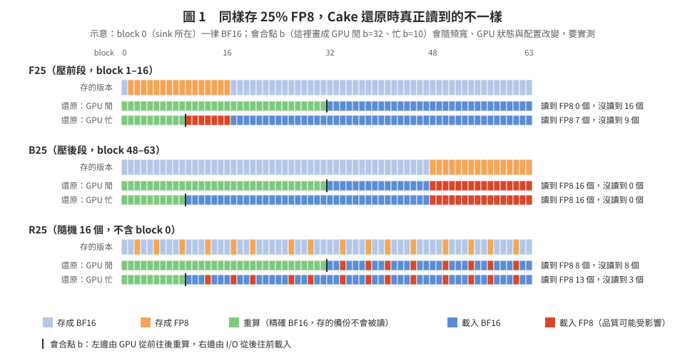
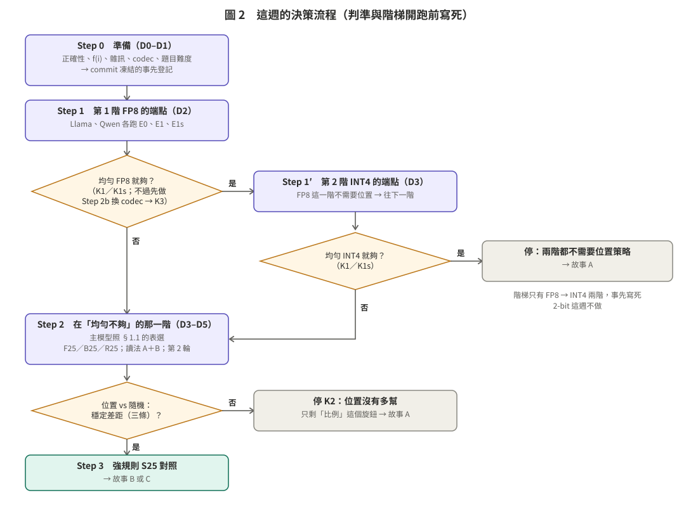

# 精度這條線：依位置決定 KV 精度，有沒有用？（2026-10-13 起）

**一句話**：先在 H200 上確認硬體、復現第一階段（和當初上 MI300X 一樣），再用兩個模型量「全 BF16」和「正確校準的全 FP8」兩個端點（外加「只保護 sink」的全 FP8）。全 FP8 就夠，就往下一階用 INT4 再量一次；兩階都夠就停。找到「均勻不夠」的那一階，才比「25% 低精度放前段／後段／隨機」（sink 一律保留 BF16），並逐 block 記錄「重算／載入 BF16／載入低精度」，把「不敏感」和「沒被讀到」分開。

**狀態**：**第二階段 GPU 實驗 10/20 全部結束，最終報告見 [report_stage2/REPORT.md](report_stage2/REPORT.md)**；逐段的結果紀錄見 [08](08_report_mi300x.md)。 **10/15 晚改成在 MI300X 上把實驗跑完、H200 只復現**（[03 開頭](03_plan_h200.md)；凍結版事先登記見 [07](07_freeze_mi300x.md)；結果放 `results/m10_precision_mi300x/`）。以下是之前的狀態：10/15 起在 MI300X 上做「彩排」：寫程式、抓 bug，數字只放 `results/m10_pilot_mi300x/`，不進任何圖或判定（見 `results/RUNLOG_MI300X.md` 的 Milestone 10-pilot）。10/15 晚上：03 §6 列的程式全部寫好、MI300X 上結構檢查全過；難度參數是候選（H200 上用 E0 確認後才凍結）；我們的數字和論文的對照見 [cards/V2](cards/V2_numbers_vs_papers_20261015.md)。**10/14 起改在 H200 上跑**（原本是 3090；改了什麼見 [03 開頭](03_plan_h200.md)，申請與 Slurm 用法見 [H200_SLURM](../H200_SLURM.md)）。這一頁取代 [CORE_QUESTION_20261008](../CORE_QUESTION_20261008.md) 的「寫入時依位置放哪一層」，當作新的核心問題。第一階段的結論（放置可以延後）不變，見 [phase1 13 號報告](../phase1_20261008/13_advisor_update_20261012.md)。

---

## 核心問題（只有一個）

> 在同樣的品質要求、同樣的資源（存的位元組、頻寬、GPU 可用度）下，**依位置決定哪些 block 用 FP8**，會不會比「全 FP8」或「同比例隨機放」更好？

用老師的筆記比喻：筆記 64 頁，回來時小明（GPU）從第 1 頁往後重抄，快遞（I/O）從倉庫把最後一頁往前送，兩人在中間碰頭。現在有 16 頁改用「縮印版」（FP8）存。
- 縮印的如果是**前面**幾頁：小明反正會重抄，縮印版根本沒人看。品質不會掉，但也沒有變快。
- 縮印的如果是**後面**幾頁：快遞一定會送到，縮印版送得快，但字比較糊，答案可能看錯。
- 小明很忙時（GPU 忙），兩人碰頭的地方往前移，前面的縮印版也開始被用到。

所以「前段量化沒掉品質」可能只是**沒被讀到**，不是**不敏感**。這週的實驗就是要把這兩件事分開。

---

## 這個資料夾

| 檔案 | 內容 | 什麼時候看 |
|:--|:--|:--|
| [01_advisor_feedback.md](01_advisor_feedback.md) | 老師 10/13 原文；每一句對到計劃的哪一節；我們自己發現的一件事（Qwen 的 FP8 失敗主要不是校準造成的） | 先看這個 |
| [02_papers.md](02_papers.md) | Cake、CacheGen 在系統層怎麼做；attention sink、MuKV 的位置偏差；最接近的做法；vLLM 的 FP8 校準 | 寫規則、寫相關工作時 |
| [03_plan_h200.md](03_plan_h200.md) | **完整規劃（H200）**：開跑前的硬體確認與第一階段復現（§R）、固定條件、八個配置、兩種讀法、事先寫死的預測與判準、品質與速度實驗、量測整理、要改的程式、時程、交付物 | 執行實驗時 |
| [07_freeze_mi300x.md](07_freeze_mi300x.md) | **事先登記凍結版（MI300X 主實驗）**：格式、δ*、頻寬、題數、判準、先跑封存的工作、凍結前看過的東西 | 判讀結果前 |
| [08_report_mi300x.md](08_report_mi300x.md) | **結果報告（MI300X，進行中）**：K0、實際讀到多少低精度、Step 1／2b／INT4、H1–H7 逐條、限制、run_id | 要看結果時 |
| [report_stage2/REPORT.md](report_stage2/REPORT.md) | **第二階段最終報告（10/20）**：問題、設定、主線判定（K0→K2）、全部探索實驗、討論與想法、限制、30 張圖（F01–F28、F30、F31）、數字來源表 | 要看第二階段總結時 |
| [09_sweep_plan.md](09_sweep_plan.md) | **大掃描（探索，另外登記）**：13 種格式 × 佔比 10–90% 每 5% × 12 種放法；海選→複賽的規則；速度推算的驗證；反量化開銷與加速 | 要看「擴大範圍」的實驗時 |
| [10_longctx_plan.md](10_longctx_plan.md) | **長 context（探索，另外登記）**：32K／64K／128K × 13 種格式＋BF16；teacher forcing＋真的生成；64K／128K 的速度格子；排在所有 32K 工作之後 | 要看「context 變長會不會不一樣」時 |
| [12_tier_plan.md](12_tier_plan.md) | **IO 牆、容量與兩層混合還原（探索，另外登記）**：同樣的記憶體放幾段對話、低精度把「要去慢層」往後推多少；一段對話部分在 CPU（BF16）、部分在慢層（INT4／BF16）時還原多快 | 要看「SSD、容量、分層」時 |
| [13_h200_repro.md](13_h200_repro.md) | **主線在 H200 上的復現（事先登記，10/17）**：和 MI300X 相同的（判準、程式、題目）、H200 自己量的（E0 難度、格式、頻寬、δ\*、會合點）、停下來的條件、只比判定節點 | 要看「換一台硬體結論還在不在」時 |
| [13_restore2_plan.md](13_restore2_plan.md) | **還原的第二輪（只報告，10/17 登記）**：GPU 忙時「拆」搶資源的解法（優先權、一組拆、CU 分區）、允許不重算的會合規則 G5、新格式的融合 kernel、拆進 attention 的對照組、64K／128K | 要看「反量化、GPU 忙、什麼時機用哪種還原」時 |
| [14_match_drop_plan.md](14_match_drop_plan.md) | **讓存和算匹配＋直接丟掉 block（只報告，10/19 登記）**：還原單位（M1）、用格式去匹配慢的層（M2）、丟掉 block 的品質與速度（D：寫入時 ATT vs 還原時 QRY vs 位置 vs 隨機，兩輪） | 要看「Cake 什麼時候有用」「丟 token 行不行」時 |
| [11_issues.md](11_issues.md) | **之後要注意的問題清單**：問題一＝反量化的開銷（低精度在真實 CPU 層反而變慢；融合 kernel 逐位元相同、速度待量） | 做相關實驗、寫任何「低精度變快」的結論前 |
| [04_story.md](04_story.md) | 故事怎麼接：主幹、三種結果對應三個故事、和前作的對照、投稿時程 | 寫報告、選投稿目標時 |
| [05_QA.md](05_QA.md) | 白話問答：為什麼 FP8、跟誰比與何時比、舊實驗哪裡有問題、Qwen 的 FP8 誰說會壞、三篇論文在做什麼、GQA 還是 MHA | 看不懂前面幾頁時先看這頁 |
| [cards/](cards/) | P01–P06：逐篇的原文卡；**P07：大掃描用的前作（格式、佔比、系統 SOTA、反量化加速；多為摘要級，未逐頁核對）**（出處、機制、頁碼、證據等級）；V：獨立複核（85 項：✅71、⚠️12、❌2，已改正）；V2：我們在 MI300X 上量到的數字 vs 論文（26 列：✅16、⚠️4、❓5、❌1） | 要查某篇的細節、或問「我們的數字和論文一樣嗎」時 |
| [figures/](figures/) | 圖 1（實際讀到什麼）、圖 2（決策流程） | — |

---

## 這週的流程

| 步驟 | 做什麼 | 停損 |
|:--|:--|:--|
| Step R（R0–R3） | H200 硬體實測報告、環境、正確性測試、第一階段的校準與主要結論在 H200 上復現（跟上 MI300X 時一樣） | **正確性不過 → 全部停**；第一階段不重現 → 停下來回報（03 §R3） |
| Step 0（D0–D1） | K／V 分布、還原器 vs vLLM、修 attention、雜訊 δ、FP8 codec、只用 BF16 調題目難度 → **凍結事先登記** | — |
| Step 0.5（D1） | **先看有沒有賺頭**：全 FP8 對全 BF16，只量還原速度（合成 token，不用等題目） | **K0**：全 FP8 在每個頻寬都沒有比較快 → 精度對速度沒好處，停（[03 §2.4](03_plan_h200.md#24-判準開跑前寫死)） |
| Step 1（D2） | 第 1 階 FP8：E0、E1、E1s、E1sr 的品質（兩輪，加 LongBench 子集）與速度，Llama 和 Qwen 都跑 | **K1／K1s**：均勻就夠 → 往下一階 |
| Step 2b（D3） | 換 codec 診斷：K 去偏移的 FP8（E1-K0）、全 INT8（E1-INT8） | **K3**：任一個過 → 8 bit 換格式就夠 → 往下一階 |
| Step 1′（D3，條件式） | 第 2 階 INT4：同樣的端點，兩個模型 | 均勻 INT4 也夠 → **整個停**（兩階都不需要位置策略） |
| Step 2（D3–D5） | 在「均勻不夠」的那一階、主模型上：F25／M25／B25／R25，兩種讀法、GPU 閒／忙、第 2 輪 | **K2**：位置沒有勝過隨機 → 停 |
| Step 3（D5，條件式） | 敏感度感知的強規則 S25 | — |
| D6（10/20） | 給老師：品質對延遲的圖、實際讀到什麼的分解、一頁報告 | — |

---

## 這版自己決定的設計（核心合理就不先問老師；10/20 報告時明講）

1. **兩個模型都跑端點，再照事先寫好的表選主模型**：Llama-3.1-8B（代表性）和 Qwen2.5-7B-1M（Key 怕量化的壓力測試）。不用九月的舊資料選，因為那批實驗題目太簡單、題數太少、情境不同、有混雜（[03 §1.1](03_plan_h200.md#11-模型兩個模型都跑端點再照規則選主模型)、[05 §3](05_QA.md#3-llama-全部-2020是不是實驗設計有問題)）。
2. **精度階梯 FP8 → INT4**：FP8 這一階不需要位置策略，就往下一階 INT4 再看一次；INT4 也不需要就整個停。只走一階、事先寫死。**這和老師「全 FP8 過就停」不同**，理由：混精度只在「均勻低精度不夠」的地方才有意義，FP8 可能還沒到那裡（[03 §2.5](03_plan_h200.md#25-精度階梯fp8-不需要就往下一階最多一階)）。
3. **停損 K3**：全 FP8 不過時，先換 codec 試（K 減掉固定偏移再存 FP8、或全 INT8）。任一個過了，就是格式的問題，不是位置的問題（[02 §5](02_papers.md#5-vllm-的-fp8怎樣才算正確校準)）。
4. **混合配置一律把 block 0（sink 所在）留成 BF16**，另加 E1s 單獨量 sink（[03 §2.1](03_plan_h200.md#21-八個配置)）。
5. **題目難度**：每個模型、任務族、位置帶的 BF16 正確率都要在 60–95%，不碰天花板；品質要求 ε＝2 個百分點，780 題（[03 §3.2](03_plan_h200.md#32-題數與難度)）。
6. **只用 GQA 模型，不改 MHA**：頻寬用「會合點落在哪」來選，相對比較不受 KV 大小影響；MHA 留到之後當穩健性檢查（[03 §1.1](03_plan_h200.md#11-模型兩個模型都跑端點再照規則選主模型)）。
7. **格式在每一階內固定**：這週只動「位置」一個變數。
8. **照系統論文的慣例補三件事**（[cards/P06](cards/P06_sys_precision_eval_practice.md)）：加 E1sr（已發表的「保護開頭＋最近」規則，KIVI／SKVQ 式）；速度每格加「只重算」「只載入」兩條參考線，並加 8K、16K 兩個長度；端點另跑 LongBench 子集當外部效度。併發、真實儲存裝置留到論文階段。
9. **前中後三帶都量得到「本身重要性」**：加 M25（FP8 放中段），3×3 表完整；Step 3 的強規則改成一對（重要性最低／最高的 16 個 block 放 FP8），重要性用 ZipCache（NeurIPS 2024）的正規化 attention，存 KV 時就算得出來；另加「逐 block 敏感度地圖」和「attention 去向」兩個診斷，只用來解釋原因（[03 §2.1、§3.3b](03_plan_h200.md#33b-比三帶更細的診斷不進判準只用來解釋原因)）。

---

## 和舊文件的關係

- [CORE_QUESTION_20261008](../CORE_QUESTION_20261008.md)：舊的核心（寫入時依位置放哪一層）。第一階段已回答：延後版追得上。
- [research_20261010_directions/D6_precision.md](../research_20261010_directions/D6_precision.md)、[research_20261010_followup/F3_dequant_fp8.md](../research_20261010_followup/F3_dequant_fp8.md)：精度的算術與 MI300X 上的反量化成本。結論「混精度對還原速度沒有額外好處」是**速度**的結論；這週補的是**品質**。
- [migration_20261013/README.md](../migration_20261013/README.md)：離開 MI300X 時的清單（模型 revision、768 個 run 的指令）。
- [H200_SLURM.md](../H200_SLURM.md)：H200 叢集的申請、登入、Slurm 記錄殼、備份。
