# 第二階段（精度線）最終報告：依位置決定 KV 精度，有沒有用？

> 回到 [precision_20261013/README](../README.md)。撰寫：2026-10-20（UTC 14:56 起）。GPU 實驗 13:59Z 全部結束（`results/RUNLOG_MI300X.md` 15.24）。
> **這是 self-review，不是 cross-model review。** 沒有外部模型或第二位審查者看過（CLAUDE.md §5）。
> **標記**：沒標記的句子＝實測，附來源檔（`results/` 底下）與 run_id；〔推論〕＝我們的解讀；〔估計〕＝用實測零件算出的模擬或算術；沒量的寫 NOT_MEASURED。
> **結果分兩種**：「判定」＝事先登記的判定流程算出來的（[07](../07_freeze_mi300x.md)，凍結 2026-10-15T16:13Z，commit `2f4fcfa`）；「只報告」＝另外登記的探索（09／10／12／13／14），或 07 本來就標只報告的。**只報告的結果不能回頭改任何判定。**
> 圖都由 `code/report_stage2/` 從 `results/` 產生，每張圖讀了哪些檔列在 [figs/SOURCES.md](figs/SOURCES.md)。圖裡的字是英文，圖說是中文。

---

## 摘要

- **要回答什麼**：同樣的品質要求和資源下，**依位置決定哪些 KV block 存成低精度**，會不會比「全部低精度」或「同比例隨機放」更好？（老師 10/13）
- **怎麼做**：
  - 機器：AMD MI300X。模型：Llama-3.1-8B、Qwen2.5-7B-1M。
  - 每一階 600 題（RULER 式 T2–T5＋HotpotQA），兩輪。兩種讀法：全部載入（量敏感度）、Cake 實際還原（量實際讀到什麼）。
  - 精度兩階：FP8 → INT4。照事先寫死的 K0／K1／K1s／K3／K2 判定。
  - 另外 9 組只報告的探索：大掃描、反量化、還原第二輪、IO 牆、長 context、丟 token、Cake 比例、vLLM 對照、雙卡檢查。
- **判定結果**：
  - K0 不成立：低精度在限速層確實讓還原變快。
  - FP8 階：Llama 由 K1 結束（全 FP8 就夠）；Qwen 的全 FP8 掉 32.8 個百分點，但同樣 8 bit 換 codec 就過 → K3。
  - INT4 階：兩個模型品質 24 格全過；只因真實 CPU 層「速度不輸」沒過，被判「均勻不夠」。
  - Step 2（Llama、INT4）：前／中／後 25% 對隨機 25% 都在 ±0.33 個百分點內 → **K2：位置沒有貢獻，主線停。**
- **為什麼位置沒用**（實測＋〔推論〕）：
  1. 在慢層，前段的低精度本來就被 Cake 重算蓋掉、沒人讀（b32 時 F25 存 16 個、讀到 0 個）。
  2. 在真實 CPU 層幾乎全部讀到（14–16／16），這時位置就只剩敏感度。
  3. 但好的格式下敏感度很平：逐 block 地圖只有 block 0 突出（約 3.5 倍），答案所在 block 不比別處明顯敏感。
- **什麼有用**：
  - **格式**：Qwen 的 K 有固定偏移，K 逐 channel 處理就好。
  - **比例**：全部低精度，慢層快 22–57%。
  - **依層選還原方式**：CPU 層全部載入＋一次拆完；慢層用 Cake；G5b 規則在 32K 平均離每格最好 0.4%。
  - **降級順序**：NFS 級要「舊的先降」。
  - **容量**：INT4 每 TiB 多放 3.2 倍對話。
- **長 context（只報告）**：好的格式到 128K 仍和 BF16 分不出差（Llama 40.3% vs 41.7–42.2%）。大的位置效應只出現在壞掉的格式（Qwen fp8_head）。
- **丟 token（只報告）**：只有「知道問題」的逐 head 丟 25% 過 ε；以 block 為單位丟 25% 至少掉 4.8 個百分點；照第 1 輪問題挑的，第 2 輪會崩。
- **最大的效度威脅**：harness 的重算比預設 vLLM 慢 1.67／1.72 倍，但比同樣 512 切法的 vLLM 快。〔估計〕重算快 1.68 倍時，會合點往後移約 6–7 塊，結論方向不變。

---

## 1　問題與目標

### 1.1 要回答什麼

- **一個問題**：同樣的品質要求、同樣的資源（存的位元組、頻寬、GPU 可用度）下，**依位置決定哪些 block 用低精度**，會不會比「全部低精度」或「同比例隨機放」更好？（[03 §0](../03_plan_h200.md)；老師原文見 [01](../01_advisor_feedback.md)）
- 「位置可能有用」拆成三個要分開量的機制：

| 機制 | 白話 | 怎麼量 |
|:--|:--|:--|
| 敏感度 | 這一段變模糊，答案會不會錯 | 讀法 A：64 個 block 全部從儲存載入 |
| 讀取機率 | 這一段的低精度備份到底有沒有被讀到 | 讀法 B：Cake 實際還原，逐 block 記「重算／載 BF16／載低精度」 |
| 速度 | 低精度讓搬運變快，會合點往前移 | 限速層 × GPU 閒／忙的還原時間 |

### 1.2 比喻：筆記本、小明、快遞

- KV cache＝模型讀文件時做的**筆記**。使用者離開又回來時，要把筆記找回來。
- **Cake 還原**＝兩個人一起找：
  - **小明**（GPU）從第 1 頁往後**重抄**；
  - **快遞**（I/O）從倉庫把**最後一頁往前**送；
  - 兩人在中間**碰頭**，碰頭的地方叫會合點 b。
- 現在有幾頁改存「**縮印版**」（FP8／INT4）：
  - 縮印前面幾頁：小明反正會重抄，縮印版沒人看。品質不掉，也沒變快。
  - 縮印後面幾頁：快遞一定送到，送得快，但字比較糊。
  - 小明忙（GPU 忙）時，碰頭點往前移，前面的縮印版開始被看到。
- 所以「前段縮印沒掉品質」可能只是**沒被讀到**，不是**不敏感**。第二階段要把這兩件事分開。

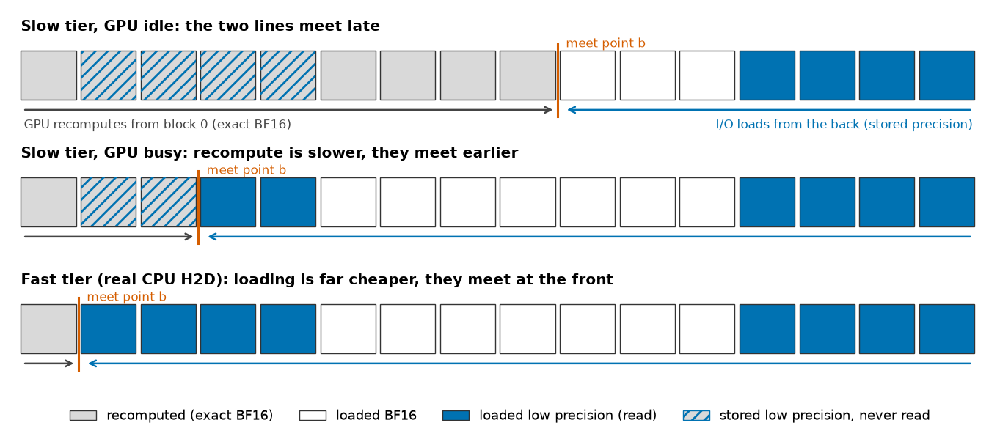

**圖 F01**　Cake 雙向還原與「存了低精度、有沒有被讀到」（示意，不是資料）。
- 灰＝重算（精確 BF16）；白＝載入 BF16；藍＝載入低精度；斜線＝存了低精度，但被重算蓋掉、沒被讀到。
- 慢層、GPU 閒：會合點偏後，前段的低精度沒人讀。
- GPU 忙：會合點前移。
- 真實 CPU 層：搬運比重算便宜得多，會合點貼在最前面，幾乎全部被讀到。

### 1.3 事先登記的預測（H1–H7，[03 §2.3](../03_plan_h200.md)）

| # | 預測（寫在看到任何低精度結果之前） | 結果在 |
|:--|:--|:--|
| H1 | Qwen 的全 FP8（E1）在檢索類任務會掉超過 ε | §3.3 |
| H1s | E1 不過時，保護開頭（E1s）、開頭＋最近（E1sr）補不回大部分 | §3.3 |
| H2 | 讀法 A 掉最多的是「低精度剛好蓋住答案所在的位置帶」 | §3.6、§3.8 |
| H3 | 讀法 B、GPU 閒：F25 的低精度幾乎都被重算蓋掉；B25 全被讀到 | §3.2 |
| H4 | GPU 忙時會合點前移，F25 被讀到的變多；E1、B25 也讓會合點前移 | §3.2 |
| H5 | 速度：E1 ≈ E1s ＜ B25 ≤ R25 ≤ F25 ≈ E0 | §3.1、§3.7 |
| H6 | 第 2 輪掉的品質 ≈ 第 1 輪；第 2 輪換成忙時，F25 開始掉 | §3.7 |
| H7 | INT4：Qwen 明顯掉、Llama 接近 ε 邊界 | §3.5 |

逐條結果在 §3.7。

### 1.4 判定流程與停損條件（[03 §2.4、§2.5](../03_plan_h200.md)、[07 §5](../07_freeze_mi300x.md)）

- **K0**：全低精度（E1）在每一格都沒比全 BF16（E0）快超過 δ\* → 精度對還原時間沒賺頭 → 停。
- **K1**：E1 在四種讀法（A、B 閒、B 忙、B 閒→忙）都過 ε，而且速度不輸 → 這一階不需要位置策略。
- **K1s**：E1 沒過，但 E1s 或 E1sr 過 → 只有已發表的「保護開頭／最近」規則有用。
- **K3**（只在 FP8 階）：E1、E1s 都沒過，但同樣 8 bit 換 codec（E1-K0、E1-INT8）就過 → 問題在格式，不在位置。
- **精度階梯**：FP8 這一階不需要位置策略 → 往下一階 INT4 再判一次，只往下一階。這一條和老師原話不同，是 10/13 自己加的。
- **K2**（Step 2）：在「均勻不夠」的那一階，F25／M25／B25 對 R25 沒有「穩定差距」→ 位置沒貢獻 → 停。
  - 穩定差距＝讀法 B、b32：品質差 ≥ 2 個百分點、CI 不含 0、時間不慢超過 δ\*、至少 2 個任務族方向一致。
- 實際走過的路徑：

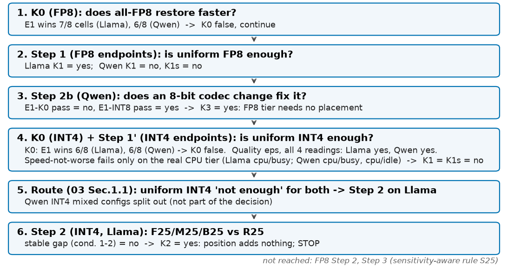

**圖 F02**　事先登記的判定流程與實際出口（判定）。每個框的結果由程式從判定 JSON 讀出來畫。
- FP8 階：Llama K1；Qwen 由 K3 結束。
- INT4 階：兩個模型品質都過 ε，但「速度不輸」只在真實 CPU 層沒過，照凍結規則判「均勻不夠」，進 Step 2（Llama）。
- Step 2 判 K2，主線停。
- 沒走到：FP8 的 Step 2、Step 3（敏感度感知的強規則）。
- 來源：`results/m10_precision_mi300x/analysis/{fp8,int4}/decide_*.json`、`fp8/k3_qwen.json`、`int4/step2_llama_int4.json`、`speed_*/k0_verdict_*.json`。

---

## 2　實驗設定

### 2.1 機器、軟體、記錄

- **機器**：AMD MI300X（MLSteam 容器）。10/18 以前一張卡，10/19 起兩張。
  - 所有計時都在同一張卡（PCI `a6:00.0`）上量；量時間時兩張卡都由同一個工作獨佔（RUNLOG 15.3、15.19）。
  - CLAUDE.md §3 寫的 3090 是舊機器，不適用。
- **軟體**：torch 2.10.0+rocm7.0（HIP 7.0.51831）、transformers 5.17.0、venv `tiara`（[07 §1](../07_freeze_mi300x.md)）。對照用 vLLM 0.28.0（ROCm）。
- **記錄**：
  - 每個 run 走 `m7run`／`runsh` 殼，`$TIARA_RUNS/<run_id>/` 裡有指令、環境、stdout、exit code。
  - 結果 CSV 每列都有 `run_id`（CLAUDE.md §4）。
- **H200**：使用者 10/17 決定不做（RUNLOG 11.2o）。本報告不涉及。

### 2.2 模型

| 模型 | 為什麼選 | 每 token KV（BF16） | 每 block（512 token） |
|:--|:--|--:|--:|
| Llama-3.1-8B-Instruct（BF16 權重） | 代表性：Cake、KIVI、ZipCache 都用；第一階段也是它 | 128 KiB〔算術〕 | 67,108,864 B |
| Qwen2.5-7B-Instruct-1M（BF16 權重） | 壓力測試：文獻說它的 Key 怕量化 | 56 KiB〔算術〕 | 29,360,128 B |

- 每 block 位元組來源：`results/m10_tier_mi300x/iowall.json` 的 `bytes_per_block`。
- Qwen 在 harness 裡不走 DCA；vLLM 對照用 noDCA 變體。

### 2.3 低精度格式

- **主線兩階**（[07 §3](../07_freeze_mi300x.md)）：20 題小測，只看 E1 對 E0 的平均 KL 挑格式，不看答對率（`results/m10_precision_mi300x/fmt_select/fmt_choice.json`）。

| 模型 | FP8（e4m3；KL 最小的 scale 粒度） | INT4 |
|:--|:--|:--|
| Llama | `fp8_token`（每 token 一個 scale；KL 0.00236） | `int4_kivi`（K 每 channel、V 每 token，group 32；KL 0.00521） |
| Qwen | `fp8_head`（每 head；KL 3.401）：三種粒度裡最小，但已是 Llama 的上千倍 | `int4_kivi`（KL 0.0125） |

- **Step 2b 的兩個 8 bit 診斷**（block 0 都保留 BF16）：
  - E1-K0：K 先減掉每（block, 層, head, channel）的平均，再存 FP8。
  - E1-INT8：每 token 每 head 對稱 INT8。
- **探索用的 13 種格式**（[09 §2.1](../09_sweep_plan.md)）：FP8 e4m3／e5m2、FP8-K0、INT8、INT4 每 token、INT4-KIVI、INT4＋Hadamard、MXFP4、NVFP4、INT2-KIVI、INT2＋Hadamard、K8V4、K4V2。
- **所有格式都是「載入後先反量化成 BF16，再走同一個 attention」**（07 §2）。比的是格式本身的誤差，不是各家 kernel。

### 2.4 配置

| 配置 | 低精度放哪 | 白話 |
|:--|:--|:--|
| E0 | 無 | 全 BF16，品質上限 |
| E1 | 64 個 block 全部（含 block 0） | 老師的端點；＝「Cake＋均勻量化」 |
| E1s | block 1–63 | 只保護 sink（block 0） |
| E1sr | block 1–62 | 保護開頭＋最近（KIVI／SKVQ 式） |
| F25／M25／B25 | block 1–16／24–39／48–63 | 前／中／後 25%（block 0 一律 BF16） |
| R25 | 從 block 1–63 隨機挑 16 個 | 同比例隨機：位置策略要贏的對手 |

F25／M25／B25／R25 存的位元組完全相同（16 個低精度＋48 個 BF16）。

### 2.5 任務與題數

| 代號 | 任務 | 進主判準？ |
|:--|:--|:--|
| T1 | 多鍵撈針（兩個模型都碰天花板） | 只報告 |
| T2 | 一鍵多值撈針 | 是 |
| T3 | 變數追蹤（多跳） | 是 |
| T4 | HotpotQA 兩跳（答案 ≤ 2 個字） | 是 |
| T5 | 常見詞聚合（全文、沒有位置帶、單輪） | 是 |
| LongBench | 6 個資料集各 50 題，讀法 A | 只報告（外部效度） |

- **長度與位置帶**：context 64 個 block × 512 token＝32,768 token。答案放在前（block 1–16）、中（24–39）、後（48–63）三帶，和 F25／M25／B25 對齊，形成「答案位置 × 低精度位置」的交叉（[05 §8.1](../05_QA.md)）。
- **題數**：主判準 600 題（T2–T4 各 180、T5 60）。T2–T4 有第 2 輪，歷史用標準答案接（SCBench 的做法）。每種讀法 1,140 列（`analysis/fp8/quality_llama_step1.json` 的 `n_items`、`n_rows`）。
- **難度**：E0 在每個（任務, 輪, 帶）格子的答對率，Llama 60.0–83.8%、Qwen 63.7–91.7%，19 格全部落在事先要求的 60–95%（同檔 `e0_accuracy`）。

### 2.6 兩種讀法、兩輪

- **讀法 A**：64 個 block 全部從儲存載入，不重算 → 量「敏感度」。
- **讀法 B**：Cake 還原，用 b32 頻寬實測的會合點重放 → 量「實際讀到什麼、實際品質」。
  - 重放和真的跑 Cake 的 logits 逐位元相同（RUNLOG Milestone 10-pilot 續 2）。
  - 三種情境：B 閒、B 忙、B 閒→忙（第 2 輪換成 GPU 忙，再還原一次）。
- 存的低精度版本不會從反量化後的值再量化一次（[03 §3.4](../03_plan_h200.md)）。

### 2.7 判準

- **ε（非劣性）**：主任務 T2–T5、兩輪合併，X 對 E0 的配對答對率差。以「題」為單位 bootstrap 10,000 次（seed 0），兩條都要過：
  - 95% CI 下界 > −2 個百分點；
  - 每個任務族、每一輪的點估計 ≥ −5 個百分點。
- **檢定力**：E1（讀法 A）CI 半寬 > 1.5 個百分點，而且 CI 跨過 −2 → 先加題（07 §9 的釐清）。這次兩個模型都沒有被它擋住判定。
- **速度不輸**：每個（頻寬, GPU 狀態）格子，X 的還原時間中位數 ≤ 最快的混合配置（F25／M25／B25／R25）×(1＋δ\*)。
- **δ\***＝max(5%, 實測雜訊 δ)。
  - δ 的量法：E0 在 4 頻寬 × 閒／忙，3 個 process × 10 次；取各格「process 中位數的最大減最小 ÷ 整體中位數」的最大值。
  - Llama：δ＝2.97% → δ\*＝5%。Qwen：δ＝9.43% → δ\*＝9.43%。
  - 來源：`results/m10_precision_mi300x/speed_<m>/noise.json`（run `20261015-154722-m10-noise-llama`、`20261015-155626-m10-noise-qwen`）。
- **K0 的「贏」**：中位數差 > δ\*，而且配對差中位數的 bootstrap 95% CI 不含 0（`code/m10_speed.py` 的 `k0_verdict`）。
- **判定程式** `code/m10_analyze.py`：在看到任何低精度答對率之前 commit（`0e79da7`；K3 與圖表補在 `d974dfc`）。

### 2.8 儲存層

- **CPU 層**：pinned 主機記憶體，真的 H2D，不限速。實測 pinned H2D：Llama 49.9、Qwen 48.6 GiB/s（`speed_<m>/bw.json`）。
- **限速層**：不是真的 SSD／NFS，而是同一份 pinned 記憶體加計時器，依每個 block 的實際位元組計時。照老師要求，只叫「限速層 X GiB/s」。
  - 頻寬照「E0 的會合點落在 block 16／32／48」選。

| 名稱 | Llama（GiB/s） | Qwen（GiB/s） | 白話 |
|:--|--:|--:|:--|
| b16 | 5.27 | 2.77 | 多半在搬；和第一階段量到的本地 SSD（6.98）同一級 |
| b32 | 1.47 | 0.764 | 一半在搬、一半在算 |
| b48 | 0.420 | 0.218 | 多半在算；和 NFS（0.331）同一級 |
| nfs | 0.331 | 0.331 | 第一階段在 MI300X 量的 NFS 讀頻寬（12、14 號用） |

- b16／b32／b48 來源：`speed_<m>/bw.json` 的 `targets`。公式：B＝(64−b\*)×block ÷ Σ_{i<b\*} f(i)；f(i) 總和 Llama 3.631 s、Qwen 3.077 s。
- SSD 6.98／NFS 0.331 GiB/s 來源：`results/m10_tier_mi300x/iowall.json` 的 `slow_GiBps`；原始量測在第一階段 `results/m7_write_policy_mi300x/tier_params.json`。
- 注意：Qwen 的 b48（0.218）比 NFS 級（0.331）還慢。

### 2.9 Cake 還原器（harness）

- **怎麼做**：前段重算、後段載入。兩條線各從自己那一端一次拿一個 512-token block，碰頭就停（`code/m7_restore_harness.py` 的 `cake`）。
  - 會合點自然形成，沒有估計器（和 Cake 原文一樣）。
  - 重算線一開始就拿 block 0，所以 **Cake 至少重算 1 塊**。
- **和 Cake 原文的差別**：
  - I/O 單位也是 512（原文是 128）。
  - 「GPU 忙」用背景 matmul（duty 0.7；第一階段量到讓 Llama 重算慢 2.07 倍，`results/m7_write_policy_mi300x/busy_levels.json`）。原文用 token budget。
- **重算比預設 vLLM 慢**：
  - harness 只算的 32K TTFT（GPU 閒）：Llama 3.64 s、Qwen 3.10 s。
  - 有 gpu_guard、兩張卡都 CLEAN 的 vLLM 0.28：預設切法（16,384 token）2.182／1.802 s；512 切法 4.182／3.720 s。
  - 來源：RUNLOG 15.24；`results/m10_precision_mi300x/vllm_ttft_guarded2/`、`vllm_ttft_guarded3/`。
  - 也就是 **harness 比預設 vLLM 慢 1.67／1.72 倍，但比同樣 512 切法的 vLLM 快**（0.87／0.83 倍）。§5.5 討論這件事對結論的影響。

### 2.10 防污染（gpu_guard）

- **計時**：每個計時 run 都包在 gpu_guard 裡，時間只用全部 CLEAN 的 run。被標污染的計時一律整批重量：
  - Qwen FP8 速度格子 → `20261015-194150-m10-regrid-fp8-qwen`；
  - Llama 128K INT4 → `20261019-173111-…-rerun`。
- **品質**：品質 run 被標污染時，**保留分數、作廢時間欄**（CLAUDE.md §3）。
  - 被標污染的原因都是我們自己同時開的品質 process。
  - 實測證據：另一批同時跑的 process 算出的全 BF16 列，和 Step 1 的 E0 生成文字、標準答案 log 機率逐位元相同（Llama 2,620 列，RUNLOG 10.10）。
- **沒有 guard 紀錄的計時，本報告不採用**：
  - vLLM FP8 KV 的 decode 對照（13 號 Q5 (d)，`results/m10_restore2_mi300x/q5/vllm_kvdecode/`）；
  - 反量化微測 `results/m10_sweep_mi300x/parts/dequant_fast_bench.json`。
  - 改用有 guard 的 stage 40 零件 `parts_<m>.csv`。

---

## 3　主線結果（判定）

### 3.1 K0：低精度有沒有讓還原變快？——有，但只在限速層

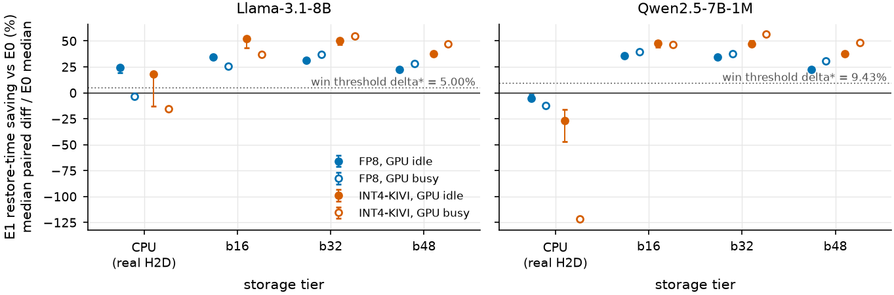

**圖 F03**　E1 對 E0 的還原時間節省（32K、Cake；正＝E1 快）。
- 點＝配對差的中位數 ÷ E0 中位數；誤差棒＝凍結程式算的配對差中位數 95% bootstrap CI（同樣除以 E0 中位數）。
- 點線＝判勝門檻 δ\*；實心＝GPU 閒，空心＝GPU 忙。
- 來源：`results/m10_precision_mi300x/speed_llama/k0_verdict_{fp8,int4}.json`、`speed_qwen_regrid/k0_verdict_fp8.json`、`speed_qwen/k0_verdict_int4.json`，以及同目錄的 `restores.csv`。

- **判定：K0 不成立（兩階、兩個模型都是）**。E1 贏 E0 的格子：FP8 Llama 7／8、Qwen 6／8；INT4 Llama 6／8、Qwen 6／8（同上 JSON 的 `E1_wins`）。
- 中位數的節省（`gain_E1_over_E0`）：

| 層 | FP8 Llama | FP8 Qwen | INT4 Llama | INT4 Qwen |
|:--|:--|:--|:--|:--|
| b16 閒／忙 | 34.6%／24.7% | 35.6%／39.2% | 52.0%／36.1% | 47.6%／41.7% |
| b32 閒／忙 | 31.1%／37.2% | 35.3%／38.0% | 50.9%／55.2% | 49.1%／56.9% |
| b48 閒／忙 | 22.7%／28.3% | 22.0%／30.4% | 37.6%／47.5% | 38.1%／48.3% |
| CPU 閒／忙 | 24.8%／−3.5% | −5.1%／−12.6% | 17.8%（CI 含 0）／−15.5% | −17.9%／−121.4% |

- **限速層**：位元組少一半（FP8）或少約七成（INT4），還原就快 22–57%。
- **真實 CPU 層**：搬運本來就不是瓶頸。反量化又和重算搶 GPU（原寫法：PyTorch 一步一步做，每步一個 kernel），省下的被吃掉，甚至變慢（Qwen INT4 忙：0.066 → 0.146 s）。
  - §4.2、§4.3 顯示：換成融合 kernel、一次拆完之後，這一層也不再變慢（只報告）。

### 3.2 實際讀到什麼（H3、H4）

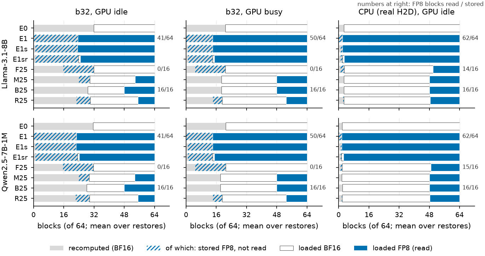

**圖 F04**　一次還原裡，64 個 block 各來自哪裡（FP8 階、32K、Cake，30 次平均）。
- 斜線＝存了 FP8 但被重算蓋掉、沒被讀到；右側數字＝讀到的 FP8 ÷ 存的 FP8。
- 來源：`results/m10_precision_mi300x/speed_llama/restores.csv`（run `20261015-161226-m10-grid-fp8-llama`）、`speed_qwen_regrid/restores.csv.gz`（run `20261015-194150-m10-regrid-fp8-qwen`），只用沒被標污染的列。

- **限速層 b32：前段的低精度沒人讀**。
  - F25 存的 16 個 FP8，GPU 閒、忙都讀到 0 個。
  - B25 每一格 16／16 全讀到。
  - 中位數來源：`speed_llama/summary_fp8.csv`、`speed_qwen_regrid/summary_fp8.csv` 的 `median_fp8_read`。
- **GPU 忙：會合點往前移**。
  - Llama b32 的 E0：31–32 → 20–21（`k0_verdict_fp8.json` 的 `b_E0`）。
  - b16 忙時，F25 開始被讀到（中位數 9／16，兩個模型都是）。
- **真實 CPU 層**：搬運很快，會合點在 b＝1–3，F25 的低精度幾乎全被讀到（Llama 14–15／16、Qwen 15–16／16）。**「前段的低精度沒被讀到」只在慢層成立。**
- 所以在讀法 B（b32）下，F25 的品質一定等於 E0。它在 F25 上量不到敏感度，敏感度只能靠讀法 A。

### 3.3 Step 1：全部用 FP8 夠不夠？（判定：Llama K1 成立；Qwen 不過）

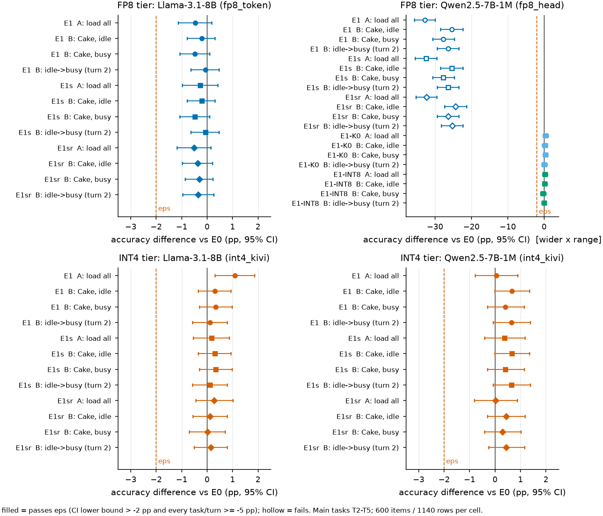

**圖 F05**　端點配置對 E0 的配對答對率差（百分點，95% CI；主任務 T2–T5、兩輪合併）。
- 上排：FP8 階（Qwen 加上 Step 2b 的兩個 8 bit codec）。下排：INT4 階。
- 實心＝過 ε、空心＝沒過；紅虛線＝−2 個百分點。Qwen FP8 那一格的橫軸範圍不同。
- 來源：`results/m10_precision_mi300x/analysis/fp8/quality_{llama,qwen}_step1.json`、`fp8/quality_qwen_step2b.json`、`int4/quality_{llama,qwen}_int4.json`。

- **Llama（fp8_token）：四種讀法、三個配置全部過 ε**。
  - 讀法 A：E1 −0.5 [−1.1, +0.2]、E1s −0.3 [−1.0, +0.4]、E1sr −0.5 [−1.2, +0.1]。
  - 讀法 B 閒／忙／閒→忙：E1 −0.2／−0.5／−0.1。
  - 檢定力夠：E1 讀法 A 的 CI 半寬 0.66。和 E0 輸出完全相同的列 82–86%。
  - 速度 8 格全部不輸（`analysis/fp8/speed_llama.json`）。
  - → **K1 成立**（`analysis/fp8/decide_fp8.json`）。
- **Qwen（fp8_head）：大幅不過**。
  - 讀法 A：E1 −32.8 [−35.8, −30.0]、E1s −32.5、E1sr −32.3。讀法 B：−24.3 到 −27.7。
  - 掉最多的：T4 HotpotQA（第 1／2 輪 −71.7／−67.2）、T5 常見詞（−51.5）。T2 −16.0／−18.2、T3 −10.1／−7.7（`quality_qwen_step1.json` 的 `aux`）。
  - 平均 KL 3.84，是 Llama（0.0035）的約 1,100 倍。
  - **保護開頭、開頭＋最近幾乎沒用**：只補回 0.3–0.5 個百分點。
  - 讀法 B 掉得少一點（−25 vs −33），因為 b32 時前約 23 個 block 是重算的 BF16（只讀到 41 個 FP8）。
  - 檢定力：CI 半寬 2.9 > 1.5，但整個 CI 都在 −2 以下，照 07 §9 判「沒過」、不加題。`decide_fp8.json` 也列了凍結時程式原本的結論 `next_frozen_code`。
- **合併**（03 §1.1 的表）：Llama 過、Qwen 沒過 → 只在 Qwen 上做 Step 2b。

### 3.4 Step 2b：是格式的問題嗎？（判定：K3 成立）

- **Qwen 的 E1-K0（K 先減平均）**：
  - 品質：四種讀法 +0.05 到 +0.39 個百分點，平均 KL 0.0049（讀法 A），ε 全過。
  - **速度在 CPU・忙沒過**：1.164 > 1.094（`analysis/fp8/speed_qwen_2b_fp8k0_head.json`），所以這個配置不算「過」。
- **Qwen 的 E1-INT8**：
  - 品質：四種讀法 −0.3 到 +0.2，KL 0.0083，ε 全過。
  - 速度：8 格都不輸（CPU・忙 1.073）。
  - → **K3 成立**：同樣 8 bit，換 codec 就夠。問題在 FP8 的 K 格式，不在位置（`analysis/fp8/k3_qwen.json`）。
- **機制**（圖 F08）：Qwen 的 K 有少數 channel 帶很大的固定偏移。
  - 最大的一個 channel 平均 415、標準差 1.7。14,336 個 channel 裡 219 個「|平均|／標準差 > 10」（`results/m10_pilot_mi300x/kv_stats/summary_kv_qwen.json`、`kv_topchan_qwen.csv`）。
  - FP8 是「數字越大、刻度越寬」的尺。在 400 附近相鄰兩格差 32，真正有用的小差異被捨入掉。
  - 一般的相對 L2 誤差看不出來：Qwen fp8_head 2.4% vs Llama 2.6%。
  - 扣掉每個 channel 的平均後就看出來了：Qwen 18.0%、Llama 4.2%。先減平均（FP8-K0）後，Qwen 降到 2.7%（同上 JSON 的 `codec_relerr_mean_over_prompts`）。
  - INT4-KIVI 的 K 也是「每個 channel 自己的 scale 和零點」，等於自動扣掉偏移，所以 §3.5 Qwen 的 INT4 反而沒掉〔推論；和 11 問題二 §2 的 CPU 假資料檢查一致〕。

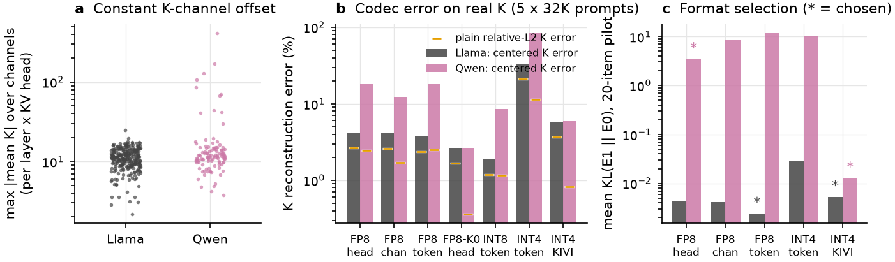

**圖 F08**　Qwen 的 FP8 為什麼壞。
- (a) 每個（層, KV head）裡最大的 |K 的 channel 平均|。這張圖的顏色代表模型，不是格式。
- (b) 真實 K 的重建誤差：長條＝扣掉 channel 平均後的誤差，短橫線＝一般的相對 L2 誤差。
- (c) 格式小測的平均 KL（\*＝選定的格式）。
- 來源：`results/m10_pilot_mi300x/kv_stats/{kv_head_*,summary_kv_*}`（run `20261015-030452-m10-kvstats2-qwen`、`-030742-m10-kvstats2-llama`）、`results/m10_precision_mi300x/fmt_select/fmt_choice.json`。

### 3.5 往下一階：INT4（判定：兩個模型都「均勻不夠」，唯一原因是真實 CPU 層的速度）

- **品質：兩個模型 24 格全過 ε**（3 個配置 × 4 種讀法 × 2 個模型）。
  - E1 讀法 A：Llama +1.1 [+0.3, +1.9]、Qwen +0.1 [−0.8, +0.9]。
  - 所有格子最低的 CI 下界是 −0.8。逐任務族、逐輪最差的點估計是 −2.8（Qwen E1sr 的 T5）。
  - 檢定力：CI 半寬 0.64–0.84（`analysis/int4/quality_{llama,qwen}_int4.json`）。
  - Llama 讀法 A 的 +1.1 CI 不含 0。但 24 格在 5% 下本來就預期約 1.2 格不含 0，所以**不解讀成「INT4 比 BF16 好」**〔推論〕。
- **速度不輸：限速層 6 格全過，真實 CPU 層沒過**（`analysis/int4/speed_{llama,qwen}.json`）。
  - Llama 只輸 CPU・忙：E1／E1s／E1sr＝1.145／1.133／1.137 > 1.05。
  - Qwen CPU 閒、忙都輸：E1＝1.142／2.098 > 1.094。
- **判定**（`analysis/int4/decide_int4.json`）：
  - 「模型過」＝品質過**而且**速度不輸。兩個模型的 K1、K1s 都不成立。
  - 照 03 §1.1：Step 2 在 Llama 上做；Qwen 的 INT4 混合配置拆出去（stage 46，不屬判定）。
- **H7 不成立**：預測 Qwen 的 INT4 會明顯掉，結果沒掉。Qwen FP8 掉 33 個百分點、INT4-KIVI 不掉，和 K3 是同一個原因（K 的偏移）〔推論〕。

### 3.6 Step 2：位置有沒有比隨機好？（判定：K2 成立，主線停）

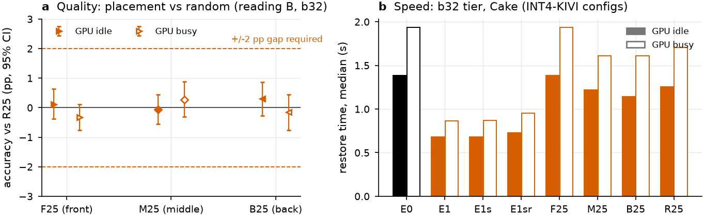

**圖 F06**　INT4 階、Llama。
- (a) F25／M25／B25 對 R25 的答對率差（讀法 B、b32，95% CI）；紅虛線＝「穩定差距」要求的 ±2 個百分點。
- (b) 同一頻寬的還原時間中位數。
- 來源：`results/m10_precision_mi300x/analysis/int4/step2_llama_int4.json`、`speed_llama/summary_int4.csv`（run `20261016-034902-m10-grid-int4-llama`）。

- **對 R25 的差**（百分點）：

| 配置 | GPU 閒 | GPU 忙 |
|:--|:--|:--|
| F25 | +0.12 [−0.37, +0.63] | −0.33 [−0.77, +0.12] |
| M25 | −0.06 [−0.56, +0.45] | +0.27 [−0.30, +0.89] |
| B25 | +0.30 [−0.27, +0.87] | −0.15 [−0.76, +0.44] |

  - 全部離門檻 2 很遠。
- → **穩定差距第 1、2 條都沒有任何配置成立 → K2 成立：位置沒有比「隨機同比例」多幫什麼**（`stable_gap_1_2=False`、`K2=True`）。
  - 第 3 條（新 seed 重跑）只在前兩條成立時才需要，所以沒跑。Step 3（強規則）也沒走到。
- **對 E0**：四個混合配置 16 格 ε 全過。讀法 A：F25 +0.5、M25 +0.6、B25 +0.2、R25 +0.2（`analysis/int4/quality_llama_step2.json`）。讀法 B 的 F25 一個 INT4 block 都沒讀到，和 E0 完全相同。
- **速度**：
  - B25 比 R25 快：b32 閒 1.141 vs 1.255 s、忙 1.611 vs 1.705 s。這是「低精度放在一定會被載入的地方」的效果。
  - 但全 INT4（E1）更快（閒 0.681 s），品質一樣。
  - **要省時間就全部用低精度，放哪裡不重要。**

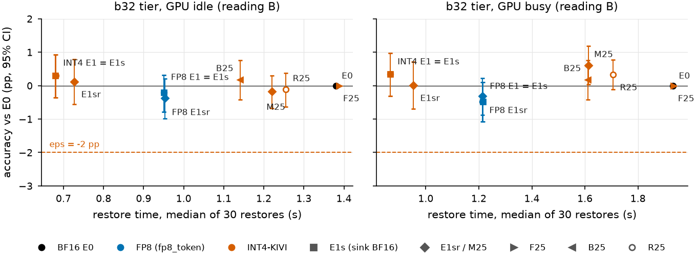

**圖 F07**　品質對延遲（老師點名的圖 A；Llama、b32、讀法 B）。
- 橫軸＝還原時間中位數（30 次）；縱軸＝對 E0 的答對率差（95% CI）。
- 所有點都在 ε 線上方。往左（變快）只能靠「全部低精度＋更少位元」；F／M／B 的放法只在同一條水平帶裡左右移動。
- 來源：`analysis/fp8/quality_llama_step1.json`、`analysis/int4/quality_llama_{int4,step2}.json`、`speed_llama/summary_{fp8,int4}.csv`。

### 3.7 預測逐條（H1–H7）

| # | 結果 | 依據 |
|:--|:--|:--|
| H1 | **成立，而且比預期大**：Qwen E1 讀法 A −32.8；掉最多的是 HotpotQA 和常見詞，不只撈針 | §3.3 |
| H1s | **成立**：E1s、E1sr 只補回 0.3–0.5；換 codec 才補得回來 | §3.3、§3.4 |
| H2 | **INT4、Llama：不成立**。見表後說明 | §3.8 |
| H3 | **限速層成立、真實 CPU 層不成立**（CPU 層 F25 讀到 14–16／16） | §3.2 |
| H4 | **成立**：b32 E0 會合點 32 → 21；b16 忙時 F25 讀到 9 個；E1、B25 的會合點比 E0 前 | §3.1、§3.2 |
| H5 | **限速層成立；CPU 層 E1、E1s、E1sr 反而最慢**。見表後說明 | §3.1 |
| H6 | **前半成立；後半沒觀察到**。見表後說明 | §3.3、§3.6 |
| H7 | **不成立**：兩個模型的 INT4 都沒掉 | §3.5 |

- **H2 的數字**：低精度剛好蓋住答案帶時（F25×前、M25×中、B25×後），T2–T4 讀法 A 對 E0 是 +0.66／+0.65／+0.52；沒蓋住的格子 +0.37／+0.58／+0.03。
  - 來源：`analysis/int4/quality_llama_step2_table.csv` 的分帶列，依列數加權。探索，沒有 CI 檢定。
  - FP8 兩個模型、INT4 Qwen 的交叉表屬封存組，「跑了、沒分析」（附錄 D）。
- **H5 的數字**：Llama b32 閒，E1 0.950 ≈ E1s 0.951 ＜ B25 1.216 ≤ R25 1.290 ≤ F25 1.382 ≈ E0 1.380（`speed_llama/summary_fp8.csv`）。
- **H6 的數字**：
  - 前半：第 2 輪沒有比第 1 輪系統性地掉更多。Llama E1 讀法 A 第 1／2 輪：T2 −0.3／−0.7、T3 −0.2／0.0、T4 0.0／−1.7。「閒→忙」和「閒」也差不多（−0.1 vs −0.2）。
  - 後半：INT4 Llama 的 F25 在讀法 B 閒→忙時，仍然一個 INT4 block 都沒讀到，品質＝E0。

### 3.8 主線附帶、只報告的結果

**(a) T1 與 LongBench**（07 §2、03 §3.2 本來就標只報告）

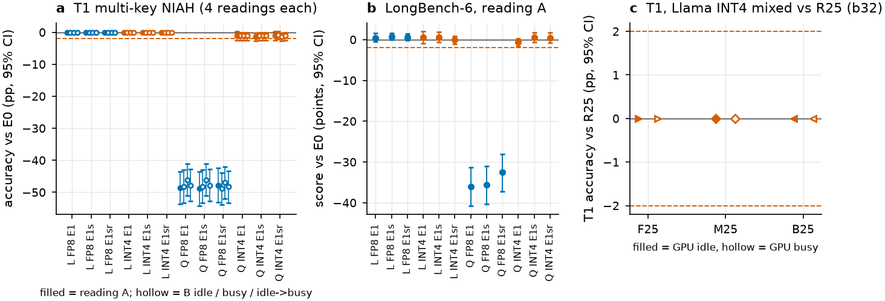

**圖 F30**　（只報告）
- (a) T1 多鍵撈針，端點配置，四種讀法。
- (b) LongBench 6 個資料集（各 50 題），讀法 A。
- (c) T1 上 Llama INT4 混合配置對 R25（讀法 B、b32）。
- 來源：`results/m10_precision_mi300x/quality/step1_<m>_{T1,LB}_s*.csv`、`quality_sealed/int4end_<m>_{T1,LB}.csv`、`quality_sealed/int4mix_llama_T1.csv`。統計重用 `code/m10_analyze.py`，數字在 `docs/precision_20261013/report_stage2/derived/report_only.json`。

- **E0**：T1 Llama 99.7%、Qwen 97.8%（碰天花板，所以 T1 不進主判準）；LongBench 平均分 Llama 40.7、Qwen 42.8。
- **Qwen 的 FP8 在兩個外部任務一樣崩**：T1 讀法 A −48.6 [−53.6, −43.6]；LongBench −36.0 [−40.7, −31.4]（E1）。連簡單的撈針都壞，不只難題。
- **好的格式在外部任務也不掉**：LongBench E1，Llama FP8 +0.4 [−0.5, +1.5]；INT4 Llama +0.5、Qwen −0.7 [−1.7, +0.2]。
- **唯一要注意的**：Qwen INT4 的 T1 點估計 −1.1 [−2.5, +0.3]，12 格裡最差的 CI 下界 −2.8。如果 T1 是主任務，主判準會差一點不過〔推論：T1 碰天花板，每 1 題翻轉就差約 0.3–0.6 個百分點〕。
- T1 上 Llama INT4 的 F25／M25／B25 對 R25：全部 0.0（天花板，沒有任何翻轉）。

**(b) 逐 block 敏感度地圖**（03 §3.3b；Llama、INT4，是判定流程走到的主模型）

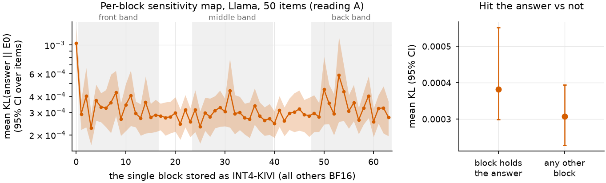

**圖 F31**　（只報告）一次只把一個 block 存成 INT4-KIVI、其他全 BF16，答案分布對 E0 的平均 KL（50 題、讀法 A、teacher forcing）。
- 灰底＝三個答案帶。右圖：低精度 block 剛好是答案所在 block vs 其他 block。
- 來源：`results/m10_precision_mi300x/quality_sealed/sensmap_llama_int4_kivi_s{0,1}.csv`（run `20261020-095335-m10-sens-llama-int4-s0`、`-095340-…-s1`）。

- **block 0（sink＋任務說明）是唯一明顯突出的 block**：
  - KL 0.00104 [0.00074, 0.00137]，其他 63 個 block 的中位數 0.00030，約 3.5 倍。
  - block 0 的 CI 下界，比其他任何 block 的點估計（最大 0.00058）都高（`derived/report_only.json` 的 `per_block_mean_kl`）。
- **「剛好壓到答案」只比「壓到別處」多一點**：KL 0.00038 [0.00030, 0.00055] vs 0.00031 [0.00023, 0.00039]，CI 重疊。
- 〔推論〕這張圖直接解釋 K2：在好的格式下，除了已經一律保護的 block 0，**沒有哪一段比較敏感**，所以挑位置沒有東西可挑。

**(c) INT4 的劑量反應**（11 問題二，`analysis/int4/sensitivity.json`，只報告）

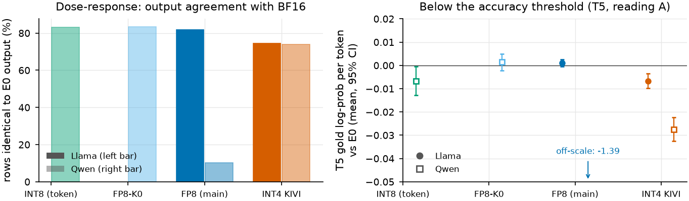

**圖 F09**　（只報告）
- (a) 和 E0 輸出逐字相同的列（讀法 A）。
- (b) T5 標準答案每 token 的 log 機率對 E0（平均 ± 95% 半寬）。
- Llama 的 FP8-K0、INT8 屬 Step 2b 封存組，判定流程沒走到，所以不畫（附錄 D）。
- 來源：`results/m10_precision_mi300x/analysis/int4/sensitivity.json`。

- **逐字相同**：Llama FP8 81.7% → INT4 74.6%；Qwen INT8 83.2%、FP8-K0 83.5% → INT4 73.9%（Qwen FP8 只有 10.3%）。
- **T5 標準答案 log 機率**：INT4 有小、但 CI 不含 0 的下降（Llama −0.0067 ± 0.0031、Qwen −0.0275 ± 0.0051）。
- 〔推論〕INT4 確實改到了模型的計算，只是在 32K、這幾種題還不夠大，翻不過答案。

---

## 4　探索實驗（全部只報告）

### 4.1 大掃描：13 種格式 × 佔比 × 放法（[09](../09_sweep_plan.md)）

**要回答什麼**：把格式、佔比（10–90%）、放法（位置、寫入時的誤差或 attention、作弊上限）全部掃一遍，「挑哪些 block 壓」能不能贏隨機？

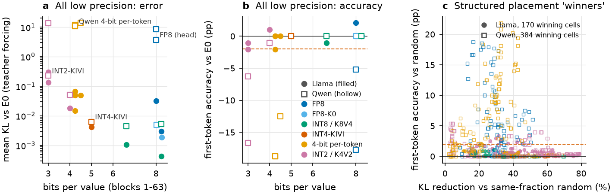

**圖 F10**　海選（stage 41，每個模型 96 題、teacher forcing、第一個答案 token 的答對率 first_ok）。
- (a)(b) 全部低精度：誤差（KL）和答對率對位元數。
- (c) 結構化放法「贏隨機」的格子：KL 降多少 vs 答對率差多少。
- 來源：`results/m10_sweep_mi300x/analysis/{agg,tests}_<m>.*`（run `20261016-135544`／`-135700`／`-135815`／`-135930-m10-sweep-screen-*`）。

- **海選**（沒有多重比較校正，只用來挑選手）：
  - 結構化放法照 09 §4.2 三條件贏隨機的格子：Llama 170／1,326、Qwen 384／1,326。假勝出的期望約 34 格。
  - 這些格子的 KL 中位數比隨機低：Llama 37%、Qwen 31%（`tests_<m>.csv`）。
  - **但答對率幾乎沒變**：Llama 平均 +0.33 個百分點（最大 +3.3）。Qwen 平均 +3.83（最大 +21.9），而 ≥ 5 個百分點的 103 格，全在 Qwen 上本來就壞掉的格式（全部壓時 KL > 1）。
- **全部低精度**（first_ok 對 E0，`agg_<m>.csv.gz`）：
  - Llama 連 INT2-KIVI（3 bit）也只掉 1.0 個百分點。
  - Qwen 的逐 token／逐 head 4-bit 格式全壞（KL 10.8–13.9）。

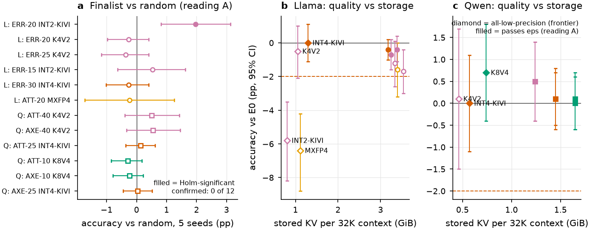

**圖 F11**　複賽（stage 43：新題目 seed 50000 起、生成答對率、Holm 校正）。
- (a) 12 個選手對同佔比隨機（5 個 seed）。(b)(c) 對 E0 的差 vs 存的 KV 大小。
- 來源：`results/m10_sweep_mi300x/confirm/confirm_<m>.json`、`detail_A.md`（品質 run `20261017-134426…`、`20261017-225319…` 等 12 個；速度格子 21 個 guard 全 CLEAN）。

- **12 個選手，0 個成立**。
- 唯一贏隨機的是 Llama INT2-KIVI 20%（照 K 誤差 ERR 挑）：+2.0 [+0.8, +3.1]，Holm 校正後仍成立。
  - 但對 E0 是 −1.2 [−2.6, +0.1]，T4 第 1 輪 −6.7 → ε 沒過。
  - 而且被「全部 INT4-KIVI」完全壓過：全 INT4 存 1.29 GiB（它要 3.34 GiB）、+0.0 [−1.1, +1.1]、還原更快。
- 其他 11 個對隨機 −0.4 到 +0.5，沒有一個顯著。
- 〔推論〕位置或寫入時的資訊能降低誤差（KL），但好的格式誤差本來就小到翻不過答案。只有格式太狠（INT2）時才有東西可救，而那時換溫和一點的均勻格式更省、更快、品質更好。

### 4.2 反量化的開銷（[11 問題一](../11_issues.md)、09 §6）

**要回答什麼**：真實 CPU 層低精度為什麼變慢？換寫法修得好嗎？

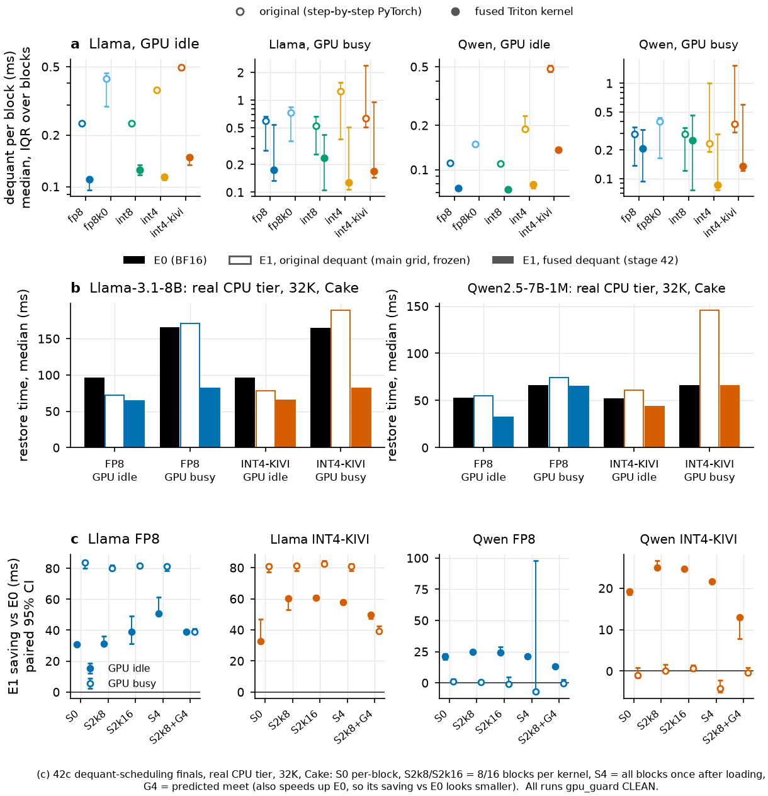

**圖 F20**
- (a) 每個 block 的反量化時間：原寫法 vs 融合 Triton kernel（有 guard 的 stage 40 零件）。
- (b) 真實 CPU 層 32K 還原：E0、E1 原寫法（主線）、E1 融合（stage 42）。
- (c) 42c 拆法複賽：E1 對 E0 省多少（配對 95% CI）。
- 來源：`results/m10_sweep_mi300x/parts/parts_<m>.csv`（run `20261016-130329`、`-130451`）、`speed_dqfast{,_int4}_<m>/summary.csv`（run `20261016-232855`、`-234030`、`-235027`、`20261017-000209`）、`dqsweep/C/report_C.json`。

- **原因**：原寫法每一步一個 kernel，和重算、背景工作搶 GPU。
- **每個 block 的反量化，原寫法 → 融合**：

| 模型・格式 | GPU 閒（ms） | GPU 忙（ms） |
|:--|:--|:--|
| Llama int4_kivi | 0.496 → 0.148 | 0.637 → 0.170 |
| Llama fp8_token | 0.235 → 0.110 | 0.595 → 0.174 |
| Qwen int4_kivi | 0.486 → 0.136 | 0.375 → 0.135 |

- **融合 kernel 和原寫法逐位元相同**（GPU 自測 run `20261016-064403`、`-064414`；int64 位址修正後 `-071948`、`-072000`）。所以只改時間，不改任何答案。
- **stage 42（融合、真實 CPU 層、32K）**：
  - E1 還原（s），原寫法 → 融合：Llama FP8 閒 0.072 → 0.065、忙 0.171 → 0.082；INT4 0.078 → 0.065、0.189 → 0.082。Qwen FP8 0.055 → 0.033、0.074 → 0.065；INT4 0.061 → 0.044、0.146 → 0.066。
  - 照凍結的速度規則，24 個「速度不輸」檢查全過；原寫法有 11 個沒過（11 問題一 §3a）。
  - **低精度在 CPU 層不再比 BF16 慢**：Llama 快 32–51%；Qwen 閒時快 21–38%，忙時打平。
- **42c 拆法複賽**（`dqsweep/C/tables_C.md`）：
  - GPU 閒：最好的拆法比逐塊拆（S0）再快 13–44%，已經到「Cake 至少重算 1 塊」的底。例：Llama INT4 8 塊一組，0.063 → 0.035 s。
  - GPU 忙：每種拆法都一樣（Llama 0.081–0.085 s、Qwen 0.065–0.073 s）。

### 4.3 還原的第二輪（[13](../13_restore2_plan.md)）

**要回答什麼**：
- Q4：GPU 忙時怎麼拆最好、誰付代價？
- Q2：什麼時候乾脆不重算（G5／G5b）？
- Q3：新格式有沒有融合 kernel？
- Q5：把拆融合進 attention 划不划算？
- Q1：上面這些到 64K／128K 還成立嗎？

比喻：搬家用壓縮袋。
- Q4：大家都在用客廳時，拆封要排隊。
- Q2：東西就在隔壁時，別自己重做一箱，直接全搬。
- Q5：乾脆不拆，要用哪件才抽出來。

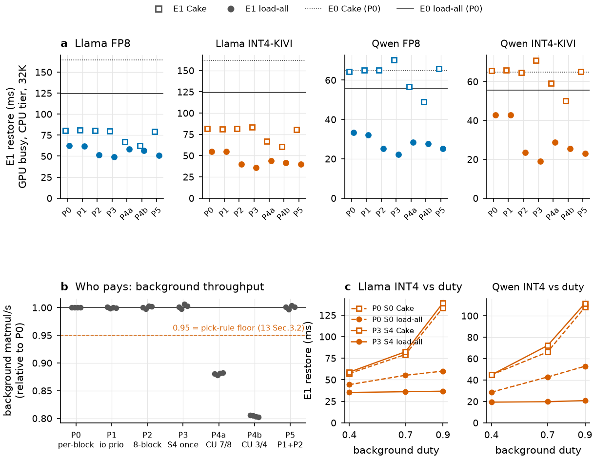

**圖 F21**　Q4，GPU 忙、真實 CPU 層、32K。
- (a) E1 還原時間，各拆法 × Cake／全部載入。
- (b) 背景工作的吞吐（對 P0）。
- (c) 背景強度 0.4／0.7／0.9。
- 來源：`results/m10_restore2_mi300x/q4/*`、`tables_13.md` Q4（run `20261018-093743…` 到 `-113436…`；P2 Llama FP8 用重量 `20261018-135548`）。

- **「全部搬完一次拆（S4）＋全部載入」最好**。比逐塊拆（P0）快 21–56%：Llama FP8 62.3 → 49.3 ms、INT4 54.7 → 35.8；Qwen FP8 33.2 → 22.2、INT4 42.9 → 18.9。
  - 背景吞吐不變（P3 對 P0 約 1.00）。留 CU 給還原的 P4a／P4b 讓背景慢到 0.88／0.80。
- **背景越忙，S4＋全載入幾乎不變**：duty 0.4／0.7／0.9 時，Llama 35.2／36.1／36.7 ms、Qwen 19.3／19.7／20.8 ms。Cake 則暴增：Llama 57 → 79 → 134 ms、Qwen 45 → 66 → 108 ms。
- 〔推論〕GPU 忙時的瓶頸不是拆的運算量，而是每次開 kernel 都要和背景排隊。一次拆完只排一次隊；全部載入又不必重算。

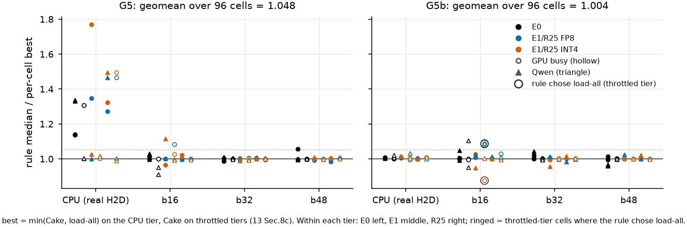

**圖 F22**　Q2：會合規則的中位數 ÷ 每格最好（CPU 層：min(Cake, 全載入)；限速層：Cake）。
- 來源：`results/m10_restore2_mi300x/q2/*`、`g5_pick.json`（run `20261018-113902…` 到 `-134456…`，40 個 guard 全 CLEAN）。

- **G5**（只拿「全部載完」和「重算第 0 塊」比）：96 格幾何平均 1.048。在 CPU 層 1.201，最差 1.77：GPU 閒時還是選了 Cake。
- **G5b**（模擬 Cake 的兩條線，再和全部載入比）：幾何平均 1.004。
  - CPU 層 1.007：24 格全部選「不重算」。
  - b16 1.0075：範圍 0.876–1.104；GPU 忙時有 3 格選了不重算，有輸有贏。
  - b32 1.002、b48 0.999。

**Q3（新格式的融合 kernel，`tables_13.md` Q3）**：全部低精度（E1s）的 CPU 層還原，原寫法 → 融合。

| 模型・格式 | GPU 閒（s） | GPU 忙（s） |
|:--|:--|:--|
| Llama INT2-KIVI | 0.122 → 0.035 | 0.193 → 0.081 |
| Llama MXFP4 | 0.112 → 0.065 | 0.195 → 0.081 |
| Llama K4V2 | 0.096 → 0.060 | 0.192 → 0.081 |
| Qwen K4V2 | 0.069 → 0.036 | 0.148 → 0.066 |

- 新格式不再比 BF16 慢（Llama E0：0.095／0.165 s）。

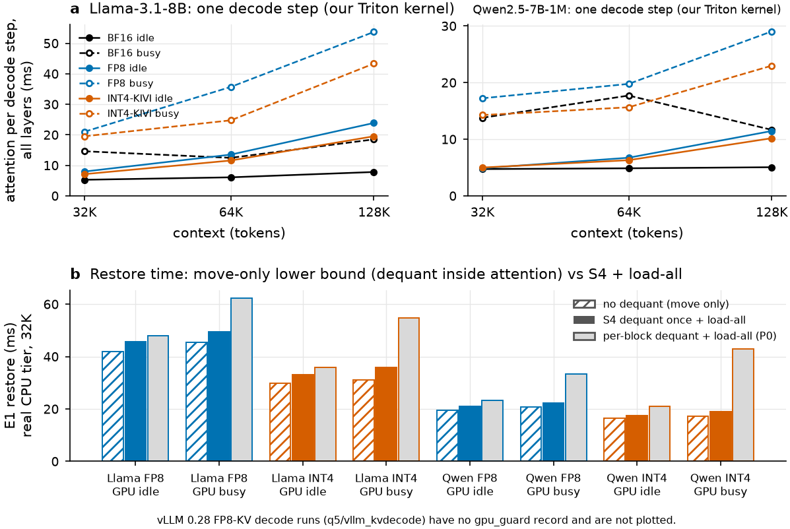

**圖 F23**　Q5：拆融合進 attention（對照組；它換了 attention，不能進任何判定）。
- (a) 一次 decode，所有層合計：同一個 Triton kernel 讀 BF16／FP8／INT4。
- (b) 只搬不拆（下限）vs S4＋全部載入 vs 逐塊拆＋全部載入。
- 來源：`results/m10_restore2_mi300x/q5/attn/*`、`q5/nodq_*`、`q4/*`。vLLM FP8 decode 那組沒有 guard 紀錄，不畫、不採用。

- **還原端**：只搬不拆的下限，CPU 層 32K E1：Llama INT4 0.030／0.031 s、Qwen INT4 0.016／0.017 s（閒／忙）。S4＋全載入只比它多 2–5 ms。
- **之後每一步 decode 要多付**（我們的 kernel）：

| 模型 | 32K 閒（BF16 vs FP8／INT4，ms） | 128K 閒（BF16 vs FP8／INT4，ms） |
|:--|:--|:--|
| Llama | 5.26 vs 7.96／7.11 | 7.81 vs 23.9／19.5 |
| Qwen | 4.73 vs 4.88／5.00 | 5.05 vs 11.5／10.2 |

  - 256 個 query（像 prefill）時，讀壓縮慢 3.6–4.6 倍（Llama 32K：154／131 vs 36 ms）。
- **划算的 token 數**（〔算術〕，`tables_13.md` Q5 (c)）：和逐塊拆＋全載入比，Llama 2–5 個 token 就賠回去；Qwen 4–54 個。
- 〔推論〕不改 attention 的前提下，S4＋全部載入已經拿到大部分好處。

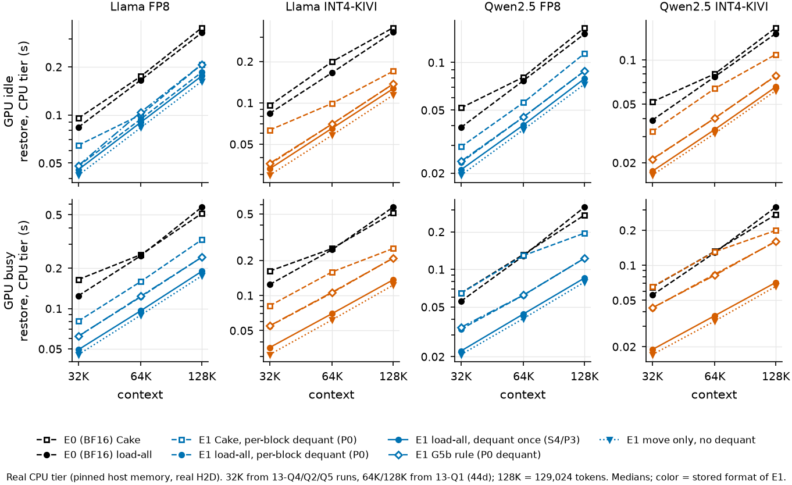

**圖 F24**　Q1：真實 CPU 層的還原方法，32K／64K／128K。
- 來源：`results/m10_restore2_mi300x/q1/*`（44d，40 個 grid，guard 全 CLEAN）、32K 來自 Q4／Q2／Q5。

- **低精度（E1）：S4＋全部載入仍然最好**。
  - Llama INT4 128K：0.127／0.136 s（閒／忙），Cake 0.170／0.252，只搬不拆 0.114／0.123。
  - Llama FP8 128K：0.176／0.189，Cake 0.207／0.326。
  - Qwen INT4 128K：0.066／0.071，Cake 0.109／0.199。
- **但 BF16（E0）在 128K、GPU 忙時是 Cake 比較快**：Llama 0.511 vs 全載入 0.570 s；Qwen 0.272 vs 0.315 s。〔推論〕128K 時 BF16 全部搬完的時間已經大於重算前幾塊。
- **G5b 在長 context 沒那麼準**：64K／128K CPU 層 48 格的幾何平均 1.027，最差 1.20（Llama FP8 64K 閒的 E0 留在 Cake：0.200 vs 0.166 s）。128K 忙的 E0 它選了全載入，但那裡 Cake 比較快（Llama 0.570 vs 0.509）。

### 4.4 IO 牆、容量、兩層混合還原（[12](../12_tier_plan.md)）

**要回答什麼**：
- 低精度讓同樣的記憶體多放幾段對話？
- 把「要去慢層」的牆往後推多少？
- 一段對話分在兩層時，先降哪些？

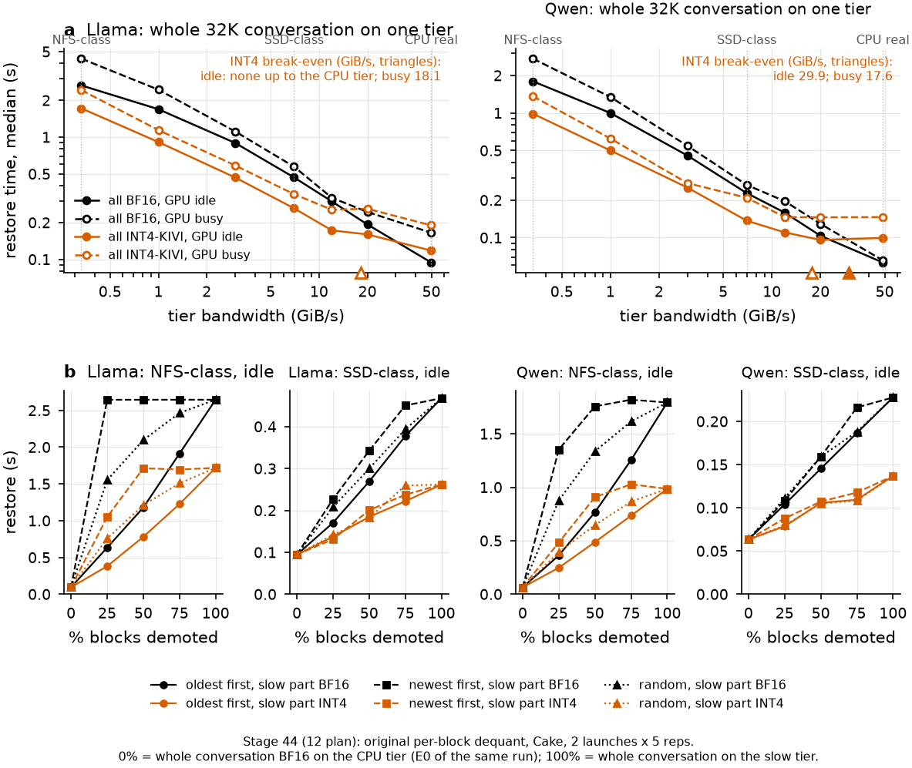

**圖 F25**
- (a) 整段 32K 對話放在一個層時，還原時間 vs 層的頻寬（實測點）。三角形＝INT4 不再省時間的頻寬。
- (b) 兩層：CPU 存 BF16，一部分 block 降到 NFS 級／SSD 級。
- 來源：`results/m10_tier_mi300x/summary_<m>.csv`、`iowall.json`（stage 44：`20261018-154708-m10-tier2-llama`、`-160950-m10-tier2-qwen`；原寫法的拆；guard 全 CLEAN）。

- **容量**（〔算術〕，`iowall.json` A1）：
  - 一段 32K 對話：Llama BF16 4.0 GiB／FP8 2.06／INT4 1.25；Qwen 1.75／0.875／0.547。
  - 每 1 TiB 放得下：Llama 256／496／819 段；Qwen 585／1,170／1,872 段（INT4 約 3.2 倍）。
- **還原時間 vs 頻寬**：
  - INT4 ÷ BF16：NFS 級 0.50–0.65、SSD 級 0.56–0.79。
  - INT4 不再省時間的頻寬（實測內插，原寫法的拆，`iowall.json` 的 `breakeven`）：Llama 忙 18.1 GiB/s，閒時一直到 CPU 層都還在省；Qwen 閒 29.9、忙 17.6。
  - 等效頻寬（NFS 級）：INT4 的還原時間等於 BF16 在 3.06–3.18 倍頻寬時的時間；FP8 是 1.88–1.98 倍（`iowall.json` 的 `k`）。
- **牆**（〔估計〕溢出模型；牆＝平均還原時間 > 全部在 CPU 的 BF16 的 2 倍；每 TiB，`iowall.json` A3）：

| 慢層、GPU 閒 | 模型 | 全 BF16 | 全 INT4 | 分層（CPU BF16、慢層 INT4） |
|:--|:--|--:|--:|--:|
| SSD 級 | Llama | 344 | 2,126 | 603 |
| SSD 級 | Qwen | 829 | 4,271 | 1,498 |
| NFS 級 | Llama | 266 | 880 | 272 |
| NFS 級 | Qwen | 603 | 1,963 | 620 |

  - Qwen・忙・全 INT4 的牆＝0：原寫法時，CPU 層的 INT4 本身就比 E0 慢 2 倍以上。
- **兩層：先降哪些，在 NFS 級差很多**（Llama、降 25%、GPU 閒）：

| 慢層存什麼 | 先降最舊的 | 先降最新的 | 隨機 |
|:--|--:|--:|--:|
| BF16 | 0.633 s | 2.644 s | 1.551 s |
| INT4 | 0.380 s | 1.050 s | 0.757 s |

  - 先降最新的 25%＝整段放 NFS 一樣慢：載入線從最後一塊開始，一開始就卡在慢層。
  - SSD 級的差異小，方向也不一致。
- **預期錯了一處**：「舊 25%」在 SSD 級仍比全部在 CPU 慢（Llama BF16 慢 81%），因為 Cake 只重算 3–5 塊，降下去的 16 塊大多還是要從慢層讀（08 §2.8）。
- 〔推論〕降級順序要配合還原方向：照整段對話的 LRU「舊的先降」，不要照前綴樹「尾巴先淘汰」。

### 4.5 長 context：32K／64K／128K（[10](../10_longctx_plan.md)；第一次完整寫）

**要回答什麼**：
1. BF16 自己變難多少？
2. 低精度的傷害會不會隨長度變大？
3. 位置在長文裡會不會開始有用？
4. 速度怎麼變？

**設定**：
- 64／128／252 個 block（252 個＝129,024 token）；每個長度 48 題（T2–T5 各 12、第 1 輪）；三個長度用同一組 seed，所以可以跨長度配對。
- 生成：E0、每種格式的「全部低精度」、三個主要格式的前／中／後／隨機 25%。生成只用讀法 A；讀法 B 用推算的會合點。
- 題目難度沒有重調。
- 品質 run：`20261019-033004`、`-033121`、`-055118`、`-055825`、`-060103`、`-082114`（Llama）；`20261019-055235`、`-055256`、`-055351`、`-060221`、`-075623`、`-082229`（Qwen）。

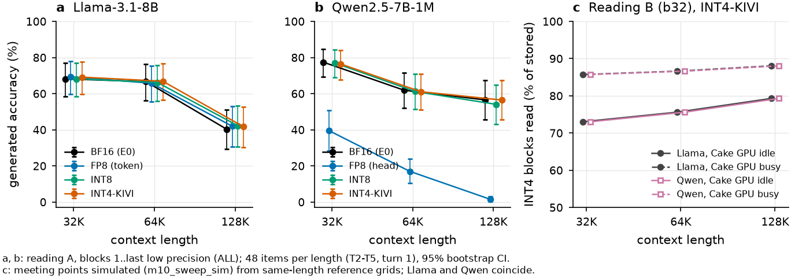

**圖 F12**
- (a)(b) 生成答對率 vs 長度（95% CI）。
- (c) 讀法 B 讀到的 INT4 block 比例（推算的會合點）。
- 來源：`results/m10_longctx_mi300x/analysis/longctx_<m>.json`。

- **(1) BF16 自己變難**：Llama 68.2 → 66.7 → 40.3%；Qwen 77.4 → 61.9 → 56.6%。
- **(2) 好的格式到 128K 仍和 E0 分不出差**：

| 模型 | 格式 | 32K | 64K | 128K |
|:--|:--|--:|--:|--:|
| Llama | E0 | 68.2% | 66.7% | 40.3% |
| Llama | FP8（token） | 69.3% | 65.7% | 42.0% |
| Llama | INT8 | 68.2% | 66.2% | 42.2% |
| Llama | INT4-KIVI | 69.1% | 66.8% | 41.7% |
| Qwen | E0 | 77.4% | 61.9% | 56.6% |
| Qwen | FP8（head） | 39.5% | 17.0% | 1.5% |
| Qwen | INT8 | 77.0% | 61.2% | 54.1% |
| Qwen | INT4-KIVI | 76.5% | 61.0% | 56.5% |

  - 「分不出差」不等於「一樣」：每個長度只有 48 題，CI 約 ±10 個百分點；128K 的 E0 本身也掉到 40%（Llama），能掉的空間變小。

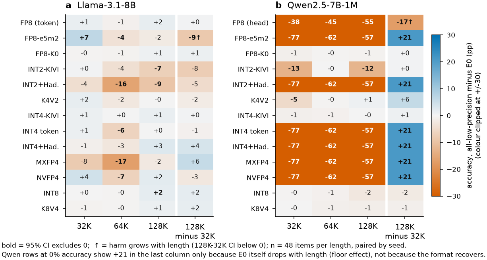

**圖 F13**　13 種格式「全部低精度」減 E0（百分點），以及 128K 減 32K。粗體＝CI 不含 0；↑＝傷害隨長度變大。
- 來源：同上 JSON 的 `harm`。

- **「傷害隨長度變大」被標記的只有**：
  - 128K−32K：Llama FP8-e5m2 −8.6 [−17.3, −1.4]、Qwen fp8_head −17.2 [−33.2, −0.5]。
  - 64K−32K（Llama）：FP8-e5m2 −10.2、INT4 每 token −7.5、NVFP4 −11.1。
- Qwen 有 6 種格式在三個長度都是 0%：FP8-e5m2、INT2＋Had、INT4 每 token、INT4＋Had、MXFP4、NVFP4。這是格式壞掉，不是長度。

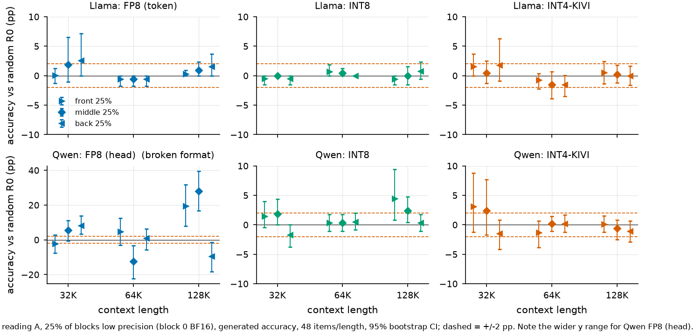

**圖 F14**　(3) 前／中／後 25% 對隨機（R0），生成答對率差（95% CI）。
- 來源：同上 JSON 的 `position`。

- **好的格式**：幾乎都在 ±2 內，CI 寬。
  - 例外（都沒校正）：Qwen INT8 128K 前 +4.5 [+0.8, +9.4]、中 +2.4 [+0.4, +4.8]；Llama FP8 32K 後 +2.6 [0.0, +7.1]。
  - 約 45 個好格式的格子裡有這 2–3 格，〔推論〕可能是碰巧。
- **壞掉的格式（Qwen fp8_head）位置效應很大，但方向不穩定**：
  - 32K 後 +8.2 [+3.4, +13.9]；64K 中 −12.4 [−22.2, −3.4]；128K 前 +19.5 [+8.0, +31.7]、中 +28.0 [+16.8, +39.5]、後 −9.5 [−18.2, −1.5]。
  - 〔推論〕格式本身大量傷害時，放哪裡才有差，但正負號隨長度改變，也不是一條能用的規則。該做的是換格式：同模型的 INT8／INT4-KIVI 到 128K 都和 E0 差不多。
- **讀法 B**：存的 INT4 被讀到的比例，閒 73／76／79%、忙 86／87／88%（32K／64K／128K；推算的會合點，兩個模型重疊）。

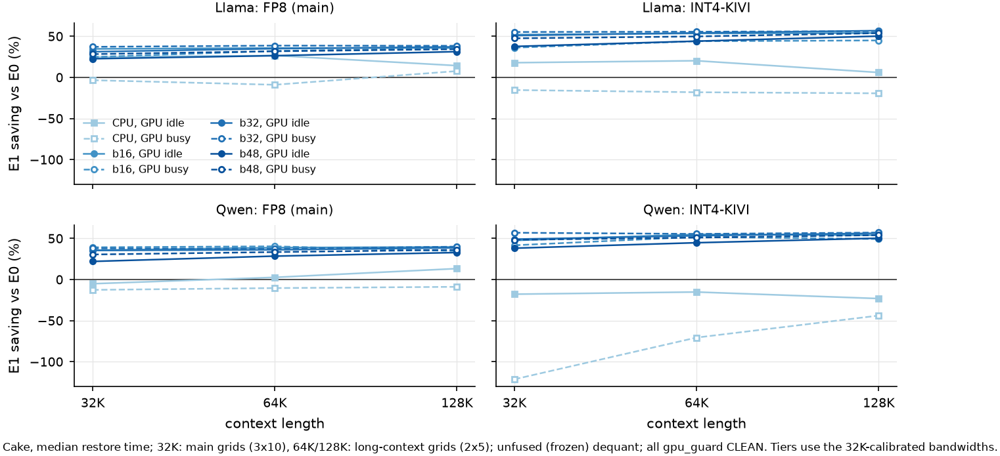

**圖 F19**　(4) 速度：E1 對 E0 的還原時間節省，32K／64K／128K（原寫法的拆；限速層沿用 32K 校正的頻寬）。
- 來源：`results/m10_longctx_mi300x/speed_<m>_<len>_<fmt>/summary.csv`，guard 全 CLEAN；Llama 128K INT4 只用重量 `20261019-173111-…-rerun`。
- 已提交的 `analysis/tables_longctx.md` 寫 INT4 64K／128K 是 NOT_MEASURED，因為它在 44ca 跑完前就產生了。更新版在 `docs/precision_20261013/report_stage2/derived/longctx/`。

- **限速層**：省得和 32K 差不多或更多。FP8 22–40%；INT4 在 64K／128K 省 44–57%。
- **真實 CPU 層**（原寫法）：
  - FP8：Llama 閒 +24.8／+26.6／+14.3%、忙 −3.5／−9.0／+7.6%；Qwen 閒 −5.1／+2.6／+13.2%、忙 −12.6／−10.4／−8.9%。
  - INT4（64K／128K）：Llama 閒 +20.2／+5.9%、忙 −18.1／−19.4%；Qwen 閒 −15.2／−23.2%、忙 −70.7／−43.9%。
  - 換成融合／一次拆完後的長 context CPU 層見 §4.3 Q1。

### 4.6 直接丟掉 token／block、讓存和算匹配（[14](../14_match_drop_plan.md)）

**要回答什麼**：
- 改精度在 32K 差距很小，那直接丟掉不重要的 token 或 block 呢？品質掉多少、省多少時間？
- 誰來決定丟哪些：寫入時（不知道問題），還是還原時（知道下一個問題）？
- 還原單位（M1）和格式（M2）怎麼配慢層？

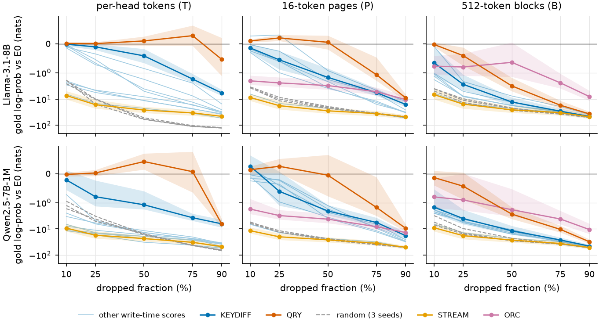

**圖 F16**　DS1 海選（teacher forcing、第 1 輪、192 題）：標準答案 log 機率的損失 vs 丟掉的比例，三種粒度。
- 粒度：每個 head 各自挑 token（T）、16-token 頁（P）、512-token block（B）。
- 來源：`results/m10_drop_mi300x/ds1/ds1_table.json`（run `20261020-001157` … `-003931-m10-ds1-*`）。

- 以 Llama T 粒度、丟 25%／50% 為例，標準答案 log 機率對 E0 的差（`tables_ds1.md`）：

| 挑法 | 丟 25% | 丟 50% |
|:--|--:|--:|
| QRY | +0.01 | +0.10 |
| KEYDIFF | −0.10 | −0.41 |
| STREAM | −16.5 | −26.4 |
| 隨機 RND0 | −10.4 | −58.9 |

  - block 粒度明顯比 T 粒度差。

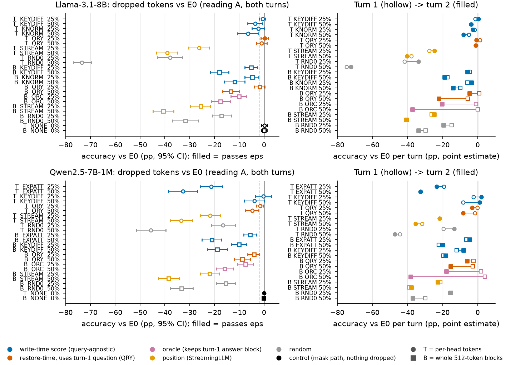

**圖 F15**　DS2 複賽（生成、兩輪、讀法 A；新題目 seed 70000 起，T2–T4 各 45、T5 15）。
- 左：對 E0（95% CI）。右：第 1 輪 → 第 2 輪。顏色＝誰決定丟哪些。
- 來源：`results/m10_drop_mi300x/ds2/ds2_report.json`、`tables_ds2.md`（run `20261020-005805` … `-034603-m10-ds2-*`）。

- **過 ε 的**：
  - 只有 Llama T-QRY-25：+0.2 [−1.3, +1.8]。它用的是第 1 輪的問題，也就是還原時才知道的資訊。
  - Qwen 的兩個不丟對照也過。Llama 不丟的對照（NONE-0）沒過，原因是 T5 每輪只有 15 題，1 題翻轉就 −6.7，連對照組都過不了這條。
- **寫入時、和問題無關的挑法裡最好的**：
  - Llama T-KEYDIFF-25：−0.5 [−1.9, +0.6]。主判準過，但 T5 第 1 輪 −7.3。
  - Llama T-KNORM-25：−2.2。
  - Qwen T-KEYDIFF-25：−0.2 [−3.4, +2.8]，T4 −15.6。
  - 丟 50% 時：Llama −3.6、Qwen −3.9。
- **以 block 為單位丟 25%，最好的也掉不少**：Llama KNORM −4.8、KEYDIFF −5.2；Qwen EXPATT −5.6。
- **對照**：隨機丟（T）Llama −38／−74；STREAM −22 到 −41。
- **多輪：照第 1 輪資訊挑的，第 2 輪會崩**（SCBench 說的問題）：
  - ORC（作弊保留第 1 輪答案的 block）B-50：Llama +0.1 → −37.1、Qwen +4.2 → −38.2。
  - QRY B-50：Llama −5.7 → −22.1、Qwen −2.8 → −15.3。
  - QRY T-50：Llama −0.9 → −1.1（沒崩）；Qwen −1.6 → −8.3。
  - 和問題無關的 KEYDIFF，第 2 輪沒有更差：第 2 − 第 1，Llama T-25 +1.9；Qwen T-25／T-50 +4.5／+9.4。

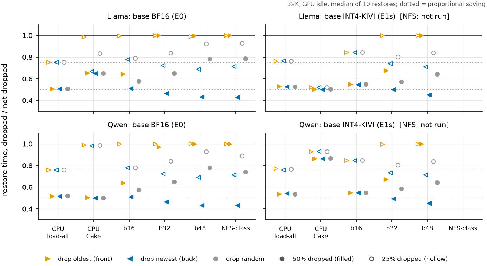

**圖 F17**　D3：丟掉以後的還原時間 ÷ 不丟（32K、GPU 閒、10 次中位數）。點線＝和丟掉的比例成正比的節省。
- 來源：`results/m10_match_mi300x/speed_14.json`、`tables_speed_14.md`（run `20261020-053032-m10-md-d3-llama`、`-055200-…-d3nfs-llama`、`-060107-…-d3-qwen`、`-061920-…-d3nfs-qwen`；guard 全 CLEAN）。

- **慢層＋Cake：丟哪裡比丟多少重要**。
  - 例（Llama INT4 E1s、b32、閒）：不丟 0.663 s；丟前 50% 0.449；丟後 50% 0.332；隨機 50% 0.379。
- **丟前面**：丟掉的範圍還沒超過 Cake 的會合點時，省 0%。
  - E0 在 b32、b48、NFS 級，丟前 25% 都是 1.00；b48、NFS 級丟前 50% 也是 1.00。前面那幾塊本來就由 GPU 重算。
  - 超過會合點才開始省：b16 閒、b32 忙、INT4 b32 閒，丟前 50% 省 28–36%。
- **丟後面**：b32、b48、NFS 級省得比比例多（丟 50%：0.43–0.50）；b16 比比例少（BF16 0.78、INT4 0.84–0.85）。
- **CPU 層**：全部載入時丟多少就省多少（25% 約 0.75、50% 約 0.51–0.54）。CPU 層用 Cake 時，因為會合點整數跳動，不規則。

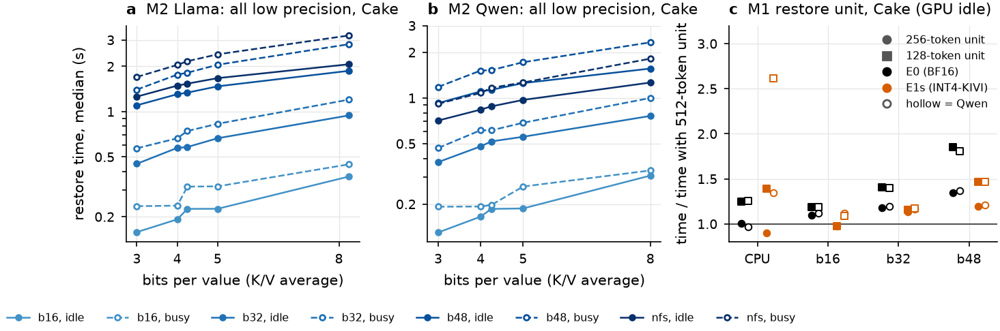

**圖 F18**
- (a)(b) M2：全部低精度、Cake，各慢層的還原時間 vs 位元數。
- (c) M1：還原單位 256／128 對 512。
- 來源：`results/m10_match_mi300x/speed_14.json`（run `20261020-062539` … `-092705-m10-md-{m2,m1}-*`；guard 全 CLEAN）、位元數來自 `m10_sweep_mi300x/analysis/agg_*.csv.gz`。

- **M2：位元越少越快，每一層都一樣**（GPU 閒，s）：

| 模型・層 | FP8 | INT4-KIVI | MXFP4 | K4V2 | INT2-KIVI |
|:--|--:|--:|--:|--:|--:|
| Llama b32 | 0.944 | 0.666 | 0.582 | 0.574 | 0.450 |
| Llama NFS 級 | 2.067 | 1.671 | 1.536 | 1.489 | 1.259 |
| Qwen b32 | 0.762 | 0.555 | 0.517 | 0.480 | 0.378 |
| Qwen NFS 級 | 1.264 | 0.972 | 0.880 | 0.839 | 0.711 |

  - 品質要另外看：在大掃描複賽（§4.1）全部低精度過 ε 的，只有 INT4-KIVI（兩個模型）和 K8V4（Qwen，不在 M2 裡）。
  - 所以「過得了 ε 又最快」的格式，兩個模型都是 INT4-KIVI。
- **M1：512 仍是最好的還原單位**。切細讓會合點更準，但每塊的固定開銷更大。
  - 例外：Llama 256 CPU 閒 0.90；Llama 128 b16 忙 0.83；Qwen 256 b16 忙 0.96。
  - 最差：Qwen 128 CPU 2.61 倍。

### 4.7 Cake 什麼時候有用：載入／重算比（[11 問題三 §3c](../11_issues.md)）

**要回答什麼**：Cake 論文說「存和算差太多，Cake 就沒意義」。我們的資料在哪個區？

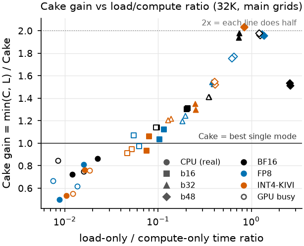

**圖 F26**　每格的 Cake 增益＝min(只算, 只載) ÷ Cake，對「只載 ÷ 只算」。
- 來源：主線速度格子 `speed_*/summary_{fp8,int4}.csv`（經 `code/m10_cake_ratio.cells()`）；表 `results/m10_precision_mi300x/analysis/cake_ratio.md`。

| 層 | 只載 ÷ 只算 | Cake 增益 |
|:--|:--|:--|
| CPU | 0.007–0.022 | 0.50–0.86 倍（輸） |
| b16 | 0.047–0.207 | 0.91–1.31 倍 |
| b32 | 0.127–0.741 | 1.20–1.98 倍 |
| b48 | 0.404–2.603 | 1.51–2.04 倍 |

- 比接近 1 時，增益接近 2 倍（兩條線各做一半的上限）。
- 壓縮會移動這個比：
  - b48：BF16 的比 2.6（增益 1.51 倍）→ INT4 0.84（2.03 倍）。
  - b32 反過來：BF16 0.74（1.98 倍）→ INT4 0.25（1.35 倍），但 INT4 的絕對時間還是快（1.38 → 0.68 s）。
- 跨層的比差了約 370 倍（0.007–2.6）。〔推論〕這和 Tiara 主張的「κ 跨硬體大幅變動」是同一件事。

### 4.8 Harness 對 vLLM、RULER CWE（stage 70／75／90–92）

**要回答什麼**：還原器的重算比 vLLM 慢多少？慢在哪？T5 和上游 RULER CWE 對不上，是不是推論框架的問題？

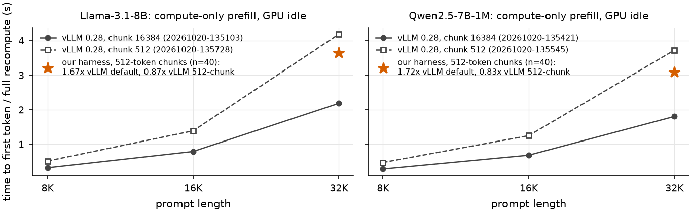

**圖 F27**　只算的 TTFT：vLLM 0.28（預設切法、512 切法）vs harness（512 切法）。
- 來源：`results/m10_precision_mi300x/vllm_ttft_guarded2/`（`20261020-135103-m10-vllmg2-llama-default`、`-135421-…-qwen-default`、`-135545-…-qwen-512`）、`vllm_ttft_guarded3/`（`20261020-135728-m10-vllmg3-llama-512`），全部兩張卡 CLEAN。
- harness：`results/m10_match_mi300x/m2/{llama_fp8_token,qwen_fp8_head}` 的只算參考線，40 次閒時中位數。

- **vLLM 預設切法**：8K／16K／32K，Llama 0.321／0.791／2.182 s、Qwen 0.287／0.684／1.802 s。**512 切法**：Llama 0.516／1.387／4.182 s、Qwen 0.474／1.248／3.720 s。
- **harness 32K**：Llama 3.637、Qwen 3.097 s → 比預設 vLLM 慢 1.67／1.72 倍；比 vLLM 512 切法快（0.87／0.83 倍）。
- **RULER CWE**：上游 jsonl（Llama、32K、30 題）用 vLLM 0.28 跑，加 BOS 1.0%、不加 6.0%，和 10/15 在 HF transformers 上量到的相同。所以 cards/V2 那個 ❌ **不是推論框架造成的**（`results/m10_precision_mi300x/ruler_cwe_vllm/cwe_vllm_llama.summary.json`，run `20261020-094344-m10-cwe-vllm`）。原因仍 NOT_MEASURED。

### 4.9 基礎設施：另一張卡在跑時能不能量時間（44cb／44d／44e2z）

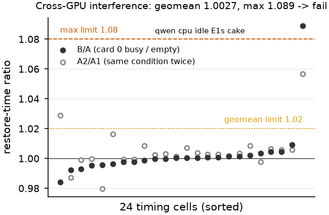

**圖 F28**　卡 1 量還原，卡 0「空著」(A) vs「跑 4 個品質 process」(B)，24 格的 B／A；空心＝同條件量兩次的 A2／A1。
- 來源：`results/m10_xgpu_mi300x/kfd/verdict.json`（run `20261020-050229` … `-052754-m10-xgpu3-*`）。

- **分卡**：gpu_guard 改讀 KFD sysfs 後，分得出兩張卡。
- **干擾**：B／A 幾何平均 1.0027（門檻 ≤ 1.02，過）；最大一格 1.089（門檻 1.08，沒過）。那一格同條件量兩次本身就差 1.057。
- 照事先寫死的判準算「沒過」→ **量時間照舊兩張卡獨佔**。所以本報告所有時間都是在獨佔狀態下量的。

---

## 5　討論與想法（〔推論〕為主；數字都是前面引過的實測）

### 5.1 一句話

在我們量到的範圍內（2 個 GQA 模型、32K–128K、MI300X、一次一個請求）：**KV 精度是「格式」「比例」「還原方式」三件事的問題，不是「位置」的問題。**

### 5.2 為什麼位置沒有用：三個原因疊在一起

1. **讀取機率的不對稱只在慢層存在，而在慢層它讓「放前面」等於「沒放」**。
   - b32 時 F25 存 16 個 FP8、讀到 0 個（§3.2）。前段的低精度只省空間，不省時間，也不影響品質。
   - 放後面（B25）雖然一定被讀、能省時間，但「全部低精度」省得更多、品質一樣（§3.6）。
   - 在真實 CPU 層幾乎全部被讀到，讀取機率的差別消失，只剩敏感度。
2. **好的格式下，敏感度又小又平**。
   - 逐 block 地圖只有 block 0 突出（3.5 倍），而 block 0 本來就一律保護；Cake 下它也一定被重算（§3.8b）。
   - 答案所在的 block 只比別處多一點點，CI 重疊。H2（壓到答案帶掉最多）不成立：蓋住答案帶 +0.66／+0.65／+0.52，沒蓋住 +0.37／+0.58／+0.03（§3.7）。
   - 比喻：縮印版字夠清楚時，縮印哪幾頁都一樣，因為每一頁都看得懂。
3. **傷害主要來自格式，而格式的傷害是「全面的」**。
   - Qwen fp8_head 每個任務都掉（T2 −16 到 T4 −72），保護開頭／最近只補回 0.3–0.5（§3.3）。
   - 格式壞掉時放哪裡才有差，但方向隨長度翻來翻去（§4.5）。該做的是換格式（INT8、FP8-K0、INT4-KIVI 都救回來）。
   - 比喻：縮印機壞了，選哪幾頁縮印只是在選「哪幾頁看不清楚」；該做的是換一台縮印機。
- 大掃描把這件事放大來看也一樣（§4.1）：寫入時的資訊確實能把誤差（KL）降 31–37%，但在好的格式下翻不過答案。唯一翻得過的（INT2 20%），又被溫和一點的均勻格式（全 INT4-KIVI）完全壓過。

### 5.3 什麼真的有用（都是實測）

| 槓桿 | 效果 | 在哪 |
|:--|:--|:--|
| 格式要對模型 | Qwen：FP8 每 head −32.8 → FP8-K0 +0.4、INT8 +0.2、INT4-KIVI +0.1 個百分點；關鍵是 K 要逐 channel 處理或先扣平均 | §3.3–§3.5 |
| 比例：全部低精度 | 限速層還原快 22–57%；NFS 級 INT4 的時間＝BF16 在 3.1 倍頻寬時的時間 | §3.1、§4.4 |
| 容量 | 每 TiB：Llama 256 → 819 段、Qwen 585 → 1,872 段（INT4） | §4.4 |
| 拆的寫法 | 融合 kernel：CPU 層低精度不再比 BF16 慢；GPU 忙＋全部載入時一次拆完再快 21–56%，背景不受影響 | §4.2、§4.3 |
| 依層選還原方式 | CPU 層全部載入比 Cake 快（低精度每個長度都是；BF16 在 32K）；慢層 Cake 快 1.2–2 倍；G5b 在 32K 平均離每格最好 0.4% | §4.3、§4.7 |
| 降級順序 | NFS 級「舊的先降」0.633 s vs「新的先降」2.644 s（Llama、25%、BF16） | §4.4 |
| 丟 token（有損） | 逐 head、和問題無關的 KEYDIFF 丟 25%：Llama −0.5（主判準過、逐族沒過）；block 級丟至少 −4.8 | §4.6 |

### 5.4 對 Tiara 動作空間的意義

Tiara 的動作空間＝{GPU-BF16, FP8, INT4, CPU, SSD, DROP＋重算}。

- **FP8／INT4 不是「依位置」的動作，是「依模型、依層」的狀態**。
  - 建議的規則：每個模型上線前做一次 codec 檢查（扣平均後的 K 誤差，或像 07 那樣 20 題的 KL），挑格式；之後整段對話用同一個格式。
  - 在我們的兩個模型上，INT4-KIVI 是安全的預設：品質過 ε，存的量是 BF16 的約 31%（Llama 1.25 vs 4.0 GiB）。
  - FP8 e4m3 每 head 的格式對 Qwen 不安全。
- **什麼時候轉低精度**：第一階段已經說「放置可以延後」。精度也一樣，可以延後到「降到慢層」時才轉。分層（CPU 存 BF16、慢層 INT4）在 SSD 級的牆，比全 BF16 晚 1.75 倍（Llama 603 vs 344 段／TiB），而且避開了 CPU 層反量化的問題。
- **CPU 與 SSD 兩層**：低精度在 CPU 層買的主要是**容量**（3.2 倍）；在慢層買的是**時間**（INT4 不再省時間的頻寬約 18–30 GiB/s，原寫法）。融合／一次拆完之後，CPU 層也不再變慢。
- **DROP＋重算（無損）**：D3 給了一個直接的設計含意。
  - 在慢層，丟掉「還在 Cake 重算範圍裡」的最舊 block，還原一點都不慢（0% 差）。所以那一段**根本不用存**，重算回來是精確的 BF16。
  - 條件是丟的範圍不超過預期的會合點。GPU 忙或低精度會讓會合點前移，可存可不存的範圍就變小（§4.6）。
  - 在真實 CPU 層剛好相反：全部載入最快，丟掉就得重算，比較貴。
  - 〔推論〕這是「放置要知道還原怎麼做」的又一個例子：同一個「不存」，在慢層免費，在 CPU 層要付錢。
- **丟 token（有損）不是 Tiara 原本的 DROP**。
  - 它省的是 attention 與容量。要省搬運，必須以 block 為單位丟，而 block 級丟 25% 就掉約 5 個百分點。
  - 照問題挑雖然好，但多輪會崩（block 級 −15 到 −38）。
  - 如果要進動作空間，〔推論〕比較站得住的是「寫入時、和問題無關、逐 head」的挑法（KEYDIFF），並且要配一個能壓縮逐 head 存量的格式，才會真的省位元組。這一點沒量（NOT_MEASURED）。
- **還原模式本身是一個要選的動作**：Cake／全部載入／一次拆完，依層、依長度、依 GPU 忙不忙。
  - G5b 在 32K 很準，但長 context 下會選錯（最差 1.20），而且 128K BF16 忙時 Cake 反而贏。
  - 〔推論〕規則需要把「長度」和「BF16 vs 低精度」一起放進估計。

### 5.5 最大的威脅：重算比預設 vLLM 慢 1.7 倍，結論會不會變？

- **先分清楚慢在哪**。
  - harness 比預設 vLLM（一次 16K token）慢 1.67／1.72 倍，但比同樣 512 切法的 vLLM 快（0.87／0.83 倍；§4.8）。
  - 〔推論〕所以差距主要是「切得細」，而 Cake 的雙向會合一定要切細。「慢 1.7 倍」高估了實作上的落後。真正受影響的是「只重算」這條參考線：用大塊算，全部重算會快 1.7 倍。
- **〔估計〕重算快 1.68 倍時**（`docs/precision_20261013/report_stage2/derived/whatif_recompute.json`；`code/report_stage2/whatif_recompute.py`；f(i) 除以 harness÷vLLM 的比，用 `m10_sweep_sim` 的兩條線模擬；它在 b16–b48 和實測會合點差 ±1 以內）：
  - **會合點往後移約 6–7 塊**：Llama b32 的 E0 32 → 39、INT4 18 → 24；b16 的 INT4 7 → 11。b16／b32／b48 不再代表「會合在 16／32／48」。
  - **「前段低精度沒被讀到」更明顯**：b16 INT4 時，F25 範圍內被讀到的 block 從 10 塊變 6 塊。
  - **低精度在慢層照樣省時間**：b32 INT4 對 BF16，0.558 vs 1.065 s（省約 48%；原本約 52%）。
  - **CPU 層全部載入仍然贏 Cake**：Llama E0 0.091 vs 0.082 s、INT4 0.072 vs 0.060 s。重算 1 塊從 29 ms 變 17 ms，還是遠大於載入 1 塊（約 1 ms）。
  - **Cake 對「只重算」的增益變小**：b32 E0，Cake 1.07 s vs 只算 2.16 s。
- **品質的判定不受影響**：讀法 A 和重算速度無關。讀法 B 在重算變快時讀到的低精度更少，只會更接近 E0〔推論〕。所以 K1／K3／K2 不會翻。
- **會變的**是「Cake 有用的頻寬帶」和「全部載入 vs Cake」的交界。例如 128K BF16 忙時 Cake 贏全載入的那一格，重算變快只會讓 Cake 更有利〔推論〕。

### 5.6 和主 session 現有判讀不一樣的地方

| 現有判讀 | 資料怎麼說 | 調整 |
|:--|:--|:--|
| 好的格式在 32K 和 128K 都 ≈ BF16 | 點估計都在 ±2.5 內，但每個長度只有 48 題（CI 約 ±10），Llama E0 自己在 128K 掉到 40%；Qwen INT8 128K −2.5 [−7.5, +0.8] | 改成「分不出差」，不寫「一樣」 |
| 位置效應只出現在壞掉的格式 | 大的效應是；但 Qwen INT8 128K 前 +4.5 [+0.8, +9.4]（沒校正）；壞格式的效應方向隨長度翻轉 | 保留，加上「壞格式下也不是可用的規則」 |
| G5b 離每格最好 0.4% 以內 | 只在 32K 的幾何平均成立；單格可到 1.10；64K／128K CPU 層平均 1.027、最差 1.20；128K BF16 忙時選錯 | 加上範圍 |
| 真實 CPU 層全部載入贏 Cake | 低精度每個長度都是；BF16 在 128K、GPU 忙時 Cake 贏（Llama 0.511 vs 0.570 s） | 加例外 |
| KEYDIFF 接近 ε | Llama 主判準過，但 T5 第 1 輪 −7.3（n＝15，對照組也過不了這條）；Qwen CI 下界 −3.4、T4 −15.6；唯一過 ε 的是知道問題的 QRY | 改成「接近，但沒過」 |
| 照問題挑的第 2 輪會崩 | block 級成立；Llama 逐 head 的 QRY 沒崩（−0.9 → −1.1） | 加上粒度 |
| 丟前面的 block 在慢層省 0% | 只在丟的範圍還在會合點之前時成立；超過後丟前 50% 省 28–36%；丟後面在 b16 比比例少 | 加條件 |
| M1：512 最好 | 大致成立；有 3 格例外（最好 0.83） | 加例外 |
| harness 重算慢 1.7 倍是所有會合點結果的威脅 | 對預設切法成立；同樣 512 切法時 harness 反而快；〔估計〕重算變快不改結論方向 | 威脅比字面小（§5.5） |
| vLLM FP8 decode 快 10%／29%（08、11、RUNLOG 14.4） | 那幾個 run 沒有 gpu_guard 紀錄 | 照 CLAUDE.md §3 不能當時間結論；需要時重量 |
| 反量化微測（11 問題一 §4） | `dequant_fast_bench.json` 沒有 guard | 改用有 guard 的 `parts_<m>.csv`（§4.2） |
| 11 問題二用了 Llama 的 FP8-K0、INT8 列 | 那是 Step 2b 封存組，Llama 沒走到 Step 2b | 本報告不用（F09 只畫 Qwen 的） |

### 5.7 還沒回答的問題與下一步（建議）

1. **融合 kernel／一次拆完放到慢層和 IO 牆上重量**：12 號的 IO 牆、兩層實驗都是原寫法；42c 只量了 b32。INT4 不再省時間的頻寬（18–30 GiB/s）很可能往上移，NOT_MEASURED。
2. **還原模式規則加上長度**：G5b 在 64K／128K 會選錯。下一版用「每塊載入、每塊重算、塊數」三個量一起估，並分 BF16／低精度。
3. **併發**：所有量測都是一次一個請求。多個請求同時還原時，「拆」和「重算」搶 GPU 的情況會更嚴重（§4.3 Q4 的趨勢），NOT_MEASURED。
4. **真實儲存裝置**：慢層都是限速模擬。要寫成 SSD／NFS 的結論，必須另外登記、量真的裝置。
5. **第三個模型與 MHA**：例如 LongAlpaca 或更大的模型，看「K 有偏移」這種格式問題有多普遍。
6. **更難的任務、長生成**：文獻說 4-bit 在難題、長推理上傷得比較多；我們的答案都短（≤ 64／120 token）。
7. **把重算修快**（03 §5.2 沒做）：重量會合點與 Cake 的頻寬帶，驗證 §5.5 的估計。
8. **「慢層的前段不用存」**（§5.4）：做成一個事先登記的實驗。依預測的會合點，把最舊的 k 塊改成 DROP＋重算，量存量省多少、還原慢多少，並在 GPU 忙、低精度時看預測錯的代價。
9. **丟 token 要省位元組**：逐 head 的挑法要配上逐 head 壓縮的存放格式，才真的少搬；設計並量一次。

---

## 6　限制與威脅

- **硬體與規模**：一種 GPU（MI300X）、兩個 7–8B 的 GQA 模型、一次一個請求。Hopper 的硬體 FP8 是 OCP e4m3，反量化成本可能不同，不能直接搬過去（11 問題一 §5）。
- **慢層是模擬**：pinned 記憶體加計時器，沒有檔案系統、讀取延遲、兩段搬運。
- **GPU 忙是合成的**：背景 matmul、duty 0.7（加上 13 號的 0.4／0.9）。不是真實的別的請求。
- **重算比預設 vLLM 慢 1.67／1.72 倍**：03 §5.2 的 attention 修正沒做。§5.5 有估計，但沒有實測驗證。
- **任務**：RULER 式合成題＋HotpotQA＋LongBench 子集，答案都短，沒有長推理。T5 只有 60 題（DS2 每輪 15 題），逐族的輔助判準解析度低：1 題翻轉＝−1.7 或 −6.7 個百分點。
- **長 context**：每個長度 48 題、沒有重調難度、128K 的 E0 有地板效應、頻寬沿用 32K 校正、讀法 B 是推算的會合點。
- **速度判準只在真實 CPU 層沒過**：INT4 階判「均勻不夠」完全是原寫法反量化造成的。凍結的規則用原寫法，不改；老師還沒對 08 §6 第 1 點的選項表態。不管選哪個，結論都是「不需要位置策略」，只差寫法。
- **封存、沒分析的資料**（附錄 D）：FP8 階的 H2 交叉表、Qwen INT4 混合配置都沒分析，所以 H2 只在 Llama INT4 上檢驗過。
- **沒有 guard 的計時不採用**：vLLM FP8 decode、反量化微測。
- **多重比較**：探索實驗格子很多，只有大掃描複賽（43）和 DS2 用了 Holm；其他探索都只報方向和 CI。
- **雜訊**：Qwen δ＝9.43%。CPU 層的格子差幾 ms 就會翻盤（例：Qwen E1s CPU 忙，兩次量 1.140 → 1.090，門檻 1.094；08 §2.1）。
- **事先登記的偏離**：
  - 精度階梯（FP8 → INT4）和老師原話不同（10/13 自己加的）。
  - 凍結後有兩處調整（07 §9：T1／LongBench 改排在後面、檢定力規則寫清楚），都在任何 Step 1 品質列產生之前。
- **這份報告是 self-review**：沒有 cross-model 或第二位審查者。

---

## 7　結論

- **判定**：FP8、INT4 兩階都得到同一個答案：**依位置決定精度沒有幫助**。
  - FP8：Llama 全部用就夠；Qwen 換 codec 就夠。
  - INT4：品質全過；要省時間時，放哪裡也不比隨機好（K2）。
- **原因**〔推論，有實測支撐〕：
  - 慢層讓前段的低精度沒人讀；CPU 層又全部讀到。
  - 好的格式下敏感度很平（只有已保護的 block 0 突出）。
  - 壞的格式傷害是全面的，該換格式，不是挑位置。
- **真正的旋鈕**：每個模型挑對的格式；在慢層全部用低精度；依層和長度選還原方式（CPU 層全部載入＋一次拆完，慢層 Cake）；降級時舊的先降。
- **對 Tiara**：FP8／INT4 應該是「依模型、依層、延後到降級時」決定的狀態，不是寫入時依位置決定的動作；還原模式本身是要選的動作；慢層上「預期會被重算的前段不用存」值得另外登記驗證。

---

## 附錄 A　重現

**圖與衍生數字**（CPU，只讀 `results/`；約 24 秒）：

```bash
cd /mlsteam/workspace/paper-hierarchical-kv-state
nice -n 19 /mlsteam/workspace/venv/tiara/bin/python code/report_stage2/make_figs.py          # 全部圖 → report_stage2/figs/
nice -n 19 /mlsteam/workspace/venv/tiara/bin/python code/report_stage2/make_figs.py --only f2 # 只重畫 F20–F28
nice -n 19 /mlsteam/workspace/venv/tiara/bin/python code/report_stage2/whatif_recompute.py    # §5.5 的估計
nice -n 19 /mlsteam/workspace/venv/tiara/bin/python code/m10_longctx_analyze.py --out-dir docs/precision_20261013/report_stage2/derived/longctx
```

**主線判定的驗算**（CPU）：
- `code/m10_queue_mi300x/analyze_step1.sh`、`analyze_2b.sh`、`analyze_int4.sh`、`analyze_step2_int4.sh`。
- 注意兩點：
  - 它們會寫進 `results/`。
  - `quality/step1_<m>_*.csv` 這個萬用字元，現在也會吃到 10/19–20 才加的 T1／LB 檔。ε 的結果不變，但 `n_items` 會變。
- 要逐位元重現，請用判定 JSON 裡 `csv` 欄列的檔案清單。

**run_id**：

| 用途 | run_id |
|:--|:--|
| 頻寬校正、雜訊 | `20261015-154558-m10-calibf-llama`、`-154647-…-qwen`；`20261015-154722-m10-noise-llama`、`-155626-…-qwen` |
| 格式小測 | `20261015-160426`／`-160541`／`-160656`／`-160811-m10-fmtsel-*` |
| FP8 速度格子 | Llama `20261015-161226-m10-grid-fp8-llama`；Qwen 重量 `20261015-194150-m10-regrid-fp8-qwen`（原 `-175050` 被標污染，不採用） |
| Step 2b 速度 | `20261015-191338`、`-192112`（Llama）；`-192845`、重量 `-210456-m10-regrid-2b-int8_token-qwen` |
| Step 1 品質（含 2b 列） | Llama `20261015-211144`…`20261016-015830`（7 個）；Qwen `20261015-211259`…`20261016-015945`（7 個）（08 附錄 A） |
| INT4 速度格子 | `20261016-034902-m10-grid-int4-llama`、`-052143-m10-grid-int4-qwen` |
| INT4 端點品質 | `20261016-064017`…`-084311`（Llama 6 個）、`-064132`…`-084426`（Qwen 6 個） |
| Step 2（INT4、Llama） | `20261016-102921`…`-115740`（7 個） |
| T1／LongBench（只報告） | `20261019-102819`、`-103050`（Llama T1）；`20261020-005507`、`-012042`（Qwen T1）；`20261019-102934`、`-103205`、`20261020-005622`、`-042944`（LB）；INT4：`20261020-095349`、`-095355`、`-100505`（＋續跑 `-130336`）、`-100521`；`-095510`（Llama INT4 混合 T1） |
| 敏感度地圖（只報告） | `20261020-095335`、`-095340-m10-sens-llama-int4-*` |
| 大掃描 | 海選 `20261016-135544`／`-135700`／`-135815`／`-135930`；複賽品質 `20261017-134426`…`20261018-045826`（12 個）；速度 `20261017-042229`…`-094858`（7 個） |
| 反量化 | 零件 `20261016-130329`、`-130451`；stage 42 `20261016-232855`、`-234030`、`-235027`、`20261017-000209`；42b／42c 見 `results/m10_sweep_mi300x/dqsweep/` |
| 還原第二輪（13） | Q4 `20261018-093743`…`-113436`、重量 `-135548`；Q2 `-113902`…`-134456`；Q3 `-135949`…`-143319`；Q5 `-143821`…`-152107`；Q1 `20261019-200526`…（`results/m10_restore2_mi300x/q1/`） |
| IO 牆／兩層（12） | `20261018-154708-m10-tier2-llama`、`-160950-m10-tier2-qwen` |
| 長 context（10） | 品質見 §4.5；速度 `20261018-163518`、`-191828`、`-213624`、`-224532`（FP8），`20261019-132102`、`-153135`、`-163608`、`-173111-…-rerun`（INT4） |
| 丟 token／匹配（14） | DS1 `20261020-001157`…`-003931`；DS2 `20261020-005805`…`-034603`；D3／M2／M1 `20261020-053032`…`-092705`（20 個，`speed_14.json`） |
| vLLM、CWE、雙卡 | `20261020-135103`、`-135421`、`-135545`、`-135728`；`20261020-094344-m10-cwe-vllm`；`20261020-050229`…`-052754-m10-xgpu3-*` |

## 附錄 B　圖索引

每張圖讀了哪些檔：[figs/SOURCES.md](figs/SOURCES.md)。

| 圖 | 內容 | 章節 | 判定／只報告 |
|:--|:--|:--|:--|
| F01 | Cake 雙向還原與「有沒有被讀到」（示意） | §1.2 | — |
| F02 | 判定流程與實際出口 | §1.4 | 判定 |
| F03 | K0：E1 對 E0 的還原時間節省 | §3.1 | 判定 |
| F04 | 每個配置實際讀到什麼 | §3.2 | 判定（H3、H4） |
| F05 | 端點品質（FP8＋2b＋INT4） | §3.3–§3.5 | 判定 |
| F06 | Step 2：位置對隨機（K2） | §3.6 | 判定 |
| F07 | 品質對延遲（圖 A） | §3.6 | 判定資料重畫 |
| F08 | Qwen FP8 的機制 | §3.4 | 只報告（解釋） |
| F09 | INT4 劑量反應 | §3.8c | 只報告 |
| F10、F11 | 大掃描海選、複賽 | §4.1 | 只報告 |
| F12–F14、F19 | 長 context：答對率、傷害、位置、速度 | §4.5 | 只報告 |
| F15–F18 | 丟 token、D3、M2、M1 | §4.6 | 只報告 |
| F20 | 反量化成本與融合 kernel | §4.2 | 只報告 |
| F21–F24 | 還原第二輪 Q4、Q2、Q5、Q1 | §4.3 | 只報告 |
| F25 | IO 牆與兩層 | §4.4 | 只報告 |
| F26 | Cake 增益 vs 載入／重算比 | §4.7 | 只報告 |
| F27 | harness vs vLLM | §2.9、§4.8 | 只報告 |
| F28 | 雙卡干擾檢查 | §4.9 | 只報告（基礎設施） |
| F30、F31 | T1／LongBench；逐 block 敏感度地圖 | §3.8 | 只報告 |

## 附錄 C　關鍵數字與來源

| 數字 | 意思 | 來源（`results/` 底下，除非另寫） |
|:--|:--|:--|
| 5%、9.43% | δ\*：Llama、Qwen | `m10_precision_mi300x/speed_<m>/noise.json` |
| 5.27／1.47／0.420；2.77／0.764／0.218 GiB/s | b16／b32／b48：Llama；Qwen | `speed_<m>/bw.json` |
| 49.9、48.6 GiB/s | 真實 pinned H2D | 同上 |
| 7／8、6／8、6／8、6／8 | K0：E1 贏的格子（FP8 L、Q；INT4 L、Q） | `speed_*/k0_verdict_*.json` |
| 22–57% | 限速層 E1 節省範圍（兩階兩模型） | 同上 `gain_E1_over_E0` |
| −121.4% | Qwen INT4 CPU 忙（原寫法） | `speed_qwen/k0_verdict_int4.json` |
| 0／16、16／16 | b32 時 F25、B25 讀到的低精度 | `speed_*/summary_fp8.csv` `median_fp8_read` |
| 14–16／16 | CPU 層 F25 讀到的低精度 | 同上 |
| −0.5 [−1.1, +0.2] | Llama FP8 E1 讀法 A | `analysis/fp8/quality_llama_step1.json` |
| −32.8 [−35.8, −30.0] | Qwen FP8 E1 讀法 A | `analysis/fp8/quality_qwen_step1.json` |
| −71.7／−67.2 | Qwen FP8 T4 兩輪 | 同上 `aux` |
| +0.4、+0.2 | Qwen E1-K0、E1-INT8 讀法 A | `analysis/fp8/quality_qwen_step2b.json` |
| 1.164、1.073（門檻 1.094） | Qwen E1-K0、E1-INT8 CPU 忙速度比 | `analysis/fp8/speed_qwen_2b_*.json` |
| 415、1.7、219／14,336 | Qwen K 偏移：最大 channel 平均、標準差、比 > 10 的 channel 數 | `m10_pilot_mi300x/kv_stats/summary_kv_qwen.json`、`kv_topchan_qwen.csv` |
| 18.0%、4.2%、2.7% | 扣平均後 K 誤差：Qwen FP8、Llama FP8、Qwen FP8-K0 | `kv_stats/summary_kv_<m>.json` |
| +1.1 [+0.3, +1.9]、+0.1 [−0.8, +0.9] | INT4 E1 讀法 A：Llama、Qwen | `analysis/int4/quality_<m>_int4.json` |
| 1.145、2.098 | INT4 CPU 忙速度比：Llama、Qwen E1 | `analysis/int4/speed_<m>.json` |
| ±0.33 以內 | Step 2：位置對 R25 | `analysis/int4/step2_llama_int4.json` |
| 1.141 vs 1.255 s；0.681 s | b32 閒 B25 vs R25；全 INT4 | `speed_llama/summary_int4.csv` |
| −48.6、−36.0 | Qwen FP8：T1、LongBench（只報告） | `docs/…/report_stage2/derived/report_only.json` |
| 0.00104 vs 0.00030 | 敏感度地圖：block 0 vs 其他中位數 | 同上 `sensmap_llama_int4` |
| 170／1,326、384／1,326 | 大掃描海選勝出格 | `m10_sweep_mi300x/analysis/tests_<m>.csv` |
| +2.0 [+0.8, +3.1]；−1.2 [−2.6, +0.1] | Llama INT2 20% ERR：對隨機；對 E0 | `m10_sweep_mi300x/confirm/confirm_llama.json`、`detail_A.md` |
| 0.072 → 0.065 … 0.146 → 0.066 s | stage 42：E1 原寫法 → 融合 | `m10_sweep_mi300x/speed_dqfast*_<m>/summary.csv` |
| −21% 到 −56% | Q4：一次拆完＋全載入 vs 逐塊（忙） | `m10_restore2_mi300x/tables_13.md` Q4 |
| 1.048、1.004 | G5、G5b 幾何平均（32K） | `m10_restore2_mi300x/g5_pick.json` |
| 0.511 vs 0.570 s | 128K BF16 忙：Cake vs 全載入（Llama） | `m10_restore2_mi300x/tables_13.md` Q1 |
| 819、1,872 段 | INT4 每 TiB 容量 | `m10_tier_mi300x/iowall.json` A1 |
| 18.1、29.9、17.6 GiB/s | INT4 不再省時間的頻寬 | 同上 A2 `breakeven` |
| 0.633 vs 2.644 s | NFS 級：舊先降 vs 新先降（Llama 25%） | `m10_tier_mi300x/summary_llama.csv` |
| 40.3%、41.7–42.2% | Llama 128K：E0、好的格式 | `m10_longctx_mi300x/analysis/longctx_llama.json` |
| 1.5% | Qwen fp8_head 128K | `longctx_qwen.json` |
| +28.0、−9.5 | Qwen fp8_head 128K 中、後對隨機 | 同上 `position` |
| +0.2 [−1.3, +1.8] | 唯一過 ε 的丟法：Llama T-QRY-25 | `m10_drop_mi300x/ds2/ds2_report.json` |
| −37.1、−38.2 | ORC B-50 第 2 輪 | 同上 |
| 0.663／0.449／0.332 s | D3：不丟／丟前 50%／丟後 50%（Llama INT4 b32 閒） | `m10_match_mi300x/tables_speed_14.md` |
| 0.450 vs 0.944 s | M2：INT2 vs FP8（Llama b32 閒） | `m10_match_mi300x/speed_14.json` |
| 0.50–0.86、1.51–2.04 倍 | Cake 增益：CPU 層、b48 | `m10_precision_mi300x/analysis/cake_ratio.md` |
| 1.67、1.72；0.87、0.83 倍 | harness ÷ vLLM 預設；÷ vLLM 512 | `vllm_ttft_guarded{2,3}/vllm_ttft.csv`、`m10_match_mi300x/m2/*/restores.csv` |
| 1.0%、6.0% | 上游 RULER CWE 在 vLLM | `ruler_cwe_vllm/cwe_vllm_llama.summary.json` |
| 1.0027、1.089 | 雙卡干擾：幾何平均、最大 | `m10_xgpu_mi300x/kfd/verdict.json` |
| 32 → 39、18 → 24 | 〔估計〕重算快 1.68 倍時 b32 的會合點（E0、INT4） | `docs/…/report_stage2/derived/whatif_recompute.json` |

## 附錄 D　封存規則怎麼套用

**規則**：[07 §6](../07_freeze_mi300x.md) 與 [03 開頭「10/15 晚改動」](../03_plan_h200.md)最後一點：判定流程還沒走到的配置可以先跑，結果封存在 `quality_sealed/`，「判定流程走到才分析；沒走到的照實記錄『跑了、沒分析』」。

**套用方式**：一筆封存結果只在「它所屬的判定節點真的被執行過」時才分析。
- 執行過的節點：FP8 Step 1（兩個模型）、Step 2b（Qwen）、INT4 Step 1′（兩個模型）、INT4 Step 2（Llama）、K2。
- 沒執行的節點：FP8 Step 2、INT4 Step 2 的 Qwen（03 §1.1：主比較只有一個模型）、Step 3。

| 封存的東西（stage） | 屬於哪個節點 | 處理 |
|:--|:--|:--|
| Step 2b 的 E1-K0、E1-INT8，Qwen | Step 2b（執行過） | 判定（§3.4） |
| Step 2b 的 E1-K0、E1-INT8，Llama（列在 Step 1 CSV 裡） | Llama 的 Step 2b（沒執行：Llama 已 K1） | **跑了、沒分析**（11 問題二曾當劑量反應用過，本報告不用） |
| INT4 速度格子、端點（33a、33b） | INT4 Step 1′（執行過） | 判定（§3.5） |
| INT4 混合配置，Llama（33c） | INT4 Step 2（執行過） | 判定（§3.6） |
| FP8 混合配置，兩個模型（35 → 45，含 55 的 FP8 混合 T1） | FP8 Step 2（沒執行） | **跑了、沒分析**：`quality_sealed/fp8mix_*` |
| INT4 混合配置，Qwen（46） | INT4 Step 2 的 Qwen 支（沒執行） | **跑了、沒分析**：`quality_sealed/int4mix_qwen_*` |
| T1、LongBench 的端點（55、88） | 端點節點（執行過），而且 07 §2、03 §3.2 本來就標只報告 | 只報告（§3.8a） |
| T1 的 Llama INT4 混合配置（88） | INT4 Step 2（執行過）；T1 只報告 | 只報告（§3.8a） |
| 逐 block 敏感度地圖，Llama INT4（60） | 03 §3.3b：主模型的診斷，用來解釋 Step 2 的結果；07 §6 標只報告 | 只報告（§3.8b） |
| 逐 block 敏感度地圖：Llama FP8、Qwen FP8、Qwen INT4（60） | 沒有對應的、執行過的 Step 2 主模型 | **跑了、沒分析** |

- 08 曾預告 45、46 會「只報告」。本報告照 07 §6 的字面判「跑了、沒分析」。
- 如果使用者決定「判定流程已經結束、分析不可能再改任何判定」而解封，可以用 `code/report_stage2/figs_report_only.py` 的同一套程式（重用 `m10_analyze.py`）分析，並標成「只報告（解封）」。
