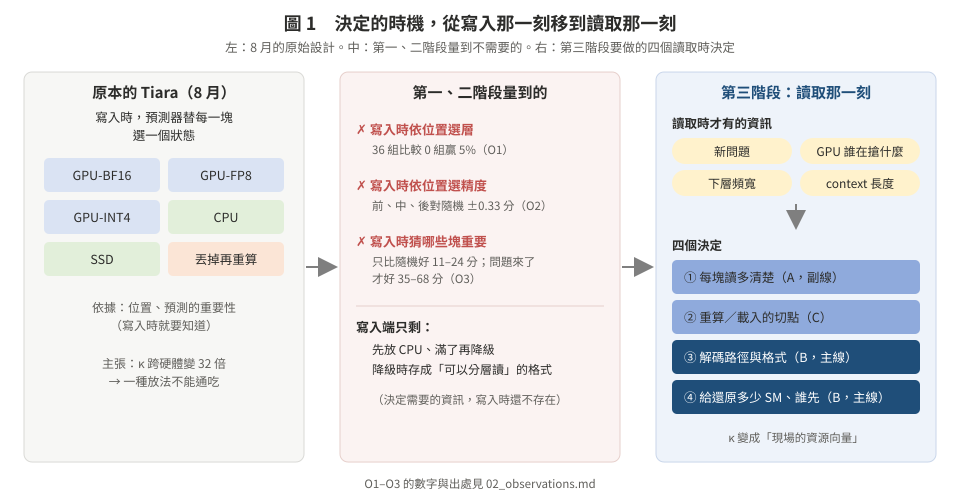
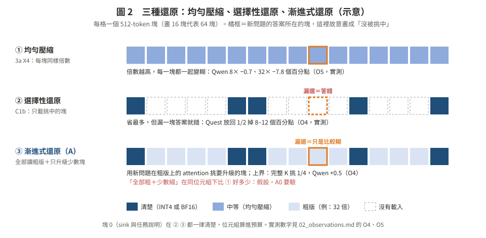
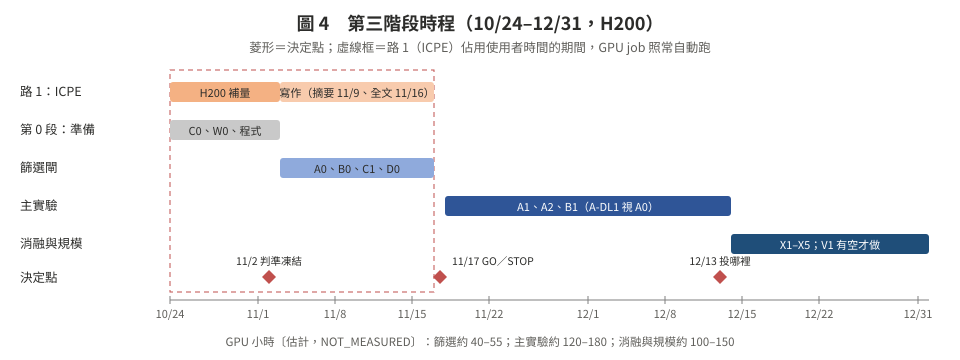

# 第三階段設計（2026-10-24）：把決定移到讀取那一刻

> **一句話**：寫入端只存一份「可以分層讀」的 KV；使用者回來時，**當下的 GPU 資源**決定用什麼方式、分多少 SM 去還原（主線 B），**新問題**決定每一塊讀多清楚（副線 A）。
>
> **10/24 補充（先看這個）**：只靠 B 機率太低。[mechanisms/](mechanisms/README.md) 用「找一個 SOTA 改它」來講：SOTA 一直是 Cake，前兩次改它的「存」都沒用（＝路 1）；第三次改它的「拿回來」：GPU 留縮印版，回來時用新問題逐層只拿需要的原版（縮圖還原）。主設定換成 128K–256K、8B–14B；11/17 前的關鍵一關是 A0。
>
> 這是第三階段（路 2）的核心頁。所有文件都從這裡連出去。路 1（ICPE）的證據表在 `origin/h200` 的 `docs/h200/ICPE_EVIDENCE.md`。

---

## 0. 你問的「對吧？」：對，但要補兩件事

你的說法：「從『寫入時逐塊預測』改成『還原時，依當下的頻寬、GPU 負載和長度決定』；實作上照 vLLM 內建，只補降級時壓縮、拿回來時選對方式。」

**方向是對的**。第一、二階段證明寫入時的決定沒有用，而 C1a 說明了原因：決定需要的資訊在寫入時根本還不存在（02 的 O1–O3）。但有兩處要補：

1. **讀取時最值錢的資訊是「新問題」，不只是頻寬、負載、長度。**
   - C1a：寫入時猜重要性只比隨機好 11–24 分；新問題來了，用完整 K 挑，好 61–68 分。
   - C1b 的上界：Qwen 只要 1/4 的塊清楚就不掉分。
   - 所以讀取時要決定的不只「用 Cake 還是全搬」，還有「**每一塊讀多清楚**」。這是第三階段的副線 A。
   - 你說的「GPU 負載」也要從一個數改成**資源向量**：搬運吃 copy engine／PCIe，反量化吃 SM，重算與低秩重建吃 tensor core，背景搶哪一種，就拖慢哪些做法（[圖 3](figures/fig3_resource_vector.svg)）。而且「分多少 SM 給還原」本身就是一個決定。這是主線 B。
2. **「照 vLLM 內建」有兩個坑。**
   - vLLM 的 KV connector 只能表達「載入已算部分之後的連續前綴」；Cake 的順序（前段重算、後段載入）不能直接插進去（`EVAL_FOUNDATIONS_20261007.md` §10.2）。
   - vLLM 的 CPU→檔案層是搬原始位元組；「降級時才壓縮」要在 OffloadingConnector 的轉移函式加 codec。
   - 這兩件是工程，但要寫進計畫（05 的 V1）。

所以讀取時的決定有四個，見[圖 1](figures/fig1_read_time_shift.svg)：
- ① 每塊讀多清楚（新問題）
- ② 重算／載入的切點（長度、頻寬、負載）
- ③ 解碼路徑與格式（誰在搶哪種資源）
- ④ 給還原多少 SM、誰先還原

---

## 1. 五個方向：B 主線、A 副線

| # | 方向 | 一句話 | 角色 | 新意〔查新後〕 | 第一道閘 |
|:--|:--|:--|:--|:--|:--|
| **B** | 資源感知的還原 | 還原成本是現場的資源向量；計畫和 SM 分配跟著瓶頸走 | ⭐ **主線**（主張 C1） | 中高：聯合規劃沒查到；12 個 GPU 共用系統都沒把 KV 還原放進 SM 分配 | B0：真實背景下排序會變，或分 SM 換到 ≥30% |
| **A** | 漸進式還原 | 讀回時不丟任何一塊，只用新問題決定每一塊讀多清楚 | ⭐ **副線**（主張 C2，上檔最大） | 中：表示法已被 ReadKV 等在 decode 時發表；剩讀回邊界的機制與量測 | A0：oracle 在同位元組下比均勻壓縮好 ≥2 分 |
| **C** | 能外推的還原方式預測 | 幾個物理量就能預測該重算還是該搬，換長度、負載、平台都準 | 基礎元件 | 低中 | C0：沒看過的格子平均 ≤1%、最差 ≤5% |
| D | 模型自帶索引 | 借新一代模型訓練過的選塊索引當挑塊器 | 併進 A 當挑法 | 低：無損版已被 Janus 做掉 | D0：512-token 粒度下 union 佔比、recall 離上界 ≤10 分 |
| E | 高併發降級還原 | 排隊時先給每個人粗版 | 延伸 | 中：沒查到依爭用改格式的 brownout | 在 A、B 之後 |

**為什麼 B 是主線**（[01](01_innovation_criteria.md) 的評分、[03](03_competitors.md) 的查新）：
- 它是唯一「整個組合查不到前作」的方向：用當下、按資源拆開的爭用，聯合決定切點、解碼路徑、copy engine 或 SM 搬運、SM 配額、還原順序。「算力型背景翻、頻寬型不翻」也沒人報過。這是老師三準則的 ①。
- 它就是你原本提的「還原時依當下頻寬、GPU 負載、長度決定」，只是把「GPU 負載」從一個數改成資源向量，並把 SM 分配也納入。
- 過閘機率比較高：H200 MPS 的合成背景下，背景讓出 13% 的 SM，Cake 就快 3.1 倍、背景只少 9%（O9）。
- 要避開的局部前例：Cascade（延遲預算決定搬多少、其餘重算）、Bidaw（依大小排讀取、假設 SM 閒）、vLLM #42212（固定 28 KiB／12 SM 選路）。py-kvcache 把「動態估計與爭用」列為未來工作，有被搶先的風險，所以要快。

**為什麼還要 A**：B 回答「怎麼讀、用多少資源讀」，A 回答「讀什麼、讀多清楚」。A 的表示法不是新的（ReadKV、Fathom；Xie et al. 有 bit-plane 存放），但「讀回時、query 本身在粗 KV 上算」這個邊界沒人做過，而且 C1b 的上界顯示 Qwen 只要 1/4 的塊清楚就不掉分，上檔空間最大。

**11/17 怎麼決定論文主軸**：照 [05](05_poc_plan_h200.md) §1.1 的決策表。兩個都過 → 「讀取時的還原規劃」；只過一個 → 就做那一個；都不過 → 負面結果併進路 1。

---

## 2. 文件

| 檔 | 內容 |
|:--|:--|
| [01_innovation_criteria.md](01_innovation_criteria.md) | 什麼算創新（老師的三準則＋系統領域的貢獻類型），每個方向的評分 |
| [02_observations.md](02_observations.md) | 我們自己的數據：十二個觀察，以及還沒用到的那一半 |
| [03_competitors.md](03_competitors.md) | 競爭對手：每個方向最接近的前作、他們沒做的、我們必須跑的基準 |
| [04_directions.md](04_directions.md) | 五個方向的故事、停放的方向、點子庫（還沒試過的作法） |
| [05_poc_plan_h200.md](05_poc_plan_h200.md) | H200 PoC 計畫：主張地圖、四道篩選閘、演算法、主實驗、消融、時程、風險 |
| [06_tracker.md](06_tracker.md) | 實驗追蹤表 |
| [07_advisor_qa.md](07_advisor_qa.md) | 給老師的三個問題的建議回答（附查證來源） |
| [08_kill_argument.md](08_kill_argument.md) | 最強的拒稿理由與回應（self-review）；由此新增到 05 的四個項目 |
| [mechanisms/](mechanisms/README.md) | 10/24 補充：16 個新機制候選（M01–M16）、128K–256K 的有利設定、新增的閘、P1／P2／P3 三種論文形狀；摘要級查新 |
| `lit/L8a–L8e` | 這輪的文獻查新（全文閱讀、標頁碼；self-review，不是 cross-model） |
| `lit/V8_verifier.md` | 零前文 verifier 對 14 條關鍵說法的原文核對 |
| `figures/` | 圖 1–4（SVG） |

---

## 3. 時程（[圖 4](figures/fig4_timeline.svg)）

- **10/24–11/2**：準備。只用 CPU 做 C0、W0，寫程式。ICPE 補量優先，H200 上不搶卡。
- **11/3–11/16**：四道篩選閘（A0、B0、C1、D0），約 40–55 GPU 小時〔估計〕。這段是 ICPE 寫作週，job 全自動跑。
- **11/17**：依事先寫死的條件，每個方向判 GO／STOP，給老師報告。
- **11/18–12/13**：主實驗（只做通過的方向）。
- **12/14–12/31**：消融與擴大規模。
- **1 月**：寫作。

---

## 4. 規矩（沿用，不重講）

- 判準在看到數字前 commit＋`date -u`；沒量到寫 `NOT_MEASURED`；失敗照實記（CLAUDE.md §1）。
- H200 的數字不和 MI300X、3090 混；量時間的 job 不和自己的其他 job 同時跑。
- 深度學習元件只在 A0 的 oracle 通過之後才訓練（CLAUDE.md §8）。
- 文獻是 agent 讀全文、標頁碼，再由獨立的 verifier 抽查；兩者都是 self-review，**不是 cross-model**（CLAUDE.md §5）。
