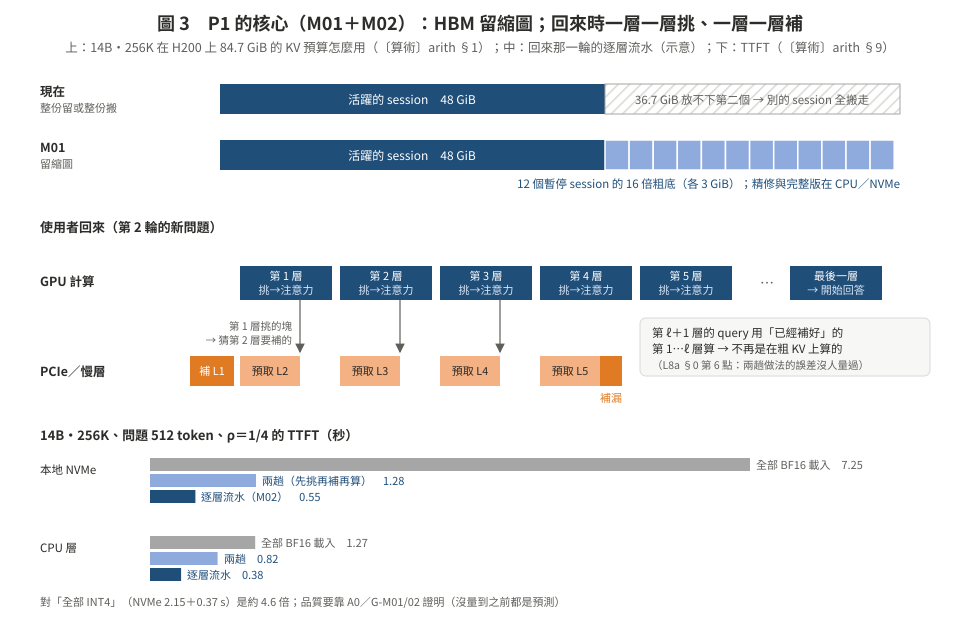
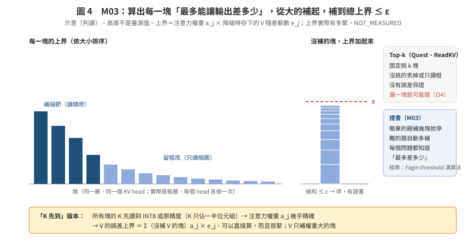

# 02　第一組：讀多少、讀多清楚（用「新問題」這個讀取時才有的資訊）

> **日期**：2026-10-24。M01–M05。每張卡的格式：一句話 → 類比 → 問題定義 → 新在哪 → 前作與他們在這裡為什麼輸 → 為什麼我們會贏（數據） → 演算法 → 評估設定 → 最小證偽 → 風險 → 方法組成 → 評分。
> 新意的判斷來自這輪的**摘要級**查新（[07](07_lit_quickcheck.md)）加上 `lit/L8a`（全文）；摘要級的部分在正式主張前要讀全文、再過 verifier。
> 回到核心頁：[README](README.md)。

---

## M01　粗底常駐：每個暫停的 session 在 HBM 留一份「縮圖」⭐

**一句話**：session 暫停時，HBM 不是「整份留著」或「整份搬走」二選一，而是留一份 16–32 倍壓縮的粗底；使用者回來，新問題直接在粗底上跑，只有它挑中的塊才從慢層補細節。

**類比**：iPhone 的「最佳化 iPhone 儲存空間」。手機上只留每張照片的縮圖，點開哪一張才從雲端下載原圖。也像 Linux 的 zswap：記憶體不夠時先壓縮留在記憶體裡，不直接丟去 swap。

**問題定義**
- 輸入：HBM 容量 C；N 個 session，每個有 KV 大小 S_s，狀態是活躍或暫停；慢層頻寬 B；每個 session 何時回來事先不知道（3b：猜不準，O12）。
- 決策：
  1. 寫入（降級）時：每個暫停 session 在 HBM 留哪一級（完整／粗底 r 倍／不留）。格式在降級時定，但**不決定哪些塊清楚**。
  2. 讀取（回來）時：哪些塊升級（比例 ρ_s），由新問題決定。
- 目標：回來那一輪 TTFT 的 P95 最小；答對率比全部 BF16 掉 ≤ ε（2 個百分點，配對 CI 下界）。
- 限制：Σ 活躍 KV＋Σ 粗底 ≤ C；粗底在 HBM 佔的空間會讓活躍 session 的 batch 變小，所以吞吐也要報。

**新在哪**
- 老師準則 ②：「HBM 能放幾個 session」和「回來要等多久」原本是一個硬取捨（整份留著放得少；整份搬走回來要搬全部）。粗底常駐讓它變成連續的：用 1/16 的空間，換「回來只要搬 ρ／3.2 的位元組」。
- 老師準則 ③：HBM 從「快取 KV」變成「快取 KV 的低解析度版本」；慢層從「KV 的倉庫」變成「細節的倉庫」。

**前作，以及他們在 128K–256K、多 session 時為什麼輸**

| 前作 | 他們怎麼做 | 在這裡輸在哪 |
|:--|:--|:--|
| vLLM OffloadingConnector、LMCache、SGLang HiCache、Dynamo KVBM | 暫停的 session 整份搬到 CPU／SSD，回來整份搬回 | 14B 256K 的 HBM 只放得下 1 個 session；回來從 NVMe 要 6.88 s〔算術 arith §2〕 |
| TensorRT-LLM NVFP4 cold-page（L8c） | 冷頁在 host／disk 存 4-bit，GPU 上原精度 | 回來仍然整份搬（只是 ÷3.6）；只看記憶體壓力；只支援 Blackwell |
| KVServe、CacheGen（均勻壓縮） | 每塊同樣倍數 | 倍數高就一起糊：X4b Qwen 16× −3.6、32× −7.8；長 context 更糟（F5） |
| IMPRESS、Quest 式選擇性還原 | 挑塊載入，沒挑的不用 | 漏一塊就錯：C1b Quest 放回 1/4 掉 18–35 分（O4） |
| SpeCache、ShadowKV、ReadKV（L8a，decode 時） | 單一請求；GPU 留低位元副本或低秩 K；每個 decode step 取 top-k | 不處理「很多暫停 session 怎麼分 HBM」；每一步都要過 PCIe；回來那一刻的新問題沒用上 |

**為什麼我們會贏（數據）**
- 容量〔算術 arith §1〕：14B 256K 完整 1 個 → 16 倍粗底 28 個；Llama 128K 6 → 97。
- 問題來了才挑得準〔實測 O3〕：recall@16 比隨機高，寫入時分數 +11～+24；完整 K 上界 +61～+68 個百分點。
- 重要的塊很少〔實測 O4〕：完整 K 挑，Qwen 只清楚 1/4 也不掉分（+0.5 [−2.5, +3.4]）。
- 回來那一輪〔算術 arith §9，配合 M02 的逐層流水〕：14B 256K、本地 NVMe，全部 BF16 載入 7.25 s → 0.55 s（約 13 倍）；和「全部 INT4」比（2.15＋0.37＝2.52 s）約 4.6 倍。CPU 層、問題 512 token 時只剩 3.4 倍（prefill 本身變成瓶頸）。

**演算法 M01（論文體）**
輸入：每個 session 的 KV；壓縮器（粗底 r 倍＋精修 INT4）；HBM 容量 C。
輸出：HBM 的配置；回來時可用的 KV。
1. 降級（session 暫停、HBM 需要空間）：把這個 session 的 KV 壓成粗底與精修兩份；精修與完整 BF16 放 CPU／慢層，粗底留 HBM。
2. HBM 還是不夠：照 LRU 把最久沒動的 session 的粗底也搬走（第二級淘汰）。
3. 回來：如果粗底還在 HBM，直接做 M02（逐層流水）；不在，就先讀粗底（16–32 倍小）再做 M02。
4. 回答完：這一輪用到、已經升級的塊保留精修版；session 再暫停時，只有這些塊的精修需要重新決定去留。

**評估設定**
- 有利但合理：Qwen2.5-14B-1M 256K、Qwen2.5-7B-1M 256K、Llama-3.1-8B 128K；agentic 多 session（I3g 式工作負載，暫停 lognormal 中位 30 s）；本地 NVMe 與限速層；「找答案」類的第 2 輪問題（DS2 T2–T5、SCBench 多輪子集）。
- 必須同時報：CPU 層、問題長（512 token）；「彙整」類問題；32K 對照；粗底佔 HBM 造成的吞吐損失。

**最小證偽**：A0（05 §4）擴到 128K／256K。ORACLE 在同位元組下比最好的均勻壓縮好不到 2 個百分點 → 停（GA0-STOP）。另加：BASE-ATTN 拿到 ORACLE 好處 <50% 而且 M16 也救不回來 → 停。

**風險**：A0 不過；粗底本身佔 HBM；粗底必須保留逐 token 的低位元 K，不能只有低秩係數（2604.08426，V8 核對）。

**方法組成**：經典：壓縮快取（zswap／zram）、多解析度貼圖（mipmap）與虛擬貼圖的「回饋決定載入」。DL：M16 的挑塊器。系統：HBM 的兩級配置器。

**評分**：新意 **中高**（摘要級查新沒找到「多 session 粗底常駐、回來時依新問題升級」；最近的是 decode 時的 SpeCache、ReadKV）；上檔 **高**；可行 **中**（A0 本來就在計畫裡）；風險 **中**。→ **主推**，和 M02 一起當論文的核心機制。

---

## M02　逐層挑塊流水：一趟 prefill 同時完成挑塊、補細節、計算 ⭐

**一句話**：不要「先在粗底上跑一次問題挑塊，再補細節、再跑一次」；改成**一層一層來**：第 ℓ 層的 query 用已經補好的下層算出來，在粗底上挑這一層要補的塊，補細節的傳輸和這一層的計算重疊。

**類比**：裝潢不必等所有建材到齊才開工。一樓的材料到了就做一樓，同時叫二樓的料；看一樓的狀況，順便預估二樓要多少。

**問題定義**
- 輸入：每層的粗底 K̂_ℓ、V̂_ℓ（在 HBM）；精修在慢層；新問題的 token；每層的傳輸頻寬 B。
- 決策：每一層 ℓ 要補哪些塊 S_ℓ；第 ℓ+1 層的哪些塊要先猜著預取。
- 目標：TTFT ≈ max（一趟 prefill 的計算，精修的傳輸）＋一層的傳輸；品質和「兩趟」相同或更好。
- 限制：第 ℓ 層的 S_ℓ 只能用第 ℓ 層之前算出來的東西決定（逐層相依）。

**新在哪**
- 兩趟做法有兩個代價：prefill 算兩次（arith §9：14B 256K、CPU 層、512 token，兩趟 0.816 s，逐層 0.375 s）；而且第一趟的 query 是在粗 KV 上算出來的，挑塊會跑掉（L8a §0 第 6 點：沒人量過這個損失）。
- 逐層做時，第 ℓ 層的 query 來自**已經補好**的第 1…ℓ−1 層，只有第 ℓ 層沒被挑中的塊是粗的。「query 不精確」的問題**大部分在結構上就消失**，不用靠更好的挑塊器。

**前作，以及他們為什麼輸**

| 前作 | 他們怎麼做 | 差別 |
|:--|:--|:--|
| InfiniGen（L 檔多處引用） | decode 時用前一層預測下一層的重要 token，從 CPU 預取 | decode、每一步；不是回來那一刻、不是從慢層補精修 |
| CachedAttention、LMCache layerwise、HCache | 逐層載入，和計算重疊 | 載入的是全部 KV，沒有挑塊、沒有粗底 |
| ReadKV、Fathom（L8a） | decode 時每一步依 query 決定讀幾位 | query 精確（來自精確的 decode）；沒有 prefill 的逐層相依問題 |

**為什麼我們會贏（數據）**
- 每層要補的量很小〔算術〕：14B 256K、ρ＝1/4、INT4 精修，總共 3.75 GiB（arith §2），平均每層約 80 MiB → CPU 層 1.5 ms、NVMe 11 ms；每層的 prefill 計算（問題 512 token）約 7.8 ms（arith §6 的 0.373 s ÷ 48 層）。CPU 層完全藏得住，NVMe 每層卡約 3 ms。
- 相鄰層的挑塊有多像：**沒量過**（K1 的「相鄰層子空間重疊 0.63–0.76」講的是低秩基底，不是挑塊，不能借用）。

**演算法 M02（論文體）**
輸入：每層的粗底；精修在慢層；新問題；每層的升級預算 R_ℓ。
輸出：一趟 prefill 完成後的 KV（被挑中的塊是精修版）。
1. 第 1 層：用問題的 embedding 算 q₁；在 K̂₁ 上打分，挑 S₁；送出 S₁ 的精修讀取；同時用 S₁ 猜第 2 層的 S₂′，先送出預取。
2. 對第 ℓ 層：等 S_ℓ 的精修到（大部分已經在第 ℓ−1 層時預取）；用「S_ℓ 精修＋其餘粗底」算第 ℓ 層的注意力與輸出。
3. 用第 ℓ 層的輸出算 q_{ℓ+1}，在 K̂_{ℓ+1} 上打分，得到真正的 S_{ℓ+1}；補讀猜漏的塊，取消猜錯的預取（還沒送出的那部分）。
4. 重複到最後一層；開始生成。

**評估設定**：同 M01。另報：每層的等待時間分布、預取命中率、取消掉的位元組。

**最小證偽**
- 品質：逐層版（ONE-PASS）對 ORACLE 的差，和兩趟版（BASE-ATTN）對 ORACLE 的差相比，沒有更小 → 「結構上消掉 query 誤差」這個主張不成立（機制仍可用，但只剩省時間）。
- 預取：第 ℓ−1 層猜第 ℓ 層，命中率 <50% → 每層都要等慢層，NVMe 上的 TTFT 好處消失。

**風險**：每層小傳輸的固定開銷（一個 512-token 塊在 Llama 一層只有 2 MiB BF16，INT4 約 0.6 MiB），要批次送；逐層同步拖慢 prefill。

**方法組成**：經典：管線化（pipelining）、預取與取消（prefetch／cancel）。系統：每層的 copy stream 與事件。

**評分**：新意 **中**；上檔 **高**（它決定 M01 在 CPU 層能不能贏）；可行 **中**；風險 **中**。→ **主推**，和 M01 合成一個機制。

---

## M03　有保證的精修：K 先到、V 按權重補，誤差上界到 ε 為止

**一句話**：降級時每塊多存幾個位元組的「殘差大小」；回來時用它算出「這一塊最多能讓輸出差多少」，從上界最大的開始補，直到總上界 ≤ ε。不用猜 top-k。

**類比**：改考卷時，先看每一題「最多還能加幾分」；如果剩下的題目全部滿分也改變不了排名，就不用細改了。這是資料庫的 Fagin threshold algorithm 的想法。

**問題定義**
- 輸入：每塊、每層、每個 KV head 的粗底 K̂、V̂，以及降級時存的殘差範數 e^K＝max‖k−k̂‖、e^V＝max‖v−v̂‖（每塊每 head 幾個位元組）；新問題的 query。
- 決策：要補 K 的塊集合、要補 V 的塊集合。
- 目標：讀的位元組最少。
- 限制：每個 query、每個 head 的注意力輸出誤差上界 ≤ ε。
- 「K 先到」版本：所有塊的 K 都讀到 INT8 或原精度（K 是一半的位元組），注意力權重 a_j 幾乎精確；V 只對權重大的塊補。這時輸出誤差 ≤ Σ（沒補 V 的塊）a_j·e^V_j，**可以直接算出來，而且很緊**。

**新在哪**：從「挑 top-k、希望沒漏」變成「每個問題都有一張證書」。簡單的問題只補幾塊，難的問題自動多補；漏選的代價有上界，不是懸崖。

**前作，以及他們為什麼輸**

| 前作 | 做了什麼 | 差別 |
|:--|:--|:--|
| Quest | 每塊每 channel 的 min／max 算 q·k 的上界，拿來挑塊 | 上界只用來排序，不保證輸出誤差；沒挑的塊丟掉 |
| ReadKV（L8a） | query 決定 K 每個 channel 讀幾位，重建 K 的注意力決定 V 每個 token 讀幾位 | 就是「K 先、V 後」的 decode 版；沒有誤差證書；不在讀回邊界 |
| Tzachristas, arXiv 2512.07647〔摘要級〕 | top-k 截斷的 total variation 誤差有確定性上界；誤差預算滿足就停 | 只看排好序的 logit；decode；沒有粗底與精修 |
| RaBitQCache, 2606.31519〔摘要級，未核對〕 | 隨機旋轉二值量化估注意力，有誤差上界，用在 top-p | 同上，decode；選擇用，不是精修 |

**為什麼可能贏**：O4 說「丟」有懸崖、「糊」可能沒有；證書讓「糊多少」可以控制。**上界有多緊沒量過**，這是最大的未知。

**最小證偽**（只用 CPU，拿 A0 存下來的注意力與殘差）：在 ε 讓品質掉 ≤2 分的設定下，證書要求的 ρ ≥ 0.8 → 上界太鬆，停（保留成一個診斷工具）。

**風險**：上界鬆；一層的誤差會傳到下一層的 query（逐層的證書不等於端到端的保證）；GQA 一個 KV head 要對整組 query 取最壞。

**方法組成**：經典：Fagin threshold algorithm、branch-and-bound、區間算術。

**評分**：新意 **中**；上檔 **中**；可行 **中高**（CPU 分析）；風險 **中高**。→ **次推**；A0 過了才做，當 M01 的挑法之一。

---

## M04　打字時、工具執行時就開始挑塊

**一句話**：使用者還在打字，問題的前半段已經知道了；agent 呼叫工具時，工具名稱和參數也已經知道了。用這些「半個問題」先挑塊、先補細節；按下送出時大部分已經在路上。

**類比**：餐廳看到客人在看菜單的哪一頁，就先備那一頁的料。

**問題定義**
- 輸入：隨時間變長的問題前綴 q_{1..t}（或工具呼叫的文字）；粗底；慢層頻寬（和別人共用）。
- 決策：每個時間點要預取哪些塊的精修。
- 目標：按下送出之後的 TTFT 最小；最終品質和 M01 用完整問題時一樣。
- 限制：猜錯的預取會浪費慢層頻寬，而慢層是共用的（O11：尾延遲幾乎都是排隊）。

**新在哪**：現在的預取是「整個 session 一起搬」（不知道問題）或「問題來了才挑」（太晚）。用部分問題挑塊，兩者都不是。

**前作**

| 前作 | 做了什麼 | 差別 |
|:--|:--|:--|
| LiveMind（arXiv 2406.14319）〔摘要級〕 | 使用者還在輸入時就對部分輸入做推論 | 用在算答案，不是挑 KV 塊 |
| Stream2LLM（MLSys 2026）〔摘要級〕 | 檢索到的 context 一段段進 prefill | 是 context 串流，不是問題串流 |
| HUOZIIME（2604.14159）〔摘要級〕 | 輸入法用前綴樹存 KV，打字修改時重用 | 裝置端、短 context |
| CachedAttention、Pensieve；我們的 3b HINT-PF | 依「快回來了」整份預取 | 不挑塊；3b 的 HINT-PF 在模擬裡 0.244 s 對 oracle 0.235 s（O12，縮小設定） |

**為什麼可能贏**：C1a：問題來了才挑得準（O3）。部分問題挑得多準：**沒量過**。

**最小證偽**（GPU 很少）：DS2 的問題取前 25／50／75% 的 token，用完整 K 挑塊，和完整問題的挑塊比 recall@k。50% 前綴的 recall 不到完整問題的 80% → 只剩「打字時先讀粗底」（M01 本來就有）。

**風險**：情境相依：聊天有打字時間，agent 沒有（工具輸出是一次到的）；打字時間的分布要找來源（NOT_MEASURED）。

**評分**：新意 **中**（摘要級沒查到用部分問題挑 KV 塊）；上檔 **中**（只有慢層明顯）；可行 **高**；風險 **中**。→ **延伸**，接在 M01 後面。

---

## M05　依注意力頭還原：檢索頭全還原，串流頭只還原窗口

**一句話**：DuoAttention 發現只有一部分頭需要看完整 context（檢索頭），其他頭只看開頭幾個 token 和最近的窗口（串流頭）。回來時，串流頭中間那一大段 KV 根本不用搬。

**問題定義**：每個（層、KV head）選「完整還原」或「只還原 sink＋窗口」；頭的類型離線、每個模型算一次。目標：同品質下位元組最少。

**前作**：DuoAttention（arXiv 2410.10819，ICLR 2025）〔摘要級〕：GQA 模型記憶體少 1.67 倍、MHA 2.55 倍；RazorAttention 同類。摘要級查新沒找到「只把檢索頭的 KV 卸載與還原」的論文，但這是直接套用。

**為什麼有用**：它是 M01、M06 的**乘數**：位元組再除 1.5 倍左右，而且和「新問題挑塊」正交。

**最小證偽**：DS2 128K、TF，用 DuoAttention 的頭表；CI 下界 < −2 → 停。Llama-3.1-8B、Qwen2.5-1M 有沒有現成頭表：NOT_VERIFIED。

**評分**：新意 **低**；上檔 **中**；可行 **中**；風險 **低中**。→ **當基準或乘數，不當貢獻**。
