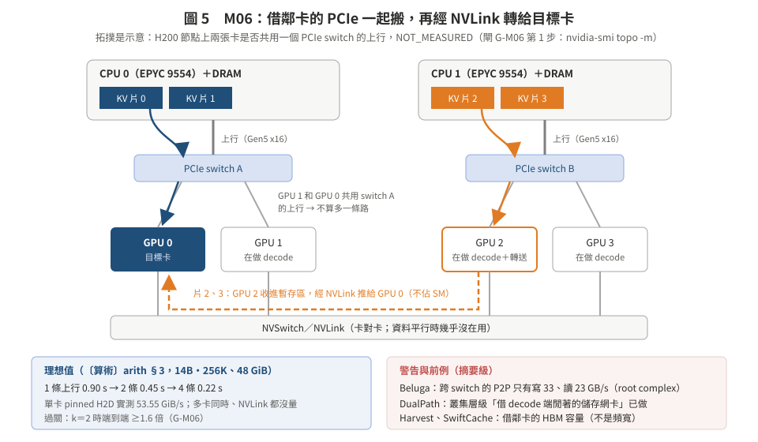
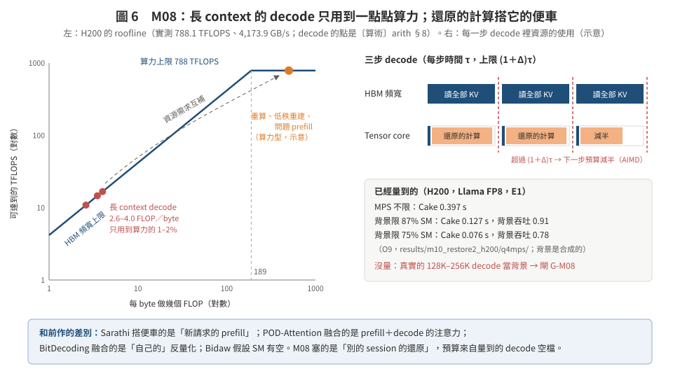

# 03　第二、三組：頻寬從哪裡來、算力從哪裡來（用「現場資源」這個讀取時才有的資訊）

> **日期**：2026-10-24。M06–M11。格式同 [02](02_bytes_quality.md)。
> 這一組把原本的方向 B（「還原成本是現場的資源向量」）拆成**具體的機制**：B 本身是規劃器（M09），真正讓數字變大的是「借別人用不到的資源」（M06、M08）。
> 回到核心頁：[README](README.md)。

---

## M06　借鄰卡的 PCIe：多路還原 ⭐（要 2–4 張卡）

**一句話**：一張卡的 PCIe 只有約 53.5 GiB/s；同一台機器上別的卡在做 decode，它們的 PCIe 幾乎是空的。把要還原的 KV 切成幾份，各走一張鄰卡的 PCIe 進去，再用 NVLink（卡和卡之間快很多）轉給目標卡。

**類比**：搬家時一台卡車太慢，就請隔壁幾台空著的車一起載，到了樓下再從走廊推進去。

**問題定義**
- 輸入：一台 G 張卡的機器；每張卡自己的 PCIe（或每兩張卡共用一個 switch 的上行，**拓撲沒量**）；卡與卡之間的 NVLink；要還原的 session 的 KV 放在主機記憶體（可能分在兩個 NUMA 節點）；目標卡 g*；每條路徑當下的負載（鄰卡自己的 H2D／D2H、HBM 忙碌度）；每張鄰卡可以拿出的暫存空間 M。
- 決策：每一份 KV 走哪條路（直接進 g*，或經過鄰卡 j）、順序、暫存區大小。
- 目標：還原時間最短。
- 限制：鄰卡自己的 TPOT 變慢 ≤ Δ；暫存區 ≤ M。

**新在哪**：還原頻寬不再被「一張卡一條 PCIe」限住。資料平行（每張卡一份 8–14B 模型）時，decode 不用 PCIe，NVLink 也幾乎沒在用：這兩個資源本來就閒著。

**前作，以及差別**

| 前作 | 做了什麼 | 差別 |
|:--|:--|:--|
| **DualPath**（arXiv 2602.21548，2026-02）〔摘要級〕 | P/D 分離時，prefill 端的儲存網卡滿了、decode 端的閒著；改成先讀到 decode 端，再用 RDMA 轉給 prefill 端；全域排程平衡兩條路。離線吞吐最多 1.87 倍、線上平均 1.96 倍 | **「借別人閒著的路」在叢集層級已經做了**；他們借的是儲存網卡，我們借的是同一台機器裡的 PCIe 上行，對象是主機記憶體層 |
| Harvest（2602.00328）〔摘要級〕、SwiftCache（D8-05 引〔摘要〕） | 把鄰卡沒用到的 HBM 當暫時的快取層 | 借的是**容量**，不是 PCIe 頻寬 |
| DeepPlan（EuroSys'23）、ZeRO-Infinity（SC'21）〔未查證，憑記憶〕 | 載入模型權重或參數時，多張卡平行走 PCIe、再用 NVLink 匯集 | 對象是權重（一次性、可以事先規劃），不是每個請求、有期限、鄰卡正在服務別人的 KV 還原 |
| Beluga（2511.20172）〔摘要級〕 | 量到跨 PCIe switch 的 GPU P2P 只有寫 33、讀 23 GB/s，瓶頸在 CPU root complex | **這是警告**：PCIe 頻寬不能直接相加 |

**為什麼可能贏（數據）**
- 單卡 pinned H2D 53.55 GiB/s〔實測，RUNLOG_H200 GPU smoke〕；vLLM 實際從 CPU 載入 42–50 GiB/s〔實測，C6〕。
- 理想值〔算術 arith §3〕：14B 256K 的 48 GiB，k＝1 要 0.896 s，k＝2 0.448 s，k＝4 0.224 s。k 是**獨立上行**的數量，不是卡數。
- 多卡同時 H2D、拓撲、NVLink 卡對卡：**全部沒量**。

**演算法 M06（論文體）**
輸入：要還原的塊；可用路徑集合 P（直接、經鄰卡 j）；每條路徑的即時速度估計 v_p；鄰卡的暫存區。
輸出：每塊走的路徑。
1. 依 v_p 的比例把塊分給各路徑，同一個 NUMA 節點上的塊優先分給靠近那個節點的卡。
2. 各路徑同時開始：鄰卡用 copy engine 把塊從主機搬到自己的暫存區，再用 copy engine 經 NVLink 推給目標卡（不佔 SM）。
3. 每完成 k 塊更新 v_p；某條路徑變慢（例如鄰卡開始自己的大傳輸）就把它剩下的塊改派給其他路徑（work stealing）。
4. 鄰卡的 TPOT 變慢超過 Δ 時，停用那條路徑。

**評估設定**：4 卡 job（lab 上限）；每張卡跑一份 Qwen2.5-7B-1M 或 Llama-3.1-8B 做 decode（資料平行）；一個 14B 或 Llama 128K 的 session 回來。**必報**：兩張卡在同一個 switch 時的結果（可能沒好處）、跨 NUMA。

**最小證偽**（4 卡 job、獨佔、約 1 小時）：
1. `nvidia-smi topo -m` 記錄拓撲；
2. 1／2／4 張卡同時 H2D，各自與合計的 GiB/s；
3. NVLink 卡對卡 D2D 的 GiB/s；
4. 16 GiB 經 1／2／4 條路徑還原的時間。
- k＝2 的端到端加速 <1.6 倍 → 停（主機端是瓶頸，寫成量測結論）。

**風險**：PCIe switch 共用上行、root complex、主機記憶體頻寬（D8-05 擔心的事）；Slurm 每次給的卡不同；暫存區佔鄰卡 HBM；真實部署裡鄰卡是另一個服務實例，跨實例協調是工程。

**方法組成**：經典：多路徑傳輸與條帶化（RAID-0、MPTCP）、work stealing。系統：copy engine、P2P。

**評分**：新意 **低中～中**（DualPath 在叢集層級已有同樣精神）；上檔 **高**（倍數）；可行 **高**（量測便宜）；風險 **中**（拓撲）。→ **次推**；可以單獨成一篇短的量測＋機制，或當主論文的「頻寬槓桿」一節。

---

## M07　還原感知的路由與 NUMA 放置（要 2–4 張卡）

**一句話**：一台機器上有好幾份模型時，回來的 session 不一定要回原本那張卡；選「現在還原最快」的那張：它的 PCIe 空、離這個 session 的主機記憶體近（同一個 NUMA 節點）、HBM 有空間。

**問題定義**：輸入：k 張卡各自的 PCIe 忙碌度、HBM 剩餘、排隊長度；session 的主機頁面在哪個 NUMA 節點。決策：派給哪張卡。目標：回來那一輪 TTFT 的 P95。

**前作**：Dynamo KV router、Mooncake Conductor、llm-d、SGLang 的 cache-aware router（看 GPU 快取有沒有前綴）；PPD（ICML 2026）把第 2 輪以後的請求動態派到 prefill 或 decode 節點〔摘要級〕。差別：他們看「前綴在不在 HBM」，不看「從主機記憶體還原到哪張卡最快」。

**數據**：H200 上 pinned 記憶體要和卡在同一個 NUMA 節點，不然 H2D 變慢（`H200_SLURM.md`）；慢多少：NOT_MEASURED。

**評分**：新意 **低中**；上檔 **低中**；可行 **中**。→ **併進 M06 的實驗**，不單獨做。

---

## M08　還原搭 decode 的便車：把還原的計算塞進 decode 用不到的 tensor core ⭐

**一句話**：長 context 的 decode 每一步只做 2.6–4 FLOP／byte，H200 要到 189 FLOP／byte 才吃滿算力：tensor core 大多閒著。把回來那個 session 的「計算型」還原工作（Cake 的前段重算、低秩重建、問題的 prefill）塞進每一步 decode 的空檔，用一個明確的預算保證別人的 TPOT。

**類比**：公車反正要開（decode 一定要跑），車上有很多空位（閒著的 tensor core），順路的人就上車，不用另外派一台。

**問題定義**
- 輸入：每一步 decode 的 batch 和它單獨跑的時間 τ_t（頻寬型）；還原工作的佇列，每個工作有資源需求（tensor core 時間、SM 時間、HBM 位元組）；TPOT 上限 (1+Δ)·τ_t。
- 決策：每一步要和 decode 一起跑哪些還原工作、怎麼一起跑（同 process 另一條 stream＋SM 上限，或融合進同一個 persistent kernel）。
- 目標：回來的 session 的 TTFT 最小（還原進度最快）。
- 限制：每一步的時間 ≤ (1+Δ)·τ_t。

**新在哪**：現有做法把還原的計算當成「另外的工作」：Cake 開另一條 stream 不管別人；Bidaw 放低優先權 stream，**假設** SM 有空（§4 p.10）。我們把「decode 留下多少空檔」量出來，當成還原的預算。老師準則 ②：「還原快」和「別人不變慢」原本要取捨，在 decode 為主的時段可以兩個都要。

**前作，以及差別**

| 前作 | 做了什麼 | 差別 |
|:--|:--|:--|
| Sarathi-Serve（OSDI'24）〔EVAL_FOUNDATIONS 引用〕 | chunked prefill：把新請求的 prefill 切小塊，搭 decode 的便車，有 token 預算 | 對象是**新請求的 prefill**；我們是回來 session 的還原工作（含重建、反量化，不只 prefill），而且預算來自量到的 decode 空檔 |
| POD-Attention（ASPLOS'25，L8b） | prefill 和 decode 的注意力融合在同一個 kernel，平衡算力和頻寬 | 不含 KV 還原 |
| NanoFlow（OSDI'25，L8b） | 裝置內 nano-batch 重疊 | offload／load 不在資源模型裡 |
| BitDecoding（2503.18773）、KVComp〔摘要級〕 | 同一個請求的 KV 反量化融合進它自己的 decode 注意力 | 融合的是**自己的**解壓；不是別的 session 的還原 |
| Bidaw（FAST'26，L8b） | 轉回 KV 的運算放低優先權 stream | 假設 SM 有空；我們量到忙時低秩重建慢 2.8 倍（O7） |

**為什麼我們會贏（數據）**
- 〔算術 arith §8〕decode 每步 FLOP／byte：Llama 128K 2.6、Qwen-7B 256K 4.0、14B 256K 3.5；H200 實測 matmul÷HBM＝189。
- 〔實測 O8〕頻寬型背景下，各種還原格式只慢 5–30%（MI300X，0／6 條翻轉）。
- 〔實測 O9〕H200 MPS：背景限 87% SM，Cake 0.397 → 0.127 s，背景吞吐 0.91；限 75%，0.076 s、0.78。
- 還沒量：**真實的長 context decode**（batch 1–6、每條 128K–256K）當背景時的空檔。B0 原本的背景是 8K context 的 decode（B＝8／32／128），要改。

**演算法 M08（論文體）**
輸入：decode 的 iteration；還原工作佇列（每個工作切成小單位：一個重算塊、一組層的重建）；Δ。
輸出：每一步一起跑的還原單位。
1. 校準：先讓 decode 單獨跑幾步，量 τ。
2. 每一步：從佇列取還原單位，直到預估的這一步時間 ≥ (1+Δ)·τ；預估用 B0 量出的干擾矩陣（M09）。
3. 實際這一步的時間超過 (1+Δ)·τ：下一步的預算減半；連續 k 步都低於：預算加一個單位（像 TCP 的 AIMD）。
4. 新的長 prefill 進來（算力型背景）：預算歸零，改由 M09 選不吃算力的還原方式（copy engine 搬原始位元組）。

**評估設定**
- 有利：Llama 128K batch 4、Qwen-7B 256K batch 4–6、14B 256K batch 1 的 decode 當背景；回來的 session 用 Cake（前段重算）或低秩粗底（重建）。
- 必報：有新的 128K prefill 同時在跑的時段（沒有空檔）；時間片共用（沒有 MPS、沒有同 process stream）時的結果。

**最小證偽**（B0 擴充，獨佔約 3–4 GPU 小時）：長 context decode 背景下，和還原工作一起跑。找不到任何設定讓還原拿到單獨跑時 ≥60% 的速度、而 TPOT 只慢 ≤5% → 停（寫成「長 context decode 沒有可用的空檔」）。

**風險**：真實背景常有新的長 prefill（F6）；decode 把 KV 串過 L2，還原的 kernel 可能搶 L2；融合 kernel 的工程量大（先用 stream＋MPS 版驗證）。

**方法組成**：經典：AIMD 預算、roofline。系統：同 process 雙 stream、MPS／green context、（選做）融合 kernel。

**評分**：新意 **中**（組合沒查到；Sarathi、POD 是近親）；上檔 **中高**；可行 **高**（B0 的 harness 已有）；風險 **中**。→ **主推**：它讓 M01、M12 的計算部分變成「免費」。

---

## M09　互補格式：依現場資源選還原的表示法（原方向 B，寫成機制）

**一句話**：同一份 KV 存成「巢狀」的格式（粗底 ⊂ INT4 ⊂ BF16，或低秩 ⊂ 殘差），每一種讀法吃不同的資源；還原時看現在哪種資源閒，就選吃那種資源的讀法。

**問題定義**：輸入：每種讀法 p 的資源需求向量 d_p＝（tensor core 時間、SM 時間、copy engine／PCIe 位元組、HBM 位元組）；當下各資源的剩餘比例 r。決策：每一段 KV 用哪種讀法。目標：最小化 max_k d_{p,k} ÷（容量_k × r_k）（瓶頸時間）。限制：品質相同（巢狀格式讓不同讀法的品質可以固定）、別人變慢 ≤ Δ。

**定位**：這就是 [05](../05_poc_plan_h200.md) 的演算法 B。使用者的判斷是對的：**它單獨是一個規劃器，不是讓數字變大的機制**（01 的評分：② ③ 都只有 ◐）。在新的組合裡，它是把 M01、M08、M12 串起來的那一層：決定「這一刻用粗底＋重建、還是搬原始位元組、還是近似重算」。

**數據**：O7–O9（02_observations）；前作與審稿人必要對照見 [03](../03_competitors.md) §2。

**最小證偽**：GB0-FLIP 與 GB0-STATIC（05 §5.3）。

**評分**：新意 **中高**（L8b：聯合規劃沒查到）；上檔 **中**（3a 量到 6–14%）；可行 **中**；風險 **中**（真實背景可能不翻）。→ **當論文的規劃器，不當主貢獻**。

---

## M10　還原的 SM 租約：給還原一個有上限、有期限的 SM 預算

**一句話**：用即時系統的 Constant Bandwidth Server：還原在每個週期 P 裡最多用 Q 份 SM 時間（MPS 比例或 green context）；多個還原之間依期限（TTFT 目標）排 EDF。decode 拿剩下的，所以 TPOT 有保證。

**問題定義**：輸入：每個回來 session 的 TTFT 期限、要還原的工作量；decode 的 TPOT 上限。決策：每個週期給還原多少 SM、給哪一個還原。目標：滿足期限的比例最大。限制：decode 拿到的 SM ≥ 保證值。

**前作**：vLLM #42212 固定 12 個 SM；Tutti 把 I/O kernel 放在靜態的 green context；L8b 查過的 12 個 GPU 空間共用系統都沒把 KV 還原放進 SM 分配。CBS（Abeni & Buttazzo, RTSS'98）〔未查證，憑記憶〕是經典出處。

**數據**：O9：限 75% SM 時 Cake 快約 5 倍、背景剩 0.78。

**最小證偽**：GB0-STATIC：最好的 SM 比例在每種背景下都一樣 → 固定預留就夠，這張卡停。green context 在 torch 2.13＋CUDA 13 能不能用：P0e 會查（NOT_VERIFIED）。

**評分**：新意 **中**；上檔 **中**；可行 **中**；風險 **中**（可能被 STATIC 殺）。→ **M08 的另一個實作**：M08 是「塞進空檔」，M10 是「切一塊保留區」；B0 兩個一起量。

---

## M11　不吃 tensor core 的 codec：查表式 VQ（DL 學 codebook）

**一句話**：低秩重建要做矩陣乘（吃 tensor core），INT4 反量化吃 SM 的 ALU；向量量化（VQ）的解碼是「查 codebook」，吃的是記憶體讀取。準備兩種以上資源需求互相錯開的 codec，規劃器（M09）永遠有一個便宜的選擇。

**問題定義**：輸入：校準資料上的 KV；位元組預算。決策：codebook（學出來的）。目標：同位元組下品質最好，**而且**在算力型背景下解碼時間不變慢。

**前作**：CommVQ（L8a、L5d 已記錄）等 VQ 型 KV 壓縮；KVCodec 用影片解碼器（NVDEC）、ShadowServe 用 SmartNIC 把解壓移出 GPU 主算力（L8b）。差別：我們的選擇準則是「和背景的資源需求錯開」，codec 本身不是新的。

**數據**：O7：GPU 忙時 FP8 反量化慢 2.4–3.8 倍、低秩重建慢 2.8 倍（MI300X）；O8：翻轉只在算力型背景出現；查表式解碼在背景下慢多少：NOT_MEASURED。

**最小證偽**：微基準（約 1 GPU 小時）：VQ、INT4、低秩三種解碼在 matmul 背景與 decode 背景下的時間；VQ 在 matmul 背景下沒有比 INT4 少慢 → 停。

**評分**：新意 **低中**；上檔 **中**；可行 **中**；**是 DL 元件**（使用者要的「要有 DL」）。→ **延伸**。
