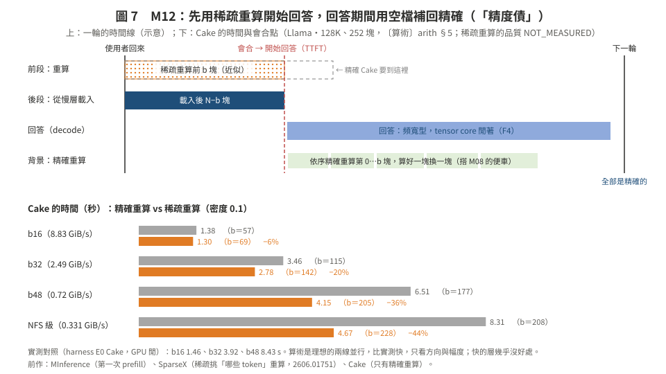
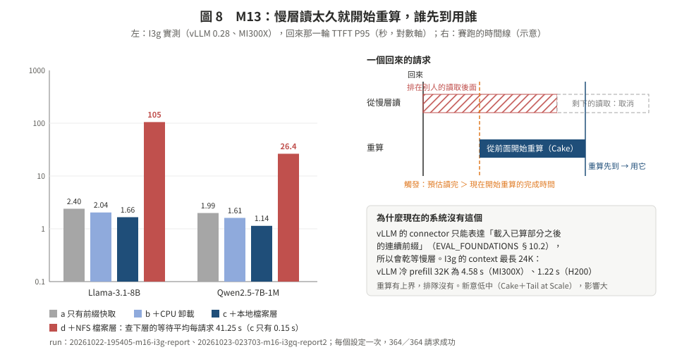

# 04　第四到六組：算 vs 搬的新動作、多 session 排程、深度學習元件

> **日期**：2026-10-24。M12–M16。格式同 [02](02_bytes_quality.md)。
> 回到核心頁：[README](README.md)。

---

## M12　先近似、後補精：稀疏重算換 TTFT，decode 的空檔再補回精確 ⭐

**一句話**：在 128K 以上，重算貴在注意力那一項（F3）。回來時，Cake 的「前段重算」改用稀疏注意力的 prefill（只算重要的注意力），重算變便宜，會合點往後移，要從慢層搬的位元組變少；回答期間（decode 讓 tensor core 閒著，F4），在背景把這些塊精確地重算一次，**下一輪之前換回精確版**，誤差不會一輪一輪累積。

**類比**：先交草圖讓會議能開始，散會前描成正式圖；下一次開會用的一定是正式圖。

**問題定義**
- 輸入：塊數 N；慢層頻寬 B；每塊的動作：載入、精確重算、稀疏重算（密度 d）；TTFT 期限；回答期間每一步 decode 留下的空檔（M08）。
- 決策：會合點 b 與前段的重算密度 d；回答期間要用多少空檔把前 b 塊精確重算。
- 目標：TTFT 最小。
- 限制：這一輪的品質損失 ≤ ε（只有這一輪用到近似的 KV）；**下一輪開始前，所有塊都是精確的**（或照實記錄沒補完的比例）。

**新在哪**
- 還原的動作集多了一個「近似重算」：前人只有「精確重算」和「載入（可能壓縮）」兩類。
- 「精度債」的概念：這一輪借精度換時間，回答期間用閒置算力還債。老師準則 ②：「快但不準」和「準但慢」不再二選一。這接上我們 10/10 的 D8-11「閒時重算當預取」（當時沒做）。

**前作，以及差別**

| 前作 | 做了什麼 | 差別 |
|:--|:--|:--|
| MInference（NeurIPS'24，EVAL_FOUNDATIONS 引用）；FlexPrefill、XAttention〔未查證〕 | 第一次 prefill 用動態稀疏注意力，長 context 加速 | 用在第一次 prefill，不是還原；產生的 KV 一直是近似的 |
| SparseX（arXiv 2606.01751）〔摘要級〕 | 非前綴的片段重用時，用 Sparse-Q 挑出要修正的 token，做 Sparse-KV 重算；前幾層用完整注意力 | 「稀疏」是挑**哪些 token** 重算，用來修跨片段的注意力；不是用稀疏注意力重算整段前綴；沒有「後補精」 |
| CacheBlend（EuroSys'25） | 片段拼接時重算少數 token | 同上 |
| Cake（ICML'25） | 前段精確重算、後段載入 | 只有精確重算；在 128K 以上，前段的會合點被注意力的 n² 卡住 |

**為什麼可能贏（數據）**
- 〔算術 arith §4〕128K 時 vLLM 冷 prefill 的 n² 項佔 75%；harness 最後一塊的重算 74% 是注意力。
- 〔算術 arith §5〕Llama 128K，密度 0.1 時 Cake 會合點往後移、時間變短：b16 −6%、b32 −20%、b48 −36%、NFS 速度 −44%。**快的層幾乎沒好處，誠實寫**。
- 〔實測錨點〕Llama 128K b48 的 Cake E0 8.43 s；Qwen 256K b48 18.6 s（`tables_longctx*.md` §5）。Qwen 256K 的注意力佔比更高，好處應該更大（算術沒做，因為只有 Llama 的 fa3 校準）。
- 稀疏重算出來的 KV，對**這一輪**品質的影響：NOT_MEASURED。

**演算法 M12（論文體）**
輸入：塊；慢層；密度 d；decode 的空檔預算（M08）。
輸出：這一輪用的 KV；下一輪之前的精確 KV。
1. 用演算法 C（05 §6.2）把重算成本換成「密度 d 的稀疏重算成本」，求會合點 b。
2. 前 b 塊用稀疏 prefill 重算，後 N−b 塊從慢層載入，兩邊同時跑到會合；記下前 b 塊是「近似」。
3. 問題 prefill、開始回答。
4. 回答期間，用 M08 的預算把近似的塊從頭依序精確重算（第 i 塊的精確重算需要第 0…i−1 塊的精確 KV，所以只能照順序），算好一塊就替換一塊。
5. 下一輪開始時，還沒換完的塊：照實記錄比例；先精確重算完再開始，或接受近似並記帳（兩個版本都報）。

**評估設定**
- 有利：Llama 128K、Qwen-7B 256K、14B 256K；慢層（b32／b48／NFS 級）；回答夠長（≥200 token）讓第 4 步做得完。
- 必報：CPU 層（重算本來就沒用，F3）；回答很短、做不完補精的情況；多跳、證據分散的題目（稀疏 prefill 的弱點）。

**最小證偽**
- 品質（約 6 GPU 小時，可和別人同時跑）：DS2 128K，前段用稀疏 prefill 重算（密度 0.1／0.2），TF 的 Δgold_lp 下界 < −2 → 停。
- 速度（約 1 GPU 小時，獨佔）：稀疏重算每塊的時間對精確（fa3），斜率沒有降到 ≤0.3 倍 → 停。
- 實作：MInference 或 FlexPrefill 在 H200、我們的兩個模型上能不能跑：NOT_VERIFIED。

**風險**：稀疏 prefill 在我們的題目上掉分；實作不支援 Qwen2.5-1M；只有慢層有好處。

**方法組成**：經典：延遲寫回（write-back）、債務／分期的想法；系統：Cake 管線＋M08 的空檔。

**評分**：新意 **中**（摘要級沒查到用稀疏 prefill 做還原；SparseX 是最近的）；上檔 **中**（慢層 36–44%）；可行 **中**；風險 **中**。→ **次推**，和 M08 一起。

---

## M13　搬運和重算賽跑：慢層的尾巴保險

**一句話**：從慢層讀 KV 時，同時預估「現在開始重算要多久」；讀取的預估完成時間一超過重算，就從前面開始重算（Cake 的做法），兩邊誰先到用誰，另一邊取消。

**類比**：叫了外送等太久，就自己開始煮；哪個先好吃哪個，另一個取消。這是 Dean & Barroso〈The Tail at Scale〉的 hedged request。

**問題定義**：輸入：每個回來的請求；慢層的即時排隊狀態；重算的時間模型（演算法 C）。決策：什麼時候開始重算、讀到哪裡取消。目標：TTFT 的 P95。限制：白做的工作（被取消的讀取或重算）≤ 預算。

**新在哪**：新意**低中**：Cake 本身就是「兩邊同時跑」；我們 10/10 的 D8-03 也提過。但**真實系統沒有**：vLLM 的 connector 只能表達「載入已算部分之後的連續前綴」（EVAL_FOUNDATIONS §10.2），所以 vLLM 會乾等慢層。

**數據（實測，I3g，MI300X、vLLM 0.28）**
- 檔案層放 NFS（d）：回來那一輪 TTFT P95，Llama **105.1 s**、Qwen **26.4 s**；同一工作負載只用 CPU 卸載（b）是 2.04、1.61 s。
- d 的 `kv_offload_lookup_async_delay` 平均每請求 41.25 s，本地檔案層（c）0.15 s；NFS 的存在檢查約 0.1 ms，所以等待是**讀取路徑排隊**，不是查詢延遲（experiment_log 10/22–10/23）。
- 同一批請求最長 24K token；vLLM 冷 prefill 32K：MI300X 4.584 s、H200 1.224 s〔實測 C6〕。重算有上界，排隊沒有。

**最小證偽**：用 I3g 的工作負載與 lookup 等待分布在模擬器裡重播加上賽跑規則（只用 CPU）；P95 沒有降到本地檔案層（c）的 1.5 倍以內 → 停。之後一次真的 vLLM run（要改 connector 或用 harness）。

**128K–256K 的限制**：重算本身要十幾秒（F3），保險的上限變高；但慢層的排隊尾巴（幾十到上百秒）仍然更大。

**評分**：新意 **低中**；上檔 **高**（慢層、高併發時）；可行 **高**；風險 **低**（但比較像工程）。→ **當論文裡的安全網與一節實驗**，不當主貢獻。

---

## M14　兩段式還原佇列：必要的部分先、可選的部分後

**一句話**：很多 session 同時回來時，先把每個人「回答這個問題必要的部分」（M01 的粗底＋挑中的精修）排完，最短的先（SRPT）；可選的預取放在後面。

**問題定義**：輸入：同時回來的 session，每個的必要工作量 m_s 與可選工作量 o_s；共用的慢層。決策：服務順序。目標：TTFT 的 P95。限制：每個問題的品質等級固定（**不隨負載改變**，避免「同一個問題、負載不同、答案不同」，08 的產品承諾問題）。

**前作**：Bidaw 的 HRRN、Cascade 的最少剩餘預算優先（L8b）；web 系統的 brownout〔未查證〕。

**數據**：O11：3b 模擬裡排隊佔 NP p99 的中位 0.983（H200 常數）。

**定位**：好處主要來自 M01 讓「必要的部分」變小；排程本身是經典的。新意 **低中**。→ **M01 的多 session 實驗的一部分**。

---

## M15　草稿先行：用粗 KV 先生成，精修到了再驗證（不建議主做）

**一句話**：精修還在路上時，用粗底先生成答案的草稿；精修到齊後，一次前向驗證整段草稿（推測解碼），輸出和完整 KV 完全一樣。

**為什麼不建議**〔算術〕：要求無損時，**第一個能給使用者的 token** 必須等精修到齊、再驗證，TTFT 不會變好；省下的只是「問題 prefill＋前 k 個 token」被藏進傳輸時間。k 個 token 的 decode 在 256K 每步 7–19 ms（arith §8），回答 300 token 最多省 2–6 s，只有在慢層（14B 256K NVMe 6.9 s）而且看「整輪完成時間」（agent 的工具呼叫要等整段輸出）時才明顯。

**前作**：Lynx（2607.01831）在 P/D 傳輸時先用高位元推測 decode；QuantSpec（2502.10424）用 4-bit KV 當草稿；TriForce、MagicDec。10/10 的 D8-10 已判「多半被殺」。

**評分**：新意 **低**；上檔 **低中**。→ **只在附錄當對照**。

---

## M16　深度學習元件：學出來的挑塊器與干擾模型

**一句話**：兩個小模型，各自補一個解析方法不夠準的地方。

| 元件 | 輸入（特徵） | 輸出（標籤） | 用在 | 什麼時候才訓練 |
|:--|:--|:--|:--|:--|
| 挑塊器 | 粗底上的注意力統計（各層組的總量、最大值、熵）、塊的位置、K 的範數、問題長度 | 升級這一塊讓答案 log-prob 改善多少（A0 的 ORACLE 資料） | M01、M02、M03、M04 | GA0-SEL 落在 50–70%（BASE-ATTN 拿到 oracle 好處的比例；05 §4.5） |
| 干擾模型 | 引擎每一步的時間、batch 組成、還原動作；（有權限的話）SM／HBM 計數器 | 這個還原動作在當下會慢幾倍、讓 decode 慢多少 | M08、M09、M10 | B0 量出干擾矩陣之後，和解析的 roofline 模型（Bullet 式，L8b）比 |

**前作**：Paragon（ASPLOS'13）、Bubble-Up（MICRO'11）的干擾分類（L8b）；KVServe 用 EWMA 殘差修正。

**規矩**：CLAUDE.md §8，oracle 出來之前不訓練；X3（05 §10）要比「學的」和「最強的簡單規則」，學的沒有比較好就不放主文。

**評分**：新意 **低中**（元件）；滿足「要有 DL」。→ **元件**。
