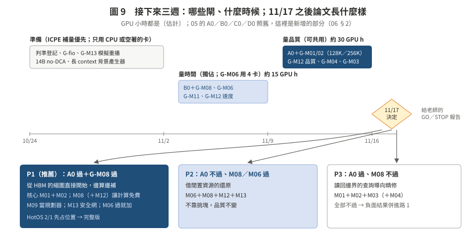

# 06　評估設定要怎麼改、每個候選的第一道閘、時程與規模

> **日期**：2026-10-24。**狀態**：草案，**沒有凍結**。依規矩，每個閘開跑前把判準 commit＋`date -u`（CLAUDE.md §1、§4）。
> 這頁是 [05_poc_plan_h200.md](../05_poc_plan_h200.md) 的**補充**，不取代它：A0／B0／C0／D0 照舊，這裡只列要改的設定與新增的閘。
> GPU 小時都是〔估計〕（NOT_MEASURED）。回到核心頁：[README](README.md)。

---

## 1. 共同設定：和 05 §2 比，要改的地方

| 項目 | 05 原本 | 改成 | 理由 |
|:--|:--|:--|:--|
| 主長度 | 32K（主）、64K、128K；Qwen 256K 只量速度 | **128K（主）、256K（主）**；32K 只當對照列 | 01 的 F1–F5：槓桿都在 128K 以上；32K 的 CPU 層還原只要 0.05–0.1 s |
| 模型 | Llama-3.1-8B、Qwen2.5-7B-1M（no-DCA）；第三個 DeepSeek-V2-Lite | 加 **Qwen2.5-14B-Instruct-1M（no-DCA，262,144）**、**Mistral-NeMo-12B（128K）** | 14B 256K 時 HBM 只放得下 1 個 session（arith §1）；兩個新模型都不用 YaRN |
| GPU 忙的背景 | decode B＝8／32／128（每條 8K）、chunked prefill、混合批次 | 加 **長 context decode**：Llama 128K B＝4、Qwen-7B 256K B＝4–6、14B 256K B＝1；加 **一個新的 128K 文件 prefill**（算力型） | F4、F6：長 context 服務的真實背景；M08 的前提 |
| 工作負載 | 單請求為主；I3g 式多 session 只在 vLLM 跑過 | **多 session 暫停／回來**（I3g 式：暫停 lognormal 中位 30 s、σ＝1），session 長度 64K–256K；HBM 放不下的比例照 arith §1 | M01、M14 要看「很多個暫停 session」 |
| 題目 | DS2（T2–T5）、X4b 式新問題 192 題 | 分兩組報：「**找答案**」類（DS2、SCBench 多輪子集）與「**彙整**」類（摘要、計數）；每個判定格 ≥288 題 | 01 §3：彙整類對 M01–M03 不利，必須報 |
| 下層 | CPU pinned、本地 NVMe、NFS、限速層 b16／b32 | 先用 `fio` 量 H200 compute node 的 `/tmp`（md0）；**確認 `/work` 是不是 NFS**（兩份紀錄矛盾，01 §3） | arith 的 NVMe 常數是 MI300X 的 |
| 卡數 | 單卡 | 單卡為主；**M06、M07 用 4 卡 job**（lab 上限） | 使用者 10/24：「可以更大規模跑」 |
| 主機記憶體 | 170 GB／卡 | 照實：14B 256K 一個 session 48 GiB，CPU 層只放得下 3 個 → 多 session 用 Qwen-7B 256K（14 GiB／個）或 4 卡 job（680 GB） | 限制要寫進論文 |

**磁碟**：14B 權重約 29.5 GB，lab 的 `/work` 配額很緊（RUNLOG_H200_P3：1500G／1536G）→ 放 compute node 的 `/tmp`（md0），每個 job 重新確認還在。

---

## 2. 新增的閘（每個候選的「最便宜的殺法」）

| 閘 | 候選 | 量什麼 | 過／停 | GPU 小時 | 獨佔 | 什麼時候 |
|:--|:--|:--|:--|--:|:--|:--|
| G-fio | 全部 | `/tmp`（md0）與 `/work` 的循序／隨機讀，`mount`、`df -T` | 只是換常數 | 0（CPU job） | — | 10/24–11/2 |
| G-M13 | M13 | I3g 工作負載＋lookup 等待分布，在模擬器裡加賽跑規則重播 | P95 ≤ 1.5×（本地檔案層 c）→ 過 | 0（CPU） | — | 10/24–11/2 |
| G-M03 | M03 | 拿 A0 存的注意力與殘差範數，算證書要求的 ρ | ε 讓品質掉 ≤2 分時 ρ ≥ 0.8 → 停 | 0（CPU，等 A0） | — | 11/10 之後 |
| **G-M01/02** | M01、M02 | A0（05 §4）擴到 128K／256K：ORACLE、BASE-ATTN（兩趟）、**ONE-PASS（逐層）**；粗底 16×／32×；ρ＝1/8、1/4 | GA0-GO／STOP 照 05；另加：ONE-PASS 對 ORACLE 的差 ≥ BASE-ATTN 的差 → 「逐層消掉 query 誤差」不成立 | 15–25（品質） | 否 | 11/10–11/16 |
| **G-M08** | M08、M10 | B0 擴充：長 context decode 背景下，和重算塊／INT4 反量化／低秩重建一起跑（同 process 雙 stream、MPS 75%／87%） | 有設定讓還原 ≥60% 單獨速度、TPOT 只慢 ≤5% → 過；否則停 | 3–4 | 是 | 11/3–11/9 |
| **G-M06** | M06、M07 | 4 卡 job：`topo -m`、1／2／4 張卡同時 H2D、NVLink D2D、16 GiB 經 1／2／4 條路徑還原 | k＝2 端到端 ≥1.6 倍 → 過 | 4（4 卡 × 1 h） | 是 | 11/3–11/9 |
| G-M12 | M12 | 品質：DS2 128K，前段稀疏重算（密度 0.1／0.2）的 TF Δgold_lp；速度：稀疏重算每塊時間對 fa3 | 品質下界 ≥ −2 **且** 斜率 ≤0.3 倍 → 過 | 6＋1 | 速度那 1 h 是 | 11/3–11/16 |
| G-M04 | M04 | DS2 問題取前 25／50／75% token，用完整 K 挑塊，對完整問題的 recall@k | 50% 前綴 ≥ 完整的 80% → 過 | 2 | 否 | 11/10–11/16 |
| G-M11 | M11 | VQ／INT4／低秩三種解碼在 matmul 與 decode 背景下的時間 | VQ 在 matmul 背景下沒有比 INT4 少慢 → 停 | 1 | 是 | 11/3–11/9 |

合計新增約 32–43 GPU 小時〔估計〕，加上 05 原本的 40–55。ICPE 補量到 11/2 優先；量時間的閘不和自己的任何 job 同時跑（memory `h200-no-self-cotenancy-for-timing`）。

**品質的閘為什麼不貴**〔判讀〕：同一題的 context KV 只算一次（128K 約 10 s），之後每個配置只是改 KV、重跑問題與答案（arith §6：0.03–0.4 s）。貴的是第一次的 context prefill，96 題 × 2 模型 × 2 長度約 1 小時量級。

---

## 3. 時程

| 日期 | 做什麼 | GPU |
|:--|:--|:--|
| 10/24–11/2 | 判準登記；G-fio、G-M13（CPU）；把 14B 做成 no-DCA、冒煙；長 context decode 背景產生器（P0b 擴充） | ICPE 優先，只在空著時冒煙 |
| 11/3–11/9 | 量時間的閘：B0＋G-M08、G-M06（4 卡）、G-M11、G-M12 速度 | 約 15 GPU 小時，獨佔 |
| 11/10–11/16 | 品質的閘：A0＋G-M01/02（128K／256K）、G-M12 品質、G-M04；G-M03（CPU） | 約 30 GPU 小時，可共用 |
| **11/17** | 依事先寫死的條件判每個候選 GO／STOP，照 §4 選論文形狀 | — |

---

## 4. 11/17 的決策表（取代 05 §1.1 的「論文主軸」一欄；05 的 A0／B0 判準不變）

| G-M01/02（＝A0） | G-M08 | G-M06 | 論文形狀 | 一句話 |
|:--|:--|:--|:--|:--|
| 過 | 過 | 任意 | **P1（推薦）** | 「長 context session 回來時，從 HBM 的縮圖直接開始，邊算邊補；補細節的計算搭 decode 的便車」：M01＋M02 核心，M08（＋M12）讓計算免費，M09 當規劃器，M13 當安全網；M06 過了就加一節頻寬 |
| 不過 | 過 | 過 | **P2** | 「借閒置資源的還原」：M06（頻寬）＋M08（算力）＋M12（近似重算）＋M13（尾巴）；不靠挑塊，品質不變 |
| 過 | 不過 | 任意 | **P3** | 「讀回邊界的查詢導向精修」：M01＋M02＋M03（＋M04）；偏 ML 系統 |
| 不過 | 不過 | 過 | P4 | 只剩 M06：短的量測＋機制論文（workshop） |
| 不過 | 不過 | 不過 | — | 負面結果併進路 1 的討論；回到方向 C（可預測的準則）或停，和老師討論 |

投稿場地沿用 05 §11（HotOS 2/1 先占位置；完整版 Euro-Par／EuroSys 2028／ATC 2027）。

---

## 5. 規模（使用者 10/24：可以更大規模跑）

| 維度 | 篩選閘 | 主實驗（GO 之後） |
|:--|:--|:--|
| 模型 | Llama-3.1-8B、Qwen2.5-7B-1M、Qwen2.5-14B-1M | ＋Mistral-NeMo-12B；X5 的 MLA／混合模型照 05 |
| 長度 | 128K、256K | 64K–256K 掃描（看好處怎麼隨長度長） |
| 卡數 | 1；G-M06 用 4 | 4 卡資料平行，多 session、多路還原、路由一起 |
| session 數 | 單一回來 | 8–32 個暫停 session（受主機記憶體限制，見 §1） |
| 題數 | TF 96 題篩選 | 每個判定格 ≥288 題 |
| 下層 | CPU、限速層、`/tmp` NVMe | ＋確認後的 NFS |

---

## 6. 事先寫死的規矩（沿用）

- 判準在看到數字前 commit＋`date -u`；沒量到寫 `NOT_MEASURED`；失敗照實記，不換方法硬幹（CLAUDE.md §1）。
- 品質的閘可以和別人的 job 同時跑（分數不受影響）；時間的閘獨佔，污染就重量。
- DL 元件（M11 的 codebook、M16）只在對應的 oracle 或干擾矩陣出來之後訓練（CLAUDE.md §8）。
- 這頁的新意判斷是**摘要級**查新＋self-review，不是 cross-model（CLAUDE.md §5）。
