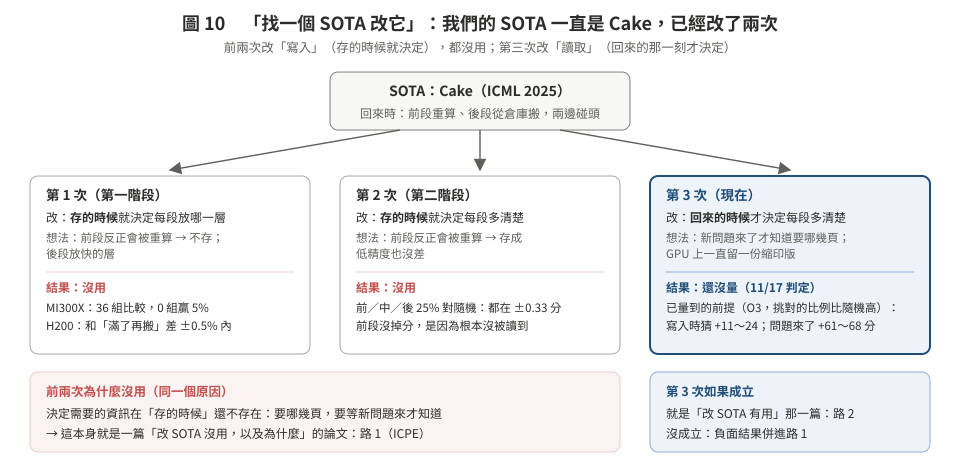
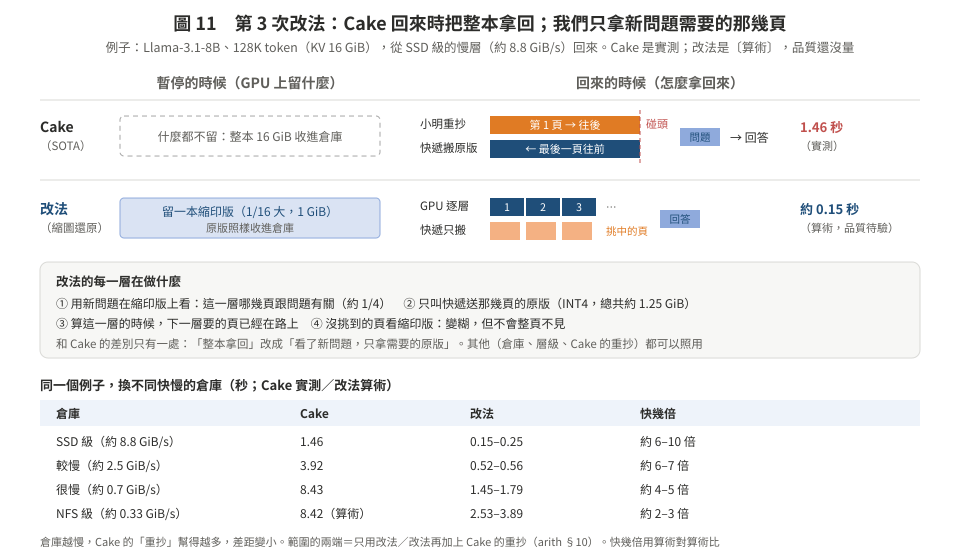

# 第三階段：拿 SOTA（Cake）來改，第三次改在「回來的那一刻」

> **只要看這一頁。** 其他檔案是附錄：候選的細節、算術、查新。
> 標記：〔實測〕附出處；〔算術〕是拿實測常數代公式的推估（[arith.md](arith.md)，`code/s3_mech_arith.py` 產生），**不是結果**。這次沒有新的量測。

## 一句話

我們的 SOTA 一直是 **Cake**（ICML 2025）。前兩次改的是它「存」的方式，都沒用，寫成路 1（ICPE）。第三次改它「拿回來」的方式：Cake 回來時把整本 KV 拿回；**我們在 GPU 上留一本縮印版，回來時用新問題一層一層挑，只拿需要的那幾頁原版**。從 SSD 級的慢層回來，〔算術〕約快 6–10 倍。**品質夠不夠還沒量，11/17 前要量。**

---

## 1. 學長說「找一個 SOTA 改它」：我們有做嗎？

**有，做了兩次。** 兩次都是改 Cake，都改在「存的時候」，都沒用。

| 次 | 改 Cake 的哪裡 | 想法 | 結果 |
|:--|:--|:--|:--|
| 1（第一階段） | 存的時候就決定每段放哪一層 | 前段反正會被重算 → 不存；後段放快的層 | **沒用**：MI300X 36 組比較 0 組贏 5%；H200 和「滿了再搬」差 ±0.5% 內〔實測，02 的 O1〕 |
| 2（第二階段） | 存的時候就決定每段多清楚 | 前段反正會被重算 → 存成低精度也沒差 | **沒用**：前／中／後 25% 低精度對隨機都在 ±0.33 分；前段沒掉分，是因為根本沒被讀到〔實測，O2〕 |
| 3（現在） | **回來的時候**才決定每段多清楚 | 新問題來了才知道要哪幾頁 | **還沒量**（11/17 判定） |

**前兩次為什麼沒用（同一個原因）**：決定需要的資訊，在「存的時候」還不存在。要哪幾頁，要等新問題來才知道：存的時候猜，挑對的比例只比隨機高 11–24 個百分點；問題來了用完整 K 挑，高 61–68 個百分點〔實測，O3〕。

所以有兩篇論文：
- **路 1（ICPE，11/16 截止）**：「改 SOTA 的存法沒用，以及為什麼」。數據已經有了。
- **路 2（這一頁）**：「改 SOTA 的拿法有用」。要驗證。

---

## 2. 第三次怎麼改（用筆記比喻）

**Cake 的做法**：筆記很厚（Llama 128K 的 KV 有 16 GiB）。你暫停時，整本收進倉庫（CPU 或 SSD）。你回來時，小明（GPU）從第 1 頁開始重抄，快遞（I/O）從最後一頁往前送原版，兩人碰頭就算拿回來了，然後才開始讀你的新問題。

**我們的改法**：桌上一直留一本**縮印版**（1/16 大）。你回來時：
1. 拿新問題翻縮印版，**這一層哪幾頁跟問題有關**（例如 1/4）；
2. 只叫快遞送那幾頁的原版；
3. 算這一層的時候，下一層要的頁已經在路上；
4. 沒挑到的頁就看縮印版：會糊一點，但不會整頁不見。

**和 Cake 只差一處**：「整本拿回」改成「看了新問題，只拿需要的原版」。倉庫、層級、Cake 的重抄都可以照用。

---

## 3. 具體數字

**例子 A：Llama-3.1-8B、128K（KV 16 GiB）**，Cake 是 harness 實測（GPU 閒）；改法是〔算術〕（[arith.md](arith.md) §10）：

| 倉庫 | Cake | 改法 | 快幾倍（算術對算術） |
|:--|--:|--:|--:|
| SSD 級（約 8.8 GiB/s） | 1.46 s | 0.15–0.25 s | 約 6–10 倍 |
| 較慢（約 2.5 GiB/s） | 3.92 s | 0.52–0.56 s | 約 6–7 倍 |
| 很慢（約 0.7 GiB/s） | 8.43 s | 1.45–1.79 s | 約 4–5 倍 |
| NFS 級（約 0.33 GiB/s） | 8.42 s（算術） | 2.53–3.89 s | 約 2–3 倍 |

範圍的兩端：只用改法／改法再加上 Cake 的前段重抄。倉庫越慢，Cake 的重抄幫得越多，差距越小。

**一張 H200 能讓幾個 session「隨時回來」**〔算術，arith §1〕：Llama 128K，完整放 6 個 → 縮印版放 97 個；Qwen2.5-14B 256K，完整只放得下 **1 個** → 縮印版 28 個。

**例子 B：Qwen2.5-14B、256K（KV 48 GiB），從本地 SSD**〔算術，arith §9〕：全部原樣搬回再讀問題 7.25 s → 改法 0.55 s；和「全部壓成 INT4」（2.52 s）比也快約 4.6 倍。

**不利的地方（論文裡要寫）**：最快的倉庫（CPU 記憶體）只快約 3–4 倍，而且本來就只要 0.3–0.4 秒；需要整本內容的題目（摘要、彙整）挑不出「只要 1/4」，就沒有好處。

---

## 4. 要打贏誰、在哪裡贏、在哪裡可能輸

| 對手 | 他們怎麼做 | 我們贏在哪 | 我們可能輸在哪 |
|:--|:--|:--|:--|
| **Cake**（SOTA） | 整本拿回（前段重抄、後段搬） | 搬的少、等的短（第 3 節） | 倉庫很慢時差距縮到 2–3 倍 |
| vLLM／LMCache 卸載 | 整本搬回，不重抄 | 差距比 Cake 更大 | — |
| 全部壓縮（INT4、8–32 倍） | 每頁一樣糊 | 同樣搬的量，重要的頁是清楚的。均勻壓縮在長 context 更傷：Qwen int2 在 32K 掉 9.7 分、256K 掉 14.4 分〔實測〕 | 每頁都一樣重要的題目 |
| 只拿重要的頁（Quest 類） | 沒挑到的頁丟掉 | 沒挑到的還有縮印版；Quest 只放回 1/4 會掉 18–35 分〔實測，O4〕 | 縮印版佔 GPU 空間 |
| ReadKV、SpeCache（生成時的漸進讀取） | 生成每個字時決定讀多清楚；單一請求 | 我們處理的是「很多 session 暫停、回來」那一刻，而且逐層挑 | 審稿人會說「只是搬到回來時」→ 要用逐層挑與多 session 的數據回應 |

---

## 5. 怎麼證明（11/17 前只要過一關）

- **關鍵的一關：A0**（[05 §4](../05_poc_plan_h200.md) 已規劃，擴到 128K／256K）。在「搬一樣多的位元組」下，「縮印版＋挑 1/4 原版」要比「全部均勻壓縮」好 **≥2 分**。
  - 過了：路 2 有論文，主實驗 11/18 開始。
  - 沒過：停。負面結果（「重要的頁不夠集中」）併進路 1。
- 同時量一次真的回來時間（CPU 記憶體、本地 SSD），換掉上面的算術。
- 時程：10/24–11/2 ICPE 優先，只做準備；11/3–11/16 跑；11/17 給老師 GO／STOP。

---

## 6. 為什麼用 128K–256K、8B–14B（[01](01_regime.md)）

- 32K 時回來只要 0.05–0.1 秒，怎麼改都差不多；128K 以上要搬 7–48 GiB。
- 14B 256K 時 GPU 只放得下 1 個 session，暫停、回來是常態。
- 長 context 時重抄很貴（128K 約 11 秒，重抄比從 CPU 搬慢 37 倍〔算術〕），所以「少搬」比「多重抄」有用。

---

## 7. 附錄：其他點子（每一個也都是「某個 SOTA＋改一處」）

主法是上面的「縮圖還原」（附錄裡的 M01＋M02）。下面這些是加分項或備案；細節在 [02](02_bytes_quality.md)、[03](03_bandwidth_compute.md)、[04](04_recompute_scheduling.md)。

| 點子 | 改哪個 SOTA | 原本 → 改成 | 建議 |
|:--|:--|:--|:--|
| 搭 decode 的便車（M08） | Sarathi-Serve | 搭便車的預算只給新請求 → 也給回來的 session 的還原計算（生成時 GPU 算力只用到 1–2%〔算術〕） | 主法的加分項 |
| 先近似、後補精（M12） | Cake＋MInference | 前段精確重抄 → 稀疏重抄，回答時再補回精確 | 只在慢倉庫有用（快 20–44%〔算術〕） |
| 讀太久就重算（M13） | vLLM 卸載 | 乾等慢層 → 讀太久就開始重抄，誰先到用誰 | 安全網（vLLM 的 NFS 層 P95 105 秒〔實測 I3g〕） |
| 借鄰卡的 PCIe（M06） | vLLM／LMCache 的載入 | 一條 PCIe → 鄰卡的 PCIe 一起搬 | 要 4 卡；DualPath 在叢集層級已有類似做法 |
| 有保證的挑法（M03） | Quest／ReadKV | 固定挑 k 頁 → 補到誤差上界 ≤ ε | 主法的挑法之一 |
| 打字時就挑（M04） | 整份預取 | 不知道問題就整份搬 → 用打到一半的問題先挑 | 延伸 |
| 看當下資源選做法（原方向 B，M09／M10） | Cascade、vLLM #42212 | 固定規則 → 看哪種資源閒 | 當規劃器，不當主貢獻 |
| 依頭還原、查表 codec、兩段佇列、草稿先行、DL 元件（M05、M11、M14、M15、M16） | — | — | 低優先 |

否決或已被別人做掉的 9 條（例如「回來的請求直接在 decode 節點算」已被 PPD（ICML 2026）做掉）：[05](05_rejected.md)。

---

## 8. 檔案

| 檔 | 內容 |
|:--|:--|
| [01_regime.md](01_regime.md) | 為什麼用 128K–256K、8B–14B；必須同時報的不利設定 |
| [02](02_bytes_quality.md)、[03](03_bandwidth_compute.md)、[04](04_recompute_scheduling.md) | 16 個點子的完整卡片（問題定義、前作、演算法、閘、風險） |
| [05_rejected.md](05_rejected.md) | 否決或已被做掉的 9 條 |
| [06_eval_gates.md](06_eval_gates.md) | 所有點子的閘、設定怎麼改、決策表 |
| [07_lit_quickcheck.md](07_lit_quickcheck.md) | 這輪的快速查新（只讀摘要，附連結） |
| [arith.md](arith.md) | 所有〔算術〕數字 |
| `figures/` | 圖 1–11 |
