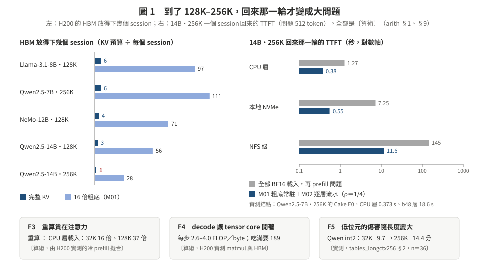
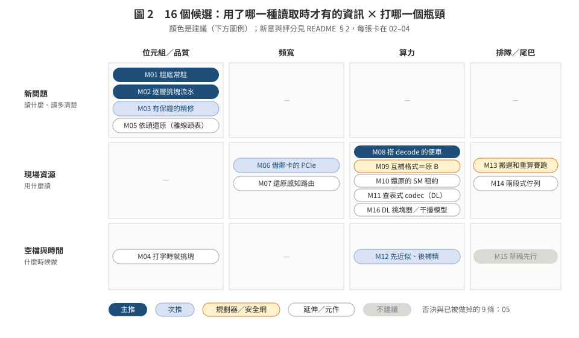

# 第三階段的新機制候選（2026-10-24）：16 個候選、128K–256K 的有利設定、三種論文形狀

> **一句話**：「還原成本是現場的資源向量」（方向 B）只是**規劃器**，不是讓數字變大的機制。真正的機制要在 128K–256K、8B–14B 才看得出來：**HBM 留縮圖、回來時一層一層挑一層一層補**（M01＋M02，位元組少 4–13 倍〔算術〕），**補細節的計算搭 decode 的便車**（M08，decode 只用 2.6–4 FLOP／byte），**借鄰卡的 PCIe**（M06），**先近似後補精**（M12），**慢層讀太久就開始重算**（M13，vLLM 實測 P95 105 s）。
>
> 這一組是 [第三階段設計](../README.md) 的補充，不取代 05 的 A0／B0／C0／D0。所有新數字都是〔算術〕（[arith.md](arith.md)，`code/s3_mech_arith.py` 產生）或已有的〔實測〕（附出處）；**這次沒有新的量測**。新意判斷是**摘要級查新＋self-review**，不是 cross-model。

---

## 0. 你的判斷是對的：只靠 B，機率太低

- B 的一句話「計畫和 SM 分配跟著瓶頸走」是**怎麼選**，不是**選什麼**。它能贏的上限，是現有選項裡最好的那個：3a 量到依情況選只好 6–14%（O8）。
- 老師的三準則：B 在 ①（量到會翻的現象）有 ●，但 ②（讓取捨消失）、③（換抽象層）都只有 ◐（[01](../01_innovation_criteria.md) §3）。審稿人最容易寫的就是「Cascade＋Bidaw＋vLLM #42212 的組合」（[08](../08_kill_argument.md)）。
- 所以這次的做法：**先換到槓桿大的設定，再找能「新增選項」的機制**，B 退成把這些選項串起來的規劃器（M09）。

---

## 1. 為什麼換到 128K–256K、8B–14B（[01](01_regime.md)）

| # | 事實 | 數字 |
|:--|:--|:--|
| F1 | HBM 放不下幾個長 session | 14B 256K 只放得下 **1 個**；換成 16 倍粗底放得下 28 個〔算術〕 |
| F2 | 回來要搬的位元組很大 | 7–48 GiB；本地 NVMe 2.0–6.9 s；實測 Qwen 256K b48 層 Cake 18.6 s |
| F3 | 重算貴在注意力 | 128K 冷 prefill 約 11 s，n² 項佔 75%；重算÷載入由 32K 的 16 倍變 37 倍〔算術，由實測擬合〕 |
| F4 | decode 讓 tensor core 閒著 | 每步 2.6–4.0 FLOP／byte；H200 要 189 才吃滿〔算術，由實測常數〕 |
| F5 | 低位元的傷害隨長度變大 | Qwen int2：32K −9.7 → 256K −14.4；Llama int2 128K−32K 為 −13.0〔實測〕 |
| F6 | 背景本來就在頻寬型與算力型之間交替 | decode（頻寬型）與新文件的 128K prefill（算力型）〔判讀〕 |

必須同時報的不利設定（CPU 層很快、主機記憶體 170 GB／卡、`/work` 是不是 NFS 有矛盾紀錄、彙整類題目）列在 [01](01_regime.md) §3。

---

## 2. 16 個候選（[02](02_bytes_quality.md)、[03](03_bandwidth_compute.md)、[04](04_recompute_scheduling.md)）

| # | 名稱 | 一句話 | 用的讀取時資訊 | 新意 | 上檔 | 可行 | 建議 |
|:--|:--|:--|:--|:--|:--|:--|:--|
| **M01** | 粗底常駐 | 暫停的 session 在 HBM 留 16–32 倍的縮圖；回來時新問題直接在縮圖上跑 | 新問題 | 中高 | 高 | 中 | ⭐ 主推 |
| **M02** | 逐層挑塊流水 | 一層一層挑、一層一層補；補細節的傳輸和這層的計算重疊；query 用已補好的下層算 | 新問題 | 中 | 高 | 中 | ⭐ 主推（和 M01 合一） |
| M03 | 有保證的精修 | 存殘差範數，K 先到、V 按權重補，補到誤差上界 ≤ ε | 新問題 | 中 | 中 | 中高 | 次推 |
| M04 | 打字時就挑塊 | 用半個問題（或工具呼叫的文字）先挑、先補 | 部分問題 | 中 | 中 | 高 | 延伸 |
| M05 | 依頭還原 | 串流頭只還原窗口 | 離線頭表 | 低 | 中 | 中 | 乘數／基準 |
| **M06** | 借鄰卡的 PCIe | KV 分幾份走鄰卡的 PCIe，再經 NVLink 轉給目標卡 | 現場資源 | 低中～中 | 高 | 高 | 次推（4 卡） |
| M07 | 還原感知路由 | 回來的 session 派給「現在還原最快」的卡 | 現場資源 | 低中 | 低中 | 中 | 併進 M06 |
| **M08** | 搭 decode 的便車 | 還原的計算塞進 decode 的 tensor core 空檔，用預算保證 TPOT | 現場資源 | 中 | 中高 | 高 | ⭐ 主推 |
| M09 | 互補格式（原 B） | 巢狀格式；看哪種資源閒就選吃那種的讀法 | 現場資源 | 中高 | 中 | 中 | 當規劃器 |
| M10 | SM 租約 | 還原拿有上限、有期限的 SM 預算（CBS＋EDF） | 現場資源 | 中 | 中 | 中 | M08 的另一個實作 |
| M11 | 查表式 codec | VQ 解碼不吃 tensor core；DL 學 codebook | 現場資源 | 低中 | 中 | 中 | 延伸（DL） |
| **M12** | 先近似後補精 | 稀疏重算換 TTFT，回答期間用空檔補回精確 | 空檔時間 | 中 | 中 | 中 | 次推 |
| M13 | 搬運和重算賽跑 | 慢層讀太久就開始重算，誰先到用誰 | 現場排隊 | 低中 | 高 | 高 | 安全網 |
| M14 | 兩段式佇列 | 必要的部分先排（SRPT），品質等級固定 | 現場排隊 | 低中 | 中 | 高 | 併進 M01 實驗 |
| M15 | 草稿先行 | 粗 KV 先生成，精修到了再驗證 | 傳輸時間 | 低 | 低中 | 中 | 不建議（附錄） |
| M16 | DL 元件 | 學的挑塊器、學的干擾模型 | — | 低中 | — | 中 | 元件 |

**怎麼讀「新意」**：中高＝這輪摘要級查新沒找到整個組合；中＝組合沒找到，但每一部分都有近親；低中＝精神上已有人做（例：DualPath 對 M06）；低＝直接套用。否決或已被做掉的 9 條在 [05](05_rejected.md)（例：「回來的請求在 decode 節點 prefill」已被 PPD（ICML 2026）做掉）。

---

## 3. 推薦的論文形狀：P1（[06](06_eval_gates.md) §4 有完整決策表）

**P1：「長 context session 回來時，從 HBM 的縮圖直接開始，邊算邊補」**

| 這篇論文裡的角色 | 機制 | 讓哪個取捨消失（老師準則 ②） | 和別人比，我們在哪裡贏 |
|:--|:--|:--|:--|
| 核心機制 | M01＋M02 | 「HBM 放得下幾個 session」vs「回來要等多久」；「均勻壓縮會糊」vs「選擇性還原會漏」 | vLLM／LMCache 整份搬（14B 256K NVMe 7.25 s → 0.55 s〔算術〕）；均勻壓縮在長 context 掉分（F5）；選擇性還原漏一塊就錯（O4）；SpeCache／ReadKV 只在 decode、單一請求 |
| 讓計算免費 | M08（＋M12） | 「還原快」vs「別人的 TPOT」 | Cake 不管別人、Bidaw 假設 SM 閒、Sarathi 只管新請求的 prefill |
| 規劃器 | M09（＝原 B） | — | Cascade／KVServe 不看 GPU 資源；vLLM #42212 是靜態常數 |
| 安全網 | M13 | 慢層的尾巴 | vLLM 0.28 的 NFS 層：P95 105 s〔實測 I3g〕 |
| 頻寬（M06 過了才放） | M06 | 「一張卡一條 PCIe」 | DualPath 只在叢集層級 |

**為什麼 P1 不是「一袋技巧」**：四個機制都是同一個原則的實例——**寫入端只存「可以分層讀」的格式，所有決定在讀取時用讀取時才有的資訊做**（新問題 → 讀什麼；現場資源 → 用什麼讀；空檔 → 什麼時候補）。這延續路 1 的負面結果（寫入時決定沒用），把它變成正面的設計。

**P2**（A0 不過、M08／M06 過）：「借閒置資源的還原」，不靠挑塊、品質不變。**P3**（A0 過、M08 不過）：「讀回邊界的查詢導向精修」。

---

## 4. 下一步（[06](06_eval_gates.md)）

- **10/24–11/2**（ICPE 優先）：判準登記；CPU 能做的先做：G-fio（量 `/tmp`、確認 `/work`）、G-M13（模擬重播）；14B 做成 no-DCA；長 context decode 背景產生器。
- **11/3–11/9**：量時間的閘（獨佔）：B0＋G-M08、G-M06（4 卡）、G-M11、G-M12 速度。
- **11/10–11/16**：品質的閘：A0＋G-M01/02（128K／256K）、G-M12 品質、G-M04。
- **11/17**：照 06 §4 的決策表選 P1／P2／P3。
- 新增約 32–43 GPU 小時〔估計〕。

---

## 5. 文件

| 檔 | 內容 |
|:--|:--|
| [01_regime.md](01_regime.md) | 六個物理事實、為什麼「有利但合理」、必須同時報的不利設定 |
| [02_bytes_quality.md](02_bytes_quality.md) | M01–M05：用新問題決定讀多少、讀多清楚 |
| [03_bandwidth_compute.md](03_bandwidth_compute.md) | M06–M11：頻寬與算力從哪裡來（含原方向 B） |
| [04_recompute_scheduling.md](04_recompute_scheduling.md) | M12–M16：近似重算、賽跑、排程、DL 元件 |
| [05_rejected.md](05_rejected.md) | 否決或已被做掉的 9 條，以及和舊點子庫的對照 |
| [06_eval_gates.md](06_eval_gates.md) | 設定要怎麼改、每個候選的第一道閘、時程、規模、決策表 |
| [07_lit_quickcheck.md](07_lit_quickcheck.md) | 這輪的快速查新（摘要級，附連結） |
| [arith.md](arith.md) | 所有〔算術〕數字（`python code/s3_mech_arith.py` 產生） |
| `figures/` | 圖 1–9（SVG） |

## 6. 規矩（沿用，不重講）

- 沒量到寫 `NOT_MEASURED`；〔算術〕不是結果，量到之前只是預測（CLAUDE.md §1）。
- 判準在看到數字前 commit＋`date -u`；失敗照實記。
- 摘要級的新意判斷，正式主張前要讀全文＋獨立 verifier（memory `paper-claims-read-original-double-check`）。
